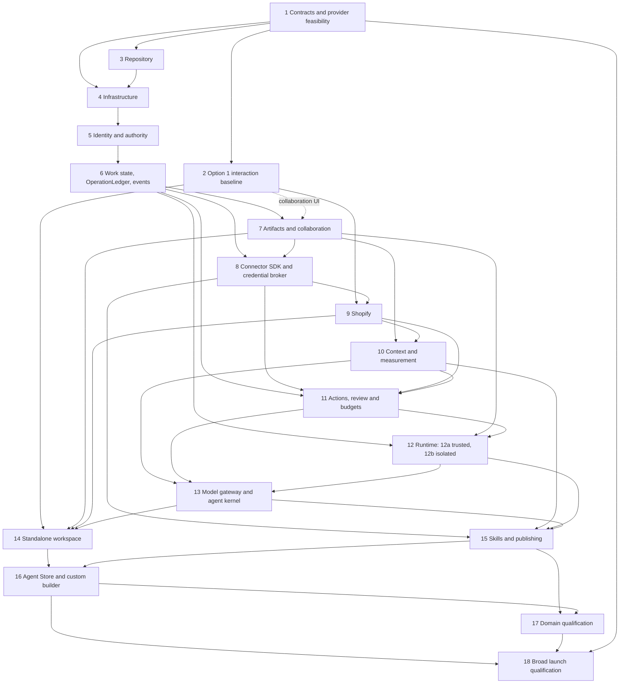

# Morrow build plan

This file is Morrow's plan of record from revision R1 (2026-10-17). It decides what Morrow builds, how it is built, the package order and the acceptance gates. The owner approved the repository as the plan of record (Owner approval, 2026-10-17; ADR-0001); adopting the content of R1, and of each later revision, is itself an owner (Tier 3) sign-off. Material decisions are recorded as ADRs under docs/decisions/adr/ before dependent work, and the active packet, blockers and next action live in docs/progress/STATUS.md. Pre-R1 status logs, evidence and revision history are preserved at git tag codex-archive-f89ad75 and in git history; the earlier ChatGPT Page is frozen as history at its final revision and no longer governs.

The supporting design documents, kept in the repository as `docs/references/architecture.md` (workspace product architecture), `docs/references/skills-and-agent-store.md` and `docs/references/visual-foundation.md` with `docs/references/visual-option-1.png`, supply detail only where consistent with this plan; conflicts are resolved here first. Where they describe superseded choices (an embedded Shopify workspace, Temporal, AWS, the earlier domain catalogue), this plan governs. Repository contracts and task packets implement the plan and cannot silently override it.

A material change (ADR-0002) needs an owner-approved ADR and a plan amendment before dependent implementation: product scope, the 18-package and task-ID structure, the authority or permission model, tenancy, data ownership and retention, public contracts, provider or model selection, billing, pricing and credits, qualification gates and dependency edges, deployment boundaries, spending money, real merchant data, external messages and creating provider resources. Routine engineering choices consistent with the plan (tests, fixtures, timing fixes, CI structure, refactors, dependency bumps within approved majors, lettered packet splits, wording) are ordinary reviewed commits.

The destination is one complete production workspace for people and agents. Internal demonstrations prove dependencies as they are built; they are not separate narrow product launches. Authorization, enterprise identity, durable execution, collaboration, real integrations, privacy, evaluation, billing and operational recovery are part of the launch foundation.

No delivery dates or staffing estimates are assumed. Package order follows technical dependencies. Several packages can progress together once their shared contracts are settled; ownership and scheduling follow when team capacity is known.

## Settled constraints

These constraints are settled by the owner and change only through an owner-approved ADR. `CLAUDE.md` restates them for coding agents; where its wording differs, this plan governs.

- Name: Morrow.
- Broad production foundation for small and large Shopify brands; no MVP scope reduction.
- Visual option 1.
- One complete standalone Morrow workspace plus a thin Shopify read/write connector for install/link/status/reconnect/disconnect/return. No embedded domain workspace in this release.
- Connector UI/distribution, Shopify App Review of the split billing model and revenue treatment remain qualified launch gates.
- Paid managed model APIs and one work-credit balance; no free merchant tier or separate infrastructure pricing ladder.
- Billing is split by origin (Owner approval, 2026-10-18; ADR-0015): a workspace created on the Morrow website pays on Morrow checkout (Stripe Billing with Stripe Tax; Morrow is the seller) before it connects a store, and merchants who arrive from Shopify get the same tiers through Shopify App Pricing and never see Morrow checkout.
- Coordinator is separate from optional Chief of Staff/CMO installations. Agent titles and delegation never confer authority.
- Stack: TypeScript and React; Cloudflare Workers, Workflows, Queues and R2; Neon PostgreSQL; E2B behind a provider-neutral runtime port; WorkOS for identity proof.
- Broker-only secret bindings: the API, connector and orchestrator Workers never read raw merchant, model or provider credentials (Security invariant 11).
- No secrets, customer records or browser session material in the repository.
- Permission and budget checks run in code outside model prompts.
- Unknown provider outcomes are reconciled before any retry.

## Plan status

Summary at R1 (2026-10-17). STATUS.md carries the current detail; this section changes only with plan revisions. "Self-review" means the implementing agent reviewed its own work; no task has yet had owner, participant or independent human review. Tasks that had been recorded as Verified on self-review alone (P01.T01-T04, P02.T01 and P03.T01-T04) are relabelled Self-reviewed in `docs/progress/tasks.json` (P03.T04d).

- **P01 contracts:** locally complete under the pre-R1 process and self-reviewed; owner contract sign-off (Tier 3) is pending, so P01 is Self-reviewed, not Verified. 103 capabilities in 14 domains, 116 core schema definitions, 8 state machines, 12 billing definitions, generated TypeScript types and ahead-of-time validators. Contract v1.1 (P01.T02a, then P01.T02c and P01.T02b; ADR-0005, ADR-0011, ADR-0016 and ADR-0018) and the pre-payment billing and billing-route acceptance cases (P01.T04a; ADR-0015, which supersedes ADR-0006) are next.
- **P02 design:** information architecture complete and self-reviewed (P02.T01 Self-reviewed), not Verified (P02 qualification is pending); option 1 tokens, component baseline and clickable prototype are candidates in review. The participant study (P02.T04) has not run.
- **P03 repository:** scaffold, typed boundaries, synthetic laboratory and CI complete locally and self-reviewed under the pre-R1 process (P03.T01-T04 Self-reviewed). The P03.T04c overhaul (generated outputs as CI artifacts, plan and hash decoupling, retirement of AWS CDK, Daytona and the frozen regressions, evidence and history pruned to the archive tag, and the parallel CI job split planned as P03.T04e) and the P03.T04d governance documents were merged through PR #2 into `codex/morrow-foundation` after green parallel CI runs, and the foundation was then merged into `main` through PR #1 with a merge commit (ADR-0014); `main` is the trunk. Enforced branch protection does not exist yet.
- **P04 infrastructure:** the selected stack is defined locally (environment inventories, service-identity profiles, workerd-compatible validators, a request-scoped Neon adapter, local PostgreSQL 17 rotation and restore drills). A Neon Free staging project and a bounded synthetic E2B qualification exist. There is no Cloudflare account, domain, Worker deployment configuration or hosted deployment.
- **P05 identity:** the local identity engine is built through P05.T01v: 11 forward migrations with FORCE RLS and restricted roles, WorkOS PKCE login, verified token, workspace selection, a 15-minute `__Host-` session, workspace bootstrap, controlled store linking and logout, composed into one Workers API and tested on workerd and real PostgreSQL 17. Signup, invitations, grant administration and session refresh do not exist. P04.T02a moves the keyed WorkOS session-catalogue read into the broker Worker: the deployable api (`apps/api/src/deployed-worker.ts`) holds no WorkOS key, which closes the Security invariant 11 deviation for anything deployed. The P05.T01r leased-key port remains only in lab-only compositions (the `build:worker` bundle of `apps/api/src/worker.ts` and the P05 lab fixtures), which are never deployed. P05.T01w (Firefox transport prerequisite) is deferred by ADR-0003.
- **P06-P18:** planned. No merchant-usable product exists yet: no real workspace UI, signup, Shopify integration, model or agent code, billing or hosted deployment.

## Hosting decision

The selected stack (owner selection, 2026-10-14) is Cloudflare Workers (Static Assets plus separate API, connector, broker and orchestrator Workers), Cloudflare Workflows, Queues and R2, Neon PostgreSQL as the system of record, E2B Linux microVM sandboxes behind a provider-neutral runtime port for code and browser work, WorkOS for identity proof and OpenAI as the managed model provider. The code is TypeScript and React. AWS, CDK, Aurora, Fargate, Temporal and Daytona are superseded and were never deployed; their code is retired from the tree (ADR-0013) and their history is at the archive tag `codex-archive-f89ad75`. Do not request AWS credentials or create AWS resources.

The default primary storage region for merchant data is the United States. Approved global processing is permitted; regional processing restrictions apply only under an explicitly agreed customer contract or an applicable obligation, and a storage preference is not an end-to-end residency promise. Selection is not activation: each hosted account, paid plan and production qualification needs its own evidence, and spending on Cloudflare Workers Paid, a domain, Neon Launch, OpenAI credits or an E2B card is pending owner decision. Transactional email, observability (error tracking and paging) and upload-scanning providers are not yet selected; those choices are pending owner decision. Stripe Billing with Stripe Tax is selected for the Morrow-direct billing route (Owner approval, 2026-10-18; ADR-0015) and is not activated: no Stripe account exists, and the account (test mode first), live activation, a business entity, a bank account and tax registrations are pending owner actions.

## Recommended engineering defaults

Use TypeScript and React for the application, a modular TypeScript backend on Cloudflare Workers, Neon PostgreSQL for authoritative business records, Cloudflare R2 for artifacts, Cloudflare Workflows and Queues for durable execution and transport, and a replaceable isolated execution provider for code and browser work, with E2B as the selected, not yet qualified, provider. Keep replaceable model, connector, database and runtime adapters. Separate deployed Workers where secrets, authority or execution require isolation, while keeping shared contracts in one repository. Specialized Python processes run only inside an approved execution profile for a justified workload.

WorkOS is the identity provider; Morrow owns all authorization. Morrow owns the harness, lease and budget enforcement, authoritative checkpoints and artifact storage. Provider-specific SDKs and handles belong in server-side runtime adapter modules; agent definitions, business tools, policy and the harness must not depend on a vendor SDK. Provider choice is a versioned qualified configuration, never model-selected authority.

The goal is a foundation that can grow without replacing its authority, work and execution contracts. It does not require starting with dozens of independently deployed services. Module boundaries, dependency tests, ownership and operational evidence establish modularity. A database migration, connector release, skill release and workflow release each need an appropriate compatibility strategy. Applied migrations are immutable; schema changes ship as new forward migrations.

Long-lived workflow changes need explicit versioning. Pin a workflow implementation, version and compatible configuration to each run; preserve old versions for live waits, test approval and event delivery after deployment, and reconcile database state before continuation. PostgreSQL owns business truth; Cloudflare Workflows owns resumable execution checkpoints. Worker rollback is not database rollback and does not undo provider effects. Qualify actual version retention, wait limits and upgrade behavior in P06/P12 before activation; do not assume deterministic-replay semantics from other workflow engines. [Workflow versions API](https://developers.cloudflare.com/api/resources/workflows/), [Worker versions](https://developers.cloudflare.com/workers/versions-and-deployments/)

## Product surface and design gate

Build one standalone React workspace application on Morrow's web origin with shared feature screens, logical routes, accessible components, state contracts and business behavior. Shopify is a thin integration app for managed installation and OAuth, verified store and workspace linking, connection status, reconnect and disconnect, and return to Morrow. No merchant workspace is rendered inside Shopify Admin in this release. Use Shopify CLI and the supported Shopify React Router template/package (or the official `@shopify/shopify-api` library where the Worker runtime requires it) for the integration boundary; use App Bridge or Polaris only where the qualified connector surface requires them. Workspace domain screens do not import Shopify host SDKs. [Shopify integration guidance](https://shopify.dev/docs/apps/build/integrating-with-shopify), [Shopify React Router package](https://shopify.dev/docs/api/shopify-app-react-router/latest)

Credentials, policy, context, connectors, orchestration and consequential execution remain in backend services. Connector-only or non-embedded classification, applicable UI review and App Review of the split billing model (ADR-0015) are external qualification gates; product selection is not App Store approval. A future embedded workspace is a new reviewed scope change, not a current parity obligation. [App Store requirements](https://shopify.dev/docs/apps/launch/shopify-app-store/app-store-requirements)

Standalone Morrow contains Home, Work, conversations, Inbox, approvals, Assets, Agents, Agent Store, Knowledge and Settings. Responsive layouts collapse secondary panes into accessible tabs or drawers without removing workflows. Maintain a surface responsibility matrix: complete domain work belongs to standalone; the Shopify connector has only installation, identity linking, connection controls and safe return. A connector return reauthenticates and resolves existing authorized records without duplicate work, widened permissions or retargeted proposals. A connector status screen is not a second workspace or a commerce-command surface. All domain services remain independent of frontend placement.

Visual option 1 is selected: shared project tabs, contextual agent conversations and a persistent decision inbox. Its spacious standalone study is the visual reference for the shared workspace; package 2 defines its desktop and narrow-browser compositions plus connector states. Earlier studies remain references.

Build visible end-to-end paths along the golden path milestones below. Implement each shared feature once and exercise it through standalone entry and qualified connector handoffs as identity and task APIs qualify. Add real records, reviewable actions and recoverable agent runs incrementally. Package 14 completes common workspace integration, package 16 completes agent lifecycle interactions in standalone desktop and narrow layouts and applicable connector journeys, and package 17 qualifies domain journeys.

Design gate (Owner approval, 2026-10-17; ADR-0003). Feature UI may be built provisionally on the selected option 1 candidate (docs/design/tokens.json, docs/design/component-baseline.md, docs/design/prototype.html), ported into packages/workspace-ui and labelled provisional. Every provisional slice carries automated accessibility, keyboard and contrast checks at 1440, 768, 390 and 320 px widths. The P02 participant study (P02.A04) gates acceptance and Verified status for feature UI and any merchant pilot; it runs on the integrated M2-M4 slices, and earlier optional sessions on the prototype are allowed. This supersedes the earlier rule that frontend feature work begins only after the reviewed package 2 baseline.

## Launch coverage matrix

For every row, the implementation backlog must name real providers, exact operations, required scopes, artifacts, verification rules and release evidence. A generic SDK, placeholder agent or mocked connector does not complete a row. Provider names still awaiting selection are decisions to resolve, not an implicit reduction in launch scope. Give each capability a stable identifier linking its scope, UI journey, connector operation, skill or agent release, implementation packet, test cases and release evidence. A blocked promised operation stays in the scope and dependency register until resolved or the owner explicitly changes the release commitment.

| Domain | End to end capability to qualify | Essential boundary |
| --- | --- | --- |
| Workspace coordination | Scope goals, assign humans and agents, track dependencies, ask questions, report results | Responsibility is separate from permission |
| Catalog | Audit products and variants, draft changes, review and publish supported fields | Field and resource scope, source authority |
| Search and discovery | Inspect pages, use search evidence, prepare improvements, verify publication and observe results | No guaranteed citations or invented measurements |
| Creative | Brief, generate, inspect contact sheets, revise, approve, attach media | Generation budget, product fidelity, asset provenance |
| Merchandising and analytics | Governed reports, anomaly investigation, assortment proposals and approved changes | Metric definitions, currency, attribution and coverage |
| Paid acquisition | Real Meta Ads connection, reporting, campaign preparation and specifically approved execution | Account, audience, publication and spend grants |
| Lifecycle marketing | Segments, campaign briefs, content, review, supported channel execution | Consent-aware provider behavior and send authority |
| Customer support | Grounded case investigation, replies, escalation and qualified case actions | Customer data, communication and refund separation |
| Orders and fulfillment | Exception triage, state checks, coordination and supported actions | Order state, staff grants and provider constraints |
| Inventory | Reconciliation, stock risk, proposed adjustments and authoritative updates | Location scope and configured stock authority |
| Finance | Cost and margin evidence, discrepancy analysis and reconciliation tasks | Sensitive-data isolation and explicit uncertainty |
| Storefront | UX evidence, proposed changes, theme implementation, preview and approved publication | Accessible previews and controlled release |
| Governance | Access reviews, usage, audit export, policies and administration | Eligible human decisions and traceable changes |
| Custom agents | Describe, configure, test, install, schedule, revise and retire a role | Approved capabilities and bounded mandates |

The knowledge/files (for example Google Drive) and team-chat (for example Slack) connectors referenced by the supporting architecture document are pending owner decision: either add them to the provider register with gates, or record them as outside this release. Neither choice removes a row above.

## Security invariants

These invariants hold across every package. A change that weakens one is a material change. Each names the module and test family that own it today, or the package that will.

1. **Server-resolved tenancy.** Organization, workspace and store context comes from trusted server authentication. Request IDs select resources but never grant access; client host flags, shop query values, selected stores and email matching never establish authority. Owner: `apps/api/src/workspace-router.ts`, `packages/identity/src/standalone-request-guard.ts`; tests `standalone-workspace-http`, `managed-workspace-api*`.
2. **Database tenant isolation.** Tenant tables use FORCE RLS; application roles are NOBYPASSRLS, least-privilege and hold no owner or administrative membership; a foreign-tenant probe is indistinguishable from not-found. Owner: `migrations/0001`-`0011`, `infra/identity-*-prerequisites.sql`; tests `identity`, `workspace-policy`, `browser-session-sql`, `provider-subject-sql` and the real-PostgreSQL identity labs. New tables register with the tenant-isolation conformance harness (P05.T02a).
3. **Deny by default.** Entry routes, the Worker default export, connector routes and dispatch deny unless explicitly composed and qualified. Owner: `apps/api/src/worker.ts`, `apps/workers`, `apps/shopify-connector`; scaffold denial guards (`npm run smoke:scaffold`).
4. **Human authority is explicit and current.** One current grant must cover the complete capability, verb, resource, store, account and field request; authority facts are reloaded for every decision and no allow is cached; role titles add nothing. Owner: `packages/policy/src/index.ts`; tests `policy`, `workspace-policy`.
5. **Agent authority is an intersection.** An agent may act only within the intersection of the requesting person's grants, the installation owner's current authority, installation and agent grants, the delegation envelope, any mandate, connector scopes and live policy. Agent titles and delegation never confer authority. Owner: `packages/policy/src/agent-authority.ts`; tests `agent-authority`; SQL persistence in P05.T04b.
6. **Permission is not approval, and approval is not execution.** A permission decision is never an approval token or dispatch receipt, and an approval cannot create a missing execution grant. Owner: `packages/policy`; tests `policy`.
7. **Digest-bound approvals.** An approval binds a SHA-256 digest of the canonical proposal: exact resources, fields, expected versions, cost and credit ceilings and review policy. Any change needs a new proposal and review; authority and preconditions are rechecked at dispatch. Owner: `docs/contracts/approvals.md`, `action-execution.md`; enforcement in P11.T01-T02.
8. **Review policy.** No self-approval for spend, communication, access_change or irreversible risk, except in a solo-owner workspace with typed confirmation and a cool-down (Owner approval, 2026-10-17; ADR-0005, made exact by ADR-0011). The human_only kill switches in invariant 14 need no second approver. Owner: the ReviewPolicy contract and pure review library (P01.T02a); first enforced for access_change in P05.T01z and P05.T02a using the P06.T01b approval records; generalized in P11.T01, which imports that library.
9. **Idempotent commands.** The same tenant-scoped command ID with the same request digest returns the existing outcome; reuse with a different digest is rejected; a retry never creates a new logical provider operation. Owner: `docs/contracts/work-state.md`, `events.md`; today in authentication exchange admission (migration 0006); P06.T01 for work commands.
10. **Reconcile before retry.** An unknown provider or commit outcome stays uncertain until reconciled against the original operation identity; it is never blindly replayed. Owner: the operation machine in `docs/contracts/state-transitions.json`; today the `outcome_unknown` handling in the P05 identity commands (`packages/identity/src/standalone-store-linking.ts`, `standalone-logout.ts`, `managed-workspace-request.ts`). The frozen WorkOS operator regressions were retired in P03.T04c (ADR-0013); they replay from the archive tag through the manual `frozen-regressions.yml` workflow or a separate worktree of the tag (ADR-0013); the denied in-tree operator journal and E2B adapter tests still run. Next: the P06.T01c OperationLedger, then P11.T03.
11. **Broker-only credentials.** Each credential class has one rule. Development and staging custody follows ADR-0007 (broker credential custody v0); production custody needs a superseding ADR.
    - Provider, merchant and model API credentials (WorkOS, OpenAI, Shopify, E2B, Meta, Stripe and the like, and Neon API keys) bind only to the broker Worker, and the broker makes the call. The API, connector and orchestrator Workers and every sandbox never read them.
    - Database role passwords: each Worker uses only the source-fixed least-privilege Neon roles of its own SQL profiles (several per Worker are allowed), obtained through short-lived broker leases as the delivered P05 pools do; never owner, migration or administrative roles.
    - Morrow-owned application keys (the login capsule keyring, the CSRF HMAC key) bind only to the Worker that uses them.
    - Secrets never enter events, workflow state, logs, model context, sandboxes, artifacts, process arguments, URLs (beyond the required OAuth transaction), error causes, evidence files or CI artifacts. Credentials reach tools through stdin or owner-only files; lab and CI outputs are redacted before upload; sensitive traces and media stay in authorized tenant artifact storage.
    - Former deviation, closed by P04.T02a for the deployable api: the session-catalogue read runs in the broker Worker, and the deployed api holds no WorkOS key. The P05.T01r leased-key port remains only in lab-only compositions (the `build:worker` bundle of `apps/api/src/worker.ts` and the P05 lab fixtures), which are never deployed.
    - Owner: `packages/infrastructure/src/selected-stack.ts` (`raw_provider_keys_in_api: false`, `broker_public_route: false`, `selectedPermissionProfiles`); tests `selected-stack`; the P04.T02a configuration check; P08.T02 broker.
12. **No secrets or customer records in the repository.** No secrets, customer records or browser session material in the repo or in chat, and nothing from private provider working directories is copied into the repository. Owner: secret scan in `scripts/delivery-checks.mjs` and, for CI artifacts, `scripts/scan-artifacts.mjs`; tests `delivery`, `artifacts`.
13. **Checks outside prompts.** Permission and budget checks run in code outside model prompts; model output, installations and client-declared roles confer nothing. Owner: `packages/policy`; P11.T02, P11.T04 and P13.T03.
14. **Kill switches are human-only.** `ads.campaign.pause`, `agents.installation.disable`, `governance.membership.revoke`, `governance.connection.disconnect` and `agents.release.revoke` have executor human_only and act without a second approver, but still require a current eligible human grant, a reason, an audit record and owner notification. Agents may only propose them (Owner approval, 2026-10-17; ADR-0005). Owner: capability executor field (P01.T02a); P11.T05.
15. **No agent external effect before controls.** No agent-initiated external effect occurs before the P11 gateway, budget reservations and stop controls exist. Owner: dispatch disabled by default (`apps/workers`); P11.
16. **No merchant data before its deletion path.** No real merchant data of a class is accepted before its P09.T05 privacy and deletion path exists; until then only synthetic fixtures and Morrow-owned test resources are used (a fresh development store, a Morrow-owned Search Console property, a no-spend Meta ad account), never the owner's live shop or ad account. Owner: no Shopify adapter exists yet and `apps/shopify-connector` fails closed (`npm run smoke:scaffold`: "Unconfigured real connector entry fails closed"); `docs/decisions/model-policy.json` records the model-dispatch block declaratively; P09.T05 owns the deletion path next.
17. **Session safety.** Session cookies are `__Host-`, Secure, HttpOnly and SameSite=Lax; private responses are uncached; session families and generations are server-side. Approved defaults: rotating generations with reuse detection, 30-minute idle and 12-hour absolute limits, logout clears the cookie, and removing an organization membership (P05.T01z) signs the person out organization-wide (Owner approval, 2026-10-17; ADR-0004). Removing a workspace membership stops that workspace in every session without a global sign-out (ADR-0004 item 4). The lifecycle defaults ship as a new forward migration; applied migration 0008 is never edited. Owner: `apps/api/src/auth-http.ts`, `packages/identity/src/standalone-login*.ts`, migrations 0008 and 0011; tests `standalone-login-http`, `standalone-logout-http`, `browser-session-sql`; lifecycle in P05.T01y.
18. **Forward-only migrations.** Applied migrations are immutable and checksum-verified; changes ship as new migrations. Owner: `migrations/manifest.json`, `scripts/delivery-checks.mjs`; tests `migration-history`.
19. **Boundary discipline.** Provider SDKs live only in server-side adapters; domain screens import no Shopify host SDK; validators are generated ahead of time with no runtime eval or schema compilation. Owner: `scripts/boundary-checks.mjs`, `scripts/generate-runtime-validators.mjs`; tests `typed-boundaries`, `runtime-validation`.
20. **Untrusted execution is contained.** Sandboxes get no database access, no raw keys and no unrestricted internet, only short-lived tenant, run and generation-scoped broker and artifact leases; effective network denial is tested, not assumed. Owner: `packages/runtime-adapters/src/e2b` (synthetic lab); P12.T01-T02.
21. **Restore never resurrects.** Restore and recovery never revive revoked authority or deleted data; dispatch and consequential tools stay quarantined until revocations, deletions and uncertain operations reconcile. Owner: the local P04.T04 restore drill; hosted in P04.T04, then P18.T04.
22. **Mutation request integrity.** Mutations require the exact trusted Origin, same-origin Fetch Metadata, `application/json`, `X-Morrow-Request: 1` and bounded duplicate-free JSON; no CORS and no forwarded-header trust. Owner: `packages/identity/src/standalone-request-guard.ts`; tests `standalone-*-http`.
23. **Connector context is not a session.** A Shopify connector context identifies a verified installation and its connection controls only; it never acts as a workspace session or authorizes domain capabilities. Owner: `apps/shopify-connector` (fails closed today); the P05.T02a harness probe; P09.T02 and P14.T01.
24. **Server-held billing route.** A workspace's billing route (Morrow-direct or Shopify App Pricing) is fixed server-side at its first verified payment and never set by a client, return URL, query value or plan handle. A Shopify-route workspace, or one with no route that has ever had a store linked (`shopifyBoundAt` set, never cleared by a disconnect), can never create a Morrow checkout, plan, upgrade, credit-purchase or billing-portal session, and no store is billed twice for Morrow work (Owner approval, 2026-10-18; ADR-0015). Owner: the P01.T04a acceptance cases; enforced in P11.T04 and the P18.T01 billing service; no billing code exists yet.

## Golden path milestones

Sequencing (Owner approval, 2026-10-17; ADR-0003): local engineering of any package may start once the interfaces it consumes are reviewed, using real local PostgreSQL 17 and workerd. The dependency table gates qualification, Verified status and activation, not the start of engineering. Two orderings stay hard: no agent-initiated external effect before the P11 gateway, budget reservations and stop controls exist, and no real merchant data of a class before its P09.T05 privacy and deletion path exists (Security invariants 15 and 16).

One active integration path runs through five milestones. Each maps to an internal demonstration in "Internal integration demonstrations" and uses lettered children of existing tasks; other capability rows stay in their parent tasks, so the launch destination is unchanged.

| Milestone | Working result | Main packets | Demonstration |
| --- | --- | --- | --- |
| M1 Hosted sign-in | A synthetic person signs in on the hosted staging origin and reaches a workspace; a real-browser Playwright login smoke passes | P04.T02a, P05.T01x, P04.T01i, P04.T03a | New first step before the identity checkpoint |
| M2 Collaboration | Two differently scoped people collaborate on one persistent task | P01.T02c, P05.T01y, P05.T01z, P05.T02a, P06.T01-T02 slices, P07.T03 slice, P14.T01 provisional UI | After identity and work state |
| M3 Store sync | A development store installs the app and its catalog syncs | P08.T01-T02 slices, P09.T01-T05 (products first), P10.T01 slice | After Shopify synchronization |
| M4 Controlled change | An AI-free exact product change goes proposal, approval, gateway, readback and audit | P06.T01c, P08.T03 slice, P11.T01-T03, P11.T05 slice, P14.T03 slice | After controlled actions |
| M5 Coordinator | The coordinator investigates, drafts, asks, waits durably and recovers after interruption | P01.T02b, P12a (P12.T01, P12.T03 and P12.T04 slices), P11.T04, P05.T04b, P13.T01-T03 | After contextual execution |

Hardening budget (ADR-0003): at most two consecutive lettered children on one subsystem without an observable product delta, unless an ADR names the specific threat being retired.

## 1 Product contracts and external dependencies

Define the capability matrix, business objects, action classifications, source authority, responsibility model, retention classes and quality criteria. Turn broad requests into exact operations with completion evidence. Record the standalone workspace plus thin Shopify connector, hosting, identity and linking, orchestration, runtime isolation and initial providers. Produce a surface responsibility matrix for every launch workflow: standalone feature and route, responsive composition, identity and store scope, and any connector handoff; deny domain execution from the connector surface. Include complete everyday business work in Morrow and connection status and control in the connector.

Evaluate public distribution, connector UI review and Built for Shopify eligibility separately; do not claim any from the UI choice. Define workspace-first, install-first and existing-account linking with single and multi-store ownership. Keep billing responsibility, subscription entitlements, work credits, monetary liabilities and task spending authority separate; billing has two routes chosen by origin (ADR-0015). [Shopify integration guidance](https://shopify.dev/docs/apps/build/integrating-with-shopify)

Start Shopify distribution, app review, protected-data, billing and provider-access work as early as possible; these are owner actions tracked as gates separate from engineering completion. Some submissions need a runnable app; prepare their evidence now and submit as soon as prerequisites exist. Public distribution and customer-data access have distinct requirements. Listings and verifications also need a legal business entity, a privacy policy and terms on the Morrow domain, support, privacy and security contact mailboxes, provider data-processing agreements with a sub-processor list, and a Shopify Partner payout and tax profile. The Morrow-direct billing route also needs a Stripe account, a bank account, a tax advisor and tax registrations where required (ADR-0015). [Shopify distribution](https://shopify.dev/docs/apps/launch/distribution), [Protected customer data](https://shopify.dev/docs/apps/launch/protected-customer-data)

For each provider operation, track its accountable owner, test account, API, scopes, protected fields, plan and region restrictions, production approvals, submission prerequisites, evidence, status and blocked package. Separate access to historical orders and permission to modify themes where applicable. Split storefront execution into analysis, app-owned extensions and merchant-theme modifications: themeFilesUpsert requires write_themes and a Shopify exemption; an extension does not grant unrestricted theme editing. [Theme write requirements](https://shopify.dev/docs/api/admin-graphql/latest/mutations/themeFilesUpsert), [Theme app extensions](https://shopify.dev/docs/apps/build/online-store/theme-app-extensions)

**Build artifact:** reviewed operation and surface responsibility matrices; permission matrix; versioned core contracts and state diagrams; infrastructure and identity decisions; billing ownership rules; provider feasibility and approval tracker; workload, quality, cost and recovery targets; bounded implementation packets with acceptance cases.

**Demo:** walk a small brand and an enterprise team through the same collection-launch scenario.

**Tests and exit gate:** every advertised operation has an accountable owner, authorization route, provider dependency, surface, failure behavior and verification method. Core state ownership, deployment and identity boundaries, runtime isolation approach, billing responsibility and acceptance thresholds are recorded before dependent implementation. External reviews that require a runnable app may remain pending with an owner, submission prerequisite and explicit activation or launch gate; they are never treated as granted. The package 1 walkthrough tests both a small brand and a specialist team against these contracts.

### Package 01 implementation tasks

**Product contracts and external dependencies.** Input: the agreed broad release scope, selected option 1 and one full standalone workspace plus a thin Shopify connector. Materialize reviewed specifications before dependent implementation; preserve all 18 packages.

1. **P01.T01 Capability and authority catalogue.** Give every advertised operation a stable capability ID, accountable owner, provider or tracked selection decision, proposed input and output schema, eligible principal, resource and field scope, source authority, effect, retention and verification rule. Map every capability to a shared journey, task and acceptance case. **P01.A01:** Given an owner and restricted specialist, when each requests a sensitive operation, then the matrix identifies the permitted path or explicit denial without granting authority through an agent. **Done:** reviewed `docs/contracts/capabilities.md`, permission matrix and traceability report.

2. **P01.T02 State and shared workspace contracts.** Specify work, approval, question, artifact, operation and event ownership, revisions and compatibility. Define `HostContext`, the logical route catalogue and narrow host ports for authenticated entry, navigation, save protection and feedback; domain screens and workflows remain shared. Specify install-first, workspace-first, existing-account linking, multiple stores and store-switch behavior. **P01.A02:** Given a standalone browser session or a connector return, when an existing proposal opens, then identity, target store and immutable approval binding are unambiguous. **Done:** versioned `docs/contracts/` schemas, transition tables and failure cases.

3. **P01.T03 Provider and deployment decisions.** Qualify the infrastructure candidate, identity, isolation, regions, recovery, capacity, model cost and quality targets. Record each provider's exact API, test account, scopes, restrictions, billing route, review prerequisites and launch blocker; theme writes require documented Shopify permission and exemption feasibility. **P01.A03:** Given an ungranted production approval, when feasibility is reviewed, then status remains pending and activation blocked. **Done:** `docs/decisions/` records and external dependency register.

4. **P01.T04 Package readiness review.** Resolve billing ownership, entitlements, usage, cancellation and store removal; approve ownership, dependency and evidence rules. Walk through small-brand and specialist-team cases, including unavailable capabilities. **P01.A04:** Given an unresolved structural decision, when a dependent packet requests Ready, then it cannot advance. **Done:** signed review, unresolved approval gates and `docs/acceptance/P01.md`; no claim that infrastructure or external access already exists.

Lettered children:

- **P01.T02a Contract v1.1 foundation: executor classes, kill switches, review policy and exact proposals.** Packet `docs/packets/P01.T02a.md`; decisions ADR-0005 and ADR-0011 (Owner approval, 2026-10-17). Delivered as two pull requests.
  - Versioning: `morrow.contracts.v1.1` keeps the three v1 schema files byte-identical and adds `schemas/v1.1/`. Replaced definitions and bodies (Proposal@2, Approval@2, the five kill-switch inputs and the `governance.approval.decide` body) are not compatible with v1 and are declared in `changes.json`; checks reject unbaselined schemas, undeclared replacements and product-code use of superseded shapes. Validators stay ahead-of-time only. The Tier 3 P01 contract sign-off freezes v1.1; later additions open v1.2.
  - PR-A, executors and kill switches (ADR-0005): every capability gains an `executor` (`human_only`, `agent_after_approval`, `agent_direct_write` or `agent_direct_read`) and a `kill_switch` flag. The five kill switches (Security invariant 14) change to `human_only` with `review_required: false` and a `kill_switch_record` obligation (reason, append-only record committed with the effect, owner notification); the owner membership cannot be revoked through one. Reversals stay reviewed. Agents are denied every verb on `human_only` capabilities except `propose`, and only where a proposal path exists. `/health` reports the contract version.
  - PR-B, review policy and exact proposals (ADR-0011): ReviewPolicy@1 with default rules per risk class from a fixed effect-to-risk table; Proposal@2 with `maximumCredits` and `maximumCost` inside the digest and server-derived risk, irreversibility, requester, beneficiaries, context taint and policy reference; Approval@2 with quorum and decisions; the solo-owner rule with typed confirmation and cool-down; partial approval producing a derived proposal and digest; the capabilities `governance.review_policy.revise` and `governance.approval.preview`; and a pure review library in `@morrow/policy` that P11.T01 imports. Kill switches never reserve credits and are never blocked by entitlement.
  - v1.1 transition rows, including the task `draft→cancelled` and `ready→cancelled` edges (ADR-0010 item 5), which a later P06 forward migration persists.
  - **Acceptance:** P01.T02a-AC01 to AC26 in the packet, among them: the v1 hashes and every P01.A02 case are unchanged; the kill-switch set equals the five ADR-0005 capabilities; an agent with otherwise sufficient grants is denied every `human_only` capability except `propose`; a human stop needs no approval but records a reason; self-approval, solo-owner, quorum, partial-approval, expiry and dispatch cases pass through the review library.
- **P01.T02b Model-call, evidence and specification contracts.** Additive v1.1 definitions under the P01.T02a versioning rules, carrying the binding requirements in P01.T02a §9. Depends on: P01.T02a.
  - Normalized ModelCall, ModelResult, ToolCall and Usage records with a finish-reason enum and message-delta frames. Vendor cost stays in an internal-only usage type that no capability body may reach, and vendor-cost ceilings stay in `VendorCostReservation` (ADR-0011 Q6). Capabilities offered to a model exclude `human_only` ones or mark them propose-only.
  - Evidence@2: `trustClass` gains `reviewed_lesson` and `untrusted_external`, with rules tying trust class to source kind (public observations, merchant uploads and customer-authored text inside provider readback are `untrusted_external`; a reviewed lesson names its human reviewer). Proposal@2 `contextTaint` is derived from these.
  - Rewrite `model-gateway.md` and `agent-loop.md` as implementable specifications: the selected OpenAI policy, step, token and time limits, coordinator routing, and the tool-call cycle validated against the capability schema.
  - Rewrite `shopify-sync.md` as an executable ingress and privacy specification: pinned Admin API version; official OAuth and HMAC verification; raw-body webhook HMAC verified in constant time before any parse; durable dedupe by shop and event ID before acknowledgement; queue processing without ordering assumptions; mandatory compliance topics, app/uninstalled and app/scopes_update; per-shop GraphQL cost budgets; scopes per capability. Record that Shopify staff permissions are not enforced on offline tokens, so Morrow grants are the authority and connector scopes are an upper bound.
  - Fill retention classes R01-R05 (commerce projections, work and artifacts, protected customer records, financial and effect evidence, operator research fixtures) from the selected retention defaults, remove the "awaits P01.T02" and "settle in P01.T02" placeholders and re-render `capabilities.md`.
  - **Acceptance:** valid and invalid fixtures for every new definition pass contract checks; a capability body that reaches the internal vendor-usage type fails; mislabelled evidence trust classes are rejected; the three rewritten contracts contain no deferred placeholders.
- **P01.T02c Collaboration contracts: conversations, inbox, projects and mentions.** Packet `docs/packets/P01.T02c.md`; decisions ADR-0016 (Owner approval, 2026-10-18). Additive v1.1 definitions under the P01.T02a versioning rules, carrying the binding requirements in P01.T02a §9. Depends on: P01.T02a.
  - Conversation and Message scoped to a project, task or ask: an ActorRef author, typed parts (text, ArtifactRef, ProposalRef, QuestionRef, evidence summary) and message-delta streaming events.
  - Asks are private to their owner. A workspace admin, meaning a human holding `administer` on `workspace.conversation.create` for that workspace, may read them through read-only paged reads; each admin read writes a content-free audit record in the same transaction and returns nothing if that record cannot commit. Admins get no Ask stream, events or posting, and agents reach an Ask only through its owner's Ask-bound envelope (ADR-0016 items 3 and 5).
  - Visibility derived from cited sources: restricted references are a typed union; a message spanning several model calls takes the union of their contexts; an evidence summary carries the least-trusted cited trust class; inbox items and mentions are re-filtered at read time. Every reference must match the trusted organization and workspace, and a denial is indistinguishable from not-found.
  - InboxItem projection (question, approval, access_request, exception, assignment, mention, and the kill-switch `stop_notice` owner notification and `stop_proposal`), with read state separate from decision state.
  - Mentions: a human @mention creates a scoped request with named verbs and never grants authority; agent-authored mentions are denied in v1.1, and agents use the bounded delegation kernel instead.
  - Project as a pinned Goal with ordered artifact tabs, its logical route, and reconciliation of the option 1 sidebar with the seven-destination information architecture.
  - EventEnvelope@2 and the payload reference kind for the P06.T02a `payloadRef` decision. `workspace.work.read`, which ADR-0010 did not adopt for P06.T01a, is added here only if a consumer needs it.
  - **Acceptance:** valid and invalid fixtures for every new schema pass contract checks; a foreign-tenant, unknown or no-access mention or reference is denied identically to not-found; an agent-authored mention is rejected; no conversation, inbox or mention record changes a grant.
- **P01.T04a Billing routes by origin: paid-work gate, route contracts and acceptance cases.** Packet `docs/packets/P01.T04a.md`; decision ADR-0015 (Owner approval, 2026-10-18; supersedes ADR-0006). Entitlement gates only paid work: `execute` or `administer` on a `billable_job`, `spend`, `external_write` or `communication` capability that is not a kill switch, and unknown capabilities count as paid; reads, setup, linking, invitations, approvals, exports and stops are never gated. Origin is `website` only for website signup with no pending install handoff, else `shopify_install`. The route is fixed server-side once, at the first payment of collected money: Morrow-direct (Stripe Billing with Stripe Tax) for a website workspace that has never linked a store, Shopify App Pricing for every other paying workspace; $0 invoices and trials never fix it. Credits come only from Morrow's terms table, once per payment; held, cross-route and duplicate charges grant nothing. Billing contracts gain a v1.1 layer. **Acceptance cases (packet AC01 to AC32, recorded in `docs/acceptance/P01.md`, enforced in P11.T04 and P18.T01):** paid dispatch before the first payment is denied with a billing reason while reads, setup, invitations and onboarding work; a website workspace becomes billable only after server-verified Morrow checkout, and a Shopify-origin workspace when a linked installation's App Pricing subscription is active, with no retroactive charge; the route never changes after the first payment and no client can set it; a Shopify-route workspace, or a website workspace that linked a store before paying, cannot create any Morrow checkout, plan, upgrade, credit-purchase or portal session and is shown no Morrow purchase link; linking a store to a Morrow-direct workspace creates no App Pricing charge for Morrow work; on the Shopify route, multi-store work requires an explicit allocation and cannot silently charge another shop. Owner questions OQ-1 to OQ-3 are open.

### Package 1 decision register

The product audience, broad release scope, one complete standalone workspace plus a thin Shopify connector, and visual option 1 are settled. Complete these records before starting implementation that depends on them. Give each record an accountable owner, decision date, affected contracts and evidence; assign actual owners when the work packet starts.

| Open record | Required decision or evidence | Completion boundary |
| --- | --- | --- |
| Capability and feature parity | Exact actions and outputs for every launch domain; shared workflow and connector handoff cases; permission and acceptance cases | Package 1, before dependent UX and schemas |
| State and authority contracts | Tenant/store ownership; human and automation grants; questions, approvals, operation states; version and event semantics | Package 1, before packages 3 to 6 consume them |
| Provider feasibility | Actual APIs, scopes, restrictions, test accounts, approval routes, and blocking dependencies | Feasibility in package 1; production grants before activation and launch |
| Infrastructure and runtime | Hosting, identity, regions, retention, isolation approach, workload/cost model, recovery and quality targets | Design decision in package 1; measured proof in packages 4 and 12 |
| Billing and entitlement ownership | Single-store/multi-store payer on both billing routes (ADR-0015), shared usage, cancellation, store removal, and outstanding charges | Package 1; integrated billing evidence in package 18 |
| Delivery ownership | Bounded task packets, owner/reviewer, required environment, dependencies, evidence and change-control rules | Before each packet becomes Ready |

Package 1 closes through reviewed contracts and feasibility decisions. Runtime measurements and provider reviews that require later software keep explicit owners and gates. A missing structural decision blocks the work that depends on it; independent research and contract work can continue.

### Required contract inventory

Package 1 must produce the following versioned specifications before their consumers become Ready. Every contract records its owner, schema version, field types and nullability, validation, trust boundary, command and query semantics, structured errors, authorization, sensitive-data handling, compatibility and acceptance examples. Include representative requests and responses or valid and invalid fixtures; diagrams alone are insufficient. Package 3 turns the reviewed shapes into executable schemas.

| Specification under docs/contracts | Minimum decisions and examples | First package |
| --- | --- | --- |
| identity-authority.md, workspace-linking.md, automation-mandates.md | Organization/workspace/store keys; authenticated principal; membership and provider-permission constraints; distinct view/propose/approve/execute/delegate grants; deny reasons; verified linking; mandate owner, scope, budget, expiry and revocation | 5 |
| work-state.md, events.md, execution-payloads.md | Goal/task/run/question/approval/operation states; allowed transitions and actor; immutable IDs; expected revisions; command ID and request digest; transactional delivery; ordering scope; early answers; cancellation; safe payload references and retention | 6 |
| artifacts.md, collaboration.md | Revision identity and lineage; edit conflicts; comments and table/image anchors; working versus shared files; access and derived restrictions; upload states; cleanup; takeover rules | 7 |
| connector-sdk.md, shopify-sync.md | Capability IDs; typed inputs/outputs; scopes and account identity; credential lifecycle; pagination/checkpoints; errors; retries and actual idempotency; async job verification; webhook/version ordering; tombstones and reconciliation | 8 and 9 |
| context-memory.md, source-authority.md, metrics.md | Fact/knowledge/lesson/hypothesis distinctions; source precedence; permission-filtered retrieval and lineage; freshness; money/currency/timezone semantics; metric definitions and missing-data behavior | 10 |
| action-execution.md, approvals.md, budgets.md | Immutable proposal and exact approval binding; current-policy checks; preconditions; operation states and uncertain outcomes; provider readback; resource coordination; reservation, liability and settlement; stop and repair controls | 11 |
| runtime-execution.md, schedules.md | Execution profile, leases and generations, files/network limits, checkpoints, current-grant recheck, workflow compatibility, schedule timezone/overlap/missed-run policy, task-tree limits and cleanup | 12 |
| model-gateway.md, agent-loop.md, run-manifest.md | Allowed provider/data policies; normalized outputs and failures; inference outside deterministic replay; loop termination; routing/delegation; evidence-based completion; pinned versions, context reconstruction and usage | 13 |
| workspace-host.md, workspace-routes.md, screen-contracts.md | Standalone bootstrap and authentication; logical route to URL mapping; store context; connector controls; shared screen data/commands/states; persisted draft handoff; width adaptation and connector handoff cases | 2 specifies interaction details; 3 scaffolds; 9 and 14 qualify |
| skill-release.md, agent-installation.md | Namespace/version/digest; sources and resources; compatibility and lockfile; evaluation and publication states; provisional samples; overlays/authority binding; activation, upgrade, retirement and revocation | 15 and 16 |
| billing-entitlements.md, service-identities.md, recovery.md | Payer ownership and the billing route of each workspace (ADR-0015); consumption versus entitlement; service/network permissions; retained liabilities; quarantine, deletion/revocation replay and cross-system restore reconciliation | 4 starts infrastructure; 18 qualifies integration |

Contract v1.1 adds schemas in three lettered children: P01.T02a the executor, kill-switch, review-policy and exact-proposal schemas (packages 5 and 11); P01.T02c the conversation, inbox, project and event-envelope schemas (packages 6, 7 and 14); and P01.T02b the model-call and evidence schemas with the rewritten model, loop and Shopify ingress specifications (packages 9, 10 and 13).

Cross-cutting invariants: tenant and workspace identity is resolved by trusted server authentication; request IDs select resources but do not grant access. A repeated command with the same tenant-scoped command ID and request digest returns the existing outcome, while reuse of that ID with a different request body is rejected. A retry cannot create a new logical provider operation. Approvals bind the exact proposal, resource and store scope, revisions, limits, reviewer and expiry; policy and preconditions are rechecked before dispatch. Unknown provider outcomes remain uncertain until reconciled. Equivalent resolved identity, grants, provider permissions and resources produce equivalent policy decisions in standalone browsers and sessions and applicable connector handoffs.

An event envelope identifies schema version, event and aggregate IDs, tenant/workspace and applicable store, aggregate revision or declared ordering position, correlation and causation, actor reference, timestamp, and an allowlisted payload or authorized reference. Timestamps alone are not ordering guarantees. An error contract distinguishes retryable transport failures, provider rejections, conflicts, missing input, denied access, expired approval, exhausted budget and uncertain external effects without leaking protected content. Schema choices and exact field names become binding only when their package 1 contract is reviewed.

### Package 1 core contract decisions

P01.T02 materializes a versioned JSON Schema 2020-12 contract baseline and representative valid and invalid fixtures, using pinned standard validators for documentation checks. Package 3 generates application validators and clients from the reviewed shapes; documentation checks do not implement production authorization. Internal IDs are opaque, revisions are bounded monotonic integers, UTC timestamps record observations, and event ordering uses aggregate revisions plus an opaque resumable stream position. Timestamps never establish ordering.

PostgreSQL-owned records define tenant, workspace and store ownership, membership and grants, goals, tasks and runs, typed questions and answers, artifact revisions, immutable proposals, exact approval decisions, operation outcomes, usage and budget liabilities. The orchestrator owns durable execution progress and projects it back through transactional outbox and inbox delivery. Authenticated principals and provider permission facts are resolved server-side; client host flags, selected stores and email matching cannot establish authority. Delegated and scheduled work intersects current originating and owning grants, installation scope, provider constraints and the explicit mandate, including revocation and expiry.

A proposal names exact resources and accounts, fields and parameters, expected versions, currency and cost ceiling (and, from v1.1, a credit ceiling) and the applicable review policy. A SHA-256 digest of canonical proposal content binds review to that immutable revision. Changes require a new proposal and review. Approval decides a proposal; it does not recursively need another action approval and cannot create a missing execution grant. Provider uncertainty is an operation state requiring reconciliation, never permission for blind replay. Money uses decimal strings with explicit currency; reporting windows preserve timezone and attribution definitions.

HostContext is a server-authenticated standalone workspace bootstrap description, not a client-issued authorization token. One logical route catalogue and screen tree serve the workspace. A separate constrained connector context identifies a verified Shopify installation and eligible connection controls; it cannot act as a full workspace session or authorize domain capabilities. Narrow ports cover authenticated entry, logical navigation, save protection, feedback and authorized external handoff.

A single-use connector-to-Morrow handoff preserves the eligible principal, workspace and store references and any persisted approved resume target; reauthenticate and reauthorize before use. Workspace-first, install-first, existing-account, invited-member and additional-store linking verify installation and eligible membership separately with explicit conflict handling. Draft version-one host enums are narrowed before release; legacy cross-host fixtures become negative unsupported-surface cases rather than evidence of embedded support.

Core contract review covers allowed state transitions, actor and precondition, early answers, stale revisions, cancellation with submitted effects, duplicate commands and events, redacted failures, derived artifact restrictions, connector return and browser and session continuity. Provider-specific nested domain projections, exact activation permissions, deployment region, retention durations, billing and runtime profiles remain explicit P01.T03/P01.T04 decisions. Dependent packets cannot become Ready while a consumed decision remains open.

### Infrastructure baseline for qualification

P01.T03 records the hosting decision above (owner selection, 2026-10-14). Cloudflare Workers hosts public assets, private application APIs and trusted connector and broker services; Workflows and Queues provide orchestration and transport; R2 stores artifacts; Neon provides PostgreSQL; E2B Linux microVM sandboxes are the selected, not yet qualified, execution provider behind vendor-neutral runtime ports. WorkOS identity and managed-model work credits remain selected. No cloud data migration was needed because no resources were ever deployed on the superseded stack. Separate provider accounts or projects and deployment identities by environment. Selection authorizes local implementation; hosted account access, provider qualification and paid activation remain distinct. [Cloudflare Workers](https://developers.cloudflare.com/workers/), [Neon plans](https://github.com/neondatabase/website/blob/main/content/docs/introduction/plans.md), [E2B sandboxes](https://docs.e2b.dev/sandbox)

Region and processing (owner decisions, 2026-10-06 and 2026-10-10): primary merchant-data storage defaults to the United States. Global request processing and approved external-provider execution are permitted subject to documented provider terms, tenant authority and data handling. Regional processing restrictions apply only to an explicitly agreed customer contract or an applicable obligation; do not invent one from the storage preference or require an enterprise localization add-on by default. Record provider storage, processing, retention and deletion behavior separately in P01.T03.

Infrastructure scales with usage and customer demand, with no arbitrary monthly ceiling. Compare variable rates and unavoidable fixed minimums, keep the agreed reliability and isolation requirements, and meter usage by tenant. This preference does not authorize paid provisioning or remove per-run merchant budgets. Keep development local where practical; record a concrete staging cost model before activating billed resources.

Commercial decision (2026-10-06): all merchant plans are paid; Morrow supplies managed model APIs and pays inference providers. Merchant ChatGPT or Claude subscriptions and API keys are not required. Independent brands and enterprise specialist teams use the same governed workspace; enterprise capacity, identity services and contractual commitments need their own costed qualification. Merchants buy paid monthly packages of agent-work credits with the workspace included, plus explicitly purchased or owner-capped additional credits, and see a single consumption balance with no separate infrastructure bill or CPU, storage or concurrency tier ladder. Complete agent work, not raw model tokens alone, determines credit consumption. Final amounts remain provisional until workload measurement.

| Responsibility | Selected design | Qualification boundary |
| --- | --- | --- |
| Workspace and ingress | Cloudflare Workers Static Assets, Workers and DNS | Standalone workspace plus thin Shopify connector. Private HTML/API/session/artifact responses are uncached and authenticated. Global processing is permitted; US-only processing is required only by explicit obligation. |
| Trusted application services | Separate API, connector, broker and orchestrator Workers | Environment-specific bindings and service identities; broker-only merchant/model credential access. Admission, current permissions and budgets outside prompts. Workers never execute generated code. |
| Authoritative records | Neon PostgreSQL, US primary storage | PostgreSQL 17-compatible major and actual region/minor qualified before use. Separate environment projects and least-privilege SQL logins, FORCE RLS, bounded interactive transactions and pool-context isolation. Launch can serve development and staging; Scale is the production candidate, with provider availability/recovery qualification. |
| Artifacts | Private Cloudflare R2, US storage | Immutable application revision keys plus checksum/manifests and conditional creation; do not assume S3 object versioning. All reads/transfers and erasure are mediated by current tenant policy. |
| Durable execution | Cloudflare Workflows plus Queues | Opaque references and safe enums in execution state; PostgreSQL business state/outbox/inbox authoritative. Duplicate delivery, provider uncertainty, long waits, workflow versions and restore reconciliation require actual tests. |
| Identity | WorkOS AuthKit, optional SSO and Directory Sync | Existing owned Morrow staging project retained. Provider proves identity; Morrow owns grants and Shopify linking. Terms, callback/session/provisioning behavior and enterprise connection costs remain qualification inputs. |
| Secrets and operations | Broker-only Cloudflare secret bindings, encrypted credential records and redacted telemetry | Platform root credentials are unavailable to ordinary Workers and untrusted execution sandboxes. Per-connection encrypted credentials use tenant/environment-bound authenticated encryption; key custody, rotation and secret-service suitability are qualified in P04/P08. Beta Secrets Store is not assumed production-qualified. |
| Untrusted code and browsers | E2B Linux microVM sandbox with scoped persistent working files | Actual VM/image/account/network/lifecycle guarantees qualified before merchant execution; synthetic operator labs do not qualify protected data. E2B keys stay outside guests; immutable template builds and source-bound operation metadata are required. No database, raw merchant/model/platform keys or unrestricted internet. Only leased broker/proxy access; private/metadata addresses, redirects, rebinding and alternative protocols denied. P12 validates isolation, pause/resume, cancellation and cleanup. |

Cloudflare hosts frontend and backend, Neon supplies PostgreSQL and E2B supplies isolated agent computers. D1 is not the authoritative store. Use a qualified Neon driver supporting interactive READ COMMITTED transactions and SET LOCAL tenant context; test reuse and concurrent tenant requests before pooling. Hyperdrive is optional only after its driver, session and caching behavior passes those tests; no double database layer or cached authorization facts. API-only work executes through trusted Workers without allocating a sandbox. [Neon driver](https://neon.com/docs/serverless/serverless-driver), [Hyperdrive](https://developers.cloudflare.com/hyperdrive/)

P04 owns versioned Cloudflare deployment configuration, Neon project, branch and role settings and E2B template and runtime profiles. Requalify service identity, ingress, egress, actual transaction behavior, private artifacts and recovery on the selected providers. Demand scaling includes Cloudflare's base charge, persistent storage, database activity, reserved sandbox wall time, provider funding and quotas, and enterprise identity. Idle storage is not free merely because no model call is running. Complete environment-bound cost and provider qualification precede paid activation. [Workers pricing](https://developers.cloudflare.com/workers/platform/pricing/), [E2B pricing](https://e2b.dev/pricing), [Secrets Store beta](https://developers.cloudflare.com/secrets-store/)

### P01 provider, cost and qualification decisions

Design selections: Shopify public distribution with GraphQL Admin API 2026-10 and quarterly compatibility review; Google Search Console v1 with read-only authorized property access; Meta Marketing API v26.0 through the credential broker; Klaviyo with revision 2026-07-15 for lifecycle marketing; Gorgias public-app OAuth for support. Meta advanced access, Shopify protected data, historical orders and theme exemption, Google verification, lifecycle and support app review and controlled accounts remain tracked gates. An observed API or browser login grants none of these. Exact scope and provider payload validation belongs in the versioned provider-binding register and connector conformance packets. Preserve all advertised domains. [Shopify versions](https://shopify.dev/docs/api/usage/versioning), [Meta's official collection](https://www.postman.com/meta/facebook-marketing-api/documentation/0zr4mes/facebook-marketing-api-mapi), [Klaviyo OAuth](https://developers.klaviyo.com/en/docs/set_up_oauth), [Gorgias public apps](https://developers.gorgias.com/docs/private-vs-public-app)

Provider completion boundaries: Shopify extension activation uses the supported merchant theme-editor deep link, preview and explicit Save; it is a human handoff from Morrow to Shopify's theme editor, not an invented automated activation API. Opening the link does not complete the task; qualify the authorized saved configuration and readback in P17. Unrestricted merchant-theme writes remain behind the exemption gate. Finance uses Shopify unit-cost, order and refund facts plus merchant-authorized, versioned cost, fee and shipping ledger imports; unavailable costs remain unknown, never zero. [Extension configuration](https://shopify.dev/docs/apps/build/online-store/theme-app-extensions/configuration), [Inventory costs](https://shopify.dev/docs/api/admin-graphql/latest/objects/InventoryItem)

Analytics starts with governed facts from Shopify, Meta and Klaviyo, explicit coverage and provider attribution; it does not claim parity with all Shopify Analytics reports. Search indexing and observation remain evidence rather than a promised outcome. Context retrieval starts with PostgreSQL full-text search and permission-filtered structured projections; add an embedding index only after its provider, data and cost contract qualifies. These selections retain every launch domain and require provider payload and import schemas before connector implementation.

Merchant model gateway: Morrow-managed provider credentials and provider billing; never expose platform keys to merchants or agent runtimes. Merchants select task goals, quality and spending limits rather than configuring model accounts. Qualified routing and premium escalation stay within approved data and cost policy. Selected adapters: OpenAI Responses API, GPT-6.1 Sol for general work and selectively approved GPT-6 Astra escalation; the direct Images API with GPT Image 2.5 Sunburst for product generation and editing. Model identifiers are documented provider aliases, not invented immutable snapshots. Pin routing configuration and available provider versions, detect changes and re-evaluate before rollout. [OpenAI models](https://developers.openai.com/api/docs/models)

No automatic fallback to an unapproved data region or provider. Use store:false; endpoint eligibility, processing, retention and deletion terms and applicable data controls require account evidence before protected content is sent. A US regional endpoint is required only for an explicit customer or applicable regional-processing obligation. Controlled web-search observations are labelled API observations, not consumer-chatbot market share or guaranteed citations. Qualifying a second managed model provider behind the same gateway port is pending owner decision. [Data controls](https://developers.openai.com/api/docs/guides/your-data), [Image generation](https://developers.openai.com/api/docs/guides/image-generation)

Billing design: paid monthly agent-work credit packages include the workspace and ordinary shared service capacity. Credit quantity is the main standard-plan difference; do not publish a separate infrastructure meter or tier-specific CPU, storage or concurrency ladder. Publish complete-work credit rates and service limits. No free merchant tier. Additional AI work requires explicit purchase or an owner-authorized capped spending mandate; automatic top-ups default off. Billing has two routes chosen by origin (Owner approval, 2026-10-18; ADR-0015). A workspace created on the Morrow website pays on Morrow checkout (Stripe Billing with Stripe Tax; Morrow is the seller of record) before it links a store; every other paying workspace, including every merchant who arrives from Shopify, pays through Shopify App Pricing on its installation and never sees Morrow checkout. Both routes offer the same tiers. App Review of the split and revenue treatment remain qualification gates.

On the Shopify route the shop installation is the billing principal; on the Morrow-direct route the workspace's Morrow billing account is. Organization or workspace membership does not create pooled subscriptions. Every paid run reserves one eligible payer before dispatch; multi-store work has explicit allocations and cannot silently charge another shop. Shared entitlements do not confer data authority. Track entitlement, usage liability and invoiced status separately. Server-side subscription reconciliation (App Pricing state, or Stripe webhooks verified in the broker plus readback) determines current access; return URLs and client plan handles are not proof. Morrow enforces its own spending limits because Shopify App Pricing does not enforce usage caps and Stripe billing credits have no hold before dispatch.

Cancellation stops new paid dispatch, retains incurred liabilities and bounded reconciliation, and leaves export and deletion available. Uninstall revokes shop access immediately without deleting other shops' authorized work; on the Morrow-direct route, disconnecting a store does not cancel the subscription. Privacy requests have their own lifecycle. Before the first payment, the pre-payment state in P01.T04a applies (ADR-0015). Pricing amounts, merchant-facing terms and enterprise terms are launch decisions. [Shopify App Pricing](https://shopify.dev/docs/apps/launch/billing/shopify-app-pricing), [Billing requirements](https://shopify.dev/docs/apps/launch/billing)

Standalone connector direction (owner approval, 2026-10-06): Morrow website signup, Shopify OAuth installation and linking, then return to the standalone Morrow workspace. The Shopify app supplies authorized read/write connectivity and connection controls instead of an embedded workspace; this supersedes the earlier two-workspace-host launch scope. Preserve all 18 packages, stable task and acceptance IDs and all 14 launch domains; embedded-domain parity cases are replaced with standalone browser, session and responsive cases and connector handoff and security cases. The selection does not establish a distribution, UI or billing exemption. Qualify connector classification and applicable UI requirements before public distribution, and each merchant billing route of ADR-0015 before accepting payment on it. Preserve scoped authority, tenant and store linking, webhook and privacy handling, revocation and server-side execution independently of UI placement.

Billing route qualification (ADR-0015): App Store requirement 1.2 requires Shopify App Pricing or the Billing API for all charges of a public app, listed or unlisted. Shopify staff say limited-visibility exemptions are no longer granted, and other exemptions are rare and not typical for a multi-platform SaaS that owns its billing. Shopify Developer Support guidance says genuine existing paying customers of an independent SaaS can generally keep direct billing when later connecting Shopify, while App-Store-acquired customers need a Shopify-billed path. A free account alone is insufficient, and Shopify has published no test of whether a completed payment is required, so ADR-0015 requires a completed Morrow payment before any store link. Persist the billing route and payer server-side; separate all checkout, upgrade and credit-purchase routes; prevent double billing; and distinguish store disconnection from subscription cancellation. App Review decides: a 2026-09-17 rejection of an app combining App Pricing with off-platform billing (ADR-0015 Risk 1) shows the risk, and its fallback needs a new owner decision. Whether Morrow-direct revenue from merchants who connect the app is App Revenue under the Partner Program Agreement is unresolved; economics assume the Shopify share until a written answer exists. [Existing paid customers](https://community.shopify.dev/t/does-a-split-billing-model-satisfy-1-2-1-shopify-origin-installs-billing-api-pre-existing-platform-customers-direct-billing/36909), [Separate billing paths](https://community.shopify.dev/t/billing-requirement-1-2-separating-app-store-installs-shopify-pricing-from-preexisting-saas-customers-stripe/35728), [Review rejection](https://community.shopify.dev/t/app-review-rejected-for-using-stripe-for-off-platform-acquisitions/37764), [Partner agreement](https://www.shopify.com/partners/terms)

P01.T04 billing contracts (extended by P01.T04a for the billing route and the Morrow-direct payer, ADR-0015): closed version-one schemas for shop billing accounts, verified subscription and entitlement snapshots, immutable multi-store cost allocations, usage liabilities and outbound meter events. A task or operation's reviewed parameters bind the allocation revision and digest and maximum liability; changing payer, split, meter, rate revision or currency invalidates review. Match each payer to its current authorized installation and subscription; reserve each share atomically before dispatch. Provider cost, merchant-billable usage and Shopify or Stripe invoice status are separate ledgers. Preserve one event identity through retries; unknown AppEvents or Stripe submission outcomes stay uncertain and reconcile through the qualified provider route before retry.

Cancelling, suspending or uninstalling stops new paid dispatch but keeps justified incurred liabilities, reconciliation and privacy and export access. Meter names, plan prices, the exact Partner and AppEvents API contract and, for the Morrow-direct route, the Stripe API version, products, prices, webhook events and Stripe Tax settings are pinned and tested in P18 before billing activation; designing records does not emit a charge. The billing schemas do not change the core proposal schema; P11 validates referenced reviewed allocation content as well as the proposal and reference hashes.

Managed AI credits: distinguish included credits, purchased credits, the authorized extra-spend cap, merchant credit consumption and actual provider and infrastructure cost. Maintain available, reserved and settled credit states under a versioned work rate card, and keep the payer's monetary billing liability and vendor cost reservations separate. Reserve bounded inference, tool and runtime cost before each paid dispatch, including all child agents and retries, under the run and payer budgets. Pin separate vendor cost schedules and published Morrow rate revisions; credits price complete work and are not provider credits, raw tokens or cash.

Settled token categories include cached input, cache writes when applicable, output and reasoning, long context, service tier and regional uplift; media, paid tools and occupied sandbox resources have qualified meters. Keep uncertain provider outcomes reserved for reconciliation; never invent zero usage. Do not bill the merchant twice or charge for platform-caused retry duplication. Read-only workspace access, approvals, export, deletion and privacy handling remain available after work credits are exhausted; pause new paid dispatch without revoking ordinary granted access. Refund, expiry, renewal, proration and rollover rules must be explicit before charging. Include the lowest effective purchased-credit price and bounded low-token execution in margin and admission checks.

Commercial pricing proposal for measurement, not activated prices: standard paid monthly packages differ primarily by agent-work credits; every package includes the governed shared workspace and qualified agent roles. Additional credits are explicit purchases or bounded owner-authorized spending, with automatic top-ups off by default. Do not advertise unlimited work, model tokens, concurrently executing agents or unlimited retained data. Earlier fixed tier prices and allowances are withdrawn; set package prices, credit quantities and any volume discounts together after measuring workflow costs and merchant value. One credit is a published Morrow work unit, not a provider token or dollar, and effective revenue per credit must account for discounts, refunds and promotions. Enterprise quotations cost stores, contractual capacity, SSO/SCIM, dedicated infrastructure, onboarding, support and SLA commitments, which cannot depend entirely on optional inference consumption. On the Shopify route billing stays shop-scoped through App Pricing, and enterprise terms outside it need an applicable Shopify exception; Morrow-direct enterprise terms are invoiced through Stripe (ADR-0015).

Merchant usage design: show one agent-work credit balance, available and reserved amounts, understandable task estimates and an explicit maximum before expensive work. A published versioned work rate card prices bounded reasoning, image generation, paid research and browser and data-execution profiles in credits without a separate infrastructure invoice. These profiles account for non-inference compute so a low-token, long-running job cannot bypass charging or budget admission. Job counts alone do not represent cost: context size, model and quality, image settings, tool use and execution duration differ. Human approval waits and parked durable workflows do not consume active-execution credits; an allocated cloud task incurs internal cost until released.

Ordinary workspace operations and baseline bounded store synchronization are included in the package, not charged per click. Publish baseline service, data and retention limits, estimate backfills before admission, meter qualified heavy imports and reports as agent work, and truthfully show any paused sync as stale. Privacy, revocation, deletion, security and outstanding-provider reconciliation continue independently of credit balance. Alert before exhaustion and pause new paid work unless extra spend is authorized. Around-the-clock schedules do not promise unlimited occupied compute. Ad spend, messaging tariffs and connected SaaS subscriptions remain identified external merchant expenses. Credit quantity does not confer greater data or action authority.

Pricing economics: aggregate inference, paid tools, variable runtime, network and workflow costs and prudent retry and uncertainty reserves into each work profile's internal cost, while keeping a separate merchant credit ledger and actual provider and infrastructure ledger. Allocate persistent shared costs, ordinary sync, retained storage, support and enterprise identity and contractual commitments independently of whether a model is running. Set package and top-up credit quantities against the lowest effective selling price, full permitted consumption and adverse workload mix; do not rely on unused credits for profitability. On the Shopify route, model the 2.9% processing fee and, conservatively for eligible revenue above the first $1 million lifetime threshold, an additional 15% revenue share, plus applicable taxes and regulatory fees. On the Morrow-direct route, model Stripe Billing at 0.7% of billing volume, card processing fees and Stripe Tax at US$0.50 per registered transaction, plus the same Shopify share until the ADR-0015 revenue question is answered.

Aim for at least 60% contribution on core paid packages at representative steady state; a paid entry package may have an explicitly accepted lower contribution. Dedicated enterprise compute, identity connections, custom support and SLA obligations must be covered by the committed enterprise payment. Merchant rates stay pinned for reviewed work; vendor or work-profile changes require requalification, not silent price changes or weakened quality or data controls. [Shopify revenue share](https://shopify.dev/docs/apps/launch/distribution/revenue-share), [Stripe Billing pricing](https://stripe.com/us/billing/pricing), [Stripe Tax pricing](https://stripe.com/us/tax/pricing), [E2B pricing](https://e2b.dev/pricing), [Cloudflare pricing](https://developers.cloudflare.com/workers/platform/pricing/), [WorkOS pricing](https://workos.com/pricing)

Credit package economics: contribution equals collected package and extra-credit revenue minus applicable billing fees, inference and paid tools, variable execution, allocated persistent services and serving-support costs. Until the revenue question is answered, both routes assume the 15% Shopify share. On the Shopify route, a conservative 17.9% billing-fee assumption (2.9% processing plus 15%) leaves $82.10 of a $100 payment before serving costs, so a $60 contribution leaves at most $22.10 for all allocated serving costs. On the Morrow-direct route, 15% plus Stripe Billing's 0.7%, Stripe Tax's $0.50 and card fees, assumed at 2.9% plus $0.30 until the card rate is confirmed, come to about $19.40 of a $100 payment, leaving $80.60, so a $60 contribution leaves at most $20.60. This is a calculation, not a provider quote, measured margin or final package. Shared services do not switch off when one merchant exhausts credits: the production database and trusted services stay warm, stored content and backups persist, and bounded sync and required security, privacy and reconciliation work continue.

P04 prices the complete resource footprint and startup and steady-state allocation, including database, warm services, network and egress, edge protection, storage and backups, workflow history, observability, identity, staging and operator costs. P12, P13, P17 and P18 measure representative and worst permitted tasks, low-token heavy execution, idle subscribed stores, backfills, retained artifacts, support effort, full credit consumption, volume discounts and refund scenarios. Contribution excludes engineering, sales and acquisition, general administration and income tax; it is not net profit.

Selected retention defaults: temporary working files seven days after run closure; minimized raw webhooks seven days; normalized commerce cache ninety days where needed; shared artifacts until deletion; content-free audit and usage metadata 365 days; redacted diagnostic logs fourteen days; completed workflow state thirty days in production and seven in staging. Neon production PITR is thirty days to match the selected Scale plan; staging uses seven days. Separately retain daily recovery snapshots or exports for thirty-five days in production, measuring their recovery granularity and restore behavior rather than claiming thirty-five-day point-in-time recovery.

Open workflows carry bounded references; permanent agent memory and merchant-approved artifacts live in governed database and R2 records rather than indefinite scratch disks. Deletion and revocation override content retention and must replay after restore. R2 bucket locks are not enabled indiscriminately because they can obstruct erasure. Shopify mandatory privacy topics and deadlines remain unchanged. [Neon restore and snapshots](https://github.com/neondatabase/website/blob/main/content/docs/introduction/plans.md), [R2 bucket locks](https://developers.cloudflare.com/r2/buckets/bucket-locks/), [Shopify privacy](https://shopify.dev/docs/apps/build/compliance/privacy-law-compliance)

Qualification targets, not measured claims: initial load fixture of 100 organizations, 1,000 linked shops, 100 concurrent interactive users, 50 reasoning jobs, ten image jobs and five isolated browser runs; 20 normal and 100 peak API requests per second and 25 normal and 100 burst webhook deliveries per second. Queue work fairly and throttle to each provider's actual limits. Control API target 99.9% availability; p95 normal metadata reads 500 ms, accepted commands one second, normal webhook projection two minutes. Provider jobs and imports have distinct latency and error measures.

Target regional database recovery RPO five minutes and RTO sixty minutes; failover and cross-system restore must be tested, with execution quarantined until revocations, deletions and uncertain operations reconcile. Critical authorization, tenant isolation, approval and duplicate-effect failures have zero acceptance tolerance. Each advertised role needs held-out outcome, correction-effort, latency and total-cost thresholds recorded before its evaluation runs; aggregate averages cannot hide a failing role. These targets inform P04, P12, P17 and P18 tests and do not authorize paid work.

Migration and rollout: no deployed application or customer state exists yet. P01.T03 keeps a register separating design, controlled-test, engineering and production-review evidence. Later accounts and measurements may remain pending with a named owner and blocked activation; schema checks never grant them. P01.T04 rejects Ready when a consumed structural decision is unresolved. A new provider or a materially different residency or billing boundary requires an ADR and plan amendment first.

Use one primary workflow engine. Keep business permissions, the action gateway, skill and agent contracts and durable artifacts independent of the frontend host. Release compute during long human waits. Sandbox instances receive narrow leases and mediated tools, without direct database access or unrestricted merchant credentials; their files survive only through explicit durable checkpoints. A managed container service alone does not implement these application guarantees.

Package 1 records the deployment region and data-residency policy, expected tenant and run concurrency, storage and media volumes, provider retention rules, the monthly infrastructure and AI usage model and runtime-provider feasibility. It defines acceptance tests for isolation, permission revocation during waits, duplicate webhooks, ambiguous provider writes, workflow upgrades and restoration, which run in the later implementation and qualification packages. Measured cost, the E2B runtime profile and hosted account qualification remain open; no paid infrastructure has been provisioned.

## 2 Visual direction and interaction baseline

Develop option 1 into the interaction baseline for standalone browsers and sessions and applicable thin-connector handoffs. Test investigation, project collaboration, product-change review, image selection, agent configuration and failed-connection recovery. Earlier studies remain references; a selected image does not replace interaction specifications or a tested prototype.

Complete the shared navigation model, information hierarchy, dense tables, document surfaces, agent work pages, review cards, onboarding, configuration and enterprise administration. Include loading, empty, denied, partial, stale, conflict, waiting and failure states. Specify the same screen and command contracts once, then describe standalone browser composition and constrained connector chrome. Use applicable Polaris and App Bridge capabilities only for the qualified connector surface; standalone screens use no Shopify host globals.

**Build artifact:** approved design baseline, component inventory, interaction specifications, accessibility criteria and prototype flows.

**Demo:** merchant and reviewer complete representative flows in the selected prototype.

**Tests and exit gate:** verify keyboard order, readable status, action clarity, navigation, session behavior, host constraints and consistent permission messaging in standalone desktop and narrow layouts and applicable connector journeys. Feature UI may be built provisionally before this gate (see Design gate); it cannot be accepted or marked Verified, and no merchant pilot may start, until the gate passes. Backend work follows its own dependencies and never waits on this package.

Apply the UI foundation's usability gates to owners and specialist teams: at least 90 percent of representative task attempts complete without moderator intervention; every participant identifies the affected store and draft or live state before consequential action; no tested approval produces an unintended scope or spending interpretation. Participants must locate current artifacts and blockers and complete core mobile review and reconnection journeys. Record failures and retest corrected flows; repeat these gates on integrated journeys. A narrower layout may alter composition but cannot remove a required action or obscure the affected store.

### Package 02 implementation tasks

**Interaction baseline for standalone browsers and sessions and applicable connector handoffs.** Input: qualified package 1 contracts. Develop selected option 1 into one responsive screen system; this is the existing design package, not an additional prototype stage.

1. **P02.T01 Shared information architecture.** Lock logical route IDs, URLs, navigation destinations and component inventory for Home, Work, Inbox, Agents, Assets, Knowledge and Settings. Specify detail routes, Agent Store and builder journeys, breadcrumbs, deep links and standalone URL translation. Use one domain route catalogue; the connected Shopify shop and workspace store selection are explicit separate values. **P02.A01:** Given the same permitted work record, when opened in another authorized standalone browser or session or after a connector return, then it preserves its workflow and target store; the connector itself exposes only connection controls. **Done:** reviewed `docs/contracts/workspace-routes.md` and screen contracts.

2. **P02.T02 Option 1 component baseline.** Define tokens, typography, density, artifact tabs, contextual conversations and decisions for standalone Morrow. Design by browser content width, including desktop and narrow or mobile review layouts; collapsed panels keep their functions. Specify a separate minimal Shopify connection status, linking and return interface using applicable native controls. **P02.A02:** Given narrow widths, when a panel collapses, then keyboard users can reach its contents and primary action; connector controls do not expose full workspace features. **Done:** component and token specifications and approved responsive reference frames.

3. **P02.T03 Stateful journey prototypes.** Cover onboarding, authentication recovery, questions, review, draft saving, denied access, stale data, reconnect, conflicting edits, partial failure and uncertain external outcomes. Specify shared state behavior and host feedback differences; later package 16 and 17 features remain design specifications. **P02.A03:** Given an unsaved draft or pending approval, when navigation or store selection changes, then changes are protected and the proposal cannot be silently retargeted. **Done:** linked prototype states and `docs/acceptance/P02.md`.

4. **P02.T04 Baseline qualification.** Test owners and specialist teams in standalone browsers and sessions and applicable connector handoffs, with mobile, keyboard and screen-reader scenarios. The required study runs on the integrated M2-M4 slices before any merchant pilot; optional earlier sessions may use the prototype. The recruitment path, participant numbers and the designated baseline reviewer are pending owner decision. **P02.A04:** Given representative tasks, when tested, then at least 90 percent complete unassisted, every participant identifies store and draft or live state before consequential action, and no approval has unintended scope or spend interpretation. **Done:** anonymized findings, corrected-flow retests and reviewer baseline approval; integrated journeys repeat these gates later.

## 3 Repository and development laboratory

Create the modular repository for one workspace client, standalone and thin connector entry modules, API, workers, shared contracts, policy, connectors, runtime, skills, evaluations and telemetry. Feature UI may be built provisionally on the option 1 candidate (see Design gate); its acceptance waits for package 2. Use the official Shopify React Router template/package (or `@shopify/shopify-api` where the Worker runtime requires it) with tested framework and SDK versions, production session storage and protected credentials. The connector runs on Cloudflare Workers; its library adapter and the placement of secret-dependent Shopify operations are decided in ADR-0008 (Owner approval, 2026-10-18). Keep domain screens independent of host SDK imports and prevent a second embedded feature tree. Establish formatting, type checks, migration integrity, dependency locking, secret scanning, recorded review and reproducible builds.

Define protected-branch requirements from day one and track actual host enforcement separately. Repository plan eligibility is not a prerequisite for writing, testing or preparing later packages. Enforced repository protection requiring the `foundation` check is mandatory before privileged deployment (the first hosted deploy). Until it exists, merges follow ADR-0014: changes reach `main` only by merging a pull request with a green `foundation` check and a passed Tier 2 AI review; no direct push to `main`, no force-push, and no tag or branch deletion without owner approval (Owner approval, 2026-10-17). Buying GitHub Pro, or moving the repository to an organization on GitHub Team, to enable enforcement is pending owner decision. Protection will require the `foundation` check rather than an approving review, so a single GitHub account does not deadlock. Do not weaken runtime authorization to satisfy a local engineering gate. The repository stays private: its history contains provider account identifiers, so any visibility change requires a scrub first.

Review is labelled honestly. Every change runs targeted tests and `npm run ci`. An AI review in a separate context is labelled "AI review (separate context, same model family)" and is never called independent. Owner review is required for material ADRs, provider, paid or live effects, launch gates, P01 contract sign-off and P02 participant qualification. Task status records which review tier a Verified task actually achieved; work complete with only implementer review is recorded as Self-reviewed.

Create synthetic organizations, users, stores, products, orders and provider accounts. Build controllable fake connectors and model stubs that can inject timeouts, malformed responses, duplicate events and partial success.

**Build artifact:** documented clean setup, CI pipeline, test fixtures, contract generation and deployment skeleton (the deployable composition root is P04.T02a).

**Demo:** a new checkout provisions local dependencies and executes a headless contract example against fake providers. This fixture validates the repository and contracts; package 6 supplies the real durable task service.

**Tests and exit gate:** CI detects invalid schemas, incompatible contracts, leaked secrets and migration failures. Local setup must not need production credentials or copied merchant data.

### Package 03 implementation tasks

**Repository and engineering foundation.** Input: qualified package 1; feature UI acceptance additionally requires package 2. Scaffold one shared workspace application with host entry adapters, API and workers. This package does not implement the durable work service or production feature flows.

1. **P03.T01 Repository and entry points.** Create `apps/workspace-web`, `apps/api`, `apps/workers`, `packages/workspace-ui`, `packages/contracts` and narrow entry and connector modules. Bootstrap the Shopify integration from the official template and pin tested versions; isolate it from standalone feature screens. Scaffold standalone and connector entry routes against package 1 fixtures; consume package 2's final catalogue after qualification. Standalone runs without Shopify host globals. **P03.A01:** Given a fresh checkout, when workspace and connector scaffolds start, then shared backend and contracts resolve without needing feature UI or public-distribution approval. **Done:** repository map and scaffold build evidence.

2. **P03.T02 Typed boundaries.** Generate clients and validators from package 1 contracts. Enforce dependency rules separating UI, host integration, policy, connectors and server credentials. Provide configuration contracts for production session storage, Shopify authentication and host-specific response headers; package 9 qualifies real installation. Never trust a client host flag or shop query as tenant authority. **P03.A02:** Given a prohibited import or incompatible schema change, when CI runs, then it fails. **Done:** import rules, compatibility fixtures and contract reports.

3. **P03.T03 Synthetic development environment.** Provide deterministic organizations, users, stores, provider accounts and fake connector behaviors, including expiry, partial results and uncertainty. Document local dependencies and approved test-account setup. Execute a headless work-contract example without implying durable orchestration. **P03.A03:** Given a new developer environment, when setup instructions run, then the example reproduces without production credentials or merchant data. **Done:** fixture catalogue and clean-checkout transcript.

4. **P03.T04 Delivery controls.** Add formatting, typing, tests, migration validation, dependency locking, secret scanning, recorded review and reproducible builds; define and track protected-review enforcement separately. Establish evidence and schema migration conventions for later packages. **P03.A04:** Given a leaked fixture secret, broken migration or failed compatibility check, when changes enter CI, then release is blocked. **Done:** passing clean build, deliberate negative-check results, baseline CI configuration and hosted checks, and linked review; no feature UI is accepted before package 2 approval. Actual enforced branch protection remains an external gate before privileged deployment (the first hosted deploy; ADR-0014), never claimed from configuration alone.

Lettered children:

- **P03.T04c Decouple tests and evidence from plan bytes; prune the archive.** Delivered locally on branch `claude/p03-t04c-overhaul` under ADR-0001 and ADR-0002, implemented by ADR-0012 (CI artifacts are the evidence) and ADR-0013 (retirement of AWS CDK, Daytona and the frozen regressions); packet `docs/packets/P03.T04c.md`. Evidence policy (Owner approval, 2026-10-17): green required CI is the engineering evidence; qualification is CI plus `docs/acceptance/PNN.md` tables mapping case ID to test.
  - Done: plan-sequence assertions, plan-file, packet and AGENTS.md digests, the plan hash binding in `verify-foundation`, production-module hash locks, exact inventory counts, "report already exists" guards, `scripts/ci-validation-evidence.mjs` and its test, and the evidence-only commit pattern are removed. Published migrations stay pinned by `tests/migration-history.test.mjs`; the labs built on the shared eleven-migration fixtures still require exactly eleven, so migration 0012 updates those fixtures in its own pull request.
  - Done: the migration-manifest checksum, contract-drift, import-boundary and secret-scan checks and the adversarial product suites are unchanged.
  - Done: lab and verification outputs go to the gitignored `.artifacts/` directory, are secret-scanned and are uploaded as CI artifacts. Only live-provider records, human-gated results, acceptance tables and ADRs are committed.
  - Done: AWS CDK, Daytona and the frozen WorkOS operator regressions are retired with their dependencies and duplicate npm aliases. The in-tree native operators stay denied by explicit gates, new E2B allocation is denied by `infra/labs/e2b-activation.json`, and the frozen regressions replay from the archive tag through the manual `frozen-regressions.yml` workflow or a separate worktree of the tag (ADR-0013).
  - Done: zero open unknown-outcome provider operations are recorded, with the terminal provider receipts cited at the archive tag in `docs/history/INDEX.md` and the retained E2B template and other console clean-up items listed in STATUS.md. Credential files in private provider working directories are never read into model context, and nothing under the previous agent's private staging directory is copied into the repository.
  - Done: `docs/history` and generated `docs/evidence` are pruned from the tree; `docs/history/INDEX.md` maps the removed paths to the archive tag.
  - Done: the parallel CI job split planned as P03.T04e (below).
  - **Acceptance:** the archive tag resolves to the pre-R1 head; `npm run ci` passes and leaves the working tree clean; no test other than `plan:check` and the `verify:foundation` ID cross-check reads plan or governance bytes. All three hold locally and in hosted CI; PR #2 merged after green parallel runs.
- **P03.T04d Governance documents.** Delivered on the same branch, after P03.T04c (ADR-0001, ADR-0002).
  - `CLAUDE.md` holds the working rules (settled constraints, security invariants, change classification, provider rules, engineering commands, delivery flow, review tiers and the status protocol). `AGENTS.md` is a short pointer to it. `docs/progress/STATUS.md`, rewritten in place, replaces the frozen `docs/progress/checkpoint.md`, which is kept at the archive tag.
  - The final ADR set is indexed in `docs/decisions/adr/README.md`: ADR-0001 plan of record; ADR-0002 working agreement, evidence policy and review tiers; ADR-0003 two-track sequencing, the P02 gate split, the golden path and the deferral of P05.T01w; ADR-0004 session lifecycle; ADR-0005 kill switches, executor classes and review policy; ADR-0006 pre-install billing (superseded by ADR-0015); ADR-0007 broker credential custody v0 (development and staging only); ADR-0008 Shopify connector runtime (accepted 2026-10-18); ADR-0009 self-serve signup; ADR-0010 tenant data pattern and work API v1; ADR-0011 review policy and contract v1.1; ADR-0012 CI artifacts are the evidence; ADR-0013 retirement of AWS CDK, Daytona and the frozen regressions. Later decisions (staging approval cards, package 8 credential custody, connection steward, content origin and others) take the next numbers when approved.
  - ADR-0003 quotes and supersedes the earlier rules "P02 interaction baseline before feature UI", "Frontend feature work begins only after this reviewed baseline" and "feature UI additionally requires package 2".
  - This plan revision splits contract v1.1 into P01.T02a-T02c and the first package 6 slices into P06.T01a-T01c and P06.T02a, and records the P03.T04c and P03.T04e deliveries. `docs/plan/source.json` was deleted in P03.T04c; git history records plan revisions. `npm run plan:check`, part of `npm run verify`, replaces `scripts/sync-plan.mjs`.
  - Packets for P01.T02a, P03.T04c, P04.T02a, P05.T01x and P06.T01a and a deferral stub for P05.T01w are in `docs/packets/`; P05.T01v is closed. Tasks recorded as Verified on self-review alone (P01.T01-T04, P02.T01, P03.T01-T04) are relabelled Self-reviewed, and `verify:foundation` rejects unknown status values.
  - Remaining: superseded banners on the older reference documents in `docs/references/`, which still link to the frozen Page.
  - **Acceptance:** `plan:check` passes on this plan and fails on deliberately broken copies (`tests/plan-check.test.mjs`). It checks the 18 package headings and their implementation-task headings in order; 80 parent task IDs, each defined once as a numbered item, and 73 acceptance IDs, each defined once, with every mentioned ID defined; every lettered ID used defined by the bold text that opens a list entry (a range's end ID included); no duplicate headings; no line over 2,000 characters; no `CanonicalNN` or `seqNN` revision tokens, SHA digests, CI run IDs or URL or ID of the frozen ChatGPT Page, in this plan or in `CLAUDE.md` (read only); and every cited ADR present in `docs/decisions/adr/`. `tests/ci-workflow.test.mjs` checks that `npm run verify` runs `plan:check` and that CI reaches it. `verify:foundation` checks that the defined parent task and acceptance IDs equal `docs/progress/tasks.json`, in order.
- **P03.T04e Parallel CI.** The job split was delivered inside the P03.T04c branch (`docs/development/ci.md`): `static`, `unit` (two shards), `workers-api`, `workers`, `postgres` (`pg-core`, `pg-linking` and `pg-http`) and the Linux-only `pgwire` job run in parallel behind the `foundation` aggregator, the check to require once branch protection exists. Every job secret-scans its reports before upload and ends with a clean-tree gate, and `tests/ci-workflow.test.mjs` guards action pinning, lab coverage and step order. Remaining from the original scope: formatting with an ignore file instead of file lists; unit tests with concurrency, ephemeral ports and temporary directories; one pinned PostgreSQL 17 service with migrations applied once to a template database and a database per suite (the shared harness that P06.T01a prefers); and a nightly or manual job for heavy fault matrices. Parallel jobs multiply billed Actions minutes; any paid plan change is pending owner decision. **Acceptance:** every existing test family still runs in a named job (met, and guarded by `tests/ci-workflow.test.mjs`); no job writes to tracked paths (the clean-tree gate in every job, passed by every job of the first hosted run); median pull-request wall time under ten minutes (the first hosted run, at `5825b09`, took 4 min 23 s from trigger to the `foundation` result; the median is confirmed over later runs).

## 4 Infrastructure and service identities

Provision separate environments through infrastructure-as-code: relational storage, object storage, durable orchestration, queues where needed, secret management, encryption, private networking, workload identities and telemetry. Establish backups and restore procedures while data volume is small.

Define resource ownership, regional policies, service permissions, deployment promotion and proposed recovery targets. Use production-shaped staging rather than postponing isolation and recovery architecture.

Define restoration as a coordinated application procedure across database state, object versions, workflow histories, credentials and provider effects. Disable dispatch and consequential tool execution during recovery. Invalidate old leases, reapply deletion and revocation records, and reconcile workflow progress against restored business records before reopening access. Operations accepted after the restored checkpoint remain uncertain until provider evidence or an authorized recovery decision establishes their outcome; restoration cannot trigger automatic resubmission. Package 4 proves the storage primitives with fixtures; packages 6, 11, 12 and 18 exercise the complete procedure as services become available.

Current state (R1): environment inventories, service-identity profiles, workerd-compatible validators, the request-scoped Neon adapter and local PostgreSQL 17 rotation and restore drills exist locally. A Neon Free staging project (AWS us-east-1, PostgreSQL 17.11, six-hour history) holds the first three identity migrations and passed restricted-role checks from local workerd. Nothing is deployed to Cloudflare.

**Build artifact:** reproducible environment definitions, secret inventory, restricted service roles, deployment pipeline, dashboards and recovery runbook.

**Demo:** rebuild staging and restore a known database and artifact checkpoint.

**Tests and exit gate:** deny unintended network paths, rotate credentials, verify encryption and log redaction, and measure restoration. Worker loss cannot destroy authoritative work state. Recovery claims must be supported by recorded exercises.

### Package 04 implementation tasks

**Inputs:** qualified packages 1 and 3; `docs/decisions/infrastructure.md`, `docs/contracts/service-identities.md` and `docs/contracts/recovery.md`. Package 1 records providers, regions, environments, retention, permitted network paths, recovery targets and spending authorization; this package does not select alternatives silently.

1. **P04.T01 Reproducible environments.** Implement Cloudflare Worker, service, queue, workflow and R2 configurations, Neon project, branch, role and compute settings and E2B template, region and quota profiles for separate development, staging and production. Produce credential-free deterministic configuration inventories with owned account, project and resource identifiers left unbound until verified. Default local scripts never activate resources. A qualification, quote or owner approval binds the exact account, environment, source revision and non-secret settings (storage region, compute limits, retention, workflow versions, runtime class, image and egress, alert recipients); a changed cost or security setting invalidates it. Readiness diagnostics never authenticate a deployment principal.

   Generate schema validators at build time from the unchanged canonical schemas, with deterministic drift checks and equivalent rejection cases; never compile schemas with eval or new Function in a Worker. Database connections are created and closed within each request; cross-request pooling needs separate context-reuse qualification. Resolve a partial provider outcome by catalog or readback inspection before continuing; never silently regenerate credentials, reinstall, grant application-owner access or overwrite unrelated state. Never install into an unrelated existing provider project.

   Lettered children:

   - **P04.T01a-T01d (done locally):** selected-stack reconciliation of registries and default tooling; the request-scoped interactive Neon adapter and build-time validators qualified in pinned local workerd; controlled Neon qualification with restricted identity migrations, roles and synthetic authority checks on the Morrow-staging project, with fixtures cleaned up. Neon Free does not meet the seven-day staging recovery requirement.
   - **P04.T01e-T01f (superseded):** Daytona support record and container lab. History only, retired from the tree with the Daytona code (ADR-0013); no Daytona keys or sandboxes were created, and closing the empty owner-created Daytona organization is an optional owner action.
   - **P04.T01g (done locally):** provider-neutral runtime port and capability blueprint, with SDK import boundaries enforced.
   - **P04.T01h (closed):** bounded synthetic E2B lab. One owned private template was built in the owner's personal E2B trial project; the final diagnostic sandbox passed synthetic file write and read across a full pause and restore; every sandbox was verified deleted and allocation is disabled. The Morrow E2B workspace has no balance or card and its API is blocked. Effective egress denial, memory continuity and a production profile remain unqualified and move to P12.T01-T02. The remaining template is a tracked cleanup item in STATUS.md.
     - Carried-forward runtime rules: E2B create is not idempotent, so persist the operation before one create and reconcile an uncertain create rather than recreating; paused sandboxes have no TTL, so a persisted cleanup controller is required; read-only inspection must not resume a sandbox; credential-bearing requests use native fixed-origin transport with redirects refused and no automatic retry; the SDK is a type and wire-conformance reference only; guest egress is denied at creation; provider tokens never reach reports or guest inputs.
     - Absence is proven only by an exact-origin native readback of the original resource; a foreign, redirected, error or file 404 response proves nothing. Cleanup-only recovery survives credit loss, deadlines and source or profile changes and never allocates. Template deletion does not prove builder teardown, and unknown builds stay held. Caps bound expected cost but are not provider-enforced, so uncertain cleanup is treated as billable. Never move projects or share keys to bypass a gate. Signup is not approval of merchant use; E2B terms and data processing are a launch gate.
   - **P04.T01i Hosted staging bring-up (M1).** Inputs: P04.T02a, P05.T01x (its forward migration removes plan-number identifiers before any hosted migration), the owner's Cloudflare, domain, Neon and WorkOS sign-ins, and owner-approved staging approval cards, or per-action owner approvals until a card exists (cards are pending owner decision, as are the Cloudflare Workers Paid plan, the domain and Neon Launch). Each card names its allowed effects, data class, expiry, cleanup duty and caps, and says which control enforces each cap: a provider hard cap or an alert plus kill switch. The Morrow ledger arrives with P06.T01c at M4, so no M1 card names it as a cap control, and each M1 effect is reconciled manually from its live-provider record. Credentials used by previous tooling are rotated by the owner before first hosted use. Credentials are placed by class (Security invariant 11): provider credentials only as broker Worker secrets, database role passwords behind broker leases, and application keys only on the Worker that uses them; never through chat or the repository. It applies the ADR-0007 compensating controls for leased runtime roles (connection limits, role timeouts, no TEMP privilege, 90-day rotation and connection monitoring) and commits only the reviewed non-secret staging identifiers. The packet records how staging is kept off the public internet (for example an access gate on the staging hostname). It re-measures P04.T02a's M1 on the hosted origin: Miniflare serves the SPA index for every unmatched non-reserved path, with or without `Sec-Fetch-Mode: navigate`, and hosted Static Assets routing may differ.
     - Outputs: the API, broker, orchestrator (dispatch disabled) and connector Workers deployed to staging; Neon staging migrations applied by the migration role, or the branch rebuilt cleanly since it holds only synthetic data; a WorkOS HTTPS redirect on the staging host; a real-browser Playwright smoke (login, workspace list or bootstrap, logout) against the hosted staging origin; p95 latency measured against the package 1 targets; hosted capsule-keyring custody and rotation qualified (emergency fleet-wide key revocation is a production gate); a live-provider record for every effect.
     - The Playwright smoke replaces the deferred P05.T01w Firefox transport prerequisite (ADR-0003) and covers real-browser `__Host-` cookie behavior on a real origin.
     - **Acceptance (feeds the P04 Done gate):** a synthetic person signs in on the hosted origin and reaches a workspace; the session cookie is `__Host-`, Secure, HttpOnly and SameSite=Lax; logout ends the session server-side and, once P05.T01y lands, clears the cookie; unauthenticated and foreign-workspace requests are denied; the broker has no public route; a development identity cannot read staging secrets or private storage (P04.A01); every provider effect has a live record, observed cost and verified cleanup.

2. **P04.T02 Service identity and network boundaries.** Compile environment-scoped API, connector, orchestrator, credential-broker, execution, deployment and recovery permission profiles. Use separate Workers and explicit service bindings with internal request authorization; unauthenticated public requests cannot reach internal broker methods. API, connector and orchestrator never read raw merchant or model credentials directly. The broker executes approved provider calls after fresh policy, scope, operation and budget checks. PostgreSQL runtime, issuer, migration and recovery roles remain separate; pooled transactions cannot keep another tenant's context. The untrusted runtime obtains only short-lived tenant, run and generation-scoped broker and artifact capabilities, never Cloudflare, Neon, WorkOS, model or Shopify credentials. Sandbox direct networking is denied before any protected content enters; actual effective network denials must pass, not merely configuration assertions. Deployment and recovery identities bind reviewed environments and resource scopes. Real cross-environment denial, key rotation, R2 authorization and provider-egress tests remain P04/P12 acceptance inputs.

   Lettered child:

   - **P04.T02a Deployable composition root.** Needs no provider account. Packet `docs/packets/P04.T02a.md`. Custody follows ADR-0007 (broker credential custody v0, accepted for development and staging only); the connector runtime is ADR-0008 (accepted 2026-10-18).
     - Add pinned Wrangler configuration for the API Worker, which serves the `apps/workspace-web` build through Static Assets on the same origin so `__Host-` cookies work; the broker Worker with no public routes, reachable only by service binding; the orchestrator Worker with a Workflow class and Queue consumer, dispatch disabled; and the connector Worker.
     - Add an environment-to-dependencies mapper for the managed workspace API, with the default export still denying anything not explicitly composed.
     - Apply the credential classes of Security invariant 11. WorkOS, OpenAI, Shopify, E2B and other provider credentials bind only to the broker Worker, which the other Workers reach by service binding, and the broker makes every credential-bearing provider call. Database role passwords reach each Worker's source-fixed SQL profiles through short-lived broker leases (several roles per Worker). Application keys (capsule keyring, CSRF HMAC) bind only to the Worker that uses them. Any other placement of a provider credential is a deviation that needs an ADR and owner sign-off. Under ADR-0007 the broker binds only the WorkOS key and the leased runtime-role passwords; Shopify, OpenAI, E2B and other provider credentials wait for the P08.T02 trust model and its custody ADR.
     - Move the credential-bearing WorkOS session-catalogue read (`readSessionPage` in `packages/identity/src/fixed-workos-login-port.ts`) into the broker Worker, which performs the GET and returns only the minimized page over the service binding. The PKCE `/user_management/authenticate` exchange sends no secret and stays in the API Worker. This closes the deviation recorded for P05.T01v.
     - Each Worker's Neon connection binds the exact configured environment, project, branch, endpoint hostname and database, cross-checked before any credential lease; there is no caller-supplied, wildcard or fallback host.
     - The connector runtime is ADR-0008; the P04.T02a connector Worker stays a fail-closed placeholder until P09.T01. ADR-0008 decides that the connector runs as a Cloudflare Worker per the 2026-10-14 hosting selection, and that every secret-dependent Shopify call stays in the broker (Owner approval, 2026-10-18). Session storage is Neon-backed per the selected stack; its token-custody details wait for the P08 credential-custody ADR. The pinned `@shopify/shopify-app-react-router` ships only a Node adapter, so `@shopify/shopify-api`'s Workers/Web adapter is used where the React Router package cannot run. A Node host is not selected.
     - The same ADR places the secret-dependent Shopify operations (OAuth code exchange, query HMAC and webhook HMAC verification). By default the connector forwards the raw request over a service binding to the broker, which verifies and exchanges; letting the connector bind only the HMAC secret is a deviation that needs owner sign-off.
     - Measure the bundle size and generate only the validators the runtime needs if the size limit or p95 target is threatened.
     - Run `wrangler deploy --dry-run` for every Worker in CI.
     - **Acceptance:** dry-run builds pass for all four Workers; a test fails if any non-broker Worker configuration declares a provider credential binding, or binds an application key it does not use; the WorkOS session-catalogue read runs in the broker; the API Worker serves the workspace and API from one origin in local workerd; the default export denies unknown routes.

3. **P04.T03 Secrets and operational signals.** Configure encrypted secret storage, credential rotation, redacted logs, correlation identifiers, health checks and actionable dependency alerts. Exercise a failed deployment and credential rotation without exposing values. Output dashboards, alert routes and rotation procedures. Operational events are strictly allowlisted, carry opaque correlation IDs and fixed codes, and exclude arbitrary errors, credentials, customer content and metric dimensions derived from merchants. Dashboard and alert routes stay unbound until actual signals, thresholds and recipients qualify; no invented paging success. Local SCRAM rotation and abrupt client-death drills on pinned PostgreSQL 17 do not qualify Cloudflare broker-secret rotation, Neon runtime-role rotation, a live deployment or durable orchestration; those observations stay pending until performed on the real accounts.

   Lettered child:

   - **P04.T03a Observability baseline.** Emit fixed-code structured events through `packages/infrastructure/src/operations.ts` with correlation, causation, tenant and outcome codes and no free text or secrets. Collect them with Cloudflare Workers observability in staging. Define alerts for authorization-denial spikes, cross-tenant probes, webhook HMAC failures, aged uncertain operations, credential refresh failures and spend-breaker trips, with named recipients. Keep the append-only audit trail separate from diagnostic logs, with the selected 365-day audit metadata and 14-day diagnostic retention. Remove AWS and SQS references from `infra/operations.json`. A third-party error-tracking, paging or email vendor is pending owner decision. **Acceptance (feeds the P04 Done gate):** a deliberately failed staging request produces one correlated, redacted event and an alert to a named recipient; a redaction test proves no secret or customer content reaches logs.

4. **P04.T04 Restore laboratory.** Implement backup and restore procedures and a recovery quarantine that prevents dispatch. Restore synthetic database records and matching object versions, and verify referential integrity. Document how later packages invalidate leases, replay deletion and revocation records, and reconcile newer workflow and provider state. Output a measured restore report and runbook. The local baseline uses pinned PostgreSQL 17 dump and transactional restore plus a synthetic encrypted versioned-object fixture: verify revision checksums and foreign keys, replay later erasure and revocation markers, reject missing objects and unresolved provider or workflow state, and leave dispatch disabled. Measuring that small fixture never claims production RTO or RPO, Neon PITR or snapshot recovery, or R2 artifact restoration. Real target and quarantine identities, object versions, later marker sources and authenticated reopening authority qualify separately; local recovery reports cannot authorize reopening. Qualify R2 revision manifests and Neon recovery independently; provider working disks and checkpoints are reconstructable execution state, not the only copy of business artifacts. Resume only with a new generation and current authority after uncertain effects reconcile. The hosted restore drill needs a Neon plan with seven-day history (pending owner decision).

**Acceptance evidence:**

- **P04.A01** Given a development workload identity, when it requests staging secrets or private storage, then access fails without disclosing content.

- **P04.A02** Given running test services, when credentials rotate and a worker dies, then new connections recover and durable fixtures remain intact.

- **P04.A03** Given a backup plus later deletion markers, when restoration runs in quarantine, then data integrity is checked and dispatch remains disabled; unresolved recovery steps block reopening.

**Done:** a fresh authorized staging deployment and restore exercise meet package 1 targets. Attach configuration revisions, permission results, measured recovery evidence and remaining later-package qualifications. No production reliability claim follows from fixture restoration alone.

## 5 Tenant identity and authority

Implement organizations, workspaces, memberships, teams, resource grants, service principals, SSO, SCIM, session revocation, and policy inheritance. Provide standalone authentication and session lifecycle, and securely link eligible Shopify identities and installations without treating an identity token as an API permission grant. Distinguish platform publishers from merchant administrators.

Implement both the principal-authorized delegation envelope and each agent's direct execution grant. Bind schedules to explicit automation mandates with expiry, ownership, and departure rules.

**Build artifact:** policy API, capability matrix enforcement, grant lifecycle, identity integration, and audited administrative commands.

**Demo:** an authorized coordinator delegates specialist work it cannot directly execute; an SEO analyst's refund request is denied.

**Tests and exit gate:** cross-tenant IDs reveal nothing; revoked employees lose access; cached results respect changed grants; ordinary approval cannot manufacture authority. Every service uses trusted tenant identity rather than client-supplied identifiers. Test installation-to-workspace linking against wrong-tenant selection, expired or replayed handoffs, conflicting ownership, and an invited user's insufficient authority. Email matching alone cannot establish workspace ownership.

### Package 05 implementation tasks

**Inputs:** package 4 and reviewed `docs/contracts/identity-authority.md`, `docs/contracts/workspace-linking.md`, `docs/contracts/automation-mandates.md` and `docs/contracts/service-identities.md`. These define ownership, role/resource conditions, authenticated handoff semantics, session rules, revocation behavior, and the policy decision schema.

1. **P05.T01 Identity and membership lifecycle.** Implement organizations, workspaces, memberships, teams, service identities, SSO, provisioning events and session revocation using WorkOS. Normalize standalone browser sessions and applicable connector handoffs into one trusted request context in `apps/api`. Output migrations, authenticated middleware and audited membership commands. Local test identity adapters never authenticate production requests; missing identity configuration fails closed.

2. **P05.T02 Shared authorization service.** Implement `packages/policy` decisions for view, propose, approve, execute, delegate, connect and administer, including store/resource conditions, returning structured decisions and obligations against current grants. Gate reads, exports, retrieval and commands consistently and invalidate permission-sensitive caches on grant changes. One explicit grant must cover the whole operation scope; partial grants are never unioned. Connection setup is `governance.connection.connect` under an administer grant (six-verb Grant schema). A permission decision is not approval, budget reservation or dispatch qualification. Runtime and agents cannot issue grants. Output policy APIs and negative fixtures.

3. **P05.T03 Verified workspace linking.** Implement the linking contract with short-lived, one-use handoffs, explicit eligible principals, installation ownership checks and conflicting-ownership handling. Controlled installation proofs are used here; package 9 supplies actual Shopify authentication. A fresh command against an owned store cannot transfer, overwrite, reactivate or resume ownership. Linking needs one whole-operation administer grant covering `governance.connection.connect`, an exact_approval policy obligation and a separate review record bound to the exact request, scope, proof, actor, target and expiry; neither the policy allow nor the review creates authority. Audit failure rolls back the whole mutation. Uninstall, revoked proof, invalidated ownership or a new command never resurrect a link. Output the linking service and replay tests.

4. **P05.T04 Delegation and automation authority.** Implement the principal-authorized work envelope separately from each agent's direct execution grant. Dispatch needs an explicit `workspace.task.delegate` grant on the parent task. Each delegated operation must fit the original envelope, every narrowed delegation scope, live policy, the specialist's current grant and installation scope, and the installation owner's current authority. Persist requester, authorizer, dispatcher and executor lineage; reject widened, cyclic or over-deep delegation. The built-in Coordinator has its own dispatcher identity and grants. Shared agents never enlarge a requester's authority and lose authority with their owner; agents never hold operator-only or human-review-only capabilities. Expiring automation mandates run without a human session, require mandate owner to equal installation owner, and end on departure or revocation. Requester and authorizer are the same current human until a separately audited authority handoff exists. Installation grants and mandates are referenced by exact record ID, record revision (distinct from `Grant.policyRevision`), tenant and store, and canonical content digest. Each delegation hop carries a server-resolved parent-task ResourceRef; store scope is never inferred from the domain target. Depth and child-count checks are eligibility only; P06 reservation and fencing provide admission. Stored tokens and approval or budget references never confer authority. Output grant and mandate lifecycle APIs.

### Package 05 delivered locally (through P05.T01v)

Default status: local engineering complete (real PostgreSQL 17, pinned workerd, no provider calls); hosted and real-browser qualification pending. Parents P05.T01–T04 stay In progress. Paths are under `packages/identity/src` unless shown.

- **P05.T01a** Organizations, principals, memberships, session digests, FORCE-RLS projections. `migrations/0001`, `index.ts`.
- **P05.T01b** WorkOS staging selectors (`docs/decisions/workos-staging.json`); one-use sign-in challenges. `migrations/0003`, `authentication-challenges.ts`.
- **P05.T01c** Audited workspace-access revocation (`morrow_identity_lifecycle`). `migrations/0004`, `workspace-access-revocation.ts`.
- **P05.T01d** PKCE S256 and one-time code admission (`morrow_identity_preauth`). `migrations/0006`, `authentication-exchange-admission.ts`.
- **P05.T01e** Scripts-only WorkOS staging operator (`scripts/workos-operator*.mjs`). Status: one sign-in completed and revoked; allowance consumed; frozen.
- **P05.T01f** Offline RS256 WebCrypto token verifier. `workos-session-token.ts`.
- **P05.T01g** Real-token operator variant. Status: staging trial completed; allowance consumed; frozen.
- **P05.T01h** Bounded WorkOS session-catalogue reader. `workos-session-status.ts`. Its operator's trial consumed its allowance.
- **P05.T01i** Verified-token plus active-session evidence composition. `workos-authentication-evidence.ts`.
- **P05.T01j** Owner-seeded provider-subject mappings and read-only workspace selection (`morrow_identity_resolution`). `migrations/0007`, `workos-workspace-selection.ts`.
- **P05.T01k** Session-status correction: impersonation and unknown auth methods hold.
- **P05.T01l** Full-evidence operator (`scripts/workos-authentication-operator*.mjs`). Status: trial expired without callback; allowance consumed.
- **P05.T01m** Browser-session families and generations, 15 minutes, generation 1 (`morrow_identity_sessions`). `migrations/0008`, `workos-browser-session-admission.ts`.
- **P05.T01n** Operator requalified. Status: one staging sign-in verified, then revoked; allowance consumed.
- **P05.T01o** Cookie-authenticated `GET /workspace/:workspaceId/bootstrap`. `standalone-workspace-bootstrap.ts`, `apps/api/src/workspace-http.ts`.
- **P05.T01p** `POST /auth/login`, callback and `GET /auth/result`; AES-256-GCM flow capsule; login quotas. `migrations/0010`, `standalone-login.ts`, `apps/api/src/auth-http.ts`.
- **P05.T01q** `POST /auth/logout` ends only the captured family (`morrow_identity_logout`). `migrations/0011`, `standalone-logout.ts`.
- **P05.T01r** Fixed WorkOS wire adapter with credential lease. `fixed-workos-login-port.ts`.
- **P05.T01s** Workers Fetch variant of that port rejecting non-200 and redirects.
- **P05.T01t** Four source-fixed request-owned Neon role pools. `controlled-neon-login-pool.ts`.
- **P05.T01u** Cross-isolate capsule keyring and `ctx.waitUntil` cleanup retention. `managed-login-capsule.ts`.
- **P05.T01v** One Worker composing login, bootstrap, linking and logout; default export denies. `apps/api/src/worker.ts`, `managed-workspace-api.ts`. Status: closed. Its leased-key login port (Security invariant 11 deviation) is superseded for deployment by P04.T02a, whose composition root reads the session catalogue through the broker and binds the api's other values; the leased-key port remains only in lab-only compositions, which are never deployed.
- **P05.T02 (permission kernel)** Closed human permission kernel. `packages/policy/src/index.ts`.
- **P05.T02 (grant storage)** Grant storage and fresh workspace-authority read port. `migrations/0002`, `index.ts`.
- **P05.T03a** Controlled workspace–store linking with five-minute one-use handoffs (`morrow_identity_linking`). `migrations/0005`, `workspace-store-linking.ts`.
- **P05.T03b** Link preview, apply and status routes with HMAC CSRF. `migrations/0009`, `standalone-store-linking.ts`.
- **P05.T04a** Delegation and automation kernel over synthetic readers. `packages/policy/src/agent-authority.ts`. Status: SQL readers pending P05.T04b.

### Package 05 load-bearing rules

Existing code relies on these; changing one needs an ADR.

- Authority comes only from the server-resolved session and current SQL facts; client tenant, principal, grant or role fields are selectors at most. Workspace selection is explicit per request, never global state. Foreign identifiers look like not-found.
- Email equality, token possession, provider session observations, approvals, CSRF tokens and agent titles never establish ownership, membership or authority.
- Handoffs, challenges, claims and code admissions are one-use and short-lived. A consumed or mismatched value never authorizes a second effect.
- Secrets are 256-bit random values stored only as SHA-256 digests, never logged or returned except in the one Set-Cookie. PKCE material crosses begin→callback only in an AES-256-GCM capsule.
- Expiry, lifetimes and quotas use database time, rechecked after every lock wait.
- Commands carry a command ID and request digest; exact replay returns the original result only to a currently eligible actor. A lost query, COMMIT, release or response is outcome_unknown: never promoted or retried automatically, only reconciled read-only by the same command. Replay and reconciliation never return, regenerate or resend bearer material (session secrets, capsule, PKCE, CSRF or handoff values): only the freshly committed and released admission returns its secret, once, and an admission that may have committed without acknowledgement is recorded as uncertain and never re-delivered.
- Private functions run under dedicated NOLOGIN executors with only schema usage and EXECUTE on fixed-search-path SECURITY DEFINER functions; no table privileges, owner membership or mutual assumption. Pools are source-fixed per role and SQL profile; no caller SQL or SET ROLE.
- Private identity tables use FORCE RLS and tenant-bound foreign keys; writers lock in one fixed order and never lock a foreign owning organization.
- Migrations are append-only and checksum-pinned in `migrations/manifest.json`; applied migrations are never edited.
- The only session cookie is `__Host-morrow_session` (Secure, HttpOnly, SameSite=Lax, Path=/). Only auth routes may Set-Cookie; workspace routes never do.
- Mutations require exact trusted Origin, same-origin Fetch Metadata, `application/json`, `X-Morrow-Request: 1` and bounded duplicate-free JSON; no CORS or forwarded-header trust.
- Each request has one bounded attempt with statement timeouts; no renewal or late success. Default or malformed bindings deny before SQL, broker or provider work.
- WorkOS calls use fixed HTTPS endpoints without redirects, retries or TLS weakening. A WorkOS call that needs a credential executes in the broker Worker (P04.T02a; the earlier lease path remains only in lab-only compositions, never deployed). Database role passwords come only through a short-lived broker lease.
- Removing a workspace membership revokes that workspace's grants, advances the policy revision and stops resolution of that workspace in every session; the person's organization membership and other independently eligible workspaces are unaffected. Removing an organization membership signs the person out organization-wide (P05.T01y, P05.T01z). Authority reads cover at most 1,000 grants.
- Revocation of a session family, generation or provider-session binding is irreversible and audited; nothing revives a revoked or expired family, generation or binding. Rotation (P05.T01y) may advance a live family's generation within the idle limit but never past its absolute limit, and new evidence creates a new family only for an unrevoked binding.
- Provider-subject mappings key on provider, environment and subject. Application and client are verification-profile restrictions, and an unbound client denies. Keys, principal association and profile-binding endpoints are immutable: no deletion and recreation, reassignment or reactivation of revoked records, and revisions strictly increase. Account merge, reassignment and reactivation need a separately audited lifecycle command. Token claims (org_id, roles, permissions, email) never select or create an organization, membership, grant or mapping. The P05.T01x definer maps only a verified subject that has no mapping. Impersonation and unknown auth methods hold.
- Logout ends only the family of the captured cookie, even when the caller's membership, mapping or profile is expired, suspended or revoked. It never ends other families or the WorkOS provider session, and clearing the cookie is not provider logout. A delayed logout must not revoke a newer family server-side; P05.T01y documents and tests that a fixed-name `Max-Age=0` clear can drop a newer cookie in the browser.
- Login flows: begin within 5 s; a flow lasts at most 300 s from its database intent; the callback completes within 25 s, with exchange and composition within 10 s each. The capsule is erased at the atomic claim and decrypted once with the claimed key only (no trial decryption, no re-claim). The keyring has one encrypting key and at most one decrypt-only key, kept no longer than encryptUntil plus 300 s. Closed flow state is retained 7 days in development and staging and 30 days in production; content-free audit 365 days.

### Package 05 remaining children

Transport, capsule, pool and cleanup hardening is frozen (ADR-0003); a new child there needs a reproduced defect, a hosted p95 miss of the one-second command target, or an ADR naming the threat. New P05 SQL registers with the P05.T02a harness. Under the two-track rule (Owner approval, 2026-10-17; ADR-0003), P06+ engineering uses reviewed P05 interfaces now; these children gate P05 qualification.

- **P05.T01w Genuine Firefox transport prerequisite.** Deferred by ADR-0003 (Owner approval, 2026-10-17). Superseded by the P04.T01i real-browser Playwright login→bootstrap→logout smoke on the hosted staging origin. Nothing from its synthetic-CA work or the uncommitted out-of-repository copy is imported. Outputs: none this release; `docs/packets/P05.T01w.md` records the deferral.

- **P05.T01x First-owner signup and workspace list.** Packet `docs/packets/P05.T01x.md`: Part A (routine) retires the plan-number identifiers in forward migration 0012 and lands first; Part B adds enrollment, signup and the workspace list under ADR-0009 (self-serve signup) and applies the plan amendments its packet lists. Scope: a verified WorkOS subject without a mapping creates principal, organization, workspace, owner membership, default owner grants and mapping in one definer transaction, idempotent per subject; a mapped subject only signs in. Sign-in needs no workspace ID; users then pick from their current memberships. New workspaces can be set up, invite and onboard, but cannot dispatch paid work before their first payment (Owner approval, 2026-10-18; ADR-0015). Before any further hosted migration, forward migration 0012 replaces the migration 0010 `controller_protocol` CHECK and functions that carry `morrow-local-login-84`, and the same packet updates the matching code and fixtures: `morrow-local-login-84` in `standalone-login-protocol.ts` and `managed-workspace-binding.ts`, `morrow-local-self-logout-85` in `standalone-logout.ts` and `managed-workspace-binding.ts`, and the `morrow_t88_` `application_name` prefix in `controlled-neon-login-pool.ts`. Migration 0012 lands before any package 6 migration, which is numbered after it. Outputs: migration 0012 (Part A), the Part B forward migration, signup definer and executor, `GET /workspaces`, signup quota, tests. Acceptance: replayed or concurrent signups yield one organization; a colliding email links nothing; the list hides foreign and revoked workspaces; no plan-number identifier remains in applied schema or shipped code. Depends on: P03.T04c; P01.T04a.

- **P05.T01y Session lifecycle.** Scope (Owner approval, 2026-10-17; ADR-0004): generations rotate on a dedicated auth route and reuse of a retired generation revokes the family; 30-minute idle and 12-hour absolute limits; logout sends `Set-Cookie` with `Max-Age=0`; removing an organization membership (P05.T01z) signs the principal out organization-wide, while removing a workspace membership stops only that workspace. A new forward migration replaces the generation-1 CHECK and 15-minute expiry; 0008 is not edited. Outputs: migration, rotate route, login and logout updates, tests. Acceptance: reuse revokes the family; both limits deny at the boundary; concurrent rotation leaves one current generation; logout clears the cookie and ends only its family; rotation never passes the absolute limit or revives a revoked family; a delayed logout cannot revoke a newer family server-side. Depends on: P05.T01x.

- **P05.T01z Invitations and membership commands.** Scope: one-use, digest-only, expiring invitations accepted with the token plus a matching verified email; audited idempotent add, remove and role change; last owner protected; organization-wide revocation through P05.T01y. Membership changes are access_change: no self-approval except a solo owner with typed confirmation and cool-down (ADR-0011), enforced here first using the P06.T01b approval records. `governance.membership.revoke` is human_only without a second approver, but needs a current eligible grant, reason, audit record and owner notification; agents may only propose it (Owner approval, 2026-10-17; ADR-0005). The owner membership cannot be revoked through the kill switch; ownership is transferred first by a reviewed access_change, and each revocation records its KillSwitchRecord atomically. Membership authority, templates and the v1.1 contract additions: ADR-0017 (Owner approval, 2026-10-18). Email delivery vendor: pending owner decision. Outputs: migration, executor, commands, routes, delivery port, tests. Acceptance: foreign, expired or replayed tokens deny silently; invitees get only the template's authority; revocation is immediate in every session. Depends on: P05.T01y, P05.T02a, P01.T02a, P01.T02c (the kill-switch owner notification), P06.T01b approval records.

- **P05.T01aa Enterprise teams, service identities, SSO and SCIM.** Scope: teams holding grants (no unions); bounded service identities without human-only capabilities; per-organization WorkOS SSO enforcement; SCIM deprovisioning via P05.T01z revocation. Paid WorkOS features: pending owner decision. Outputs: tables, SSO/SCIM handlers, commands, tests. Acceptance: deprovisioning revokes all sessions; SSO-enforced organizations reject other sign-in. Depends on: P05.T01z, P05.T02a, P04.T01i. Gates P05 qualification and launch, not P06 engineering.

- **P05.T02a Grant lifecycle and tenant-isolation harness.** Follows the delivered P05.T02 permission kernel and grant storage. Scope: audited human-initiated grant issuance and revocation (access_change under ReviewPolicy, using the P06.T01b approval records) advancing `policy_revision` atomically; caches keyed by revision, stale revisions deny. One harness for every P05 and P06+ table and route probes foreign IDs, revoked members, stale caches, connector context as session, cross-store retargeting, pooled-context leakage, unset context and a forged `SET LOCAL`/`set_config` tenant context. Outputs: migration, executor, commands, cache hook, harness in CI. Acceptance: P05.A01 on SQL; every registered surface passes. Depends on: P05.T01x, P01.T02a, P06.T01a, P06.T01b.

- **P05.T04b Agent-authority persistence.** Scope: SQL tables and readers for agent installations, agent grants, mandates, work envelopes and the Coordinator's dispatcher grants behind the unchanged `agent-authority.ts` interfaces; audited human-initiated issuance; agents only propose; `agents.installation.disable` is a human_only kill switch under the P05.T01z rule. It adds the Ask-bound work envelope: requester and authorizer are the Ask owner, depth 0, no children, read capabilities and `workspace.conversation.post` only; until then agents have no path into an Ask (Owner approval, 2026-10-18; ADR-0016 item 3). Outputs: migration, executor, readers, commands, tests. Acceptance: P05.A02 and P05.A03 on real PostgreSQL 17 and workerd, including the P05.T04 rules (same current human as requester and authorizer, exact record and digest references, server-resolved parent-task ResourceRefs, eligibility-only depth checks). Depends on: P05.T02a, P05.T01z, P01.T02a; reviewed P06.T01 task interface.

**Qualification:** P05 is Verified when the exit gate and P05.A01–A03 pass in CI on real PostgreSQL 17 and workerd, every child except deferred P05.T01w is complete, the P04.T01i hosted smoke passes, and package 4 is qualified for hosted tenant isolation, credential rotation and recovery (dependency table row 5).

**Acceptance evidence:**

- **P05.A01** Given equivalent resolved standalone authority, when the same operation is requested across sessions, then decisions match; a connector token cannot become workspace authority or bypass a restriction.

- **P05.A02** Given an authorized owner and a coordinator lacking a direct tool, when delegation occurs, then the qualified specialist can act; an SEO analyst proposing a refund through the same route is denied.

- **P05.A03** Given a revoked member, replayed handoff, or expired mandate, when cached access or background execution is attempted, then it fails and produces an attributable denial.

**Done:** policy and lifecycle cases pass against isolated tenants, including cross-tenant identifiers and restricted specialist outputs. Runtime enforcement follows in packages 11 and 12.

## 6 Durable work state and event delivery

Implement goals, tasks, runs, assignments, dependencies, responsibility maps, questions, approvals, action intents, and operation records. The relational work service owns intent and decisions; the orchestrator owns execution progress. Project runtime events into user-facing status.

Define allowlisted payload schemas for workflow histories, queues, traces, and errors. Pass access-controlled references for sensitive content and large artifacts, and reauthorize every dereference. Specify retention, deletion, and supported encryption for unavoidable sensitive payloads. Credentials, browser sessions, and raw customer records must not enter general execution histories or logs.

Add transactional outboxes, durable deduplicated inboxes, stable command IDs, expected revisions, event causation, and reconciliation. Define partial completion and cancellation explicitly.

**OperationLedger.** Build one durable operation record for every external effect whose outcome can be unknown. P08 connector writes, P11 gateway effects and P18 billing usage all use it; none re-implements its own outcome tracking. A work command whose commit outcome is unknown is reconciled by its command ID through its own `commands` row, which commits atomically with the effect (ADR-0010 item 2), not through the ledger. The ledger lands with its first consumer as P06.T01c (step 15 of Next work, M4). Until then, each staging provider effect (the P04.T01i deploys, hosted migrations and sign-in tests) runs under a per-action owner approval, or an approved card whose caps do not rely on the ledger, with a `docs/evidence/live/` record and manual reconciliation of any unknown outcome against that record before any retry; once the ledger lands, staging provider effects are recorded in it.

- Persist the intent, with its tenant-scoped command ID and request digest, before any effect is attempted.
- Drive each operation through the operation machine in `docs/contracts/state-transitions.json`, using its state names unchanged: planned, awaiting_approval, authorized, reserved, dispatching, submitted, uncertain, verifying, verified, failed, conflict, rejected, cancel_requested and cancelled. There is never a second machine.
- Enforce reconcile-before-retry in the state machine: an uncertain operation cannot be resubmitted until reconciliation records an outcome. Use provider idempotency keys where the provider supports them.
- Reach verified only through readback or a declared postcondition. Each connector operation declares its reconciliation query and postcondition in its manifest (P08.T01); the ledger refuses to resubmit an operation that lacks one.
- Raise an aging alert when an operation remains uncertain beyond its declared window.

**Tenant data pattern (ADR-0010).** Every table created in package 6 and later follows one pattern:

- `organization_id` and `workspace_id` (and `store_installation_id` where relevant) on every row, with composite tenant foreign keys so a cross-tenant reference cannot be represented.
- Row-level security `USING`/`WITH CHECK` against a tenant context that only a `SECURITY DEFINER` function sets, after validating the server session, using `SET LOCAL`. PostgreSQL cannot stop a session from setting a custom setting itself, so that context is trustworthy only because application roles run source-fixed SQL with no caller SQL or `SET ROLE`, as in P05; prefer the P05 definer-only executor pattern where it fits. The harness runs a forged `SET LOCAL`/`set_config` probe from each application role, and a pattern the probe can widen fails. ADR-0010 item 2 refines this for P06+: the context is a session digest re-resolved by `current_tenant()`, and each Worker login enters its role through one fixed, parameter-free `SET LOCAL ROLE` prologue; the P06.T01a pull request rewrites this paragraph.
- `NOBYPASSRLS` application roles and `security_invoker` views.
- One connection per request; no tenant context survives on a pooled connection, and an unset context returns zero rows.
- Registration with the tenant-isolation conformance harness from P05.T02a. Foreign-tenant IDs look identical to not-found; revoked members lose access; stale `policy_revision` caches are rejected; a connector context cannot act as a session; cross-store proposal retargeting fails; pooled-connection context does not leak. A package 6 packet that lands before the harness ships the same probes for its own tables and moves them into the harness when it lands.

**Fairness and quotas.** Partition command admission and queues by tenant from the start: per-organization and per-workspace quotas with fair dequeue, so one tenant's burst cannot starve others. Package 11 adds spend limits and P12.T04 extends fairness to run scheduling.

Build the minimal orchestration bridge here: stable workflow identities, transactional start/resume commands, authenticated signal delivery, and reconciliation with authoritative work records. Persist answers or approvals together with their delivery intent; deliver them safely whether they precede or follow a workflow wait. Late progress events cannot overwrite newer cancellation or decision revisions. Exercise a small real workflow now; package 12 expands this foundation into the complete agent runtime.

**Build artifact:** command APIs, state machines, the OperationLedger, ordered resumable events, and consistency repair jobs.

**Demo:** create a task, interrupt event delivery, restore service, and recover the correct state.

**Tests and exit gate:** crash between commit and dispatch, duplicate commands, reorder events, lose acknowledgements, and replay safely. No phantom completion, lost approval, or repeated business operation is accepted as normal recovery behavior. Exercise a real workflow with lost start acknowledgements, repeated start/resume messages, an answer arriving before the wait, and cancellation racing with completion. Inspect workflow histories, queue payloads, failures, and telemetry with seeded sensitive markers; paused and replayed work cannot dereference deleted or newly restricted content. Every new table passes the tenant-isolation harness; an uncertain operation raises its aging alert and cannot be resubmitted before reconciliation; one tenant's burst does not starve another tenant's commands.

### Package 06 implementation tasks

**Inputs:** reviewed package 5 interfaces for engineering (see the two-track rule under Dependency graph); `docs/contracts/work-state.md`, `docs/contracts/events.md`, and `docs/contracts/execution-payloads.md`. Package 1 defines state transitions, command identity/revision rules, event ordering scope, payload classifications, and the database/orchestrator ownership boundary. P01.T02c adds the Conversation/Message, InboxItem, Project and EventEnvelope@2 contracts that the collaboration and event slices consume; P01.T02a adds the v1.1 task-cancel transition rows (ADR-0010 item 5), which a later P06 forward migration persists. P06.T01a uses the existing v1 state names and does not wait for P01.T02a.

1. **P06.T01 Authoritative work commands.** Implement goals, tasks, runs, assignments, dependencies, questions, approval records, action intents, and operation schemas in the relational work service, on the tenant data pattern. Commands validate current authority, expected revisions, and stable idempotency identifiers (command ID plus request digest). Output migrations, typed command/query APIs, and the OperationLedger record and state machine. Recording an intent does not enable provider effects; package 11 owns execution.

2. **P06.T02 Reliable event transport.** Commit business changes and outbox records atomically. Implement durable consumer inboxes, deduplication, causation identifiers, ordered projections within the declared scope, and resumable client cursors. Output dispatchers, reconciliation jobs, per-tenant quotas with fair dequeue, and the OperationLedger aging alert; do not promise a cross-system transaction.

3. **P06.T03 Real orchestration bridge.** Implement stable workflow identities, idempotent start/resume delivery, authenticated messages, and a minimal actual workflow on Cloudflare Workflows. Persist answers/approvals with delivery intent before signaling. Handle responses arriving before waits and lost start acknowledgements. Output the production bridge and retained test histories, available before package 11 qualification.

4. **P06.T04 Recovery and safe payloads.** Reconcile workflow progress without overwriting newer business decisions. Implement cancellation/partial-result semantics and payload allowlists; dereference content through current authorization. Use controlled reference fixtures until package 7 integrates artifact storage. Output repair commands, redaction checks, and recovery evidence using package 4 quarantine.

Lettered children (each gets its own packet in `docs/packets/`):

- **P06.T01a Work commands on the tenant data pattern.** Packet `docs/packets/P06.T01a.md`. Goals, tasks, assignment and questions under `/workspace/:ws/work/*` on the API Worker. Commands are idempotent per actor and key, recheck authority under lock and commit their outbox event in the same transaction. ADR-0010 (Owner approval, 2026-10-17) settles the work permission vocabulary, the tenant database pattern and the work HTTP API v1. It uses the existing v1 state names, and `tasks` stays limited to draft and ready, so there is no external effect. Migrations are numbered after 0012.
- **P06.T01b Approval records.** Packet `docs/packets/P06.T01b.md`. Proposal and approval records on the P01.T02a contracts (Proposal@2, Approval@2 and the review library), first used for access_change review by P05.T01z and P05.T02a and generalized by P11.T01. Proposals without a task (Owner approval, 2026-10-18; ADR-0018): `taskId` may be null only for a human-made governance proposal, whose `requestedBy` is then the proposer; agents always need a task. The Proposal@2 candidate edit implementing ADR-0018 lands before this packet's first PR merges. Depends on: P01.T02a, P06.T01a.
- **P06.T01c OperationLedger.** The ledger described above, with its aging alert, landing together with its first consumer: a package 8 connector write or the package 11 gateway. Intents start planned and stay ungranted until package 11, and verified is reached only through verifying. Depends on: P06.T01a.
- **P06.T02a Reliable event transport.** Work event and task activity reads: the EventEnvelope mapping on the P01.T02c contract, the `payloadRef` decision, per-field payload view checks, an exactly-once activity projection with resumable cursors, and per-tenant fair dequeue. Depends on: P06.T01a, P01.T02c.

**Acceptance evidence:**

- **P06.A01** Given a committed task, when dispatch crashes after workflow creation but before acknowledgement, then retry attaches to the same logical workflow without duplicating work.

- **P06.A02** Given an early answer and duplicate delivery, when the workflow reaches its wait, then one valid decision resumes it; stale progress cannot undo a newer cancellation.

- **P06.A03** Given sensitive markers and subsequently revoked references, when execution pauses, resumes, or replays, then histories/logs contain only permitted payloads and dereferencing is denied.

**Done:** real database, transport, and orchestration fault tests pass. Standalone sessions and connector handoffs consume identical work records and decision commands. Full worker isolation and run scheduling remain package 12 responsibilities.

## 7 Artifacts and collaboration services

Implement versioned documents, tables, images, files, comments, mentions, assignments, notifications, search, and exports behind common permissions. Integrate mature editing components on the selected option-1 design. Agent edits use the same revision and conflict checks as human edits.

Scan uploads, isolate active HTML rendering, stage downloads, and distinguish private working files from shared artifacts. Add task takeover leases and durable notification delivery.

**Content origin (proposed; an owner-approved ADR precedes dependent implementation).** Serve uploads, artifact files and previews only from a separate cookieless registrable domain, through short-lived signed URLs bound to tenant, resource and revision. Send `X-Content-Type-Options: nosniff`, `Content-Disposition: attachment` for active types and a sandboxing CSP. The workspace application keeps a strict CSP and never renders user, provider or model content from its session origin. Registering the content domain is a spending item pending owner decision.

**Upload scanning.** Scan every upload before it can be promoted or previewed. The approach and vendor (a dedicated isolated scanning profile or a third-party scanner) are pending owner decision; P07.T02 cannot qualify without one.

**Build artifact:** artifact APIs, lineage, revision diffs, collaboration events, and retention-aware file access.

**Demo:** a person edits an agent draft while another reviewer comments on a specific row or image.

**Tests and exit gate:** simultaneous edits preserve work or expose conflicts; reconnect restores missed activity; invalid revisions cannot retain approval; private sources cannot leak through summaries, exports, links, or notifications. Content served from the content origin carries no session cookie and cannot script the workspace origin.

### Package 07 implementation tasks

Dependencies: packages 1, 3–6 for contracts, storage, authority, and work events. Editor UI may be built provisionally on option 1; package 2's participant qualification gates its acceptance. Later packages consume these services rather than inventing parallel artifact stores.

1. **P07.T01 — Versioned artifact contract.** Implement documents, tables, images, and files with tenant/resource identity, immutable revision identifiers, provenance, sensitivity, retention class, and task links. Define create, read, revise, diff, and export contracts with expected-revision preconditions. Deliver migrations, API schemas, and contract fixtures. Publish the ArtifactRef contract and fixtures early: package 8 engineering consumes them. **P07.A01:** a human and agent updating the same revision preserve both contributions or receive an actionable conflict; neither silently overwrites work.

2. **P07.T02 — File ingestion and delivery.** Implement upload quarantine, scanning, approved storage, bounded downloads, isolated active-content previews on the content origin, and private-working-file promotion. All access passes current authorization; choose and document revocation behavior for issued download links. **P07.A02:** malicious uploads, cross-tenant object IDs, forged media types, and revoked access cannot expose protected content; incomplete uploads expire without producing usable artifacts.

3. **P07.T03 — Collaboration and takeover.** Add revision-anchored comments, row/image references, mentions, assignments, and durable notifications. Implement human task-takeover behavior using package 5 authority and package 6 work state, distinct from package 12 runtime leases. Comments, mentions and conversation messages follow the P01.T02c contracts; a mention creates a scoped request and never grants authority. Email delivery needs a transactional email vendor, pending owner decision; WorkOS invitation emails may cover member invitations first. **P07.A03:** duplicate events create one logical notification; reconnect restores activity; stale takeover cannot commit; comments cannot grant authority or publish changes.

4. **P07.T04 — Shared editors and resource views.** Integrate reviewed editing components into `packages/workspace-ui`; persist state through common APIs in the standalone workspace. Provide lineage, conflict resolution, unsaved-work protection, and accessible image/table review. **P07.A04:** edit in one browser session and continue in another with the same authorized revision; keyboard and screen-reader users resolve a conflict without losing content.

5. **P07.T05 — Disclosure and approval integrity.** Qualify search, previews, exports, notifications, and deletion propagation against source restrictions. **P07.A05:** restricted text never appears in a broader-access summary or notification; changing approved content invalidates its approval; stale caches respect revocation. Preserve redacted test records and representative artifact diffs.

Done: P07.A01–A05 pass against real storage and multi-tenant fixtures; package 11 later qualifies provider-action approval binding.

## 8 Connector SDK and credential gateway

Implement typed lifecycle hooks for authorization, refresh, revocation, discovery, sync, events, execution, asynchronous jobs, cancellation, reconciliation, verification, and supported compensation. Define normalized errors, rate limits, data classifications, actual concurrency guarantees, and capability schemas.

Build credential brokerage, provider account identity, package compatibility, provenance checks, fixtures, and a connector conformance runner. Approved MCP tools enter through these same boundaries.

**Credential custody.** One Shopify offline token is store-wide write access, so custody is decided before packages 8 and 9 ship. The settled baseline is broker-only, tenant- and environment-bound authenticated encryption (infrastructure table). The specifics below, including the owner-held offline key backup duty, are proposed and need an owner-approved ADR before P08.T02 implementation:

- Encrypt each provider credential with AES-256-GCM under a per-record data key. The additional authenticated data is (environment, organization, connection, provider, credential_version).
- Store ciphertext in a broker-only Neon schema that only the broker's database role can read.
- Keep versioned key-encryption keys only in the broker Worker's secret bindings. Rotate by re-wrapping data keys; keep an offline owner-held key-encryption-key backup. Reuse the reviewed P05 keyring code where it fits.
- Decrypt only inside the broker, which performs the provider call or returns a short-lived scoped result. API, connector and orchestrator Workers reach the broker only through a service binding and never read raw merchant, model or provider credentials.
- Refresh single-flight per credential version.
- Payload allowlists and redaction tests prove credentials never reach events, workflow history, logs, model context, sandboxes or artifacts.

**Build artifact:** versioned SDK, scaffold command, fake provider, broker integration, and release checklist.

**Demo:** generate a connector scaffold and qualify it against a deliberately unreliable fake service.

**Tests and exit gate:** refresh races, throttling, malformed responses, callback spoofing, pagination, changed scopes, and uncertain outcomes are handled. A reusable SDK is complete only as infrastructure; individual provider integrations still require separate implementation and qualification.

### Package 08 implementation tasks

**Connector SDK and credential boundary.** Inputs: package 6 and the P07.T01 ArtifactRef contract and fixtures for engineering; qualified packages 6 and 7 for qualification. Implement reusable service adapters and their conformance framework; merchant connections remain separate instances that agents can share only through authorized capabilities.

1. **P08.T01 Contracts and manifests.** Implement `packages/connectors` lifecycle interfaces for authorize, refresh, revoke, discover, sync, events, execute, asynchronous status, cancellation, reconciliation, verification and supported compensation. Define versioned operation schemas, account and connection IDs, scopes, effects, costs, pagination, error classes, concurrency and provider limits. Every effectful operation declares its reconciliation query and postcondition for the OperationLedger. Unsupported lifecycle methods must declare that fact. **P08.A01:** Given an incomplete or incompatible manifest, when registered, then validation rejects it before activation. **Done:** SDK contract tests and manifest examples.

2. **P08.T02 Credential broker.** Resolve connection and provider-account identity server-side; issue bounded access through the credential custody design without exposing tokens to prompts or clients. Serialize refresh using connection revision checks, enforce tenant and capability scope, and propagate revocation. **P08.A02:** Given concurrent refresh and revocation, when both execute, then retired credentials cannot become the active connection again. **Done:** race, isolation, rotation, re-wrap and redaction evidence.

3. **P08.T03 Execution integration ports.** Connect lifecycle operations to work records, typed event ingestion and effect declarations, recording every external write in the OperationLedger. Expose policy and execution-authorization ports for package 11; unqualified mutations remain disabled. Separate retryable transport failure from uncertain external completion, and declare verification limitations rather than claiming exactly-once effects. **P08.A03:** Given a timed-out external write, when status is unknown, then the SDK preserves uncertainty and requests reconciliation instead of blindly repeating it. **Done:** fault-injection traces and integration contract tests.

4. **P08.T04 Scaffold and release conformance.** Produce a connector generator, synthetic provider, fixtures and release checks covering spoofed events, repeated pages, schema changes, token expiry, throttling and asynchronous failures. Apply the same broker and policy boundary to MCP adapters. **P08.A04:** Given an adapter that passes mocks but lacks real-provider evidence, when evaluated, then SDK conformance is recorded without marking that integration production-ready. **Done:** scaffold walkthrough, reproducible provenance and conformance report; Shopify and other real adapters qualify in packages 9 and 17.

## 9 Shopify installation and commerce synchronization

Implement Shopify managed installation/OAuth and constrained connector authentication, independent Morrow workspace sessions, verified identity/installation linking, current scopes, expiring offline credentials, appropriate staff-bound access, serialized refresh and uninstall handling. Keep human workspace sessions distinct from Shopify API access. Shopify distinguishes identity from API access and requires expiring offline tokens for new public GraphQL Admin apps. [Access tokens](https://shopify.dev/docs/apps/build/authentication-authorization/access-tokens)

Implement workspace-first, install-first, existing-account and additional-store linking with a short-lived replay-resistant handoff returning to Morrow. Never infer workspace ownership from email equality or forward credentials in URLs. Linking follows the billing routes of ADR-0015: a store linked to a workspace with no billing route puts that workspace on the Shopify route at its first payment, and a store linked to a paid Morrow-direct workspace gets no App Pricing charge for Morrow work. The connector status surface shows only authorized connection facts and controls; no embedded domain workspace or agent execution. A connector public-review classification remains separately qualified. [Shopify integration guidance](https://shopify.dev/docs/apps/build/integrating-with-shopify)

Build bulk bootstrap, checkpointed imports, verified webhook inboxes, deletion tombstones, reconciliation, provider mappings, API-budget coordination, and pinned API versions. Implement required privacy callbacks and downstream deletion/export jobs. [Privacy callbacks](https://shopify.dev/docs/apps/build/compliance/privacy-law-compliance)

**Ingress and privacy specification.** `docs/contracts/shopify-sync.md` is rewritten as an executable specification (P01.T02b):

- Pin the GraphQL Admin API to 2026-10, with quarterly compatibility review. Declare scopes per capability.
- Verify OAuth state and query HMAC through the official Shopify library, and validate the shop domain against `*.myshopify.com`. The connector runs on Cloudflare Workers (ADR-0008, Owner approval, 2026-10-18). Operations that need the app client secret (OAuth code exchange, query HMAC and webhook HMAC verification) run where that ADR places them: by default in the broker, which receives the raw request from the connector over a service binding.
- Webhooks: read the raw body and verify `X-Shopify-Hmac-Sha256` with a constant-time WebCrypto comparison before any JSON parse. Reject failures with 401 and no state change. Insert a minimized envelope under a unique (shop, event id) key and acknowledge only after that durable insert. Process through a Queue, never assume ordering, and reconcile against authoritative reads and tombstones. Retain minimized raw webhook bodies no longer than the selected seven-day default (P01 retention defaults).
- Mandatory topics: `customers/data_request`, `customers/redact` and `shop/redact`, completed within Shopify's required window and wired into deletion propagation; `app/uninstalled` immediately disables credentials and dispatch; `app/scopes_update` immediately blocks affected capabilities. Subscribe product topics and `bulk_operations/finish`. No App Pricing webhook topic exists: since 2026-04-28 App Pricing sends no subscription webhooks, so Shopify-route subscription state comes from Partner API `activeSubscription` and `events` reads, owned by the package 18 App Pricing projection under P18.T01 (ADR-0015; packet P01.T04a §10).
- Keep a per-shop GraphQL cost budget driven by the returned throttle status. Cap webhook ingress per shop with Queue backpressure.

**Development data.** The first slice uses `read_products`/`write_products` only, on a fresh development store created for Morrow, never the owner's live shop. Orders follow in a later P09.T03 slice once development-store protected-data access is configured. No real merchant data of a class enters Morrow before P09.T05's privacy and deletion path for that class exists.

**Connection steward (proposed; requires an owner-approved ADR before P09.T02 qualifies).** Standalone actions use expiring offline tokens, so Shopify staff permissions are not an enforced term: Morrow grants are the sole authority and connector scopes are an upper bound. The linking principal is proven through the Shopify-authenticated install, never by email, and is recorded as connection steward. The steward is re-verified on reconnect and scope changes; if the steward departs, an Inbox exception is raised.

**Build artifact:** real Shopify adapter, synchronized commerce projection, connection health, and privacy workflows.

**Demo:** install on a development store, import records, observe edits, remove access, and uninstall.

**Tests and exit gate:** bootstrap races, duplicate/late events, invalid signatures, scope loss, protected-data redaction, and token rotation pass. Development-store success is not treated as production access approval. Also verify wrong-workspace binding, repeated callbacks, conflicting installation ownership, restricted staff, expired sessions, reinstall, and any connector presentation inside Shopify Admin without third-party-cookie dependence. [App Store requirements](https://shopify.dev/docs/apps/launch/shopify-app-store/app-store-requirements)

### Package 09 implementation tasks

**Shopify installation and recoverable commerce data.** Inputs: package 8 interfaces for engineering; qualified packages 2 and 8 for qualification. The connector status/linking UI may be built provisionally on option 1, and package 2's participant qualification gates its acceptance (ADR-0003). Implement `packages/connectors-shopify` and real installation journeys through the shared client; development-store evidence does not grant production approval.

1. **P09.T01 Installation and ownership.** Configure app distribution, the pinned GraphQL Admin API version, scopes and callbacks. Implement install-first, workspace-first, verified linking, invited users and additional stores using stable installation IDs and short-lived, single-use handoffs. **P09.A01:** Given conflicting ownership or a replayed handoff, when linking occurs, then no store changes workspace without authorized resolution. **Done:** installation matrix and development-store traces.

2. **P09.T02 Connector authentication and credentials.** Implement verified Shopify installation/connector requests with the official library and independently authenticated Morrow sessions. Resolve the installation from validated server context; authorize membership separately from API credentials. Rotate expiring offline tokens through the package 8 broker and support staff-bound access where required; apply the connection-steward rule once it is approved. Qualify CSP and session-token/cookie behavior for the actual connector presentation; protect standalone sessions independently. Deny full workspace/domain routes on the connector. [Iframe protection](https://shopify.dev/docs/apps/build/security/set-up-iframe-protection) **P09.A02:** Given a forged installation, unsupported surface, missing membership or expired session, when a route opens or returns to Morrow, then it denies or reauthenticates without another tenant's data. **Done:** connector/standalone entry, header, restricted-staff, handoff replay and token-race tests.

3. **P09.T03 Initial projection and budgets.** Implement bulk bootstrap, durable checkpoints, normalized identifiers, freshness indicators, tombstones, field coverage and cost-aware API scheduling under the per-shop GraphQL cost budget. **P09.A03:** Given changes during bootstrap or throttling, when synchronization resumes, then reconciliation converges without declaring incomplete data current. **Done:** source-to-projection comparisons and recovery evidence.

4. **P09.T04 Webhook processing and reconciliation.** Implement the webhook ingress specification: raw-body HMAC before parse, durable (shop, event id) deduplication before acknowledgement, Queue processing, and handling of late or out-of-order events; reconcile missing events against authoritative records. **P09.A04:** Given duplicates, invalid signatures or gaps, when deliveries arrive, then invalid messages cannot mutate state and valid gaps are repaired. **Done:** replay and reconciliation reports.

5. **P09.T05 Revocation and privacy.** Implement scope loss, uninstall, reinstall and the mandatory compliance topics for existing credentials, work records, projections and artifacts. Publish durable cleanup and revocation contracts for later consumers. **P09.A05:** Given removal or redaction, when current consumers process it, then forbidden access stops and completion evidence records outstanding consumers. **Done:** current lifecycle evidence and pending production-access gates; packages 10, 12 and 18 must qualify real downstream propagation before launch.

## 10 Merchant context and governed measurement

Implement source authority by domain, exact money values, currencies, reporting timezones, product identity, and metric definitions. Add approved knowledge, source records, lessons, hypotheses, responsibility context, and permission-aware retrieval with freshness metadata.

Build bounded context plans that identify missing required facts and optional enrichment. Preserve source restrictions in derived outputs. Keep merchant facts out of globally published skills. Every context item carries its source and trust class (including `reviewed_lesson` and `untrusted_external` from P01.T02b) so package 11 can apply the untrusted-content rule.

**Build artifact:** typed context APIs, governed queries, authorized search, evidence links, and correction/deletion propagation.

**Demo:** reconcile differing revenue reports and conflicting stock sources without inventing a combined truth.

**Tests and exit gate:** cross-store SKU collisions, refunds, timezone boundaries, missing costs, conflicting policies, deleted documents, and revoked retrieval access produce accurate qualified outputs. Aggregate access does not automatically authorize underlying customer records.

### Package 10 implementation tasks

**Inputs:** packages 7 and 9; `docs/contracts/context-memory.md`, `docs/contracts/source-authority.md`, and `docs/contracts/metrics.md`. Package 1 settles identity keys, money representation, reporting periods, metric definitions, source precedence, and supported retrieval technology. P10.T01 needs only the package 9 projection and may start once that interface is reviewed.

1. **P10.T01 Governed commerce queries.** Implement typed queries over qualified projections using store/provider/resource identity, exact monetary representation, currency, reporting timezone, and coverage/freshness metadata. Encode refunds and other agreed metric semantics; mark missing costs and unavailable history rather than inventing values. Output versioned metric definitions and deterministic reference fixtures.

2. **P10.T02 Knowledge and memory lifecycle.** Implement separate source records, approved knowledge, reviewable lessons, and temporary hypotheses with provenance, access scope, status, retention, and supersession. Require eligible review to promote a lesson into approved knowledge. Output memory commands and conflict-resolution rules; this package cannot publish merchant facts into global skills.

3. **P10.T03 Authorized retrieval and lineage.** Integrate structured queries and the selected document search implementation. Enforce access before retrieval and before disclosure; scope caches by authority context and revalidate results. Track restrictions into derived summaries and artifacts. Propagate corrections, deletion, and revocation to indexes, caches, and links. Output retrieval APIs and lineage jobs.

4. **P10.T04 Bounded context assembly.** Implement context plans listing required facts, optional enrichment, authorized references, trust class, freshness, unresolved conflicts, and resource limits. Return structured missing-input requirements rather than fabricating context. Expose the same APIs to shared workspace features and the later agent kernel. Output context bundles with evidence links and a qualification report.

**Acceptance evidence:**

- **P10.A01** Given identical SKUs in different stores and reports spanning a timezone boundary, when metrics are requested, then identities and periods remain distinct and results match reference calculations.

- **P10.A02** Given cached restricted evidence, when its grant is revoked or source deleted, then no workspace session, connector surface, summary, or resumed task can disclose it.

- **P10.A03** Given conflicting stock authorities or missing costs, when a context bundle is assembled, then the configured authority and uncertainty are explicit; aggregate access does not expose customer rows.

**Done:** governed calculations, retrieval isolation, deletion propagation, and bounded context cases pass with preserved query/source versions. No model is required to establish factual correctness.

## 11 Controlled actions and task budgets

Implement immutable change sets, approval hashes, eligible reviewers, expiry, current-policy checks, source preconditions, resource coordination, postcondition verification, and per-item batch results. Record each logical operation in the OperationLedger before provider submission.

Add atomic budget reservations and usage settlement across child tasks and provider jobs. Unknown outcomes retain their liabilities until reconciled. Provider idempotency is capability-specific, not an assumed universal guarantee.

Before enabling provider writes, implement platform, organization, workspace, installation, connection, and capability stop controls, provider circuit breakers, and bounded admission in the shared action gateway. Manual repair, compensation, and operational replay use the same current authority, approval, budget, and operation-recording controls. Test replay uses recorded responses or controlled accounts. Uncertain external actions require reconciliation before any resubmission.

**Hard ordering (Owner approval, 2026-10-17).** No agent-initiated external effect is enabled before this gateway, budget reservations and stop controls exist and pass their tests. Permission and budget checks run in backend code, outside model prompts.

**ReviewPolicy.** Approval requires an eligible reviewer grant. Approved (Owner approval, 2026-10-17; ADR-0005, made exact by ADR-0011): nobody approves their own proposal for spend, communication, access_change or irreversible risk, except in a solo-owner workspace, which requires a typed confirmation and a cool-down. The ReviewPolicy schema (P01.T02a) also carries optional quorum and a default expiry per risk class from a fixed effect-to-risk table; approving selected items of a batch produces a new derived proposal and digest. P11.T01 imports the P01.T02a review library rather than re-implementing it.

**Executor classes and kill switches.** Each capability declares an executor class (P01.T02a), enforced by the gateway.

- Approved (Owner approval, 2026-10-17; ADR-0005): the kill switches `ads.campaign.pause`, `agents.installation.disable`, `governance.membership.revoke`, `governance.connection.disconnect` and `agents.release.revoke` are executor=human_only and act without a second approver. Each still requires a current eligible human grant, a reason, an audit record and owner notification. Agents may only propose them. Kill switches never reserve credits and are never blocked by balance or entitlement; provider limits still apply (ADR-0011 Q8).
- Grant issuance and revocation are already human-only (P05.T02: runtime and agents cannot issue grants).
- Accepted with ADR-0005 (§2; the quoted approval text covers the kill switches and self-approval, so owner confirmation of these executor-class assignments is a pending owner action in STATUS.md; ADR-0011 Q7 defines delegation changes as grants carrying delegate and mandate activation): governance grant, membership, connection and delegation changes are human_only; spend, communication and external_write capabilities are agent_after_approval, with exact content in the digest; reversing a stop is an ordinary reviewed action. Read and internal-write capabilities keep today's agent behavior (agent_direct_read and agent_direct_write).

**Untrusted-content rule (proposed; an owner-approved ADR precedes its enforcement in P11.T02).** The gateway rejects an agent-proposed effect from any run that consumed `untrusted_external` content (tickets, reviews, web pages, uploads, third-party tool output) unless a human approves its exact digest. This is enforced in code, never in prompts; reads and drafts are unaffected. Communication capabilities bind exact content and recipients in the digest.

**Abuse limits and spend circuit breakers.**

- Edge rate limits per IP and route class.
- Token buckets per principal, workspace and shop, generalizing the P05 login quotas.
- Model and provider spend limits per run, per workspace per day and per organization, enforced through atomic credit reservation.
- A platform circuit breaker that pauses new paid dispatch when hourly vendor spend exceeds a configured ceiling. Reads, approvals and exports continue. Ceiling values are owner-set configuration.

**Build artifact:** shared action gateway, approval service with ReviewPolicy, OperationLedger integration, usage ledger, and recovery queue.

**Demo:** approve a product update, introduce a conflicting edit, and recover an accepted request whose response was lost.

**Tests and exit gate:** stale approval, wrong reviewer, self-approval outside the solo-owner exception, partial success, exhausted budget, GraphQL business errors, and duplicate delivery cannot cause blind execution. An agent cannot invoke a human_only capability, and a run that consumed untrusted content cannot dispatch without exact-digest human approval. Document residual races when the provider lacks conditional writes. Use package 6's real orchestration bridge for recovery tests. Exercise stop controls before dispatch and during repair; reconcile accepted provider jobs after a stop without claiming that the stop reverses completed external effects.

### Package 11 implementation tasks

**Inputs:** engineering of P11.T01–T03 may start on the reviewed interfaces of packages 6, 8 and 9 and the package 1 source-authority rules, and P11.T04–T05 on those of packages 6 and 8. Qualification needs qualified packages 6, 8, 9 and 10; narrowing the package 10 edge to context- or agent-originated proposals needs an owner-approved ADR. Contracts: `docs/contracts/action-execution.md`, `docs/contracts/approvals.md`, and `docs/contracts/budgets.md`, which specify operation states, approval binding, retry classifications, budget liabilities, and connector guarantees. Use package 6's real orchestration bridge and OperationLedger.

1. **P11.T01 Exact proposals and decisions.** Implement immutable change sets containing account/resources, parameters, versions, costs (`maximumCredits` and the cash `maximumCost` of Proposal@2 inside the digest; vendor-cost ceilings stay in `VendorCostReservation`, ADR-0011 Q6), risk, and approval requirements. Bind decisions to proposal hash, reviewer, expiry, and selected items under ReviewPolicy. Output approval commands shared by standalone browsers/sessions and applicable connector handoffs; store switching cannot retarget an existing proposal.

2. **P11.T02 Single execution gateway.** Implement current authority, executor class, approval, untrusted-content, resource precondition, operation claiming, and stop-control checks before dispatch. Record the logical operation in the OperationLedger before submission; reuse supported provider idempotency keys. Route human, agent, scheduled, and administrative effect requests through this gateway. Output gateway APIs and operation transitions in `apps/api` and trusted `apps/workers`.

3. **P11.T03 Verification and uncertain outcomes.** Inspect transport, GraphQL, and business errors; perform capability-specific readback and retain per-item results. Distinguish rejected, accepted, uncertain, and verified outcomes. Reconcile uncertainty before resubmission; unresolved cases stop. Output verification handlers and recovery commands, with provider concurrency limitations documented.

4. **P11.T04 Budget enforcement.** Implement atomic reservations across task descendants, raw usage records, settlement, and safe release, with per-run, per-workspace-per-day and per-organization limits. Retain liabilities for uncertain external jobs. Output the usage ledger and concurrency tests; billing entitlements remain distinct from spending authority. Entitlement comes from the workspace's billing route (ADR-0015): an active Stripe subscription for a Morrow-direct workspace, or an active App Pricing subscription on the installation for a Shopify-route one; paid dispatch is denied before the first payment.

5. **P11.T05 Operational controls.** Implement platform/organization/workspace/installation/connection/capability stops, the human_only kill switches, provider and spend circuit breakers, rate limits, and bounded admission before enabling writes. Apply identical authorization and recording to repair, compensation, and replay. Output restricted controls and recorded-response replay tooling.

**Acceptance evidence:**

- **P11.A01** Given a changed proposal or concurrent source edit, when a workspace session or connector handoff submits approval/execution, then stale authority or preconditions block dispatch.

- **P11.A02** Given provider acceptance followed by response loss and worker failure, when recovery retries, then reconciliation prevents blind duplicate execution and preserves budget liability.

- **P11.A03** Given parallel children competing for insufficient funds, when they submit concurrently, then reservations bound submission; activating a stop prevents new effects while accepted effects remain tracked.

**Done:** real controlled Shopify writes on the development store and fault-simulated outcomes produce matching ledger/readback evidence. No repair endpoint bypasses the single action architecture.

## 12 Runtime and durable orchestration

Build versioned execution profiles, isolated workers, scoped files, read-only packages, checkpoints, leases, lease generations, and stale-worker fencing. Implement durable waits, retries, schedules, overlap rules, catch-up limits, and bounded subtask delegation. Build on package 6's minimal orchestration bridge. Extend package 6's per-tenant quotas into per-tenant concurrency limits and fair run scheduling, and verify that stop controls cover queued, delegated, browser, and resumed work.

Qualify optional browser profiles for account ownership, persistence, encrypted session state, mediated actions, egress, recovery, and cleanup. Persistent agent identity remains independent of permanent compute.

**Grouping (task IDs unchanged).** Package 12 is delivered in two groups:

- **P12a, trusted runtime:** P12.T01 RuntimeProviderPort and lease interfaces, P12.T03 durable waits, lease generations and gateway fencing, and P12.T04 scheduling and limits. These run in trusted Workers and need no sandbox provider.
- **P12b, isolated execution:** P12.T01 execution-profile qualification, P12.T02 E2B isolated execution, and P12.T05 browser sessions. P12b builds on P12a, package 7 artifact promotion and the P04.T02 network boundaries, which the package already requires directly or through its inputs, and its execution profiles need a qualified provider account before activation; provider spending is pending owner decision.

**Build artifact:** runtime service, scheduler, orchestration workflows, recovery mechanisms, and operational controls.

**Demo:** kill a worker during an approval wait, replace it, and resume under the same pinned configuration and current grants.

**Tests and exit gate:** zombie workers, browser-account switching, lost provider responses, schedule bursts, cross-tenant files, and cancellation pass. Browser workflows whose permissions cannot be enforced require supported APIs or human handoff, not unrestricted automation.

### Package 12 implementation tasks

**Inputs:** engineering of P12a may start on package 6 and the reviewed package 11 gateway interfaces, and P12b on P12a's interfaces. Qualification needs qualified packages 6, 7 and 11 for the whole package; the P12a/P12b grouping (ADR-0003 item 7) applies to the start of engineering only. Contracts: `docs/contracts/runtime-execution.md`, `docs/contracts/schedules.md`, and the package 1 isolation decision. Profile sizes, regions, network policy, browser requirements, and recovery targets must already be reviewed.

1. **P12.T01 Execution profiles and leases.** Implement `packages/runtime` contracts for versioned images, modalities, mounts, destinations, limits, and leases binding tenant, agent, task/run, principal, stores, configuration, budget, expiry, and generation. Output allocation/renewal/revocation APIs; workers cannot broaden leases. The port and lease interfaces belong to P12a; execution-profile qualification belongs to P12b.
   - Define a provider-neutral RuntimeProviderPort for allocation, inspection/reconciliation, bounded command/file operations, quiescence, restore, verified deletion and normalized usage outcomes.
   - Separate required capabilities from advertised provider features: hardware isolation, effective egress, file persistence, memory persistence, maximum lifetime, ownership reconciliation and cleanup semantics. Missing or unknown guarantees deny the execution profile; never reduce security to the weakest provider.
   - Each operation pins provider/account/environment/region, adapter and API version, immutable image/profile digest, opaque provider resource identifier, original deadline and lease generation.
   - Provider handles are internal and cannot confer authority; adapters cannot mint/renew grants, enlarge leases, set budgets or promote artifacts.
   - Conformance tests cover uncertain allocation without duplication, foreign-resource rejection, cancellation, timeout, pause/resume distinctions, partial usage and failed deletion.

2. **P12.T02 Isolated execution and durable files.** Implement the selected runtime adapter, scoped scratch space, read-only reviewed packages, controlled artifact promotion, and durable checkpoints. Separate untrusted execution from trusted connector workers. Deny direct database and unrestricted merchant-credential access. Output reproducible runtime images and isolation evidence.
   - Require a qualified hardware-isolated Linux VM profile for merchant execution. E2B is the selected, not yet qualified, provider; another provider may satisfy the same explicit requirements through its own qualified adapter. The historical P04.T01f (Daytona) and P04.T01h (E2B synthetic) labs cannot satisfy this production profile or its isolation and pause/resume cases; further E2B work happens here.
   - Pin the runtime image and API/SDK boundary. Bind each mutable working space to one tenant/agent with a single writer generation, and separate overlapping runs with isolated scratch branches.
   - Deny all direct sandbox networking at creation. The only reachable destinations are the Morrow broker/proxy and artifact endpoints leased for that tenant, run and generation; any allowlist may name only those. Private and metadata addresses, redirects, DNS rebinding and alternative protocols are denied. Test actual effective denial, not configuration.
   - Stop or pause compute when safe; retain files under the declared lifecycle and promote durable merchant artifacts into R2.
   - Test provider quota/funding behavior, resume/cancel races and orphan cleanup; unavailable guarantees block that execution profile.
   - Keep business-domain code and the harness independent of provider names. Vendor VM snapshots, live memory and browser sessions are not portable.
   - Provider changes affect new qualified allocations only; an existing run stays bound to its original provider for reconciliation and cleanup, especially after an unknown effect. Cross-provider migration freezes/revokes the old writer, exports approved files and checkpoint manifests through Morrow-owned R2/Neon, validates a new runtime recipe/profile, then restores under a new fenced generation. No automatic failover may replay connector effects or abandon an unresolved original resource.

3. **P12.T03 Recovery and fencing.** Extend the existing bridge with resumable execution, durable waits, current-grant checks, operation reconciliation, and configuration pinning. Validate lease generations at gateway dispatch and durable writes. Release compute during waits. Output recovery workflows and retained-history upgrade tests.

4. **P12.T04 Scheduling and task-tree limits.** Implement owned mandates, timezone/DST semantics, overlap/missed-run policies, catch-up caps, deduplication, bounded delegation, per-tenant fairness, and cancellation propagation. Output scheduler and admission controls using the existing authority and budget services.

5. **P12.T05 Browser sessions and cleanup.** Qualify selected browser profiles against account/store binding, single active interaction leases, encrypted session state, mediated effects, restricted egress, download staging, and recovery by re-observation. Implement expiry/cancellation/uninstall cleanup. Unenforceable workflows require the declared API or human route.

**Acceptance evidence:**

- **P12.A01** Given replacement and stale workers, when both attempt writes or tool dispatch, then only the current generation succeeds; accepted remote jobs stay recorded.

- **P12.A02** Given a paused run and revoked grant, when it resumes after deployment, then pinned configuration is recoverable but affected execution is denied.

- **P12.A03** Given missed schedules and competing tenants, when scheduling resumes, then catch-up and task-tree budgets remain bounded and one tenant cannot monopolize dispatch.

- **P12.A04** Given foreign files, account changes, or cancellation, when execution continues, then access/actions are denied or suspended and cleanup preserves only permitted durable state.

**Done:** runtime fault, isolation, restore, upgrade, and fairness evidence passes before agent-kernel qualification. Agent identity survives complete compute loss.

## 13 Models and the agent execution kernel

Integrate model providers behind capability matching, schema validation, streaming, cost accounting, data policy, and tested fallback that is policy-compatible and only to a qualified provider. Implement the coordinator's bounded plan, retrieve, act, verify, ask, and delegate loop through existing services. Resolve current authorized capabilities, connection health, and available roles before proposing execution or delegation. Test a simple direct answer, a temporary specialist task, and a recurring-agent recommendation separately; the coordinator cannot invent tools or treat a job title as authority. Package 15 supplies the qualified skill registry and package 16 the installation lifecycle.

Persist concise plans, evidence, tool receipts, context references, and actual versions. Reconstruct context after interruption. Distinguish useful progress from unsupported completion claims.

**Data-class routing and model safety.**

- Classify data as public catalog, merchant business, customer PII/protected customer data, or credentials (never sent to a model). Classification comes from field-level schema annotations, never from a model; unannotated fields are denied.
- Minimize and redact PII before context assembly. The run manifest records data classes, provider, model alias and usage.
- Morrow's atomic credit reservation precedes every inference. A provider-side project budget limit applies in addition where the provider enforces one; it never replaces the reservation.
- Pending owner approval: until provider data controls or zero data retention qualify, model calls may use only synthetic fixtures and Morrow-owned development-store catalog data, through a dedicated staging project with response storage disabled. Until that approval, no private content is dispatched to a model.
- Pending owner decision: whether to qualify a second managed provider behind the same gateway port. There is no automatic fallback to an unqualified provider; without a second qualified provider, fallback means bounded failure.
- A prompt-injection corpus (P13.A01) runs in CI against the real gateway.
- Rendered model output is sanitized: no remote images or automatic fetches, and links show their full domain.

**Build artifact:** model gateway, agent kernel, routing policy, run manifest, and baseline evaluation harness.

**Demo:** investigate a catalog issue, request a missing decision, delegate a bounded task, and produce verified artifacts.

**Tests and exit gate:** malformed model output, unavailable providers, injected source instructions, context compaction, runaway loops, and incompatible fallback are controlled. Neither reasoning text nor a subagent message grants execution authority.

### Package 13 implementation tasks

**Inputs:** engineering needs P10.T01, package 11 and P12a; qualification needs packages 10, 11 and all of package 12. Code and browser tools stay hard-denied until P12b qualifies. Contracts: `docs/contracts/model-gateway.md`, `docs/contracts/agent-loop.md`, and `docs/contracts/run-manifest.md`, rewritten as implementable specifications in P01.T02b. Package 1 defines allowed providers/data policies, capability requirements, output schemas, termination conditions, and quality/cost thresholds.

1. **P13.T01 Model gateway.** Implement provider adapters with capability matching, structured-output validation, streaming, normalized failures (the P01.T02b ModelCall, ModelResult, ToolCall and Usage records with a finish-reason enum), actual usage, data-class routing, and policy-compatible fallback. Keep external inference outside deterministic workflow replay. Output gateway APIs and provider conformance fixtures; fallback cannot weaken data policy or required output guarantees. Enforce managed credentials through the gateway and atomic cost reservations before inference. Set input/context, output/reasoning, tool, retry and child-run bounds; streaming/cancellation must reconcile incurred usage. Include vendor price changes, unknown usage, exhausted budgets, qualified escalation and simultaneous child reservations in conformance fixtures. A model cannot approve its own higher spending limit.

2. **P13.T02 Capability discovery and routing.** Resolve current permitted tools, connection health, and role definitions before planning. Implement direct answers, temporary specialist delegation, and recurring-role recommendations as distinct paths. Use a typed definition-provider interface and reviewed fixtures until packages 15 and 16 supply registry/installations. Output routing decisions; fixtures do not become merchant-installed agents.

3. **P13.T03 Bounded agent loop.** Implement plan, retrieve, act, verify, ask, and delegate transitions through existing services. Persist questions through package 6, retrieve through package 10, execute through package 11, and obtain leases through package 12. Enforce step/time/budget/delegation limits. Output executable workflows and structured completion evidence; model statements alone cannot complete an external action. Until P12b qualifies, the loop can only read, draft, create package 11 proposals and ask package 6 questions.

4. **P13.T04 Context reconstruction and evaluations.** Persist concise plans, source/artifact references, tool receipts, decision records, usage, data classes, and model/prompt/tool/configuration versions in a run manifest. Reconstruct authorized context after compaction or interruption. Implement repeated evaluation cases for routing, factual outputs, permissions, failure recovery, injection resistance, and cost. Output versioned cases, graders, and trace-linked reports.

**Acceptance evidence:**

- **P13.A01** Given an injected source instruction or invented tool call, when the loop proposes execution, then backend policy/schema checks prevent unauthorized effects.

- **P13.A02** Given a provider outage, malformed result, or runaway delegation, when execution continues, then approved fallback or bounded failure occurs without losing usage or duplicating actions.

- **P13.A03** Given an interrupted task and revoked source, when context is reconstructed from any authorized session, then restricted evidence is unavailable and every session shows the same durable state.

- **P13.A04** Given recurring work, when routing it, then the kernel proposes governed creation without granting permissions or activating a schedule.

**Done:** the kernel passes agreed workload thresholds and denial/recovery invariants. Registry and installation lifecycle qualification remain in packages 15 and 16.

## 14 Complete the standalone workspace and connector returns

Integrate option 1 as the complete standalone Morrow workspace using common APIs: onboarding, Home, Work and contextual conversations, Inbox/review, Assets/resource views, Agents, Knowledge and Settings for connections, governance and usage. Apply the surface responsibility matrix, responsive layout, persisted drafts and stable logical routes. Domain screens exist only in Morrow; integrate the thin Shopify connector's qualified return/linking/status paths. Package 14 qualifies workspace and existing execution flows; package 16 completes Agent Store/builder lifecycle and package 17 qualifies domain journeys. No simulated provider result satisfies production acceptance.

Implement merchant company context, responsibility setup, multi-store selection, reviewer assignment, collaboration, and direct specialist access. Empty states reflect actual unavailable capabilities rather than simulated success.

**Provisional UI (Owner approval, 2026-10-17).** Feature UI may be built provisionally on the selected option-1 design (tokens, component baseline and prototype) and is labelled provisional. P02 participant qualification (P02.A04) on the integrated slices gates acceptance, Verified status for feature UI, and any merchant pilot. Every slice runs automated axe, keyboard and contrast checks at 1440, 768, 390 and 320 px widths.

**Build artifact:** one connected workspace, qualified standalone entry and connector returns, a completed responsibility matrix, and evidence against the reviewed design baseline and applicable distribution requirements.

**Demo:** owner, analyst, and reviewer complete a shared task without copying information between disconnected screens.

**Tests and exit gate:** standalone keyboard/screen-reader journeys, narrow/wide layouts, session expiry, browser history, live updates, unsaved work, permissions, partial completion and recovery pass. Verify install-first/workspace-first connector linking and returns preserve authorization and current target without creating duplicate work. Reject domain routes invoked through a connector context. Feature slices are built provisionally and integrate incrementally as their APIs become available; acceptance waits for package 2 participant qualification. Agent Store/builder lifecycle tests finish in package 16, domain journeys in package 17; provisional fixtures cannot satisfy package 18. Test bulk selection across filtering/pagination and store switching without retargeting approvals.

### Package 14 implementation tasks

**Complete standalone workspace integration.** Inputs: each slice depends on the APIs it consumes from packages 5–13; package qualification needs qualified packages 2, 7, 9 and 13. Qualify one complete workspace client in standalone browsers/sessions and applicable connector handoffs, progressively consuming earlier APIs. Package 16 completes agent lifecycle interactions; package 17 qualifies released domain journeys.

1. **P14.T01 Workspace routes and connector returns.** Integrate onboarding, Home, Work/conversations, Inbox, Assets, Agents, Knowledge and Settings from package 2, on the P01.T02c Conversation, InboxItem and Project contracts. Mount one standalone domain screen tree; integrate qualified Shopify connection status/linking/return without copying workspace features into Admin. Onboarding supports a workspace with no linked shop and no payment and shows truthfully that paid work needs an active plan (P01.T04a; ADR-0015). Morrow checkout appears only for a website workspace with no billing route and no linked store, and never for a Shopify-route workspace. Use logical navigation, authentication and feedback ports. **P14.A01:** Given current effective grants, when a standalone journey is resumed from another authorized browser/session or connector return, then existing records and targets persist; connector context cannot invoke domain actions. **Done:** route responsibility inventory and standalone/connector-handoff journey evidence.

2. **P14.T02 Persistent collaboration.** Integrate company context, responsibility maps, human and agent assignments, scoped conversations, versioned artifacts and live updates. Connect real APIs for filtering, pagination, empty states, partial results and reconnect recovery. Shared draft logic owns persistence; the workspace shell supplies the save bar and navigation protection. Render model and provider content through the package 13 sanitization rules. Ask screens tell their creator that workspace admins can read Asks and that each admin read is audited, and admins get no Ask stream or posting controls (ADR-0016 item 5). **P14.A02:** Given concurrent edits and reconnection, when users resume, then revisions remain attributable and conflicts are visible. **Done:** collaboration, draft recovery and artifact trace evidence.

3. **P14.T03 Decisions and store boundaries.** Integrate structured questions, exact change review (P01.T02a Proposal@2 and review library), effective-permission denial, cost and credit estimates, approved actions and uncertain-outcome recovery. Distinguish the connector installation shop from explicitly selected work stores, and preserve approval targets across filters and deep links. **P14.A03:** Given a pending proposal, when stores change or grants are revoked, then its target cannot change and stale authority cannot execute it. **Done:** adversarial store, revision and authorization cases through the shared action gateway.

4. **P14.T04 Integrated experience qualification.** Exercise narrow and wide containers, keyboard and screen reader use, session expiry, handoffs, browser history, live updates and long-running work in standalone browsers/sessions and applicable connector handoffs. Repeat package 2 usability gates on working software. **P14.A04:** Given unavailable later-package capabilities, when users reach their locations, then truthful availability and dependency states appear without simulated completion. **Done:** accessibility, performance, surface responsibility and recovery reports; package 16 and 17 evidence remains required before broad launch.

## 15 Skills registry and operator research workbench

Implement immutable skill releases, manifests, dependency graphs, source dossiers, signatures, runtime profiles, progressive loading, revocation, and activation evidence. Build the operator workbench from brief and primary-source research through procedures, fixtures, evaluations, agent composition, and release review.

Implement the source dependency index and maintenance queue. Changed provider guidance identifies affected skills, agent releases, installations, and evaluation suites, assigns review, and produces a tested candidate release. Qualify a scheduled freshness review and an event-driven critical update. Stale evidence creates a review task; suspend the affected capability when its safe execution depends on that evidence. Published release content stays immutable.

Separate author, domain reviewer, and publisher permissions. Evaluate routing separately from task quality and compare skill-assisted outcomes with a strong baseline. Authoring environments use approved fixtures rather than production merchant credentials.

**Build artifact:** registry, authoring tools, evaluation service, release pipeline, and listing preview.

**Demo:** research an SEO procedure, identify a missing connector, improve its evaluation results, and publish a qualified internal release.

**Tests and exit gate:** tampering, dependency cycles, stale evidence, shadowed names, unapproved scripts, incompatible runtimes, and unauthorized publishing fail safely. Every published package has reproducible provenance and scoped evaluation evidence. Qualify authorized discovery, activation, and resource reads separately: stable release identities, compatible resources, recorded purpose and phase lifetime, deduplicated loading, removal of irrelevant context, and pinned instructions restored after compaction or interruption. Positive, negative, ambiguous, and overlapping requests must pass routing criteria independently of output quality. Backend authorization must hold even when no safety skill is loaded.

### Package 15 implementation tasks

Dependencies: packages 5–8 and 10–13 for authority, artifacts, connectors, context, runtime, and evaluation execution. Schemas and research may begin earlier against reviewed contracts; runtime qualification cannot.

1. **P15.T01 — Immutable registry.** Implement namespaced SkillDefinition, SkillRelease, AgentRelease, dependency lockfiles, runtime compatibility, digests, signatures, and separate release status. Resolve requirements for skills, tools, workflows, models, and merchant inputs. **P15.A01:** tampering, cycles, missing resources, schema conflicts, unsupported runtimes, and name shadowing block qualification; merchant administrators cannot publish first-party releases.

2. **P15.T02 — Research and authoring workbench.** Deliver the operator journey from job brief to source dossier, compact SKILL.md, references, output templates, meaningful validators, agent composition, and listing preview. Track source URLs, observed dates, applicability, licensing, evidence class, and reviewer. **P15.A02:** author an SEO procedure; missing APIs become engineering dependencies, missing merchant facts become inputs, and uncertain tactics remain hypotheses. No production merchant credentials enter authoring fixtures.

3. **P15.T03 — Evaluation and publishing.** Separate author, reviewer, and publisher permissions. Run versioned routing, task-quality, composition, authority, and efficiency suites, comparing a strong baseline, skill assistance, authorized context, and prior release under equivalent conditions. **P15.A03:** held-out cases and artifact review by a domain reviewer other than the author detect invented certification, attribution double counting, changed product features, and unsupported uplift claims. Evidence must meet role-specific thresholds before promotion through internal, canary, and stable channels.

4. **P15.T04 — Progressive skill loading.** Implement authorized search, activation, resource reads, purpose/lifetime records, deduplication, phase cleanup, and pinned resume. **P15.A04:** positive, negative, ambiguous, and overlapping requests pass routing criteria; interruption restores exact instructions; forbidden actions remain denied when no safety skill loads.

5. **P15.T05 — Maintained expertise.** Index source-to-skill-to-agent-to-installation dependencies; implement scheduled review, critical-change triggers, review tasks, and reviewed updates. **P15.A05:** changed guidance finds affected evaluations and contract-valid fixture installation references; merchant corrections never silently rewrite releases. Packages 16 and 18 qualify real suspension/revocation fanout. Fixtures do not finish runtime or domain gates.

Done: P15.A01–A05 retain reproducible source, package, evaluation, and approval evidence. Publishing metadata is distinct from installing or authorizing merchant execution.

## 16 Agent Store and merchant agent builder

Build first-party listings, readiness checks, connection binding, configuration schemas, overlays, provisional samples, installation revisions, entitlements, updates, disable/uninstall, and emergency revocation. Activate one complete lockfile, overlay, and authority binding atomically.

Implement natural-language creation as compilation into approved capabilities, skills, workflows, and output contracts. Ask structured questions for meaningful gaps; create a dependency request when a capability is absent. Private custom agents do not gain first-party publishing rights. The Coordinator is separate from optional Chief of Staff/CMO installations, and an agent's title or delegation never confers authority.

**Build artifact:** installable agents, governed merchant builder, and complete installation lifecycle.

**Demo:** describe a recurring CMO role, answer missing inputs, review a sample, configure its mandate, upgrade it, and revoke it.

**Tests and exit gate:** samples have bounded provisional authority; abandoned setup leaves no schedules; missing providers remain visible; failed upgrades retain the previous installation; cached revoked releases cannot execute. Test owner-selected update policies, staged enterprise rollout, overlay compatibility, and explicit authorization for additional permissions. Existing runs retain their revision unless revoked. Upgrade, disable, and uninstall retries cannot duplicate routines; disabling stops new work and applies the declared in-flight policy. Rollback restores a qualified configuration without reversing external effects. Saving a custom-agent draft cannot activate a routine; activation requires its inputs, capabilities, output checks, and mandate.

### Package 16 implementation tasks

Dependencies: packages 5–7 and 10–15; package 14 supplies shared UI. Qualify this lifecycle using an already-qualified controlled Shopify capability and internal release. Package 17 repeats domain-specific samples and journeys; it does not gate package 16 closure.

1. **P16.T01 — First-party catalogue and readiness.** Implement listings with supported outcomes, representative artifacts, prerequisites, language coverage, permissions, usage drivers, evaluated limitations, and support owner. Bind readiness to real connections, entitlements, current grants, stores, and required inputs. **P16.A01:** two differently scoped merchants see accurate eligible capabilities; an unavailable provider cannot appear ready or be concealed by a demo artifact.

2. **P16.T02 — Natural-language agent builder.** Compile a requested role into approved skills, workflows, output contracts, configuration, and bounded authority. Persist structured factual questions separately from permission requests and change approvals; reuse authorized preferences. **P16.A02:** “create my CMO” produces a reviewable configuration, asks consequential missing questions, and creates a dependency request for unsupported work. A malicious description cannot invent tools, privileges, or first-party publishing rights.

3. **P16.T03 — Sample and atomic activation.** Create a provisional revision with scoped authority and reserved budget; evaluate its artifact before activating the complete lockfile, overlay, connections, and authority binding. **P16.A03:** cancellation and abandoned setup expire authority and release unused reservations; retries create one installation; saving a draft starts no schedule. Ongoing work requires a configured mandate.

4. **P16.T04 — Update and retirement lifecycle.** Implement pinned releases, owner update policy, staged rollout, overlay migration, additional-permission authorization, disable, uninstall, and revocation. Disabling an installation and revoking a release are human_only kill switches (package 11). **P16.A04:** failed upgrades preserve the prior revision; running work retains its version unless revoked; duplicate commands create no duplicate routines; cached revoked releases cannot act. Reconcile submitted provider jobs separately; rollback never claims to undo external effects.

5. **P16.T05 — Complete standalone agent journeys.** Wire installation, builder, sample review, schedules, credits/spending, correction history, upgrades and retirement into Morrow. **P16.A05:** small-brand owners and specialist teams complete desktop/narrow-browser journeys, including interrupted setup resumed after session renewal or a connector return with current identity/store scope.

Done: P16.A01–A05 pass; samples satisfy declared output checks; integrated usability gates pass separately for both merchant segments in desktop and narrow layouts.

## 17 Real provider adapters and domain agent qualification

Implement every selected launch integration and domain package from the coverage matrix. Include a real Meta Ads adapter: account discovery, authorized reporting, declared campaign/creative operations, publication controls, budget boundaries, provider errors, and result verification. Verify current Meta access and review requirements against the chosen operations; do not infer them from SDK support.

Add creative generation, search/analytics, files and communication (provider selection pending owner decision, kept in the scope register), lifecycle, support, and inventory integrations as required. Qualify APIs on controlled accounts; simulated provider tests supplement, but never replace, actual integration evidence. Live spend or customer communication requires its own authorized test conditions. For storefront changes, qualify the selected extension or theme-write route, required access, theme-version conflicts, isolated preview, exact publication approval, and recovery. Provider access that is unavailable remains a blocker for the promised operation.

Controlled accounts are Morrow-owned: a fresh no-spend Meta ad account, never the owner's real one, and a Search Console property on a Morrow-owned site, never the owner's live shop. Whether knowledge/files connectors (for example Google Drive) and team-chat connectors (for example Slack) are in this release is pending owner decision. Until the owner decides, they are tracked as an open record in the scope and dependency register; no launch-matrix row or existing files or communication capability is removed, and no build or advertisement starts before the decision.

**Build artifact:** released adapters, domain skills, agent packages, capability matrix evidence, and provider runbooks.

**Demo:** complete collection improvement across SEO, creative, analytics, review, and publication; then introduce a supplier delay and revise dependent campaign work.

**Tests and exit gate:** facts, images, metric interpretation, source authority, sends, spend, conflicts, and partial results meet each role's criteria. Every advertised integration is real and approved for its production use.

### Package 17 implementation tasks

Dependencies: package qualification needs packages 8–13, 15 and 16, plus 14 for the integrated merchant journeys (P17.T03–T05). Engineering: P17.T01 and the P17.T02 children may start as bounded parallel work once the package 8 conformance suite and the reviewed package 11 gateway interfaces exist (reached at M4); P17.T02e also needs the reviewed P13.T01 model gateway. Their conformance is recorded but is not production-ready (P08.A04). Provider production approvals remain explicit activation and launch gates.

1. **P17.T01 — Expand provider operation contracts.** Turn every package 1 capability row into a named provider/API operation, version, scopes, account/region constraints, output schema, verification rule, and acceptance case. Include coordination, catalog, search, creative, merchandising/analytics, paid acquisition, lifecycle, support, orders/fulfillment, inventory, finance, storefront, governance, and custom agents. **P17.A01:** every advertised operation traces to executable evidence; unresolved access remains a blocker.

2. **P17.T02 — Deliver actual adapters.** Implement each selected provider behind package 8, including real Meta Ads account discovery, reporting, declared campaign/creative operations, publication, budget boundaries, and readback. Cover creative, search/analytics, files and communication (provider selection pending owner decision), lifecycle, support, and inventory providers. **P17.A02:** controlled-account API traces prove each operation; refresh races, throttling, changed permissions, malformed responses, and ambiguous writes are handled. SDKs and simulated responses cannot qualify providers. P17.A02 applies to every child below; each child has its own operation-contract expansion from P17.T01 and its own package 8 conformance run, and conformance alone never makes it production-ready (P08.A04).
   - **P17.T02a Meta Marketing API v26.0:** account discovery, reporting, declared campaign/creative operations, publication controls, budget boundaries and readback, through the credential broker.
   - **P17.T02b Klaviyo (revision 2026-07-15):** lifecycle marketing operations, with consent-aware sends.
   - **P17.T02c Gorgias:** public-app OAuth support operations; support communication stays separate from refund authority.
   - **P17.T02d Google Search Console v1:** read-only authorized property access.
   - **P17.T02e OpenAI Images (creative):** product image generation and editing through the package 13 gateway and package 11 budgets; follows P13.T01.
   - **P17.T02f Storefront/theme:** the selected extension or theme-write route, required access and any exemption, theme-version conflicts, isolated preview, exact publication approval and recovery.
   - Further selected providers (files, communication, inventory) get their own lettered children when selected.

3. **P17.T03 — Release all domain roles.** Compose supported workflows, skills, outputs, and connection requirements through package 15; install through package 16. **P17.A03:** each advertised role completes its individual journey against governed facts and real capabilities, meeting predefined quality, correction-effort, latency, and cost criteria. No generic agent prompt substitutes for domain evidence.

4. **P17.T04 — Verify domain-specific consequences.** Test image/product fidelity; factual SEO changes versus uncertain later discovery; currency, refunds, and overlapping attribution; consent-aware sends; support communication versus refund authority; inventory-location conflicts; and order-state transitions. Qualify extension/theme routes with preview, exact publication approval, conflicts, and recovery. **P17.A04:** provider readback and artifacts reviewed by someone other than their producer establish results; authorized test spend, messages, and cleanup are recorded.

5. **P17.T05 — Cross-functional delivery.** Run a collection launch, then introduce a supplier delay requiring inventory, creative, merchandising, and campaign changes with owner decisions. **P17.A05:** standalone sessions and connector returns preserve shared work and approvals; specialists respect originating authority; partial outcomes remain visible; no duplicate publication occurs. Repeat with a small brand and department-scoped large team.

Done: P17.A01–A05 cover every committed capability and provider; real integration evidence accompanies failure simulations.

## 18 Enterprise operations and production launch qualification

Finish cross-cutting integration of billing, usage reconciliation, audit export, retention, deletion, support access, release migrations, kill switches, fair queues, circuit breakers, and incident response. These systems start in earlier packages; this package proves they work together.

Implement both billing routes of ADR-0015, Shopify App Pricing for Shopify-route workspaces and Stripe Billing with Stripe Tax for Morrow-direct workspaces, and verify entitlements independently from metered consumption on each. Confirm current Shopify requirements during release preparation. [Shopify app billing](https://shopify.dev/docs/apps/launch/billing) Qualify the package 1 billing contract on both routes for multiple stores, shared allowances, plan changes, cancellation, reinstall, store disconnection and loss of the billing installation. Preserve outstanding provider liabilities and retained-work rules when entitlements change. The split rests on Shopify staff guidance and App Review, not on a Shopify exemption: a Shopify-route workspace never reaches Morrow checkout.

**Pre-payment billing state (Owner approval, 2026-10-18; ADR-0015, which supersedes ADR-0006; acceptance cases in P01.T04a).** A workspace can be set up, invite members and onboard before paying, but cannot dispatch paid work until it has an active entitlement on its billing route. The route is fixed server-side at the first completed payment. Stripe (Billing and Tax) is selected for the Morrow-direct route and is not activated.

**Operations baseline.** The baseline lands in P04.T03a; P18.T03 qualifies it at load.

- Cloudflare Workers Logs/Logpush plus one error-tracking and paging service, with named alert recipients. The vendor is pending owner decision.
- Fixed-code structured events carrying correlation, causation, tenant and outcome codes; no free text, secrets or customer content.
- An append-only AuditEvent store separate from diagnostic logs. Retention follows the selected P01 defaults: 365 days of content-free audit metadata and 14 days of redacted diagnostics; changing them is an owner decision recorded in an ADR.
- Security alerts for authorization-denial spikes, cross-tenant probes, webhook HMAC failures, aged uncertain operations, credential refresh failures and circuit-breaker trips.

**Launch prerequisites (owner actions, tracked as launch gates).** A legal business entity; a privacy policy and terms of service on the Morrow domain; a support contact and inbound support, privacy and security mailboxes; provider data processing agreements and a sub-processor list; and the Shopify Partner payout and tax profile. For the Morrow-direct billing route (ADR-0015): a Stripe account activated for live payments, a bank account, a tax advisor and sales tax and VAT registrations where required. Also a written answer on whether Shopify's revenue share covers Morrow-direct revenue, and the Shopify App Review outcome for the split billing model.

**Build artifact:** launch evidence bundle, measured objectives, recovery drills, operational ownership, support playbooks, and release checklist.

**Demo:** operate the broad workspace under load, remove a provider, revoke a defective skill, restore data, and recover paused work.

**Tests and exit gate:** all domain journeys, external approvals, security reviews, load/soak tests, failure exercises, billing checks, accessibility checks, and recovery objectives pass. There is one production launch gate. No demo, mock, or unreviewed future integration substitutes for the promised scope. Restore a database checkpoint older than an accepted provider write while workflow history is newer; recovery must neither repeat the effect nor restore revoked access or deleted data. Required distribution, data-access, and provider approvals gate launch. Built for Shopify is a separate qualification track once its adoption, review, and measurement prerequisites are met; meet applicable standards from the outset without making the badge a prerequisite to acquiring the first customers. [Built for Shopify requirements](https://shopify.dev/docs/apps/launch/built-for-shopify/requirements)

### Package 18 implementation tasks

Dependencies: all preceding packages’ applicable acceptance evidence, current distribution/provider approvals, and package 1 operating targets. This package integrates earlier controls; it must not postpone their first implementation.

1. **P18.T01 — Billing and usage reconciliation.** Qualify both charging routes of ADR-0015 (Shopify App Pricing, and Morrow-direct Stripe Billing with Stripe Tax), payer ownership, multi-store allowances, plan changes, cancellation, reinstall, store disconnection and loss of the billing installation. Reconcile entitlements, reservations, actual consumption, and outstanding provider liabilities independently through the OperationLedger. Qualify the pre-payment state and the route rules: paid dispatch is denied before the first payment; a website workspace becomes billable after server-verified Morrow checkout, and a Shopify-origin workspace when its installation's App Pricing subscription is active; the route never changes after the first payment; a Shopify-route workspace cannot create any Morrow checkout or portal session; no store is billed twice. **P18.A01:** duplicate usage delivery, delayed charges, and concurrent budgets neither double bill nor erase liabilities; loss of entitlement follows the retained-work contract.
   - Qualify the Morrow-direct Stripe integration: broker-only keys, signature-verified and deduplicated webhooks reconciled by readback, idempotency keys bound to OperationLedger operations, credits granted only after confirmed payment, and Stripe Tax on every charge where Morrow is registered.
   - Qualify paid-only managed AI allowances, disabled-by-default top-ups, expiry/renewal/proration/refunds, versioned merchant and vendor rates, regional/tool/media costs, runaway children, cancellation after provider acceptance and missing-usage reconciliation.
   - Demonstrate hard spending limits across every session and connector return; no surprise charge can be created from a client/model assertion.
   - Benchmark complete workflow costs and contribution under full included consumption before publishing package credit allowances.

2. **P18.T02 — Privacy and enterprise operations.** Complete scoped support access, audit export, retention, deletion, identity deprovisioning, and release migrations. **P18.A02:** an exported audit remains permission-filtered; time-limited support authority expires; deletion reaches derived indexes and artifacts; revocation survives reconnect and restores. Test small-team defaults and enterprise department/store restrictions with the same backend rules.

3. **P18.T03 — Load and incident control.** Exercise representative tenant/run/media loads, fair queues, circuit breakers, cost ceilings, the operations baseline, and tenant/provider/capability kill switches. **P18.A03:** one tenant’s burst and one provider’s outage do not starve unrelated work; stopping new dispatch respects already-submitted operations and reconciles them truthfully. Measure agreed latency, throughput, and recovery targets; retain alert and on-call response evidence.

4. **P18.T04 — Restore and upgrade rehearsal.** Restore a database checkpoint older than an accepted provider write while retained workflow history is newer; replay paused histories across qualified releases. **P18.A04:** the recovery barrier prevents dispatch until reconciliation; no external effect repeats, no revoked authority returns, and no deleted data becomes usable. Demonstrate rollback, backup recovery, and verified reopening under named operational ownership.

5. **P18.T05 — Broad production release gate.** Assemble the capability-to-evidence ledger, required external approvals, launch prerequisites, security results, accessibility journeys, operator runbooks, and measured merchant outcomes. The App Review submission carries the split-billing evidence of ADR-0015: test instructions that explain the split at the top, a reviewer install path that reaches only App Pricing, listing and in-app copy that does not suggest Shopify merchants are billed elsewhere, and evidence that the server refuses Morrow checkout to Shopify-route workspaces. **P18.A05:** every advertised workflow passes standalone desktop/narrow browsers, with small-brand and specialist-team results recorded separately; failures retain explicit blockers. Revenue claims require suitable attribution or experiments, not installation timing.

Done: P18.A01–A05 and every prerequisite acceptance ID pass at recorded versions; release review assigns operational owners and rollout/recovery criteria. A badge or mock demonstration cannot replace production qualification.

## Dependency graph

Package numbers remain stable. A provisional adapter, mocked role, or prototype does not satisfy a downstream qualification gate.

**Two-track rule (Owner approval, 2026-10-17; ADR-0003).** Local engineering of any package may start once the interfaces it consumes are reviewed, using real local PostgreSQL 17 and workerd (Workflows, Queues, R2). In the table below, the qualification column gates qualification, Verified status and activation; the engineering column shows only where engineering may start. Feature UI may be built provisionally on the selected option-1 design; P02 participant qualification gates acceptance and Verified status for feature UI and any merchant pilot.

Two orderings are hard and are never relaxed by the two-track rule:

- **(a)** No agent-initiated external effect before the package 11 gateway, budget reservations and stop controls exist.
- **(b)** No real merchant data of a class before its P09.T05 privacy and deletion path exists.

| Package | Engineering may start on (reviewed interfaces) | Qualification inputs | Qualification boundary |
| --- | --- | --- | --- |
| 1 Contracts | Agreed product direction | Agreed product direction | Reviewed decisions, contracts, provider feasibility, and tracked pending approvals |
| 2 Design | 1 | 1 | Option 1 shared interaction baseline and standalone responsive and connector prototype evidence. Participant qualification (P02.A04) gates feature-UI acceptance, Verified status and any merchant pilot (ADR-0003) |
| 3 Repository | 1 | 1 | Reproducible scaffold, contracts, CI and fixtures; feature UI may be built provisionally, and package 2 gates its acceptance (ADR-0003). Host-enforced protection gates release merge/privileged deployment, not coding. |
| 4 Infrastructure | 1, 3 | 1, 3 engineering | Infrastructure templates/local primitive tests may proceed; actual provisioning needs qualified accounts and cost authorization. Isolated real environments and storage/recovery evidence still qualify the package. |
| 5 Identity | 4 (reviewed infrastructure and local PostgreSQL 17 primitives) | 4 engineering for local implementation; actual 4 for hosted qualification | Reviewed reproducible infrastructure, actual isolated PostgreSQL 17 rotation/recovery primitives and fail-closed service boundaries qualify local identity/membership/policy code and real local DB tests. Selected-provider/SSO/SCIM/session integration and hosted tenant/IAM/rotation/recovery qualification still require actual 4 and controlled provider accounts; local fixtures cannot qualify hosted activation or production. |
| 6 Work state | 5 | 5 | Durable records, events and minimal real orchestration bridge |
| 7 Collaboration | 6 | 2, 6 | Versioned artifacts, conflicts, access and reconnect behavior |
| 8 Connector SDK | 6 and the P07.T01 ArtifactRef contract | 6, 7 | Typed lifecycle, credential gateway and conformance suite |
| 9 Shopify | 8 | 2, 8 | Real installation, verified connection and recoverable sync |
| 10 Context | 7, 9 (P10.T01: the package 9 projection) | 7, 9 | Authorized knowledge, current facts and governed measurement |
| 11 Actions | T01–T03: 6, 8, 9 and the package 1 source-authority rules. T04–T05: 6, 8 | 6, 8, 9, 10 | Reviewed effects, budgets, verification and stop controls |
| 12 Runtime | P12a (the P12.T01 port and lease interfaces, P12.T03, P12.T04): 6 and the package 11 gateway interfaces. P12b (P12.T01 profile qualification, P12.T02, P12.T05): P12a | 6, 7, 11 | Isolated execution, durable waits, leases and fair scheduling |
| 13 Agent kernel | P10.T01, 11, P12a; code and browser tools stay hard-denied until P12b qualifies | 10, 11, 12 | Bounded reasoning, discovery, delegation and truthful results |
| 14 Workspace | Each slice: the APIs it consumes (5–13), as provisional UI | 2, 7, 9, 13 | Standalone workspace and connector returns qualified; lifecycle views finish in 16 |
| 15 Skills | Schemas and research on reviewed contracts | 8, 10, 12, 13 | Research, skill selection, maintenance and qualified publication |
| 16 Agent Store | 5–7, 10–15 | 14, 15 | Real installation/builder UI, scoped samples, upgrades and revocation |
| 17 Domain roles | T01–T02: package 8 conformance and the package 11 gateway interfaces (M4); T02e also P13.T01 | 9 to 13, 15, 16 | Installed roles and real providers pass every advertised domain journey |
| 18 Production | Earlier controls as they land | 1 to 17 and required external approvals | Broad launch evidence, measured operations, recovery and support |

The qualification inputs and boundaries are those of the final pre-R1 plan (sequence 94, at the archive tag), unchanged as ADR-0003 item 7 requires; only the package 2 and 3 boundaries carry the ADR-0003 item 3 split of the P02 gate. Inputs are direct: a package section may also list the transitive prerequisites, for example packages 5–8 and 10–13 for package 15. The package 2 input to package 7 applies to its collaboration (editor) UI, as in the pre-R1 plan. Narrowing any qualification input, for example limiting package 11's package 10 input to context- or agent-originated proposals, needs a separate owner-approved ADR (ADR-0003 item 7).

Solid arrows are qualification prerequisites; the dotted arrow marks the package 2 input that applies only to collaboration UI within package 7. The diagram draws every direct input in the table except the earlier inputs of packages 17 and 18, which longer paths already imply. Under ADR-0003 item 3, package 2 gates acceptance and Verified status of feature UI in packages 7, 9 and 14, not the start of any package. Real provider feasibility starts in package 1, and adapter work can proceed after package 8. Package 17 is final domain qualification using installed releases, not the first attempt to connect a provider. External approvals remain distinct launch dependencies.

The workspace consumes identity, work, artifact, and Shopify APIs from packages 5 through 9 through standalone entry and qualified connector handoffs. Build each feature slice once as its APIs become available. Connector work can run in parallel once the SDK contract stabilizes; operator research and evaluation-case authoring can begin before execution infrastructure is finished. Qualification waits for the integrated runtime. The visual choice and surface responsibilities do not reorder these dependencies.

The critical path combines authority and durable state, real provider access, controlled execution, runtime recovery, contextual agents, installable releases, and domain acceptance. Track external approvals separately from engineering completion.

## Internal integration demonstrations

| Milestone | Checkpoint | Working demonstration | Evidence before advancing |
| --- | --- | --- | --- |
| M1 | After hosted staging bring-up | A synthetic person signs in on the staging origin in a real browser, reaches a workspace and signs out; an owner manual check is optional and additional | Real-browser login smoke, session cookie behavior, broker-only secrets, alerting baseline |
| M2 | After identity and work state | Invite two differently scoped people and collaborate on one persistent task | Isolation, permissions, revisions, reconnect recovery |
| M3 | After Shopify synchronization | Install a development store and inspect a real synchronized catalog | Bootstrap race, webhook replay, scope and freshness checks |
| M4 | After controlled actions | Review and publish an exact product change without an AI dependency | Approval binding, conflict handling, provider verification, ledger and audit records |
| M5 | After contextual execution | Ask the coordinator to investigate, create a draft, wait for an answer, and recover after interruption | Model evaluation, durable wait, current authority, truthful status |
| — | After registry and store | Publish a researched role, install it in two workspaces, and safely upgrade one | Provenance, scoped sample, isolation, atomic activation, revocation |
| — | Before broad launch | Run collection launch and operational disruption across departments | Real adapters, human review, cross-agent coordination, recovery, outcome measurement |

M1–M5 form the single active integration path. Delegate bounded research, adapter or evaluation packets in parallel once the interfaces they consume are reviewed. More parallel code does not shorten provider reviews or replace integration tests. Estimate calendar duration only after scope rows, provider access, capacity, and the first representative task timings are known.

## Test tiers and evidence

**Evidence policy (Owner approval, 2026-10-17; ADR-0002, implemented by ADR-0012).**

- CI is the engineering evidence. Required checks run on every pull request; lab and verification outputs go to the gitignored `.artifacts/` directory (or `MORROW_ARTIFACTS_DIR`), are secret-scanned and are uploaded as one GitHub Actions artifact per CI job, not committed.
- Commit only three kinds of evidence: live-provider effect records at `docs/evidence/live/YYYY-MM-DD-provider-action.md`; human-gated results (P02 participant study, owner sign-offs, provider approvals); and ADRs under `docs/decisions/adr/`.
- A live-provider record states the approval it relies on, the exact action and resources, the cap and which control actually enforces it (provider hard cap, Morrow ledger, or alert plus kill switch), observed cost, cleanup, and any unknown-outcome status.
- Acceptance tables `docs/acceptance/PNN.md` map each case ID to the tests that exercise it. They are maps, not evidence: the commit and CI run are recorded once, when a packet becomes Verified.
- Evidence and history removed from the tree remain available at tag `codex-archive-f89ad75` and in git history.
- Tests never assert plan sequence numbers, plan-file or production-module hashes, or exact evidence inventories. Migration-manifest checksums, contract drift, import boundaries and secret scanning remain enforced. `npm run ci` leaves the working tree clean.

| Tier | Purpose | Required evidence |
| --- | --- | --- |
| Contract and component | Validate schemas, state transitions, policies, money and revisions | Deterministic checks in CI |
| Service integration | Exercise storage, queues, orchestration, identity, broker and tenant isolation | Real local PostgreSQL 17 and workerd suites in CI, including the tenant-isolation harness |
| Provider conformance | Validate actual APIs, permissions, rate limits and errors | Real controlled accounts plus failure simulators; live-provider records for every real effect |
| Agent evaluation | Test routing, factual quality, outcomes, cost and repeated-run reliability | Versioned cases, graders separate from the system under test, and artifacts |
| Merchant journey | Prove people and agents finish shared work | Same journeys in standalone desktop/narrow layouts and applicable connector journeys, connector return and browser/session continuity, and distinct roles; human-gated results committed |
| Security and resilience | Challenge isolation, injection, revocation, recovery and deletion | Adversarial tests, injection corpus, fault injection and restore records |
| Production operation | Validate scale, migrations, alerting, billing and support | Load/soak results, incident exercises and launch signoff |

Maintain clean fixtures and isolated evaluation trials. Pin relevant versions and compare old and new releases under equivalent conditions. Read failed traces to distinguish product failures from broken tests. Prefer checking outcomes over prescribing one exact reasoning path; authorization, approval, and irreversible-action boundaries still require explicit invariant tests.

For each acceptance case, the acceptance table records the capability identifier, fixture or controlled account, actor and store scope, expected artifact or provider readback, failure invariant, metric threshold, sample, and the tests that establish it. When the case becomes Verified, the record adds the commit, the CI run and, where they apply, the schema, model alias, skill, connector, workflow and configuration versions the result was obtained with. Access leaks, unauthorized effects, stale approvals, and uncontrolled duplicate actions are release-blocking failures; quality and cost thresholds are set per workload. Requalify affected cases after contract, model, skill, or provider changes.

Proposed starting objectives include 99.9% control API availability and p95 webhook-to-projection delay below two minutes under defined normal conditions. These are design candidates, not observed results or public promises. Set recovery objectives by data class and cost/latency/quality thresholds by workload before qualification. Provider outages, bulk imports, and long creative jobs need distinct measures. A universal agent score would conceal important differences.

Qualification also measures merchant value: accepted output quality, time to first useful result, review and correction minutes, avoidable interruptions, completed work per team, and total execution cost. Establish baselines with small-brand owners and larger specialist teams. Revenue, margin, and retention changes require governed attribution and suitable experiments; an increase after installing an agent alone does not prove the agent caused it. Repeated merchant testing begins with prototypes and internal slices, before public launch. Before qualification, record each workflow's baseline, acceptance thresholds, sample, and accountable reviewer, including correction effort and total execution cost. Report small-brand and specialist-team results separately. A workflow missing its agreed outcome gate remains unqualified even when technical checks pass.

## Working agreement and change control

**Plan of record (Owner approval, 2026-10-17; ADR-0001).** `docs/plan/build-plan.md` in git is the plan of record. The former ChatGPT Page is frozen history at its final revision (see the archive tag). Material decisions are recorded as ADRs in `docs/decisions/adr/ADR-NNNN-<slug>.md`, indexed in that directory's README (context, decision, alternatives, consequences, and approved-by quoting the owner with the date), before any dependent code; `npm run plan:check` fails when this plan cites an ADR that does not exist. `CLAUDE.md` holds the working rules and `docs/progress/STATUS.md` holds current status; they replace the rules in `AGENTS.md` and `docs/progress/checkpoint.md`.

**Material and routine changes (ADR-0002).**

| Class | Examples | Required before implementation |
| --- | --- | --- |
| Material | Product scope; the 18-package/task-ID structure; authority and permission model; tenancy, data ownership and retention; public contracts; provider or model selection; billing, pricing and credits; qualification gates and dependency edges; deployment boundaries; spending money; real merchant data; external messages; creating provider resources | ADR with owner approval quoted in it; plan updated in the same pull request |
| Routine | Test, fixture and timing fixes; harness and CI structure; refactors; layout; dependency bumps within approved majors; lettered packet splits; wording | A normal pull request with tests; no ADR |

Preserve the owner's existing approvals and settled constraints. A packet that conflicts with the plan or a provider stops at the conflict and records it; independent work continues.

**Packets.** Each bounded packet lives at `docs/packets/PNN.TNNx.md` and states: task ID and parent, capability and acceptance IDs, dependencies and the reviewed interfaces it consumes, one observable outcome, the change boundary (permitted modules and explicit exclusions), the contract delta (schemas, state transitions, migrations, compatibility; "none" where none), the execution envelope (principal, authority, data classes, spend and effect limits), environment and accounts, acceptance cases with the tests that prove them, runnable commands, and rollback; where applicable, also equivalent behavior in standalone desktop and narrow layouts, the credential-injection mechanism, production-access status and cleanup, the workload threshold and sample, and rollout, telemetry and documentation. A bootstrap packet creates and validates missing tooling before dependent packets become Ready. A coding packet never itself authorizes live customer messages, publication, ad spend or provider resources.

Split a task with several independently reviewable outcomes into lettered children (for example P11.T03a) that keep the parent ID and acceptance links. Do not expand a packet to fill a session. Hardening budget: at most two consecutive lettered children on one subsystem without an observable product change, unless an ADR names the specific threat being retired.

**Status.** Packets move through Planned, Ready, In progress, In review, Self-reviewed, Verified, or Blocked; `docs/progress/tasks.json` records each parent task's status, and `verify:foundation` rejects any other value. Ready requires settled consumed contracts, bounded scope, suitable fixtures or accounts, acceptance cases and runnable checks. Self-reviewed records work that is complete with only implementer (Tier 1) review while a required Tier 2 or Tier 3 review or human gate is still open. Verified requires green required CI, the acceptance table updated, the review tier the packet needs, and any human-gated result. Engineering completion, provider permission and merchant-workflow qualification remain separately recorded states; activation and launch require every applicable gate. Do not mark a task Verified because it compiles or looks finished. A failure creates a repair task and holds dependent activation rather than removing a test or weakening the capability.

**Delivery.** One pull request per bounded packet, from a short-lived `claude/<task-id>-<slug>` branch, carrying its tests; every pull request changes observable behavior or retires a named risk. The foundation was merged into `main` with a merge commit, and `main` is the trunk. Packet pull requests target `main`, and Claude merges each one after the hosted `foundation` check is green on the exact head and the Tier 2 AI review has passed (ADR-0014, Owner approval, 2026-10-17). Changes reach `main` only through merged pull requests: no direct push to `main`, no force-push, no tag or branch deletion without owner approval, and no merge with a failing or skipped required check. Host-enforced branch protection requiring `foundation` comes before the first hosted deploy; enabling it needs GitHub Pro or an organization on GitHub Team, which is pending owner decision. Protection requires the `foundation` check rather than an approving review.

**Review tiers (ADR-0002).**

- **Tier 1, implementer:** targeted tests plus `npm run ci` on every pull request.
- **Tier 2, AI review:** a separate-context review of the diff, packet, consumed contracts and ADRs, with a security review for authority, tenant isolation, migrations, credentials, provider adapters, approvals, budgets, billing and durable execution. Findings go in the pull request. It is labelled "AI review (separate context, same model family)", is never called independent, and is never committed as qualification evidence.
- **Tier 3, owner:** material ADRs, provider, paid or live effects, launch gates, package 1 contract sign-off and P02 participant qualification.

Tier 2 is required before merge and before Verified for any packet touching authority, tenant isolation, sessions, migrations, credentials, connectors or provider adapters, approvals, budgets, billing or durable execution. Findings are repaired, or an owner-accepted exception is recorded, and affected checks are rerun before merge.

The acceptance table records which tier each Verified packet actually achieved. Tests challenge observable behavior independently of the implementation: persisted provider state, separate consumer expectations, concurrency and recovery cases, hostile inputs and held-out merchant cases. Avoid tests that copy the implementation's calculation or mock every meaningful boundary.

**Provider effects and credentials.** Standing per-provider staging approval cards, and the caps on them, are pending owner decision; until a card is approved, every provider effect needs a per-action owner approval. Each card must state which control enforces each cap (provider hard cap, Morrow ledger, or alert plus kill switch); no card may name the Morrow ledger before P06.T01c lands (step 15 below, M4). Production resources, real merchant or customer data, customer messages, ad spend, public publication, app-review submissions, purchases and plan upgrades always need per-action approval. Every provider effect produces a live-provider record. Once P06.T01c lands, every provider effect also goes through the OperationLedger; until then, staging provider effects run under per-action owner approval, or an approved card whose caps do not rely on the ledger, and any unknown outcome is reconciled manually against the live-provider record. Unknown outcomes are reconciled before any retry. Credentials never pass through chat or the repository: the owner places them with terminal secret commands or owner-only files outside the repository, and they bind by credential class (Security invariant 11). Credential files in private provider working directories are never read into model context; receipts are cited by file name with owner confirmation. The previous agent's private staging directory stays intact until reconciliation is recorded, and nothing under it is copied into the repository. No secrets, customer records or browser session material are committed.

**Session protocol.** At the start of each session, read `CLAUDE.md`, `docs/progress/STATUS.md`, the active packet and the working-tree diff. Check for open unknown-outcome provider operations, pending approvals and unresolved decisions; reconcile unknown outcomes before retrying any effect. Continue the next incomplete task or acceptance step without repeating completed publication, provider jobs or paid work. At the end of each session, and whenever interrupted, update `docs/progress/STATUS.md` in place: active packet, last green commit, next action, blockers, pending owner actions, open unknown-outcome operations and active approval cards.

## Next work

Owner actions (tracked in STATUS.md): make sure the previous Codex Morrow task no longer writes to the repository or the pull request; rotate the E2B key, Neon passwords and WorkOS staging key that another agent held, placing the new values without chat; when payments work starts, create a Stripe account in test mode (ADR-0015); before live billing, set up the business entity, bank account, tax advisor and tax registrations, and the Shopify Partner payout and tax profile for the Shopify route. Credential files in the previous agent's private working directories are never read into model context, and its private staging directory stays intact until reconciliation is recorded. The previous task's uncommitted Firefox-packet work is not imported. P05.T01v is closed (`docs/packets/P05.T01v.md` records its final commit and CI run); its leased WorkOS credential path is superseded for deployment by P04.T02a and remains only in lab-only compositions. P05.T01w (Firefox transport prerequisite) is deferred by ADR-0003; its genuine-browser cookie goal is covered by the real-browser Playwright login smoke in P04.T01i.

Ordered packets. Steps on separate lines may overlap when the interfaces they consume are reviewed (two-track rule). An ID such as P06.T01a names the first lettered slice of its parent task (P12.T03b the second); each slice is materialized as a packet with its own acceptance cases before it starts. A lettered ID is defined by the bold text that opens a list entry: a bullet among a package's lettered children, or one of the steps below, so a step that opens with a slice's ID defines that slice. `plan:check` enforces this; bold text later in an entry is only a mention.

1. **P03.T04c Decouple tests and evidence from plan bytes; prune the archive.** Delivered on branch `claude/p03-t04c-overhaul` (ADR-0012, ADR-0013): archive tag `codex-archive-f89ad75`, zero open unknown-outcome provider operations recorded, plan-sequence and hash-lock assertions removed, outputs moved to CI artifacts, AWS CDK, Daytona and the frozen regressions retired, and history and generated evidence pruned with an index pointing to the tag. Merged through PR #2 after green parallel CI runs, then into `main` through PR #1 (ADR-0014).
2. **P03.T04d Governance documents.** Delivered on the same branch: `CLAUDE.md`, the `AGENTS.md` pointer, `docs/progress/STATUS.md`, ADR-0001 to ADR-0013, this plan revision, the `plan:check` script, the packets for steps 4 to 6 and the Self-reviewed relabelling.
3. **P03.T04e Parallel CI.** The parallel job split was delivered inside the P03.T04c branch; its first hosted run took 4 min 23 s, and the median wall time is confirmed over later runs. The shared PostgreSQL 17 template-database harness, unit-test concurrency, a formatting ignore file and the heavy-fault job remain and do not block step 4.
4. **P04.T02a Deployable composition root** (ADR-0007; connector runtime ADR-0008 accepted). Wrangler configurations, same-origin static assets, broker Worker reachable only by service binding, credential classes with the WorkOS session-catalogue read moved into the broker, exact Neon endpoint binding, environment-to-dependencies mapper, and `wrangler deploy --dry-run` in CI.
5. **P01.T04a Billing routes by origin** (ADR-0015; packet `docs/packets/P01.T04a.md`): PR-A the paid-work gate and billing contracts v1.1, then PR-B the pure billing route library. It builds on the merged **P01.T02a Contract v1.1 foundation** (PR-A executors and kill switches, ADR-0005; PR-B review policy and exact proposals, ADR-0011). Owner question OQ-1 (purchase authority) is due before the P05.T01x Part B merge in step 6.
6. **P05.T01x First-owner signup and workspace list** (ADR-0009): Part A, forward migration 0012 with matching code changes removing plan-number identifiers before any hosted migration, then Part B enrollment and signup; **P06.T01a** work commands (goals, tasks, assignment and questions) on the tenant data pattern (ADR-0010) in parallel, with migrations numbered after 0012.
7. **P04.T01i Hosted staging bring-up (M1)**, with the P04.T03a observability baseline and the real-browser Playwright login smoke. Needs owner sign-ins (Cloudflare, domain, Neon, WorkOS), approved spending, and approved staging approval cards or per-action owner approvals.
8. **P01.T02c** collaboration contracts (ADR-0016), **P06.T01b** approval records on the P01.T02a contracts (with the ADR-0018 Proposal@2 candidate edit first), and **P06.T02a** event transport: activity projection, cursors and per-tenant fair dequeue.
9. **P05.T01y session lifecycle**, **P05.T01z invitations and membership** (ADR-0017), and **P05.T02a grants, policy_revision invalidation and the tenant-isolation conformance harness**, after P01.T02a, P01.T02c and the P06.T01b approval records.
10. **P14.T01a + P07.T03a Provisional workspace UI and task conversation (M2).**
11. **P06.T03a + P12.T03a** Cloudflare Workflows bridge and trusted durable waits; gateway fencing waits for step 17.
12. **P01.T02b, then P08.T01a + P08.T02a:** first the model-call, evidence and specification contracts (including the `shopify-sync.md` ingress specification), then the Shopify-first connector manifest and credential broker with envelope encryption, after the package 8 credential-custody ADR.
13. **P09.T01a + P09.T02a + P09.T05a** real app install and linking on a fresh development store, with compliance webhooks. Needs the owner's Shopify Partner app and development store.
14. **P09.T03a + P09.T04a + P10.T01a Synced catalog (M3).**
15. **P06.T01c + P08.T03a + P11.T01a–T03a + P11.T05a + P14.T03a AI-free controlled product change (M4)**: the OperationLedger with its aging alert, execution ports recording writes in it, ReviewPolicy, kill switches, stop controls and the decision UI slice.
16. **P11.T04a + P05.T04b** credit reservations, spend breakers and SQL-persisted agent authority (P05.A02 and P05.A03 on SQL).
17. **P12.T01a + P12.T03b + P12.T04a** RuntimeProviderPort and lease interfaces, lease generations with gateway fencing after P11.T02a, and per-tenant scheduling limits.
18. **P13.T01a–T03a Coordinator read-and-propose loop (M5).** Needs the pending model data allowance and OpenAI credits (spending pending owner decision).
19. **Parallel tracks**, off the critical path: the P02.T04 participant study on the integrated M2–M4 slices before any merchant pilot; P05.T01aa enterprise teams, service identities, SSO and SCIM; long-lead external submissions (Shopify protected data, theme access and distribution; Meta business verification; Google OAuth verification; Klaviyo and Gorgias apps); P12b isolated execution once P12a's interfaces are reviewed (M5); the P17.T02a–d and P17.T02f adapters once package 8 conformance and the package 11 gateway interfaces exist (M4), and P17.T02e after P13.T01a; the remaining tasks of packages 4 (P04.T02, P04.T03 and the P04.T04 restore drill), 6, 8, 9, 11, 13 and 14; then the rest of packages 7 and 10, and packages 15 to 18.
