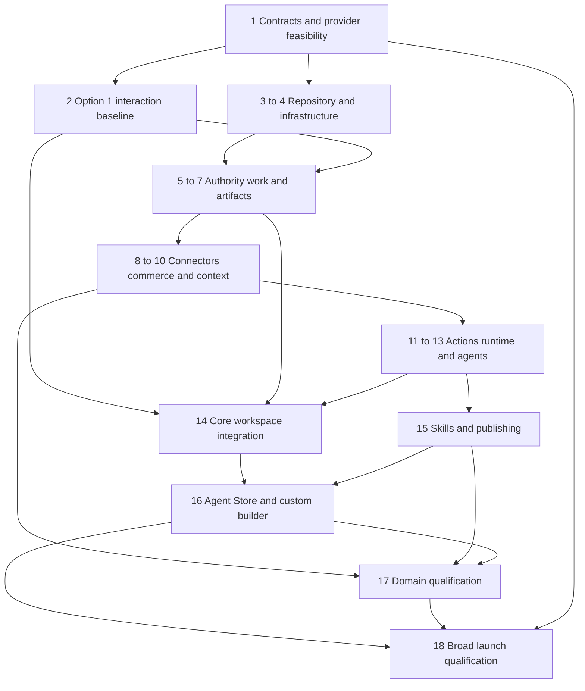

This build plan is the plan of record for what Morrow builds, how it is built, package order, and acceptance gates. It is maintained in this repository: it changes by commit, and material decisions are recorded as ADRs in `docs/decisions/adr/` (ADR-0001). The references in `docs/references/` (`architecture.md`, the Workspace Product Architecture and Day One Foundation; `skills-and-agent-store.md`, the Skills and Agent Store design; and `visual-foundation.md`, the UI foundation) supply supporting detail only where consistent with this plan. Repository contracts and task packets implement the plan; they cannot silently override it. Proposed improvements must be reconciled into this plan before dependent implementation.

The destination is one complete production workspace for people and agents. Internal demonstrations prove dependencies as they are built; they are not separate narrow product launches. Authorization, enterprise identity, durable execution, collaboration, real integrations, privacy, evaluation, billing, and operational recovery are part of the launch foundation.

No delivery dates or staffing estimates are assumed. Package order follows technical dependencies. Several packages can progress together once their shared contracts are settled; ownership and scheduling follow when team capacity is known.

Current hosting decision on 14 October 2026: the owner selects Cloudflare Workers/Workflows/Queues/R2, Neon PostgreSQL and E2B isolated execution, retaining WorkOS. E2B replaces the prior unqualified Daytona choice for new implementation; older Daytona observations below are history, not active selection. Provider/account/image/network/terms and production qualification remain open; selection is not activation. AWS/CDK/Aurora/Fargate/Temporal below are superseded historical engineering observations only; no hosted resources existed and their account-selection questions no longer gate Morrow. Begin P04.T01a selected-stack reconciliation, preserving P05 local authority/SQL work and all real hosted acceptance gates. No provider provisioning, paid activation or migrated cloud data is claimed. Status on 6 October 2026: package 1 documentary design passed signed Codex semantic self-review (same implementer), qualifying local inputs rather than independent, merchant or production review. Foundation: 103 capabilities/14 domains, 116 core definitions, 206 capability bodies, 94 transitions and 12 billing definitions. Package 2 information architecture is self-reviewed; selected option 1 tokens, responsive frames and stateful prototype are review candidates with 44 URL tests and 54 recorded browser checks. Actual owners/specialists, native screen-reader findings and reviewer baseline approval remain unperformed; no human completion percentage is claimed, and feature UI is held. Package 3 standalone/connector/API/worker shells, 334 generated definitions/103 typed capability pairs and synthetic laboratory pass local self-review. Local delivery pipeline passes 515 tests, clean source-copy builds and nine scaffold guards; patched dependencies show zero npm advisories at observation. The private sultanhunter/Morrow foundation is published as draft PR #1 (https://github.com/sultanhunter/Morrow/pull/1). Hosted CI passed on commit 8fdf84fbf29c988d33855367e531f0c2d1d1b625, including the full pipeline and scaffold guards. Desktop/Morrow is saved, installed and tracks codex/morrow-foundation; twelve artifacts match independent clean builds. GitHub rejected private-main branch protection with HTTP 403 and requires Pro or an eligible organization; no upgrade was purchased and privacy was preserved. Sequencing correction: package 3's reproducible engineering/CI foundation is qualified for continued implementation; GitHub subscription eligibility does not block coding. Actual enforced repository protection remains mandatory before merging release code or privileged deployment, with manual review and draft PRs during development. No Pro purchase is requested to continue. Package 2 representative participant qualification remains pending and still precedes accepted feature UI. Package 4 now has deterministic, no-lookup CDK templates for development/staging/production, private encrypted/versioned storage, regional closed TLS/WAF ingress, database/transport definitions and a separate unrouted untrusted VPC reservation. The initial infrastructure candidate passed554 local tests; pinned CloudFormation validation reports no findings for all three templates. The actual isolated PostgreSQL17.11 local engine passes startup and transaction commit/rollback; its ephemeral container was removed. This does not qualify Aurora's regional minor, real IAM, rotation, restore, tenant authority or provider access. All actual provisioning inventories remain pending without account/qualification/complete regional quote/bound owner authorization; application services and dispatch remain absent/disabled. CDK2.272.0 has a bundled brace-expansion advisory: a checksum-verified replacement from locked upstream5.0.12 passes normal/deep nesting checks, while the original registry advisory remains recorded; no zero-advisory claim applies to this new dependency set. Hosted CI passed infrastructure commit54949de7a82c579e5a82a20c2e4beaf0cc7cca51 (run37490758758). Package4 identity/network candidate now passes589 local tests and regional CloudFormation validation: seven bounded roles per environment, broker-only credential retrieval, scoped private AWS dependency paths and effective-configuration binding for evidence/quote/cost approvals. Synthetic denials do not qualify actual AWS IAM or tenant authority. Independent clean reproduction matched fifteen artifacts and passed589 tests/nine scaffold guards; hosted CI passed identity commit befbaf6fd8fde32cab86c79eb21409c07886af51 (run37497806878). Operational/recovery candidates now pass592 repository tests and nine scaffold guards. Actual isolated PostgreSQL17.11 SCRAM rotation rejects failed/old candidates, verifies new login and retains committed SQL after abrupt client death. Actual local pg_dump/transactional pg_restore plus explicitly synthetic encrypted versioned objects detects missing/mismatched revisions, replays later erasure/revocation markers, validates foreign keys and keeps dispatch quarantined. Timings cover a tiny fixture, not production RTO/RPO. Allowlisted telemetry excludes arbitrary errors/content; dashboard/alert account/threshold/recipient bindings are pending. These reports do not qualify AWS Secrets Manager/Aurora/S3/Temporal, authenticated marker/reopening authority or live deployments. Remaining hosted qualification: designate the owner's AWS account, prepare complete bound regional costs, and qualify real development/staging identities/network/rotation/recovery through reviewed activation. Existing local profiles are not inferred to belong to Morrow. No paid provisioning is authorized. Independent local engineering has proceeded without a GitHub plan upgrade. No merge or deployment. All 18 packages, 80 tasks and 73 acceptance IDs remain. Selected: standalone Morrow/thin Shopify connector, paid managed-model work credits, US data, demand-scaled costs, Cloudflare public assets, AWS us-east-1/Aurora/Fargate, Temporal Cloud and WorkOS. No live installation, paid provisioning, merchant charges or production activation exists; classification/UI, billing eligibility, prices/terms, provider/account and engineering/launch gates remain unqualified. Hosted CI also passed operational/recovery source920e2a21f1dc5a3cc7032eb4f75138cd37a1933a (run37499932106), including both isolated container drills. Sequencing improvement: package4 engineering now qualifies local identity backend implementation and actual PostgreSQL17 tenant tests while cloud account/cost selection proceeds; actual package4/provider qualifications still gate hosted identity and activation. Start local identity engineering rather than blocking code on cloud signup. The canonical package sequence and all real acceptance/production gates remain. Package5 first local identity-persistence step is now an In-progress parent/local engineering candidate: an immutable application migration, private identity/session/membership records, same-organization workspace assignments, FORCE RLS projections and a strict server-only parameterized read transaction. Only a separate unprivileged runtime login may read an eligible workspace; maintenance authority is explicit and never inherited. Actual pinned PostgreSQL17.11 passed31 checks, including cross-merchant denial, committed revocation between statements, proof expiry/revocation, privilege/escalation denial and failed-migration rollback. Full613 repository tests and nine scaffold guards passed in both working and separate clean locked trees; fifteen build/template artifacts matched. These are local candidate/self-review observations, not WorkOS authentication, capability authority, audited lifecycle completion or hosted acceptance. Real routes still deny unqualified identity. Next local work: lifecycle/provider boundary interfaces, audited commands and shared capability authorization; hosted provider accounts and actual package4 remain required for activation. The local human-permission kernel now passes69 targeted decision cases and682 repository tests in working and separate clean locked builds. Nine application guards and31 actual SQL identity checks also passed in the clean tree; fifteen application/template artifacts matched. The kernel denies stale or ambiguous grant facts, cross-resource/account/field selection, approval-as-execution, merchant platform-publisher authority and unqualified agent/automation identities. Every call reloads its reader facts; allowed decisions retain execution obligations. The reader is still a typed port with synthetic current-fact fixtures, not an implemented SQL grant/lifecycle or HTTP/dispatch authorizer. Keep package5 lifecycle and shared authorization In progress. Hosted CI passed identity source0194e3ceac8faa1accfde9608be167396ea98ec3 (run37506347298); permission-kernel source still needs publication/current-head CI. Next implement the audited grant/current-authority database integration and qualified identity-provider boundary, preserving all hosted/production gates. SQL-backed local workspace-permission continuation now passes698 full repository tests and22 actual application/PostgreSQL boundary checks in both working and separate clean locked trees, with nine scaffold guards and fifteen matching artifacts. A second immutable migration binds grant ownership relationally and in JSON; FORCE RLS permits only the current actor's workspace grants and denies runtime issuance/writes. Actual application read transactions feed fresh SQL identity/workspace/grant facts to the shared kernel. Scope/grant denial precedes constraint lookup; SQL authority reloads after it, so changed policy or removed membership cannot return the earlier permission. Malformed stored grants, tenant-binding drift and failed second migration deny/rollback. Only identity-owned workspace resources resolve. The persistent psql adapter/session issuer and provider/entitlement facts are explicitly local test facilities, not production pool/WorkOS/TLS/IAM/HTTP/dispatch qualification. Audited lifecycle, provider-backed sign-in, resource integrations and command serialization remain required; package5 stays In progress. Hosted CI passed the pure permission source f8941d7c99a571e778488a1426a94378101ae48c (run37508391061); current SQL continuation still needs publication/CI. The owner AWS-account designation and WorkOS-project setup questions are pending; do not infer another project's credentials or provider configuration. All18 packages/80tasks/73cases and actual hosted/launch gates remain. Hosted CI now also passed SQL-backed source16fcdd7fd6e60413bdb10dbe23cffbf2408ee15c (run37511141168), including the698-test build, nine application guards, all four isolated PostgreSQL laboratories and regional template validation. The actual Desktop repository was safely aligned, its locked dependencies installed/repaired and all strict types/106 targeted identity-policy cases passed; the tree was clean. Package5 remains In progress: no production driver, WorkOS sign-in/SSO/provisioning, audited lifecycle/issuance, real domain/HTTP/dispatch authorization or launch acceptance is conferred. The two pending provider setup choices are needed for actual cloud and identity-provider integration; existing unrelated account profiles are never inferred as Morrow. Preserve these checked local implementations and resume from the audited lifecycle/provider-boundary work once owned account/project configuration is established. On10October2026, the signed-in owner's WorkOS team now has a new Morrow project with staging only and a default application named Morrow Workspace. The owned staging environment/application/client identifiers are recorded as non-secret integration selectors; production was left out and no key was copied, callback configured, user invited or provider login activated. Actual WorkOS sign-in/SSO/provisioning qualification is still pending. Local authentication-challenge engineering continues under package5's existing engineering permission. The local pre-authentication challenge candidate passed45 targeted cases and743 repository tests in working and fresh locked trees, nine application denial guards and31 actual isolated PostgreSQL challenge checks in both trees; fifteen build/template artifacts match. Real concurrent consumption has exactly one winner. Expiry after row-lock waiting is checked using database wall time after acquisition; application/environment/callback rebinding, browser mix-up, direct private-table writes, escalation and failed-migration rollback are denied. Existing31 identity and22 permission SQL cases, rotation and quarantined restore drills also passed. These are engineering/self-review observations; cookie/origin/rate controls, provider exchange/PKCE, audited issuer/provisioning and actual hosted identity remain pending, and real entry routes stay disabled. Challenge source e7b7805ebd5e3bc445bf2f2d46610d9776b9883c passed hosted CI38006242566, including743 tests, all five isolated database laboratories, nine application guards and regional template validation. Desktop/Morrow is saved and aligned clean; its identity types and45 targeted challenge cases pass. The next actual provider/infrastructure integration still needs the designated Morrow AWS account and controlled staging credential handling; the owner is unavailable, so these inputs stay pending rather than using another project's profiles or exposing credentials. On10October2026 the owner rejected the inferred blanket US-only processing requirement. US remains the default primary storage region; approved global processing is permitted, with regional-processing restrictions only for an explicit customer contract or applicable obligation. The regional AWS baseline remains an undeployed implementation candidate; a Cloudflare backend/external sandbox/serverless PostgreSQL replacement is under comparison, not activated or selected by this correction. Remove US-only default gates from provider/model-policy consumers when refreshing the affected decisions and packets; preserve provider retention/deletion, tenant authority and credential isolation checks. E2B account setup on14October2026 created the approved Morrow workspace and Morrow-staging Hobby project in US-WEST-1. Current console blocks all workspace APIs until a payment method is added; workspace credit is$0 with no cards. Live tests remain blocked; no key, sandbox, paid plan or card was created. The personal trial is separate and must be qualified before any alternative use. The pinned E2B SDK's automatic redirects are unqualified for credential-bearing execution. Live P04.T01h uses the documented native control-plane and fixed envd file APIs with redirects denied; SDK remains a pinned type/wire conformance reference. Real access/testing stays gated.

Design reference: [UI UX and Visual Foundation](https://chatgpt.com/space/page_bbb9d8ed22008191ba32290a4d6cc362).

## Recommended engineering defaults

Use TypeScript and React for the application, a modular TypeScript backend on Cloudflare Workers, Neon PostgreSQL for authoritative business records, Cloudflare R2 for artifacts, Cloudflare Workflows and Queues for durable execution and transport, and a replaceable isolated execution provider for code/browser work, with E2B as the selected unqualified provider. Keep replaceable model, connector, database and runtime adapters. Separate deployed Workers where secrets, authority or execution requires isolation, while retaining shared contracts in one repository. Specialized Python processes run only inside an approved execution profile for a justified workload. WorkOS remains the identity provider; Morrow owns all authorization. Morrow owns the harness, lease/budget enforcement, authoritative checkpoints and artifact storage. Provider-specific SDKs and handles belong in server-side runtime adapter modules; agent definitions, business tools, policy and the harness must not depend on a vendor SDK. Provider choice is a versioned qualified configuration, never model-selected authority.

The goal is a foundation that can grow without replacing its authority, work, and execution contracts. It does not require starting with dozens of independently deployed services. Module boundaries, dependency tests, ownership, and operational evidence establish modularity. A database migration, connector release, skill release, and workflow release each need an appropriate compatibility strategy.

Long-lived workflow changes need explicit versioning. Pin a workflow implementation/version and compatible configuration to each run; preserve old versions for live waits, test approval/event delivery after deployment, and reconcile database state before continuation. PostgreSQL owns business truth; Cloudflare Workflows owns resumable execution checkpoints. Worker rollback is not database rollback and does not undo provider effects. Qualify actual version retention, wait limits and upgrade behavior in P06/P12 before activation; Temporal replay semantics must not be assumed. [Workflow versions API](https://developers.cloudflare.com/api/resources/workflows/), [Worker versions](https://developers.cloudflare.com/workers/versions-and-deployments/)

## Product surface and design gate

Build one standalone React workspace application on Morrow's web origin with shared feature screens, logical routes, accessible components, state contracts and business behavior. Shopify is a thin integration app for managed installation/OAuth, verified store/workspace linking, connection status, reconnect/disconnect and return to Morrow. No full merchant workspace is rendered inside Shopify Admin in this release. Use Shopify CLI and the supported Shopify React Router template/package for the integration boundary; use App Bridge/Polaris only where the qualified connector surface requires them. Workspace domain screens do not import Shopify host SDKs. Credentials, policy, context, connectors, orchestration and consequential execution remain in backend services. Shopify connector-only/non-embedded classification, applicable UI review and billing treatment are external qualification gates; product selection is not App Store approval. A future embedded workspace is a new reviewed scope change, not a current parity obligation. [Shopify integration guidance](https://shopify.dev/docs/apps/build/integrating-with-shopify), [Shopify React Router package](https://shopify.dev/docs/api/shopify-app-react-router/latest), [App Store requirements](https://shopify.dev/docs/apps/launch/shopify-app-store/app-store-requirements)

Standalone Morrow contains Home, Work, conversations, Inbox, approvals, Assets, Agents, Agent Store, Knowledge and Settings. Responsive layouts collapse secondary panes into accessible tabs or drawers without removing workflows. Maintain a surface responsibility matrix: complete domain work belongs to standalone; the Shopify connector has only installation, identity linking, connection controls and safe return. A connector return reauthenticates and resolves existing authorized records without duplicate work, widened permissions or retargeted proposals. A connector status screen is not a second workspace or a commerce-command surface. All domain services remain independent of frontend placement.

Visual option 1 is selected, using shared project tabs, contextual agent conversations, and a persistent decision inbox. Its spacious standalone study is the visual reference for the shared workspace; package 2 defines its desktop and narrow-browser compositions plus connector states. Retain earlier studies as references. Resume package 1 contracts before package 2 completes states, prototypes, and the reviewed baseline. Preserve every package dependency.

Build visible end-to-end paths throughout the established sequence. After package 1 contracts and package 2's reviewed baseline, implement each shared feature once and exercise it through standalone entry and qualified connector handoffs as identity and task APIs qualify. Add real records, reviewable actions, and recoverable agent runs incrementally. Package 14 completes common workspace integration; package 16 completes agent lifecycle interactions in standalone desktop/narrow layouts and applicable connector journeys and package 17 qualifies domain journeys.

## Launch coverage matrix

For every row, the implementation backlog must name real providers, exact operations, required scopes, artifacts, verification rules, and release evidence. A generic SDK, placeholder agent, or mocked connector does not complete a row. Provider names still awaiting selection are decisions to resolve, not an implicit reduction in launch scope. Give each capability a stable identifier linking its scope, UI journey, connector operation, skill or agent release, implementation packet, test cases, and release evidence. A blocked promised operation stays in the scope and dependency register until resolved or the owner explicitly changes the release commitment.

| Domain | End to end capability to qualify | Essential boundary |
| --- | --- | --- |
| Workspace coordination | Scope goals, assign humans and agents, track dependencies, ask questions, report results | Responsibility is separate from permission |
| Catalog | Audit products and variants, draft changes, review and publish supported fields | Field and resource scope, source authority |
| Search and discovery | Inspect pages, use search evidence, prepare improvements, verify publication and observe results | No guaranteed citations or invented measurements |
| Creative | Brief, generate, inspect contact sheets, revise, approve, attach media | Generation budget, product fidelity, asset provenance |
| Merchandising and analytics | Governed reports, anomaly investigation, assortment proposals and approved changes | Metric definitions, currency, attribution and coverage |
| Paid acquisition | Real Meta Ads connection, reporting, campaign preparation and specifically approved execution | Account, audience, publication and spend grants |
| Lifecycle marketing | Segments, campaign briefs, content, review, supported channel execution | Consent-aware provider behavior and send authority |
| Customer support | Grounded case investigation, replies, escalation and qualified case actions | Customer data, communication and refund separation |
| Orders and fulfillment | Exception triage, state checks, coordination and supported actions | Order state, staff grants and provider constraints |
| Inventory | Reconciliation, stock risk, proposed adjustments and authoritative updates | Location scope and configured stock authority |
| Finance | Cost and margin evidence, discrepancy analysis and reconciliation tasks | Sensitive-data isolation and explicit uncertainty |
| Storefront | UX evidence, proposed changes, theme implementation, preview and approved publication | Accessible previews and controlled release |
| Governance | Access reviews, usage, audit export, policies and administration | Eligible human decisions and traceable changes |
| Custom agents | Describe, configure, test, install, schedule, revise and retire a role | Approved capabilities and bounded mandates |

## 1 Product contracts and external dependencies

Define the capability matrix, business objects, action classifications, source authority, responsibility model, retention classes and quality criteria. Turn broad requests into exact operations with completion evidence. Record the standalone workspace plus thin Shopify connector, hosting, identity/linking, orchestration, runtime isolation and initial providers. Produce a surface responsibility matrix for every launch workflow: standalone feature/route, responsive composition, identity/store scope, and any connector handoff; deny domain execution from the connector surface. Include complete everyday business work in Morrow and connection status/control in the connector. Evaluate public distribution, connector UI review and Built for Shopify eligibility separately; do not claim any from the UI choice. Define workspace-first, install-first and existing-account linking with single/multi-store ownership. Keep billing responsibility, subscription entitlements, work credits, monetary liabilities and task spending authority separate. [Shopify integration guidance](https://shopify.dev/docs/apps/build/integrating-with-shopify)

Start Shopify distribution, app review, protected-data, billing, and provider-access work immediately. Some submissions need a runnable app; prepare their evidence now and submit as soon as prerequisites exist. Public distribution and customer-data access have distinct requirements. [Shopify distribution](https://shopify.dev/docs/apps/launch/distribution), [Protected customer data](https://shopify.dev/docs/apps/launch/protected-customer-data) For each provider operation, track its accountable owner, test account, API, scopes, protected fields, plan/region restrictions, production approvals, submission prerequisites, evidence, status, and package blocked. Separate access to historical orders and permission to modify themes where applicable. Split storefront execution into analysis, app-owned extensions, and merchant-theme modifications: themeFilesUpsert requires write_themes and a Shopify exemption; an extension does not grant unrestricted theme editing. [Theme write requirements](https://shopify.dev/docs/api/admin-graphql/latest/mutations/themeFilesUpsert), [Theme app extensions](https://shopify.dev/docs/apps/build/online-store/theme-app-extensions)

**Build artifact:** reviewed operation and surface responsibility matrices; permission matrix; versioned core contracts and state diagrams; infrastructure and identity decisions; billing ownership rules; provider feasibility and approval tracker; workload, quality, cost, and recovery targets; bounded implementation packets with acceptance cases.

**Demo:** walk a small brand and an enterprise team through the same collection-launch scenario.

**Tests and exit gate:** every advertised operation has an accountable owner, authorization route, provider dependency, surface, failure behavior, and verification method. Core state ownership, deployment and identity boundaries, runtime isolation approach, billing responsibility, and acceptance thresholds are recorded before dependent implementation. External reviews that require a runnable app may remain pending with an owner, submission prerequisite, and explicit activation/launch gate; they are never treated as granted. The package 1 walkthrough tests both a small brand and a specialist team against these contracts.

### Package 01 implementation tasks

**Product contracts and external dependencies.** Input: the agreed broad release scope, selected option 1 and one full standalone workspace plus a thin Shopify connector. Materialize reviewed specifications before dependent implementation; preserve all 18 packages.

1. **P01.T01 Capability and authority catalogue.** Give every advertised operation a stable capability ID, accountable owner, provider or tracked selection decision, proposed input and output schema, eligible principal, resource and field scope, source authority, effect, retention and verification rule. Map every capability to a shared journey, task and acceptance case. **P01.A01:** Given an owner and restricted specialist, when each requests a sensitive operation, then the matrix identifies the permitted path or explicit denial without granting authority through an agent. **Done:** reviewed `docs/contracts/capabilities.md`, permission matrix and traceability report.

2. **P01.T02 State and shared workspace contracts.** Specify work, approval, question, artifact, operation and event ownership, revisions and compatibility. Define `HostContext`, logical route catalogue and narrow host ports for authenticated entry, navigation, save protection and feedback; domain screens and workflows remain shared. Specify install-first, workspace-first, existing-account linking, multiple stores and store-switch behavior. **P01.A02:** Given either host, when an existing proposal opens, then identity, target store and immutable approval binding are unambiguous. **Done:** versioned `docs/contracts/` schemas, transition tables and failure cases.

3. **P01.T03 Provider and deployment decisions.** Qualify the infrastructure candidate, identity, isolation, regions, recovery, capacity, model cost and quality targets. Record each provider's exact API, test account, scopes, restrictions, billing route, review prerequisites and launch blocker; theme writes require documented Shopify permission and exemption feasibility. **P01.A03:** Given an ungranted production approval, when feasibility is reviewed, then status remains pending and activation blocked. **Done:** `docs/decisions/` records and external dependency register.

4. **P01.T04 Package readiness review.** Resolve billing ownership, entitlements, usage, cancellation and store removal; approve ownership, dependency and evidence rules. Walk through small-brand and specialist-team cases, including unavailable capabilities. **P01.A04:** Given an unresolved structural decision, when a dependent packet requests Ready, then it cannot advance. **Done:** signed review, unresolved approval gates and `docs/acceptance/P01.md`; no claim that infrastructure or external access already exists.

### Package 1 decision register

The product audience, broad release scope, one complete standalone workspace plus a thin Shopify connector, and visual option 1 are settled. Complete these records before starting implementation that depends on them. Give each record an accountable owner, decision date, affected contracts, and evidence; assign actual owners when the work packet starts.

| Open record | Required decision or evidence | Completion boundary |
| --- | --- | --- |
| Capability and feature parity | Exact actions and outputs for every launch domain; shared workflow and host adaptations; permission and acceptance cases | Package 1, before dependent UX and schemas |
| State and authority contracts | Tenant/store ownership; human and automation grants; questions, approvals, operation states; version and event semantics | Package 1, before packages 3 to 6 consume them |
| Provider feasibility | Actual APIs, scopes, restrictions, test accounts, approval routes, and blocking dependencies | Feasibility in package 1; production grants before activation and launch |
| Infrastructure and runtime | Hosting, identity, regions, retention, isolation approach, workload/cost model, recovery and quality targets | Design decision in package 1; measured proof in packages 4 and 12 |
| Billing and entitlement ownership | Single-store/multi-store payer, approved billing path, shared usage, cancellation, store removal, and outstanding charges | Package 1; integrated billing evidence in package 18 |
| Delivery ownership | Bounded task packets, owner/reviewer, required environment, dependencies, evidence and change-control rules | Before each packet becomes Ready |

Package 1 closes through reviewed contracts and feasibility decisions. Runtime measurements and provider reviews that require later software retain explicit owners and gates. A missing structural decision blocks the work that depends on it; independent research and contract work can continue.

### Required contract inventory

Package 1 must produce the following versioned specifications before their consumers become Ready. Every contract records its owner, schema version, field types and nullability, validation, trust boundary, command/query semantics, structured errors, authorization, sensitive-data handling, compatibility, and acceptance examples. Include representative requests and responses or valid/invalid fixtures; diagrams alone are insufficient. Package 3 turns the reviewed shapes into executable schemas. File names below are planned repository locations, not claims that files already exist.

| Specification under docs/contracts | Minimum decisions and examples | First package |
| --- | --- | --- |
| identity-authority.md, workspace-linking.md, automation-mandates.md | Organization/workspace/store keys; authenticated principal; membership and provider-permission constraints; distinct view/propose/approve/execute/delegate grants; deny reasons; verified linking; mandate owner, scope, budget, expiry and revocation | 5 |
| work-state.md, events.md, execution-payloads.md | Goal/task/run/question/approval/operation states; allowed transitions and actor; immutable IDs; expected revisions; command ID and request digest; transactional delivery; ordering scope; early answers; cancellation; safe payload references and retention | 6 |
| artifacts.md, collaboration.md | Revision identity and lineage; edit conflicts; comments and table/image anchors; working versus shared files; access and derived restrictions; upload states; cleanup; takeover rules | 7 |
| connector-sdk.md, shopify-sync.md | Capability IDs; typed inputs/outputs; scopes and account identity; credential lifecycle; pagination/checkpoints; errors; retries and actual idempotency; async job verification; webhook/version ordering; tombstones and reconciliation | 8 and 9 |
| context-memory.md, source-authority.md, metrics.md | Fact/knowledge/lesson/hypothesis distinctions; source precedence; permission-filtered retrieval and lineage; freshness; money/currency/timezone semantics; metric definitions and missing-data behavior | 10 |
| action-execution.md, approvals.md, budgets.md | Immutable proposal and exact approval binding; current-policy checks; preconditions; operation states and uncertain outcomes; provider readback; resource coordination; reservation, liability and settlement; stop and repair controls | 11 |
| runtime-execution.md, schedules.md | Execution profile, leases and generations, files/network limits, checkpoints, current-grant recheck, workflow compatibility, schedule timezone/overlap/missed-run policy, task-tree limits and cleanup | 12 |
| model-gateway.md, agent-loop.md, run-manifest.md | Allowed provider/data policies; normalized outputs and failures; inference outside deterministic replay; loop termination; routing/delegation; evidence-based completion; pinned versions, context reconstruction and usage | 13 |
| workspace-host.md, workspace-routes.md, screen-contracts.md | Host bootstrap and authentication; logical route to host URL mapping; store context; native controls; shared screen data/commands/states; persisted draft handoff; width adaptation and parity cases | 2 specifies interaction details; 3 scaffolds; 9 and 14 qualify |
| skill-release.md, agent-installation.md | Namespace/version/digest; sources and resources; compatibility and lockfile; evaluation and publication states; provisional samples; overlays/authority binding; activation, upgrade, retirement and revocation | 15 and 16 |
| billing-entitlements.md, service-identities.md, recovery.md | Payer/installation ownership and allowed billing path; consumption versus entitlement; service/network permissions; retained liabilities; quarantine, deletion/revocation replay and cross-system restore reconciliation | 4 starts infrastructure; 18 qualifies integration |

Cross-cutting invariants: tenant/workspace identity is resolved by trusted server authentication; request IDs select resources but do not grant access. A repeated command with the same tenant-scoped command ID and request digest returns the existing outcome, while reuse of that ID with a different request body is rejected. A retry cannot create a new logical provider operation. Approvals bind the exact proposal, resource/store scope, revisions, limits, reviewer, and expiry; policy and preconditions are rechecked before dispatch. Unknown provider outcomes remain uncertain until reconciled. Equivalent resolved identity, grants, provider permissions, and resources produce equivalent policy decisions in standalone browsers/sessions and applicable connector handoffs.

An event envelope must identify schema version, event and aggregate IDs, tenant/workspace and applicable store, aggregate revision or declared ordering position, correlation/causation, actor reference, timestamp, and an allowlisted payload or authorized reference. Timestamps alone are not ordering guarantees. An error contract distinguishes retryable transport failures, provider rejections, conflicts, missing input, denied access, expired approval, exhausted budget, and uncertain external effects without leaking protected content. Schema choices and exact field names become binding only when their package 1 contract is reviewed.

### Package 1 core contract decisions

P01.T02 materializes a versioned JSON Schema 2020-12 contract baseline and representative valid/invalid fixtures, using pinned standard validators for documentation checks. Package 3 generates application validators and clients from the reviewed shapes; documentation checks do not implement production authorization. Internal IDs are opaque, revisions are bounded monotonic integers, UTC timestamps record observations, and event ordering uses aggregate revisions plus an opaque resumable stream position. Timestamps never establish ordering.

PostgreSQL-owned records define tenant/workspace/store ownership, membership/grants, goals/tasks/runs, typed questions and answers, artifact revisions, immutable proposals, exact approval decisions, operation outcomes, usage and budget liabilities. The orchestrator owns durable execution progress and projects it back through transactional outbox/inbox delivery. Authenticated principals and provider permission facts are resolved server-side; client host flags, selected stores and email matching cannot establish authority. Delegated and scheduled work intersects current originating/owning grants, installation scope, provider constraints and the explicit mandate, including revocation and expiry.

A proposal names exact resources/accounts, fields/parameters, expected versions, currency/cost ceiling and applicable review policy. A SHA-256 digest of canonical proposal content binds review to that immutable revision. Changes require a new proposal and review. Approval decides a proposal; it does not recursively need another action approval and cannot create a missing execution grant. Provider uncertainty is an operation state requiring reconciliation, never permission for blind replay. Money uses decimal strings with explicit currency; reporting windows preserve timezone and attribution definitions.

HostContext is a server-authenticated standalone workspace bootstrap description, not a client-issued authorization token. One logical route catalogue and screen tree serve the workspace. A separate constrained connector context identifies a verified Shopify installation and eligible connection controls; it cannot act as a full workspace session or authorize domain capabilities. Narrow ports cover authenticated entry, logical navigation, save protection, feedback and authorized external handoff. A single-use connector-to-Morrow handoff preserves eligible principal, workspace/store references and any persisted approved resume target; reauthenticate and reauthorize before use. Workspace-first, install-first, existing-account, invited-member and additional-store linking verify installation and eligible membership separately with explicit conflict handling. Existing draft version-one host enums are narrowed before release; legacy cross-host fixtures become negative unsupported-surface cases rather than evidence of embedded support.

Core contract review covers allowed state transitions, actor and precondition, early answers, stale revisions, cancellation with submitted effects, duplicate commands/events, redacted failures, derived artifact restrictions and connector return and browser/session continuity. Provider-specific nested domain projections, exact activation permissions, deployment region, retention durations, billing and runtime profiles remain explicit P01.T03/P01.T04 decisions. Dependent packets cannot become Ready while a consumed decision remains open; those decisions must be reconciled here before dependent code.

### Infrastructure baseline for qualification

P01.T03 hosting decision on 14 October 2026: the owner selects Cloudflare, Neon and E2B. Cloudflare Workers hosts public assets, private application APIs and trusted connector/broker services; Workflows and Queues replace Temporal orchestration/transport; R2 replaces S3 artifacts; Neon replaces Aurora; E2B Linux microVM sandboxes are the unqualified execution candidate, replacing the earlier Daytona selection; vendor-neutral runtime ports remain required. WorkOS identity and managed-model work credits remain selected. This supersedes the undeployed AWS/CDK/Temporal hosting baseline, not the validated local SQL and authority implementations. No cloud data migration is necessary because no Morrow resources were deployed. Preserve all 18 packages and acceptance cases. Separate provider accounts/projects and deployment identities by environment, with owned US primary storage and approved global processing. Selection authorizes local implementation; hosted account access, provider qualification and paid resource activation remain distinct. [Cloudflare Workers](https://developers.cloudflare.com/workers/), [Neon plans](https://github.com/neondatabase/website/blob/main/content/docs/introduction/plans.md), [E2B sandboxes](https://docs.e2b.dev/sandbox)

Merchant-owner decisions on 6 October 2026: the default region for primary merchant-data storage is the United States. The owner's 10 October 2026 correction removes the inferred blanket US-only processing requirement: global request processing and approved external-provider execution are permitted subject to documented provider terms, tenant authority and data handling. A storage-region preference is not an end-to-end residency promise. Regional processing restrictions apply only to an explicitly agreed customer contract or an applicable obligation; do not invent one from the initial region answer or require an enterprise localization add-on by default. Record provider storage, processing, retention and deletion behavior separately in P01.T03. Infrastructure should scale with usage and customer demand, with no arbitrary monthly ceiling. Compare variable rates and unavoidable fixed minimums, retain the agreed reliability/isolation requirements, and meter usage by tenant. This preference does not authorize paid provisioning or remove per-run merchant budgets. Keep development local where practical; record a concrete staging cost model before activating billed resources. Commercial decision on 6 October 2026: all merchant plans are paid; Morrow supplies managed model APIs and pays inference providers. Merchant ChatGPT/Claude subscriptions and API keys are not required for onboarding. This supersedes the earlier BYOM-first pricing idea. Target independent brands and enterprise specialist teams with the same governed workspace; enterprise capacity, identity services and contractual commitments require their own costed qualification. Final tier amounts remain provisional until workload measurements and commercial selection. Pricing direction: offer paid monthly packages of agent-work credits with the workspace included, plus explicitly purchased or owner-capped additional credits. Use a single merchant consumption balance; no separate infrastructure usage bill or CPU/storage/concurrency tier ladder. Complete agent work, not raw model tokens alone, determines credit consumption. Shared persistent costs and enterprise commitments still need coverage by minimum package revenue and costed enterprise contracts.

| Responsibility | Selected design | Qualification boundary |
| --- | --- | --- |
| Workspace and ingress | Cloudflare Workers Static Assets, Workers and DNS | Standalone workspace plus thin Shopify connector. Private HTML/API/session/artifact responses are uncached and authenticated. Global processing is permitted; US-only processing is required only by explicit obligation. |
| Trusted application services | Separate API, connector, broker and orchestrator Workers | Environment-specific bindings and service identities; broker-only merchant/model credential access. Admission, current permissions and budgets outside prompts. Workers never execute generated code. |
| Authoritative records | Neon PostgreSQL, US primary storage | PostgreSQL 17-compatible major and actual region/minor qualified before use. Separate environment projects and least-privilege SQL logins, FORCE RLS, bounded interactive transactions and pool-context isolation. Launch can serve development; Scale is the production candidate, with provider availability/recovery qualification. |
| Artifacts | Private Cloudflare R2, US storage | Immutable application revision keys plus checksum/manifests and conditional creation; do not assume S3 object versioning. All reads/transfers and erasure are mediated by current tenant policy. |
| Durable execution | Cloudflare Workflows plus Queues | Opaque references and safe enums in execution state; PostgreSQL business state/outbox/inbox authoritative. Duplicate delivery, provider uncertainty, long waits, workflow versions and restore reconciliation require actual tests. |
| Identity | WorkOS AuthKit, optional SSO and Directory Sync | Existing owned Morrow staging project retained. Provider proves identity; Morrow owns grants and Shopify linking. Terms, callback/session/provisioning behavior and enterprise connection costs remain qualification inputs. |
| Secrets and operations | Broker-only Cloudflare secret bindings, encrypted credential records and redacted telemetry | Platform root credentials are unavailable to ordinary Workers and untrusted execution sandboxes. Per-connection encrypted credentials have tenant/environment-bound authenticated encryption; key custody, rotation and secret-service suitability are qualified in P04/P08. Beta Secrets Store is not assumed production-qualified. |
| Untrusted code and browsers | E2B Linux microVM sandbox with scoped persistent working files | Actual VM/image/account/network/lifecycle guarantees qualified before merchant execution; separate synthetic operator labs do not qualify protected data. E2B project keys stay outside guests; immutable template builds and source-bound operation metadata are required. No database, raw merchant/model/platform keys or unrestricted internet. Only leased broker/proxy access; private/metadata addresses, redirects, rebinding and alternative protocols denied. P12 validates isolation, pause/resume, cancellation and cleanup. |

Cloudflare hosts frontend and backend while Neon supplies PostgreSQL and Daytona supplies agent computers. D1 is not the authoritative store. Start with a qualified Neon driver supporting interactive READ COMMITTED transactions and SET LOCAL tenant context; test reuse and concurrent tenant requests before pooling. Hyperdrive is optional only after its driver/session/caching behavior passes those tests; no double database layer or cached authorization facts. API-only work can execute through trusted Workers without allocating a Daytona sandbox. [Neon driver](https://neon.com/docs/serverless/serverless-driver), [Hyperdrive](https://developers.cloudflare.com/hyperdrive/)

Use versioned Cloudflare deployment configuration, Neon project/branch/role settings and E2B image/runtime profiles in P04. The superseded AWS CDK templates, the Daytona laboratory and the frozen WorkOS operator regressions are retired from the tree (ADR-0013); their history is at the tag `codex-archive-f89ad75`. The pending AWS-account designation is obsolete; do not request AWS credentials or create AWS resources. Requalify service identity, ingress, egress, actual transaction behavior, private artifacts and recovery on the selected providers. No AWS/Temporal account is a dependency. Global processing is permitted; enterprise localization is not required by default. Demand scaling includes Cloudflare's base charge, persistent storage, database activity, reserved sandbox wall time, provider funding/quotas and enterprise identity. Idle storage is not free merely because no model call is running. Complete environment-bound cost and provider qualification precede paid activation. [Workers pricing](https://developers.cloudflare.com/workers/platform/pricing/), [Daytona billing](https://www.daytona.io/docs/billing/), [Secrets Store beta](https://developers.cloudflare.com/secrets-store/)

### P01 provider, cost and qualification decisions

Design selections: Shopify public distribution with GraphQL Admin API 2026-10 and quarterly compatibility review; Google Search Console v1 with read-only authorized property access; Meta Marketing API v26.0 through the credential broker; Klaviyo with revision 2026-07-15 for lifecycle marketing; Gorgias public-app OAuth for support. Meta advanced access, Shopify protected data/historical orders/theme exemption, Google verification, lifecycle/support app review and controlled accounts remain tracked gates. An observed API or browser login grants none of these. Exact scope and provider payload validation belongs in the versioned provider-binding register and connector conformance packets. Preserve all advertised domains. [Shopify versions](https://shopify.dev/docs/api/usage/versioning), [Meta's official collection](https://www.postman.com/meta/facebook-marketing-api/documentation/0zr4mes/facebook-marketing-api-mapi), [Klaviyo OAuth](https://developers.klaviyo.com/en/docs/set_up_oauth), [Gorgias public apps](https://developers.gorgias.com/docs/private-vs-public-app)

Provider completion boundaries: Shopify extension activation uses the supported merchant theme-editor deep link, preview and explicit Save; it is a human handoff from Morrow to Shopify's theme editor, not an invented automated activation API. Opening the link does not complete the task; qualify the authorized saved configuration/readback in P17. Unrestricted merchant-theme writes remain behind the exemption gate. Finance uses Shopify unit-cost/order/refund facts plus merchant-authorized, versioned cost/fee/shipping ledger imports; unavailable costs remain unknown, never zero. Analytics starts with governed facts from Shopify, Meta and Klaviyo, explicit coverage and provider attribution; it does not claim parity with all Shopify Analytics reports. Search indexing/observation remains evidence rather than a promised outcome. Context retrieval starts with PostgreSQL full-text search and permission-filtered structured projections; add an embedding index only after its provider/data/cost contract qualifies. These selections retain every launch domain and require provider payload/import schemas before connector implementation. [Extension configuration](https://shopify.dev/docs/apps/build/online-store/theme-app-extensions/configuration), [Inventory costs](https://shopify.dev/docs/api/admin-graphql/latest/objects/InventoryItem)

Merchant model gateway design: Morrow-managed provider credentials and provider billing; never expose platform keys to merchants or agent runtimes. Merchants select task goals/quality and spending limits rather than configuring model accounts. Qualified routing and premium escalation must remain within approved data and cost policy. Selected adapters: OpenAI Responses API, GPT-6.1 Sol for general work and selectively approved GPT-6 Astra escalation; direct Images API with GPT Image 2.5 Sunburst for product generation/editing. Model identifiers are documented provider aliases, not invented immutable snapshots. Pin routing configuration and available provider versions, detect changes and re-evaluate before rollout. No automatic fallback to an unapproved data region/provider. Use store:false; selected endpoint eligibility, processing/retention/deletion terms and applicable data controls require account evidence before protected content is sent. A US regional endpoint is required only for an explicit customer or applicable regional-processing obligation, not for Morrow's default storage preference. Controlled web-search observations are labelled API observations, not consumer-chatbot market share or guaranteed citations. Development model selection remains GPT-6.1 Sol High. [OpenAI models](https://developers.openai.com/api/docs/models), [Data controls](https://developers.openai.com/api/docs/guides/your-data), [Image generation](https://developers.openai.com/api/docs/guides/image-generation)

Billing design: paid monthly agent-work credit packages include the workspace and ordinary shared service capacity. Credit quantity is the main standard-plan difference; do not publish a separate infrastructure meter or tier-specific CPU/storage/concurrency ladder. Publish complete-work credit rates and service limits. No free merchant tier. Additional AI work requires explicit purchase or an owner-authorized capped spending mandate; automatic top-ups default off. Use Shopify App Pricing as the selected default for applicable public-installation charges, regardless of workspace UI placement. External routes and revenue treatment remain qualification gates. The Shopify shop installation is the billing principal; organization/workspace membership does not create pooled subscriptions. Every paid run reserves one eligible installation/cost center before dispatch; multi-store work has explicit allocations and cannot silently charge another shop. Shared entitlements do not confer data authority. Track entitlement, usage liability and invoiced status separately. Server-side subscription reconciliation determines current access; return URLs and client plan handles are not proof. Morrow enforces its own spending limits because Shopify App Pricing does not enforce usage caps. Cancellation stops new paid dispatch, retains incurred liabilities and bounded reconciliation, and leaves export/deletion available. Uninstall revokes shop access immediately without deleting other shops' authorized work; privacy requests have their own lifecycle. Pricing amounts, merchant-facing terms and any enterprise exception are launch decisions; no direct billing bypass is selected. [Shopify App Pricing](https://shopify.dev/docs/apps/launch/billing/shopify-app-pricing), [Billing requirements](https://shopify.dev/docs/apps/launch/billing)

Selected standalone connector direction on 6 October 2026: the owner approved Morrow website signup, Shopify OAuth installation/linking, then returning to the standalone Morrow workspace. The Shopify app supplies authorized read/write connectivity and connection controls instead of the full embedded workspace. This supersedes the previous two-workspace-host launch scope. Preserve all 18 packages, stable task/acceptance IDs and all 14 launch domains; replace embedded-domain parity cases with standalone browser/session/responsive cases and connector handoff/security cases. The selection does not establish a distribution, UI or billing exemption. Qualify the connector classification and applicable UI requirements before public distribution, and the specific merchant billing route before accepting payment. Preserve scoped authority, tenant/store linking, webhooks/privacy handling, revocation and server-side execution independently of UI placement. [App Store requirements](https://shopify.dev/docs/apps/launch/shopify-app-store/app-store-requirements)

Billing qualification clarification: Shopify Developer Support guidance says genuine existing paying customers of an independent SaaS can generally retain direct billing when later connecting Shopify, while App-Store-acquired customers need a Shopify-billed path. A free account alone is insufficient; guidance for usage-only paid relationships remains case-specific. This guidance does not establish Morrow eligibility, a mandatory pay-first connector onboarding exemption, or a revenue-share waiver. If qualified, persist evidenced billing origin and an approved provider-specific billing principal server-side; separate all checkout, upgrades and credit-purchase routes, prevent double billing, and distinguish store disconnection from SaaS subscription cancellation. The current Shopify billing default remains selected until the Morrow-specific flow and commercial terms qualify. Any off-platform agreement must explicitly resolve revenue scope, fee/reporting obligations and processing costs rather than assume zero Shopify share. [Support guidance on existing paid customers](https://community.shopify.dev/t/does-a-split-billing-model-satisfy-1-2-1-shopify-origin-installs-billing-api-pre-existing-platform-customers-direct-billing/36909), [Support clarification on separate billing paths](https://community.shopify.dev/t/billing-requirement-1-2-separating-app-store-installs-shopify-pricing-from-preexisting-saas-customers-stripe/35728), [Partner agreement](https://www.shopify.com/partners/terms)

P01.T04 billing contract elaboration: add closed version-one schemas for shop billing accounts, verified subscription/entitlement snapshots, immutable multi-store cost allocations, usage liabilities and outbound meter events. A task/operation's reviewed parameters bind the allocation revision/digest and maximum liability; changing payer, split, meter, rate revision or currency invalidates review. Match each payer to its current authorized installation and subscription; reserve each share atomically before dispatch. Provider cost, merchant-billable usage and Shopify invoice status are separate ledgers. Preserve one event identity through retries; unknown AppEvents submission outcomes stay uncertain and reconcile through the qualified provider route before retry. Cancelling, suspending or uninstalling stops new paid dispatch but retains justified incurred liabilities/reconciliation and privacy/export access. Meter names/plan prices and exact Partner/AppEvents API contract are pinned and tested in P18 before billing activation; designing records does not emit a charge. This elaboration adds billing schemas without changing the existing core proposal schema; P11 validates referenced reviewed allocation content as well as the proposal/reference hashes. Managed AI elaboration: distinguish included credits, purchased credits, authorized extra-spend cap, merchant credit consumption and actual provider/infrastructure cost. Maintain available/reserved/settled credit states under a versioned work rate card; also preserve the payer's actual monetary billing liability and the vendor monetary cost reservations separately. Reserve bounded inference/tool/runtime cost before each paid dispatch, including all child agents and retries, under the run and payer budgets. Pin separate vendor cost schedules and published Morrow rate revisions; Morrow credits price complete work and are not provider credits, raw tokens or cash. Settled token categories include cached input, cache writes when applicable, output/reasoning, long context, service tier and regional uplift; media/paid tools and occupied sandbox resources have qualified meters. Keep uncertain provider outcomes reserved for reconciliation; never invent zero usage. Do not bill the merchant twice or charge platform-caused retry duplication. Read-only workspace access, approvals, export/deletion and privacy handling remain available after the work credits are exhausted; pause new paid dispatch without revoking ordinary granted access. Refund/expiry/renewal/proration and any rollover rules must be explicit before charging. Include the lowest effective purchased-credit price and bounded low-token execution in margin/admission checks.

Commercial pricing proposal for measurement, not activated prices: standard paid monthly packages differ primarily by agent-work credits; every package includes the governed shared workspace and qualified agent roles. Additional credits are explicit purchases or bounded owner-authorized spending, with automatic top-ups off by default. Do not advertise unlimited work, model tokens, agents executing concurrently or unlimited retained data. The earlier $79/$299/$999 prices with separate $20/$100/$400 allowance amounts and tier-specific infrastructure limits are withdrawn as a launch proposal; set package prices, credit quantities and any volume discounts together after measuring workflow costs and merchant value. One credit is a published Morrow work unit, not a provider token or dollar, and the effective revenue per credit must account for discounts, refunds and promotions. Enterprise quotations cost stores, contractual capacity, SSO/SCIM, dedicated infrastructure, onboarding, support and SLA commitments; those fixed commitments cannot depend entirely on optional inference consumption. Public-installation billing remains shop-scoped through the applicable Shopify route; enterprise billing outside that route requires an applicable exception.

Merchant usage design: show one agent-work credit balance, available and reserved amounts, understandable task estimates and an explicit maximum before expensive work. A published versioned work rate card prices bounded reasoning, image generation, paid research and browser/data-execution profiles in credits without a separate infrastructure invoice. These profiles account for non-inference compute so a low-token, long-running job cannot bypass charging or budget admission. Job counts alone do not represent cost: context size, model/quality, image settings, tool use and execution duration differ. Human approval waits and parked durable workflows do not consume active-execution credits; an allocated cloud task continues to incur internal cost until released. Ordinary workspace operations and baseline bounded store synchronization are included in the package, not charged per click. Publish baseline service/data/retention limits, estimate backfills before admission, meter qualified heavy imports/reports as agent work and truthfully show any paused sync as stale. Privacy, revocation, deletion, security and outstanding-provider reconciliation continue independently of credit balance. Alert before exhaustion and pause new paid work unless extra spend is authorized. Around-the-clock schedules do not promise unlimited occupied compute. Ad spend, messaging tariffs and connected SaaS subscriptions remain identified external merchant expenses. Credit quantity does not confer greater data or action authority.

Pricing economics proposal: aggregate inference, paid tools, variable runtime/network/workflow costs and prudent retry/uncertainty reserves into each work profile's internal cost, while preserving a separate merchant credit ledger and actual provider/infrastructure ledger. Allocate persistent shared costs, ordinary sync, retained storage, support and enterprise identity/contractual commitments independently of whether a model is running. Set package and top-up credit quantities against the lowest effective selling price, full permitted consumption and adverse workload mix; do not rely on unused credits for profitability. Model Shopify processing at 2.9% and, conservatively for eligible revenue above the first $1 million lifetime threshold, an additional 15% revenue share, plus applicable taxes/regulatory fees. Aim for at least 60% contribution on core paid packages at representative steady state; a paid entry package may have an explicitly accepted lower contribution. Dedicated enterprise compute, identity connections, custom support and SLA obligations must be covered by the committed enterprise payment. Merchant rates remain pinned for reviewed work; vendor or work-profile changes require requalification, not silent price changes or weakened quality/data controls. [Shopify revenue share](https://shopify.dev/docs/apps/launch/distribution/revenue-share), [Daytona billing](https://www.daytona.io/docs/billing/), [Cloudflare pricing](https://developers.cloudflare.com/workers/platform/pricing/), [WorkOS pricing](https://workos.com/pricing)

Credit package economics: contribution equals collected package/extra-credit revenue minus applicable billing fees, inference/paid tools, variable execution, allocated persistent services and serving-support costs. With a conservative 17.9% billing-fee assumption, a $100 payment leaves $82.10 before serving costs; achieving $60 contribution leaves at most $22.10 for all allocated serving costs. This is a calculation, not a provider quote, measured margin or final package. Shared services do not switch off when one merchant exhausts credits: the selected production database and trusted services stay warm, stored content/backups persist, and bounded sync and required security/privacy/reconciliation work continue. The former tier contribution figures no longer qualify the revised credit packaging. P04 must price the complete regional resource footprint and startup/steady-state allocation, including database, warm services, network/egress, WAF/load balancing, storage/backups, workflow history, observability, identity, staging and operator costs. P12/P13/P17/P18 must measure representative and worst permitted tasks, low-token heavy execution, idle subscribed stores, backfills, retained artifacts, support effort, full credit consumption, volume discounts and refund scenarios. Contribution excludes engineering, sales/acquisition, general administration and income tax; it is not net profit.

Selected retention defaults: temporary working files seven days after run closure; minimized raw webhooks seven days; normalized commerce cache ninety days where needed; shared artifacts until deletion; content-free audit/usage metadata 365 days; redacted diagnostic logs fourteen days; completed workflow state thirty production/seven staging days. Neon production PITR is explicitly revised from thirty-five to thirty days to match the selected Scale plan; staging uses seven days. Separately retain daily recovery snapshots/exports for thirty-five days in production, measuring their recovery granularity and restore behavior rather than claiming thirty-five-day point-in-time recovery. Open workflows carry bounded references; permanent agent memory and merchant-approved artifacts reside in governed database/R2 records rather than indefinite scratch disks. Deletion/revocation overrides content retention and must replay after restore. R2 bucket locks are not enabled indiscriminately because they can obstruct erasure. Shopify mandatory privacy topics and deadlines remain unchanged. [Neon restore and snapshots](https://github.com/neondatabase/website/blob/main/content/docs/introduction/plans.md), [R2 bucket locks](https://developers.cloudflare.com/r2/buckets/bucket-locks/), [Shopify privacy](https://shopify.dev/docs/apps/build/compliance/privacy-law-compliance)

Qualification targets, not measured claims: initial load fixture 100 organizations, 1,000 linked shops, 100 concurrent interactive users, 50 reasoning jobs, ten image jobs and five isolated browser runs; 20 normal/100 peak API requests per second and 25 normal/100 burst webhook deliveries per second. Queue work fairly and throttle to each provider's actual limits. Control API target 99.9% availability; p95 normal metadata reads 500 ms, accepted commands one second, normal webhook projection two minutes. Provider jobs and imports have distinct latency/error measures. Target regional database recovery RPO five minutes/RTO sixty minutes; failover and cross-system restore must be tested, with execution quarantined until revocations/deletions and uncertain operations reconcile. Critical authorization, tenant isolation, approval and duplicate-effect failures have zero acceptance tolerance. Each advertised role needs held-out outcome, correction-effort, latency and total-cost thresholds recorded before its evaluation runs; aggregate averages cannot hide a failing role. These targets inform P04/P12/P17/P18 tests and do not authorize paid work.

Migration and rollout: no deployed application or customer state exists yet. These decisions supersede the infrastructure candidate only; P01 contracts and all 18 packages/80 tasks/73 cases remain. P01.T03 produces documentary qualification and a register separating design, controlled-test, engineering and production-review evidence. Later accounts/measurements may remain pending with named owner and blocked activation; they do not become granted through schema checks. P01.T04 must reject Ready when a consumed structural decision is unresolved. A new provider or materially different residency/billing boundary requires this Page to change first.

Use one primary workflow engine. Keep business permissions, the action gateway, skill and agent contracts, and durable artifacts independent of the frontend host. Release compute during long human waits. Sandbox instances receive narrow leases and mediated tools, without direct database access or unrestricted merchant credentials; their files must survive only through explicit durable checkpoints. A managed container service alone does not implement these application guarantees.

Before completing package 1, record the deployment region and data-residency policy, expected tenant and run concurrency, storage/media volumes, provider retention rules, monthly infrastructure and AI usage model, and runtime-provider feasibility. Define acceptance tests for isolation, permission revocation during waits, duplicate webhooks, ambiguous provider writes, workflow upgrades, and restoration. Execute those tests in the existing implementation and qualification packages. Cost, sandbox selection, and region remain open; no accounts or paid infrastructure have been provisioned.

## 2 Visual direction and interaction baseline

After package 1 establishes contracts and feasibility boundaries, develop option 1 into the interaction baseline for standalone browsers/sessions and applicable thin-connector handoffs. Test investigation, project collaboration, product-change review, image selection, agent configuration and failed-connection recovery. Earlier studies remain references; a selected image does not replace interaction specifications or a tested prototype.

Complete the shared navigation model, information hierarchy, dense tables, document surfaces, agent work pages, review cards, onboarding, configuration, and enterprise administration. Include loading, empty, denied, partial, stale, conflict, waiting, and failure states. Specify the same screen and command contracts once, then describe standalone browser composition and constrained connector chrome. Use applicable Polaris/App Bridge capabilities only for the qualified connector surface; standalone screens use no Shopify host globals.

**Build artifact:** approved design baseline, component inventory, interaction specifications, accessibility criteria, and prototype flows.

**Demo:** merchant and reviewer complete representative flows in the selected prototype.

**Tests and exit gate:** verify keyboard order, readable status, action clarity, navigation, session behavior, and host constraints in standalone desktop/narrow layouts and applicable connector journeys, and consistent permission messaging. Frontend feature work begins only after this reviewed baseline. Independent backend work follows its existing dependencies; it need not wait for decorative details. Apply the UI foundation's usability gates to owners and specialist teams: at least 90 percent of representative task attempts complete without moderator intervention; every participant identifies the affected store and draft/live state before consequential action; no tested approval produces an unintended scope or spending interpretation. Participants must locate current artifacts and blockers, and complete core mobile review and reconnection journeys. Record failures and retest corrected flows; repeat these gates on integrated journeys in standalone desktop/narrow layouts and applicable connector journeys. A narrower layout may alter composition but cannot remove a required action or obscure the affected store.

### Package 02 implementation tasks

**Interaction baseline for standalone browsers/sessions and applicable connector handoffs.** Input: qualified package 1 contracts. Develop selected option 1 into one responsive screen system before frontend feature construction; this is the existing design package, not an additional prototype stage.

1. **P02.T01 Shared information architecture.** Lock logical route IDs, URLs, navigation destinations and component inventory for Home, Work, Inbox, Agents, Assets, Knowledge and Settings. Specify detail routes, Agent Store and builder journeys, breadcrumbs, deep links and standalone URL translation. Use one domain route catalogue; the connected Shopify shop and workspace store selection are explicit separate values. **P02.A01:** Given the same permitted work record, when opened in another authorized standalone browser/session or after a connector return, then it preserves its workflow and target store; the connector itself exposes only connection controls. **Done:** reviewed `docs/contracts/workspace-routes.md` and screen contracts.

2. **P02.T02 Option 1 component baseline.** Define tokens, typography, density, artifact tabs, contextual conversations and decisions for standalone Morrow. Design by browser content width, including desktop and narrow/mobile review layouts; collapsed panels retain their functions. Specify a separate minimal Shopify connection status/linking/return interface using applicable native controls. **P02.A02:** Given narrow widths, when a panel collapses, then keyboard users can reach its contents and primary action; connector controls do not expose full workspace features. **Done:** component/token specifications and approved responsive reference frames.

3. **P02.T03 Stateful journey prototypes.** Cover onboarding, authentication recovery, questions, review, draft saving, denied access, stale data, reconnect, conflicting edits, partial failure and uncertain external outcomes. Specify shared state behavior and host feedback differences; later package 16 and 17 features remain design specifications. **P02.A03:** Given an unsaved draft or pending approval, when navigation or store selection changes, then changes are protected and the proposal cannot be silently retargeted. **Done:** linked prototype states and `docs/acceptance/P02.md`.

4. **P02.T04 Baseline qualification.** Test owners and specialist teams in standalone browsers/sessions and applicable connector handoffs, with mobile, keyboard and screen-reader scenarios. **P02.A04:** Given representative tasks, when tested, then at least 90 percent complete unassisted, every participant identifies store and draft/live state before consequential action, and no approval has unintended scope or spend interpretation. **Done:** anonymized findings, corrected-flow retests and reviewer baseline approval; integrated journeys repeat these gates later.

## 3 Repository and development laboratory

Create the modular repository for one workspace client, standalone and thin connector entry modules, API, workers, shared contracts, policy, connectors, runtime, skills, evaluations, and telemetry. Framework scaffolding can start after package 1; frontend feature construction waits for package 2's reviewed interaction baseline. Use the official Shopify React Router template with tested framework and SDK versions, production session storage, and protected credentials. Keep domain screens independent of host SDK imports and prevent a second embedded feature tree. Establish formatting, type checks, migration integrity, dependency locking, secret scanning, recorded review and reproducible builds. Define protected-branch requirements from day one and track actual host enforcement separately. Private-repository plan eligibility is not a prerequisite for writing, testing or preparing subsequent packages. Enforced repository protection is mandatory before merging release code or privileged deployment; keep draft PRs and manual review while host eligibility remains pending. Do not purchase a subscription, make the repo public or weaken runtime authorization to satisfy a local engineering gate.

Create synthetic organizations, users, stores, products, orders, and provider accounts. Build controllable fake connectors and model stubs that can inject timeouts, malformed responses, duplicate events, and partial success.

**Build artifact:** documented clean setup, CI pipeline, test fixtures, contract generation, and deployment skeleton.

**Demo:** a new checkout provisions local dependencies and executes a headless contract example against fake providers. This fixture validates the repository and contracts; package 6 supplies the real durable task service.

**Tests and exit gate:** CI detects invalid schemas, incompatible contracts, leaked secrets, and migration failures. Local setup must not need production credentials or copied merchant data.

### Package 03 implementation tasks

**Repository and engineering foundation.** Input: qualified package 1; feature UI additionally requires package 2. Scaffold one shared workspace application with host entry adapters, API and workers. This package does not implement the durable work service or production feature flows.

1. **P03.T01 Repository and entry points.** Create `apps/workspace-web`, `apps/api`, `apps/workers`, `packages/workspace-ui`, `packages/contracts` and narrow entry/connector modules. Bootstrap Shopify integration from the official React Router template and pin tested versions; isolate it from standalone feature screens. Scaffold standalone and connector entry routes against package 1 fixtures; consume package 2's final catalogue after qualification. Standalone runs without Shopify host globals. **P03.A01:** Given a fresh checkout, when workspace and connector scaffolds start, then shared backend/contracts resolve without needing feature UI or public-distribution approval. **Done:** repository map and scaffold build evidence.

2. **P03.T02 Typed boundaries.** Generate clients and validators from package 1 contracts. Enforce dependency rules separating UI, host integration, policy, connectors and server credentials. Provide configuration contracts for production session storage, Shopify authentication and host-specific response headers; package 9 qualifies real installation. Never trust a client host flag or shop query as tenant authority. **P03.A02:** Given a prohibited import or incompatible schema change, when CI runs, then it fails. **Done:** import rules, compatibility fixtures and contract reports.

3. **P03.T03 Synthetic development environment.** Provide deterministic organizations, users, stores, provider accounts and fake connector behaviors, including expiry, partial results and uncertainty. Document local dependencies and approved test-account setup. Execute a headless work-contract example without implying durable orchestration. **P03.A03:** Given a new developer environment, when setup instructions run, then the example reproduces without production credentials or merchant data. **Done:** fixture catalogue and clean-checkout transcript.

4. **P03.T04 Delivery controls.** Add formatting, typing, tests, migration validation, dependency locking, secret scanning, recorded review and reproducible builds; define and track protected-review enforcement separately. Establish evidence indexing and schema migration conventions for later packages. **P03.A04:** Given a leaked fixture secret, broken migration or failed compatibility check, when changes enter CI, then release is blocked. **Done:** passing clean build, deliberate negative-check results and baseline CI configuration/hosted checks and linked engineering self-review; no feature UI is accepted before package 2 approval. Passing this engineering gate permits subsequent local implementation without a GitHub plan upgrade. Actual enforced branch protection remains an external gate before merging release code or privileged deployment, never claimed from configuration alone.

## 4 Infrastructure and service identities

Provision separate environments through infrastructure-as-code: relational storage, object storage, durable orchestration, queues where needed, secret management, encryption, private networking, workload identities, and telemetry. Establish backups and restore procedures while data volume is small.

Define resource ownership, regional policies, service permissions, deployment promotion, and proposed recovery targets. Use production-shaped staging rather than postponing isolation and recovery architecture.

Define restoration as a coordinated application procedure across database state, object versions, workflow histories, credentials, and provider effects. Disable dispatch and consequential tool execution during recovery. Invalidate old leases, reapply deletion and revocation records, and reconcile workflow progress against restored business records before reopening access. Operations accepted after the restored checkpoint remain uncertain until provider evidence or an authorized recovery decision establishes their outcome; restoration cannot trigger automatic resubmission. Package 4 proves the storage primitives with fixtures; packages 6, 11, 12, and 18 exercise the complete procedure as services become available.

**Build artifact:** reproducible environment definitions, secret inventory, restricted service roles, deployment pipeline, dashboards, and recovery runbook.

**Demo:** rebuild staging and restore a known database and artifact checkpoint.

**Tests and exit gate:** deny unintended network paths, rotate credentials, verify encryption and log redaction, and measure restoration. Worker loss cannot destroy authoritative work state. Recovery claims must be supported by recorded exercises.

### Package 04 implementation tasks

**Inputs:** qualified packages 1 and 3; `docs/decisions/infrastructure.md`, `docs/contracts/service-identities.md`, and `docs/contracts/recovery.md`. Package 1 records providers, regions, environments, retention, permitted network paths, recovery targets, and spending authorization; this package does not select alternatives silently.

1. **P04.T01 Reproducible environments.** Implement Cloudflare Worker/service/queue/workflow/R2 configurations, Neon project/branch/role/compute settings and selected E2B image/region/quota profiles for separate development, staging and production. Older Daytona test/support records remain separate history. Produce credential-free deterministic configuration inventories with owned account/project/resource identifiers left unbound until verified. No activation through default local scripts. Qualification, quote and owner receipts bind account/environment/source/configuration digests and exact non-secret settings, including storage region, compute limits, retention, workflow versions, runtime class/image/egress and alert recipients. Changed cost or security settings invalidate old receipts. P04.T01a first reconciles active selection/registries/default tooling and archives the AWS candidate; preserve existing local SQL evidence. Then qualify actual provider adapters and staging. Readiness diagnostics never authenticate a deployment principal. P04.T01b implements the request-scoped interactive Neon Client adapter and fixes runtime compatibility: generate schema validators from unchanged canonical schemas at build time, with deterministic drift checks and equivalent rejection cases; do not compile schemas using eval/new Function in a Worker. Qualify the validator/adapter bundle in the pinned local Workers runtime before real staging; local simulation is not hosted Neon/TLS/pool or provider acceptance. Initial connections are created and closed within each request; cross-request pooling requires separate context-reuse qualification. P04.T01c prepares controlled selected-provider qualification using only synthetic identities and records. Bind owned organization/project/branch/endpoint selectors from visible provider evidence, validate the actual PostgreSQL version and separate restricted runtime login, and exercise the real Neon WSS adapter from a local Workers runtime without deploying a public service. A temporary Neon Free project may support this laboratory without paid activation; it does not replace the selected Launch staging configuration, seven-day recovery requirement or paid-environment acceptance. Capture fresh authority, concurrent tenant denial, rollback/context cleanup and redacted failures; verify fixture cleanup and never install into an unrelated existing project. For merchant or protected-data execution, Daytona Linux VM availability, regional quota, tier-specific firewall exceptions and snapshot identity must be qualified before sandbox creation or protected content; Tier 1/2 essential-service access does not satisfy Morrow's egress boundary. No production container substitution or uncontrolled network fallback. On 14 October 2026 (India), the owner approved a separate P04.T01f development-only container laboratory to continue without a $500 top-up. Keep selected development/staging/production VM inventories and protected RuntimeProfile contracts unchanged. The lab is scripts-only, disconnected from merchant routing, identity, Neon/R2 and credential-broker authority. Accept only built-in synthetic fixtures and fixed lifecycle probes; deny arbitrary code, uploaded payloads, merchant/artifact references, connector/model calls, secret environment variables, public previews and linked sandboxes. Record Tier1 essential-service exceptions explicitly; never claim strict egress or VM isolation from this lab. Pin the official SDK/image boundary, cap one disposable 1vCPU/1GiB/3GiB container, ten-minute wall lifetime, explicit idle/cleanup intervals and a $0.25 estimated credit-consumption ceiling. Default tooling prepares offline without reading credentials or contacting providers. New allocation requires verified owned account/free-credit eligibility, current balance/rates and bound private access authorization; no paid top-up, billing-method change or automatic recharge is included. Cleanup-only resume cannot allocate or continue probes: it reloads the original private journal under the controller mutex, verifies the actual key's organization/permissions/expiry, and can inspect/delete only the recorded operation even when free credit has dropped below the allocation threshold. Current owned-account binding and private access remain mandatory; credit loss must not prevent reducing an existing effect. Bound cleanup timeout and key expiry cover cleanup only, while new allocation retains the full lifetime/credit gates. Terminal absence/destruction is recorded explicitly; expired/revoked access or a crashed controller lock requires verified operator recovery, never a new allocation. Resource/time caps constrain expected cost, not a provider-enforced dollar cutoff; uncertain cleanup remains potentially billable. Persist operation/name/resource identity before effects; inspect uncertain creation by original name/labels before retry, never duplicate create or adopt a foreign resource. Verify actual container resources, synthetic filesystem write/read across stop/start, terminal deletion and cleanup outcomes with a source-bound redacted report; memory pause/resume is VM-only. Local fault tests cover foreign IDs, cancellation/timeouts, failed cleanup, partial effects and production promotion denial. This laboratory qualifies development mechanics only and does not advance P12 or production acceptance. Dedicated Morrow organization/key creation and private staging credential handling remain explicit provider-access actions, and paid resources still require a bound quote/owner receipt. On 11 October 2026 (India), the owner approved and created the separate Neon Morrow-staging Free project (cool-butterfly-64820147, branch br-flat-sea-b8pulqt6, database morrow_staging, AWS US East1) and Daytona Morrow-staging organization (8862ff17-6109-4eb1-ac70-2f7bafba64ae, region us). Read-only operator connections from local workerd passed actual PostgreSQL17.11 database/login binding, READ COMMITTED/read-only transactions, commit/rollback context cleanup and concurrent separate-client isolation. The new database credential is private local staging material, never source or deployed runtime authority. The observed Neon c-14 routing label is supported as a bounded optional numeric hostname segment; exact endpoint egress binding remains mandatory. The owner subsequently authorized the three immutable identity migrations, restricted test roles and synthetic authority tests only in morrow_staging. P04.T01d installed all three unchanged migrations as the restricted NOLOGIN identity owner and passed25 actual Neon checks from local workerd using the separate unprivileged morrow_api login. All nine tables have forced RLS; runtime has no owner/administrative membership or database/schema CREATE privilege. Real request-scoped adapter and shared kernel tests passed own-workspace access, foreign/missing/expired/revoked proof denial, concurrent contexts, retained-scope denial, private-table/write/escalation denial, commit/rollback cleanup and policy/membership revocation between awaited reads. Both synthetic tenants were removed and fixture cleanup verified. The first installation stopped after role creation because the operator lacked SET permission; catalog readback resolved the partial state, and an explicit resume retained the original private credential while changing only the operator's owner membership to SET true, INHERIT false. Future partial outcomes still require catalog inspection before continuation; never regenerate credentials, silently reinstall, grant application owner access or overwrite unrelated state. This qualifies the restricted database authority laboratory only; WorkOS authentication, deployed Cloudflare services, credential rotation, seven-day recovery and production acceptance remain pending. Daytona's prepared Linux VM/firewall/usage-pricing qualification request was sent to support. On 11 October 2026 (India), support issue20446 received a conditional offer: Tier3 requires a one-time $500 top-up, after which support can provision linux-vm access. This is not enabled access, confirmed VM quota/rates or a qualified runtime. P04.T01e records this response and a controlled qualification checklist; no purchase, key or sandbox is authorized by the reply. Official billing documentation describes top-ups as wallet credit, distinct from metered consumption; confirm this organization's credit expiry/refund and recurring/automatic-top-up terms before a bound quote. Tier3 full internet by default requires an enforced sandbox allowlist/block-all policy before protected execution; test essential-service bypass, policy mutation permissions and effective denial rather than treating the tier upgrade itself as isolation. Linux VM pause preserves memory/files; stop preserves files and clears memory. Both release CPU/RAM/disk quota but retain billed reserved disk; transitions remain fully billed, VM archive is unsupported and separately created snapshots remain charged after sandbox deletion. Keep existing gross disk cost assumptions; quota release is not a zero-cost persistent workspace. Pin the qualified Linux VM snapshot and lifecycle/network/API profile, set explicit idle handling and reconcile usage measurements before activation. [Daytona billing](https://www.daytona.io/docs/en/billing/) [Daytona limits](https://www.daytona.io/docs/en/limits/) ShopifyFlow (wandering-tree-28469764) was permanently deleted after the owner's exact action-time confirmation; provider project-list readback retains only Morrow-staging. Neon Free retains six hours of history, not the required seven-day Launch staging recovery. Daytona's new organization remains Tier1, requires a payment method and exposes Container/Windows quota views without confirming Linux VM quota. Billing, keys, sandbox creation and paid upgrades are unperformed. Obtain a qualified VM/firewall profile before runtime activation. [Daytona networking](https://www.daytona.io/docs/en/network-limits/) [Daytona sandboxes](https://www.daytona.io/docs/en/sandboxes/) P04.T01g prepares runtime portability without advancing P12 execution: audit vendor coupling, record the provider-neutral port/capability/conformance blueprint and enforce SDK import boundaries in the foundation checker. Keep the existing Daytona synthetic lab and selected merchant environment inventories unchanged. Candidate research on 14 October 2026 recommends E2B for the next no-card synthetic trial and Modal VM Sandboxes for a later usage-based production benchmark; research is not a provider switch, owned account or enabled capability. An alternate lab needs its own bounded recipe, verified actual resources/credit eligibility/private access, deny-by-default networking, create reconciliation, persistence probes and cleanup evidence. No key, account, payment method or sandbox is created by this packet. [E2B pricing](https://e2b.dev/pricing) [Modal pricing](https://modal.com/pricing) [Modal billing](https://modal.com/docs/guide/billing) On 14 October 2026 the owner selects E2B. P04.T01h reconciles the active provider and prepares a separate scripts-only E2B synthetic qualification lab; P04.T01f, the historical Daytona lab, is retired (ADR-0013); it never created a key, sandbox or provider call, so it has no operation to clean up. Use a provider-neutral synthetic lifecycle port and a dedicated E2B adapter; no merchant routes, credentials, arbitrary code/uploads, models/connectors, database or artifact authority. Default preparation remains offline. Before allocation verify the owned project, actual free-credit eligibility, private access and a source/config/account-bound quote; no Pro subscription, card, top-up or paid activation is included. Native keys are project-scoped; do not invent scopes/expiry introspection. Confirm key/project authority through an authenticated fixed-origin read that checks the requested project, then resolve a ready immutable templateID:buildUUID and exact native resource settings. Pin official SDK/options, disable automatic retries and implicit E2B endpoint/proxy settings. Resource IDs are opaque. E2B create has no idempotent name: persist original metadata/operation/deadline before one create, reconcile uncertain creation across running and paused resources, and hold ambiguous/no-match outcomes rather than recreating. Cap one synthetic sandbox, ten-minute original wall deadline and a $0.25 expected-credit ceiling with qualified resources/rates. Explicit native timeout-to-kill bounds running time only; paused instances have no TTL, so require a persisted cleanup/recovery controller and do not claim a provider-enforced absolute deadline while paused. Readonly inspect and cleanup must not call connect because it resumes/extends expiry. Verify builtin marker files across full pause/restore; memory persistence requires its own fixed process probe. Deny guest egress at creation and test application-level denial, authenticate controller/preview access, create no public app server, and keep provider tokens out of reports/guest inputs. Cleanup-only recovery inspects/kills the original resource even after credit loss/deadline and verifies terminal absence; uncertain effects remain unresolved. Source/profile changes cannot abandon old cleanup. A successful local mock does not qualify live networking, isolation or production P12. E2B terms/enterprise data processing and commercial SaaS integration remain launch qualifications; account signup accepted by the owner is not written provider approval of all downstream use. [E2B lifecycle](https://docs.e2b.dev/sandbox/persistence) [Template build pins](https://docs.e2b.dev/template/tags) [Network controls](https://docs.e2b.dev/network/internet-access) [E2B terms](https://e2b.dev/terms) Actual account readback on14October2026: the owner approved a separate Morrow workspace/free staging project, and Morrow-staging was created on Hobby in US-WEST-1. The console now shows shared workspace invoices/payment methods/credit, a$0 balance, no cards, and API requests blocked pending a payment method; this overrides older public docs describing project-only billing and advertised no-card trial assumptions for this standard workspace. Do not add a card, upgrade, create a key or allocate from this observation. A separate personally scoped trial may be proposed only after actual entitlement/account approval and its own bound quote; never move projects or share keys to bypass a gate. Preserve original cleanup bindings. The pinned SDK's automatic compensating kill on malformed creation responses must be disabled through its supported allocation-only subclass; deletion remains behind original ownership readback. No mock report is live provider evidence, and actual egress/memory qualification stays separate. SDK redirect qualification found that a controlled307 can forward X-API-Key to a foreign origin and turn its404 into SandboxNotFoundError; fixed apiUrl and retry settings alone are insufficient. Before live P04.T01h access, implement the dedicated E2B adapter using documented native control-plane create/get/list/pause/connect/delete and fixed envd marker upload/download requests, with redirect:error, explicit original-origin validation, bounded responses/timeouts and no automatic retry for every credential-bearing request. SDK remains pinned for types and wire-conformance tests, not live network transport. Do not monkeypatch global fetch or use an unsupported client hook. Tokens stay private in controller memory; guest origin derives only from the statically owned opaque resource and fixed official domain, and file paths/payloads remain builtin. Native exact-origin GET404 alone may verify known-resource absence; foreign/redirect/error/file404 cannot. Fault tests must prove API-key and envd-token redirect denial, no foreign terminal proof, one uncertain-create request, ownership-preserving cleanup and original deadline. No actual key or sandbox was used to discover this SDK issue. The owner subsequently approves using Sultanibne's Project in Personal Workspace for the synthetic qualification, creating one project-scoped API key, storing it only in the protected local staging folder and making readonly project/template requests. Actual personal balance is$100/no card; Morrow-staging remains separate and API-blocked. Bind this operator recipe to the approved personal project, modern/legacy identifiers and current source; no merchant selector is changed. This authorization excludes sandbox allocation, paid activation/card, project moves and merchant data. Resolve immutable build/resources and a reviewed bounded quote before requesting a disposable test; key scopes/expiry remain native-observed rather than invented. Actual approved key qualification returns200 for the bound project metrics but403 for public base alias inspection. E2B's current alias/template/build metadata handlers require template ownership, including public templates. Do not use the public base discovery assumption, guessed IDs, another auth identity or runtime allocation to obtain resources. Within approved readonly scope, list only the bound project's owned templates through native GET/v2/templates, then inspect a ready owned template/build/resources if present. An empty owned catalogue is a qualified project observation with runtime image still unavailable, not a passed runtime profile. If no owned recipe exists, prepare a minimal reviewed custom-template build and its exact resource/cost/source/reconciliation controls; template creation/build is a distinct provider mutation/full build environment and requires separate explicit authorization before effects. Preserve the failed alias attempt and actual key/project proof separately. No sandbox is authorized by these reads. On15October2026 the owner requests owned-image/build-cost qualification followed by the E2B test. Extend P04.T01h with a separate scripts-only owned-template preparation and recovery controller; no new business schemas, package sequence or merchant selectors. Pin the verified official e2bdev/base OCI indexsha256:4a369f01a820fe5e65f53c2c5727a78899daf86f0541b721097f289559c8b73f and Linuxamd64 childsha256:197ad15124a51884aea5a629b96045cd8300bdbbb6df648647004fad99fc59ec using anonymous exact-origin bounded manifest reads/hash verification, not guessed public template/build IDs. OCI integrity does not attest hosted image configuration/resources, envd authentication or an owned ready build. Use one fresh UUID private name/owner-scoped recipe, explicit2vCPU/512MiB/minFreeDiskMb0 and no uploaded files/custom build steps/provider keys/models/connectors/merchant content; minFreeDiskMb is no-growth intent, not a disk cap. Default scripts prepare offline, without private input or provider calls; public manifest verification is separate opt-in readonly and cannot register/start a template. Owned registration POST/v3/templates and start POST/v2/templates/{originalID}/builds/{originalBuildID} are distinct non-idempotent effects: persist original source/project/name/recipe/manifest proof before registration, and pin verified private owned IDs plus each synchronized attempted flag before either single POST. Never retry an uncertain registration/start or start a replacement to cancel; bounded complete owned-catalogue/build readback reconciles only the original operation. Ambiguous/no-match/unprovable recipe provenance remains held; failed/foreign/redirect responses cannot establish ownership or terminal cleanup. Poll the original build without arbitrary logs; request cancellation cannot claim server cancellation. The public API lacks customer build cancellation; template deletion is a catalogue effect and never proves active-builder teardown. Dennis's E2B support reply, supplied by the owner on15October2026, states that hosted builders terminate after one hour but that clients have no supported independent stopped-compute proof. Treat this as a provider-stated lifecycle limit, distinct from observed termination, and keep uncertain attempted builds held. Keep any active/unknown builder held for read-only reconciliation/operator recovery, not catalogue404 cleanup proof. Preserve terminal build and image qualification independently of template-retention/deletion policy. Actual building stays denied until fresh owned Hobby/free-credit/key/project proof, the reviewed public manifest/source, exact builder/retention/transfer rates and estimated-credit quote, acceptable original-build recovery and explicit owner receipt qualify. The owner's approved E2B support request asks for these billing/recovery facts; no new key, card, upgrade or merchant access. Prepare meaningful registration/start/ownership/unknown-effect/source/journal/redirect fault tests and a source-bound evidence packet while that reply is pending. Preserve actual59 readonly results under their original source; cleanup decoders retain55–59 original operations while new runtime allocation requires the current source/profile. Qualify owned ready template/build/resources, then rebind the single ten-minute runtime test and its all-meters$0.25 expected-credit budget before execution; no production/P12 acceptance is inferred. On15October2026 Dennis confirms that template builds and ready-template/image storage are not billed today; sandbox CPU/RAM are charged per running second, pause/kill/timeout stops that billing, and Hobby without a payment method uses existing credits then blocks instead of billing an overage. Official pricing corroborates $0.000014/vCPU-second and $0.0000045/GiB-second; 2vCPU/512MiB for600seconds estimates$0.018150, with included Hobby disk and a total test credit ceiling$0.25. E2B terms require at least30days notice before adding/increasing service fees. Preserve the support reply as owner-supplied evidence, official URLs and observation/freshness dates; free today is not a permanent price guarantee. Refresh current account/credit/card and exact source/image/quote bindings before effects. Acceptable development build recovery is one attempted registration/start, exact original read-only reconciliation, retained ready-image proof on success, and an unresolved held journal on error/ambiguity; neither elapsed1hour, error status, template404, catalogue deletion nor local abort releases that journal or authorizes replacement. No new support message or paid action follows from this reply. Resume P04.T01h with a current source-bound preparation and reviewed quote, archiving original60 operator bytes/receipts and preserving55–60 cleanup without rebinding journals; unrelated P05 authority/SQL work and frozen business schemas stay unchanged. The prior personal key approval covered read-only qualification; provider writes still require a concrete owner receipt for the single owned-image build and bounded disposable sandbox test after preparation. All merchant selectors and execution remain disabled; this synthetic qualification does not satisfy production/P12 gates. [Sandbox rates](https://docs.e2b.dev/faq/calculate-sandbox-price) [Current pricing](https://e2b.dev/pricing) [Fee notice terms](https://e2b.dev/terms) Actual approved trial on15October2026: the owner explicitly approves the one private image build and one disposable sandbox test in Personal Workspace/Sultanibne's Project, within the existing$0.25 expected-credit envelope; this receipt is resolved and must not be requested again for these exact effects. One original registration/start created private templatepdht65h2trfuizuvmotc/build4324bde3-d3a9-4d18-91c1-b2b1b3e80b80, operationc423fb7d-6935-4917-8862-0b4bbf5a2961, original65 sourceb20517ffdaac601c56edea1c2d75d81c636b914b7b546be7661aaf3236c8b4ce. Provider reports ready after about40seconds,2vCPU/512MiB/envd0.10.0 and12422MiB total filesystem. The controller correctly holds the journal because its10240MiB total-disk validator contradicts the documented10GiB free-space allowance above image contents. Repair this units assumption without registering/rebuilding: preserve exact65 source/config/public reports, original journal/source/receipt and IDs; current controller performs read-only original65 reconciliation. For the current bounded trial accept the separately observed exact12422MiB total disk for this owned build, alongside the existing small-disk range; adjacent unqualified sizes still deny. Native current template/build reads must match that exact size before sandbox allocation. Keep CPU/RAM/time and all other authority/network/cleanup limits unchanged; disk is included in this Hobby profile, with no storage add-on or price increase inferred. Current66 runtime recipe consumes the qualified immutable image/actual resources and existing explicit single-test approval; no second build or sandbox is authorized. Extend original65 cleanup decoding and preserve all55–60 and60 owned recovery paths; never change an existing operation's source/recipe. Record this actual-provider discrepancy and meaningful resource-boundary/source/recovery tests, rerun affected engineering checks, then continue the approved lifecycle test. [Included free space and total image disk](https://docs.e2b.dev/faq/build-limits) Actual runtime66 qualification: exactly one sandboxi9z55h09hwmhn67t0ks1p was created for operationcb45e68e-79d7-4e01-9bf7-7e16fc2545c9/sourceaddeb2cec5911c95c2cace93b3f83e900bbb1348aa2fe607192e2eeb8d3368f2. Project/image/CPU/RAM/disk/controller/network-configuration checks passed; the marker phase failed before pause/restore. Static original-resource absence and a protected terminal receipt verified deletion; no sandbox remains and allocation permission is consumed/disabled. Preserve this failed actual report and original66 source/profile/account/receipt; file persistence, effective egress and process-memory continuity remain unqualified. The marker_requested phase covers identity recheck, upload, response decoding and initial readback, so generic provider_failed cannot identify the root cause. Official pinned SDK and envd docs corroborate the existing fixed guest origin/headers/multipart path; HTTP/1 versus2 is not an established cause. Before any second test, add bounded adapter/CLI diagnostics consisting only of fixed request-stage, endpoint-class and outcome enums, numeric HTTP status or null, bounded elapsed time and capped counts. Capture the first execution failure separately from cleanup and distinguish marker write, initial read, pause, restore and restored read. Construct these values in owned branches without inspecting arbitrary errors/causes/messages or exposing URLs, headers, bodies, tokens or provider text. Diagnostic collection failure must not prevent cleanup. Public reports must distinguish verified absence from a durably saved terminal receipt and remaining held slot. Archive original66 controller closure and keep cleanup65/66/source identities unchanged; current67 recipe is preparation-only until a concrete additional diagnostic sandbox receipt is approved. No automatic second allocation, rebuild, message, key, card or paid change. Tests must cover non200/redirect/transport/decode/shape/timeout distinctions, first-read versus write, hostile error objects and cleanup failing without overwriting the original cause. Run engineering/peer checks and prepare a reviewable same-image2CPU/512MiB/six-hundred-second diagnostic test with no more than$0.25 expected credit before requesting the additional allocation; the original one-build/one-sandbox authorization is not reusable for a second sandbox.

During unrelated P05 linking work, preserve the completed E2B67 operator/profile/account/report bytes and exact historical source/cleanup bindings. Its approved three-run diagnostic batch is consumed: the final synthetic file pause/restore passed and all test sandboxes were verified deleted. New allocation stays disabled. A test-only isolated67 plan fixture may exercise that completed controller; current-plan allocation must deny before private input or provider access, while original cleanup/reconciliation remains supported. Do not rebind E2B recipes or regenerate provider evidence for this plan change.

2. **P04.T02 Service identity and network boundaries.** Compile environment-scoped API, connector, orchestrator, credential-broker, execution, deployment and recovery permission profiles. Use separate Workers and explicit service bindings/internal request authorization; unauthenticated public requests cannot reach internal broker methods. API/connector/orchestrator never read raw merchant/model credentials directly. Broker executes approved provider calls after fresh policy, scope, operation and budget checks. PostgreSQL runtime/issuer/migration/recovery roles remain separate; pooled transactions cannot retain another tenant's context. The selected untrusted runtime obtains only short-lived tenant/run/generation-scoped broker/artifact capabilities, no Cloudflare/Neon/WorkOS/model/Shopify credentials. Sandbox direct networking is denied before any protected content enters; actual effective network denials must pass, not merely configuration assertions. Deployment/recovery identities bind reviewed environments and resource scopes. Real cross-environment denial, key rotation, R2 authorization and provider-egress tests remain P04/P12 acceptance inputs.

3. **P04.T03 Secrets and operational signals.** Configure encrypted secret storage, credential rotation, redacted logs, correlation identifiers, health checks, and actionable dependency alerts. Exercise a failed deployment and credential rotation without exposing values. Output dashboards, alert routes, and rotation procedures. Local candidate baseline: strict allowlisted operational events carry opaque correlation IDs and fixed codes, excluding arbitrary errors, credentials, customer content and metric dimensions derived from merchants. Dashboard/alert routes remain unbound until actual signals, thresholds and recipients are qualified; no invented paging success. Exercise SCRAM credential rotation and abrupt synthetic client-worker death on the pinned isolated PostgreSQL17 image, with credentials delivered over stdin/tmpfs and redacted evidence. Encrypted local credential fixtures and failed activation checks do not qualify Cloudflare broker-secret rotation, Neon runtime-role rotation, a live service deployment or Cloudflare durable orchestration. Keep those real-account acceptance observations pending.

4. **P04.T04 Restore laboratory.** Implement backup/restore procedures and a recovery quarantine that prevents dispatch. Restore synthetic database records and matching object versions, and verify referential integrity. Document how later packages invalidate leases, replay deletion/revocation records, and reconcile newer workflow/provider state. Output a measured restore report and runbook. Local candidate baseline: use actual pinned PostgreSQL17 pg_dump/transactional restore plus an explicitly synthetic encrypted versioned-object fixture. Verify revision checksums and foreign keys, replay later erasure/revocation markers, reject missing objects and unresolved provider/workflow state, and leave dispatch disabled. Measure this small fixture without claiming production RTO/RPO, Neon PITR/snapshot recovery or R2 artifact restoration. Real target/quarantine identities, object versions, later marker sources and authenticated reopening authority must qualify separately; local recovery reports cannot authorize reopening. Qualify R2 revision manifests and Neon recovery independently; Provider working disks/checkpoints are reconstructable execution state, not the sole copy of business artifacts. Resume only with a new generation and current authority after uncertain effects reconcile.

**Acceptance evidence:**

- **P04.A01** Given a development workload identity, when it requests staging secrets or private storage, then access fails without disclosing content.

- **P04.A02** Given running test services, when credentials rotate and a worker dies, then new connections recover and durable fixtures remain intact.

- **P04.A03** Given a backup plus later deletion markers, when restoration runs in quarantine, then data integrity is checked and dispatch remains disabled; unresolved recovery steps block reopening.

**Done:** a fresh authorized staging deployment and restore exercise meet package 1 targets. Attach configuration revisions, permission results, measured recovery evidence, and remaining later-package qualifications. No production reliability claim follows from fixture restoration alone.

## 5 Tenant identity and authority

Implement organizations, workspaces, memberships, teams, resource grants, service principals, SSO, SCIM, session revocation, and policy inheritance. Provide standalone authentication and session lifecycle, and securely link eligible Shopify identities and installations without treating an identity token as an API permission grant. Distinguish platform publishers from merchant administrators.

Implement both the principal-authorized delegation envelope and each agent's direct execution grant. Bind schedules to explicit automation mandates with expiry, ownership, and departure rules.

**Build artifact:** policy API, capability matrix enforcement, grant lifecycle, identity integration, and audited administrative commands.

**Demo:** an authorized coordinator delegates specialist work it cannot directly execute; an SEO analyst's refund request is denied.

**Tests and exit gate:** cross-tenant IDs reveal nothing; revoked employees lose access; cached results respect changed grants; ordinary approval cannot manufacture authority. Every service uses trusted tenant identity rather than client-supplied identifiers. Test installation-to-workspace linking against wrong-tenant selection, expired or replayed handoffs, conflicting ownership, and an invited user's insufficient authority. Email matching alone cannot establish workspace ownership.

### Package 05 implementation tasks

**Inputs:** package 4 and reviewed `docs/contracts/identity-authority.md`, `docs/contracts/workspace-linking.md`, and `docs/contracts/automation-mandates.md`. These define ownership, role/resource conditions, authenticated handoff semantics, session rules, revocation behavior, and the policy decision schema.

1. **P05.T01 Identity and membership lifecycle.** Implement organizations, workspaces, memberships, teams, service identities, SSO, provisioning events, and session revocation using the selected identity provider. Normalize standalone browsers/sessions and applicable connector handoffs into one trusted request context in `apps/api`. Never accept client tenant identifiers as authority. Output migrations, authenticated middleware, and audited membership commands. Local engineering may proceed after package4's reproducible definitions and actual isolated PostgreSQL17 primitive/recovery tests. Build deployable identity interfaces, audited membership persistence and tenant SQL enforcement against the same supported major; explicit local test identity adapters never authenticate production requests. Keep selected WorkOS token/session/provisioning/SSO/SCIM qualification pending until owned controlled accounts and actual package4 integration exist. Missing qualified identity configuration fails closed. No accepted feature UI or live tenant activation is implied. Initial provider-login preparation uses a private, short-lived authentication-challenge ledger with 256-bit random state and separate browser proof, stored only as digests and bound to an owner-configured environment/application/exact callback/return-route tuple. Narrow security-definer functions may create and atomically consume these pre-authentication challenges under the unprivileged API role; they confer no principal, tenant, session or capability authority and expose no direct private-table writes. Expiry is checked using database time; consumed or mismatched challenges cannot authorize a second callback. Qualify the application boundary and real isolated PostgreSQL replay/concurrency/cross-binding/privilege tests. Keep login routes disabled until rate/origin/cookie/CSRF controls, provider exchange/PKCE, secret broker, audited identity mapping/session issuer and actual provider/infrastructure qualification exist. A successful challenge proves only the initiating browser transaction, never authentication. Record the selected owned staging application without storing secrets. The next local lifecycle slice is an internal workspace-access revocation persistence primitive, not the public organization-membership revocation capability. Introduce a separate NOLOGIN lifecycle executor with no table privileges or owner membership; neither the API role nor merchant/runtime roles may execute or assume it. A private, owner-seeded test receipt binds the exact command ID, request digest, actor session digest, organization, workspace, target membership, expected organization policy revision, immutable approval-evidence reference, expiry and validated authorizing-grant payload. No production receipt issuer or approval bypass is provided. Under one organization serialization lock, re-resolve current active human/session/organization/workspace memberships, compare every receipt field and the current authorizing-grant payload, and check database time after waits. Atomically deactivate only the target workspace membership, revoke only its workspace grants, advance the organization policy revision, consume the receipt and append one attributable audit/result record. Preserve the target's organization membership, other workspaces and organization-wide sessions; those sessions must immediately lose resolution for the revoked workspace. Expected denial results commit their redacted audit when an exactly bound receipt supplies attributable authority; unknown or mismatched receipts confer none. Exact successful replays return the original result only to a currently eligible actor; changed bindings cannot replay or mutate. An uncertain commit never proves failure and reconciles the same command instead of creating a fresh one. Qualify real PostgreSQL17 privilege, isolation, rollback, receipt replay, expiry-after-lock, concurrent revocation and fresh-policy-read tests. HTTP routes, provider identity, organization-wide revocation, grant issuance, approval issuance, affected-run cancellation and dispatch serialization remain gated follow-on work.

**P05.T01d Durable PKCE and code-exchange admission.** After the controlled linking candidate is saved, implement a separate provider-free sign-in prerequisite in `packages/identity` and isolated PostgreSQL17. This is private pre-authentication correlation and one-time reservation only. It issues no authenticated identity, principal, tenant, session, grant, reusable dispatch permit or production success receipt; it makes no WorkOS request and enables no HTTP route. Keep the owned Morrow staging selectors, callbacks and credentials unchanged. Future browser transport, private provider broker and audited identity/session issuer require their own concrete qualification.

Append immutable migration6 and a separate `morrow_identity_preauth` NOLOGIN executor with no memberships, direct table privileges, owner access or API/runtime/lifecycle/linking assumption. Preserve migration1–5 bytes and frozen v1 contracts. Add three private FORCE RLS sidecars: an owner-configured active WorkOS application/revision binding to the existing exact authentication binding; an immutable S256 PKCE record for a challenge; and an immutable admission ledger that is also its redacted pre-authentication audit. Uniqueness covers begin command, callback command, challenge and `(provider, environment, client, code_digest)` across binding/callback aliases. There is no tenant or membership authority in these records.

Define server-only `createAuthenticationExchangeAdmission(pool,bindingJson)` with a closed primitive JSON binding containing exactly bindingId,bindingRevision,environmentId,applicationId,clientId,redirectUri,returnPath. `begin` accepts only primitive JSON with commandId and generates independent256-bit state,browserProof and verifier plus a challenge UUID. Persist only SHA256 commitments; S256 is unpadded base64url SHA256 of the exact verifier bytes. Atomically create the original authentication challenge and its PKCE sidecar against the current locked owner binding/application tuple. Return private initiation material to a trusted future server caller only after confirmed commit and successful release. No raw material is a public identity or logged output. A duplicate begin command does not regenerate or disclose the original secrets.

`admit` and read-only `reconcile` accept only bounded primitive JSON with exactly commandId,challengeId,state,browserProof,verifier,code. Snapshot closed validated scalar input before awaits; reject caller objects before reflection. Bind every operation to the server-owned exact tuple/revision. Bound opaque provider code bytes without trim, case folding, generated-state grammar or Unicode normalization; reject malformed UTF16. Hash private values before fixed parameterized SQL. Never persist or log raw code,state,browser proof,verifier,provider tokens or provider errors. The actual future HTTP cookie/CSRF/origin/rate and protected transport boundary is not supplied here.

Admission takes locks in one consistent order: existing binding, application configuration, transaction advisory command namespace, separate advisory code namespace keyed by canonical provider/environment/client/code digest, original challenge and PKCE sidecar. Advisory hash collisions may serialize but cannot confer authority; unique constraints remain backstops. Recheck current exact configuration, immutable proof commitments and database wall time after waits. Atomically reserve the immutable ledger/audit and consume only its original unconsumed PKCE challenge. Perform a final clock check after potentially blocking inserts/constraints; expiry aborts all reservation/consumption writes. One fresh confirmed transaction returns only newly_reserved correlation. Exact replay returns held correlation and cannot reserve again; changed command/code/proof/binding conflicts or denies without consuming the losing challenge. No reservation deletion, lease expiry, silent reclaim or retry creates a second opportunity.

Replace the existing legacy consume function in migration6, preserving its signature and legacy-only behavior, to exclude PKCE-managed challenges. Legacy-created or legacy-consumed challenges and a successful legacy consume result never establish new admission. New begin creates both rows in one transaction, with no committed legacy-only gap. Validate the dedicated actual login and unsafe role flags/memberships in both the application port and definer. Withhold fresh results until COMMIT acknowledgement and awaited connection release; ambiguous commit/release is a fixed uncertain error with stable command correlation, never a blind retry. Reconciliation performs no insert/update/consume and never emits newly_reserved, including when a row is absent. SQL cannot remember a rolled-back unknown attempt: the trusted future controller must retain uncertainty and explicitly abandon/restart authorization with a new challenge/code rather than automatically call admit again. This slice favors one-time admission; it does not promise crash-resumable or exactly-once external exchange.

Qualify independent S256 vectors, primitive-input zero-reflection/privacy checks, strict result decoding and actual Workers execution with zero provider requests. Run real PostgreSQL atomic-begin rollback, duplicate/replay/competing callback, cross-binding code uniqueness, current config drift, legacy isolation, least privilege, immutable ledger/audit, rollback and uncertain commit/release tests. Test expiry after binding/challenge/advisory waits and an actual uncommitted unique-code reservation whose owner rolls back after the contender expires; the contender cannot retain reservation or consumption. Repeat existing SQL regressions, full repository pipeline, scaffold guards and exact-head hosted CI. A future fixed-egress broker must separately qualify durable pre-send/unknown-outcome handling and actual WorkOS behavior; no caller status or code reservation alone authorizes that network effect. WorkOS JWT issuer/JWKS/application binding, immutable provider-ID mapping, session issuance/refresh/logout, provisioning/SSO, hosted infrastructure and merchant activation remain open. Primary references checked15October2026: [authorization and S256](https://workos.com/docs/reference/authkit/authentication/get-authorization-url), [authentication exchange](https://workos.com/docs/reference/authkit/authentication), [server cookie/CSRF integration](https://workos.com/docs/authkit/vanilla/nodejs).

During this P05 identity continuation, preserve completed E2B67 operator/profile/account/report bytes and exact historical source/cleanup bindings under the same restriction recorded for linking68. The approved batch remains consumed and new allocation disabled; only test fixture/current-plan-denial metadata may follow the new Page revision. Preserve the saved68 controlled-linking engineering evidence and immutable migration5. No provider account, key, sandbox, deployment or merchant content is authorized by this local authentication increment.

**P05.T01e Isolated WorkOS operator qualification.** After the saved69 admission candidate, prepare a scripts-only controller, protected journal, local browser fixture and fixed native transport. Keep `apps/api`, merchant login, session/grant issuance and production broker routes disabled. This slice first qualifies synthetic faults and actual local PostgreSQL/loopback behavior with zero real WorkOS effects. The existing owned Morrow staging environment/application/client was rechecked15October2026; callbacks/initiate-login/signout remain Not set. No new project, key, provider request or account edit is implied. Before an actual trial, obtain concrete action-time approval for the exact callback and scoped browser/provider effects after the tool is implemented and reviewed.

The proposed operator origin is exactly `http://127.0.0.1:4110`, callback `/operator/workos/callback`, start `/operator/workos/start` and clean result `/operator/workos/result`. It is separate from prototype8877 and every merchant route. Its fixed profile pins the observed Morrow staging environment/application/client, binding/revision, source/plan/profile digests, native API endpoint and finite limits. There is no caller-supplied URL, return target, alternate client, tenant, SDK or credential fallback. The local PostgreSQL operator adapter installs immutable migrations1–6 in a disposable isolated database, seeds only that exact owner binding, enables only its dedicated test login and uses the real69 application port; it is not a Neon deployment, production driver or provider authenticator. Preserve all six migration bytes and prior engineering/provider evidence.

A separate protected operator activation binds exact operation/activation IDs, current plan/source/profile/binding hashes, owned staging selectors, OS owner and private-root identity, expiry, fixed endpoint, one browser initiation and at most one native code POST. OS ownership is not a Morrow principal or WorkOS identity. Real mode requires explicit owner approval plus observed exact callback registration and controlled-user/session cleanup baseline; current preparation creates none of that authority. Synthetic fixtures and injected transport responses are labelled synthetic and cannot qualify actual WorkOS behavior. A successful69 reservation is only a prerequisite; the operator activation and fresh same-process journal handles govern the separate test effect.

Use an owner0700 root outside source/publisher/Desktop repositories and0600 exclusive, no-follow, inode/device/owner/type/single-link checked records. Persist and synchronize file and directory before exposing effects. Fixed irreversible records cover claim, initiation_started, send_requested and an allowlisted observation; never overwrite, reset, delete, expire/reclaim or rebuild a send handle from inspection. The initial exclusive claim/mutex precedes SQL begin and listener work. Persist initiation_started before exposing the WorkOS authorization link/redirect: browser login itself can create a provider user/session even if no native POST follows. Latch the first locally valid callback before any await, require fresh committed69 newly_reserved, recheck exact source/profile/binding/deadline and durably persist send_requested with command/challenge/admission/code/request commitments before the sole POST. Any existing, malformed, partial, stale or uncertain journal, SQL acknowledgement loss, synchronization failure, restart or observation-write loss stays held. Missing SQL rows or a recreated local database never authorize reuse. Inspection is strictly read-only; raw codes/proofs are intentionally unrecoverable, so no crash-resumable or exactly-once external exchange claim is made.

Bind the listener only to127.0.0.1:4110, with exact single Host and raw path/method, bounded URI/headers/cookies/body/time/request count and no CORS. GET start renders only a fixed same-origin form; it cannot begin SQL authentication or contact WorkOS. POST start requires exact Origin and a separate one-use256-bit bootstrap CSRF binding before starting once. After real SQL begin, retain verifier/state/browser values only in memory and set a distinct host-only, path-scoped HttpOnly SameSite=Lax browser-proof cookie with short lifetime; non-Secure HTTP is an explicit staging-loopback test exception, never production cookie qualification. Provide a fixed authorization continuation link if browser form-action policy would block an external redirect chain. Test actual listener/browser-compatible behavior rather than assuming restrictive headers preserve navigation.

Callback GET may lack Origin, so require exact protected cookie, independent state, live flow deadline and one strict code/state query pair (or a separately closed authorization-error shape). Parse raw query with strict percent/UTF8 decoding, reject duplicate/unknown fields, malformed encodings, path aliases, duplicate Host/Origin/target cookies and unpaired UTF16, preserving opaque code bytes without trim/normalization. Invalid callbacks confer no admission or send. A valid callback must quickly redirect to the fixed clean result URL and never echo/log its query, body, cookie or provider data; result GET is read-only. Every response uses no-store, nosniff, frame protection and minimal CSP. Referrer-Policy is no-referrer except the successful exact clean GET start form, whose same-origin policy preserves the browser's native POST Origin without sending a referrer cross-origin. POST continuation, callback, result, denial and client-error responses remain no-referrer. No raw state/browser/verifier/CSRF/code/provider tokens or response bodies enter files, evidence, URLs other than the necessary OAuth state/code transaction, error causes, telemetry or process arguments.

The native keyless test transport sends at most one fixed HTTPS POST to `https://api.workos.com/user_management/authenticate` with only client_id, grant_type=authorization_code, code and code_verifier. Use no SDK automatic retries, redirects, forwarded cookies/IP/user-agent, caller host, secret or environment fallback. Reject disabled TLS validation and ambient WorkOS credential/proxy/config overrides; enforce cancellation and an overall bounded response deadline and body cap. Recheck the effective response origin, status/content and minimal token-pair shape only, discard sensitive values and emit fixed coarse observations with provider_session_cleanup unknown. A shaped200 is wire evidence, never JWT verification, an authenticated identity, membership, session or grant. Non200/client-auth failure, timeout, abort, malformed/oversized/stalled body, foreign/redirected response and hostile error all hold the consumed attempt without retry or key fallback. Native transport and private filesystem controller remain operator adapters, not qualified Cloudflare service bindings.

Run meaningful closed-input/privacy, concurrent process/callback, source/activation/config drift, file crash/fsync/close loss, held/restart/inspect and no-second-POST tests; actual loopback Host/Origin/CSRF/cookie/query/rate/expiry tests; and actual PostgreSQL69 integration with journal retained across database loss. Synthetic transport must prove zero real provider requests; repeat the full pipeline/scaffold, relevant existing labs and exact-head hosted CI. Before any real trial, prepare an exact dashboard baseline and identify/revoke/read back only the controlled staging session(s) attributable to that attempt under approved scope. Browser authorization may create user/session effects even if exchange_not_sent. Dropping tokens, local cookie clearing or database teardown is not provider logout; unidentifiable or unverified cleanup remains unknown/cleanup_pending with the journal held. Do not derive trusted cleanup identity from an unverified JWT or copy a key to avoid this gate. Manual owner completion is used for the actual Hosted AuthKit challenge; CI must not automate that real login. Preserve completed E2B67 allocation-disabled sources/reports, original linking68 evidence and saved69 admission evidence. Primary references checked15October2026: [keyless mode and environment fallback](https://workos.com/docs/sdks/authkit-react-router#public-client-keyless-mode), [authorization/PKCE](https://workos.com/docs/reference/authkit/authentication/get-authorization-url), [authentication](https://workos.com/docs/reference/authkit/authentication), [controlled testing](https://workos.com/docs/authkit/testing), [session effects](https://workos.com/docs/reference/authkit/session), [logout](https://workos.com/docs/reference/authkit/logout).

**P05.T01e Browser form compatibility repair.** On15October2026 the owner-approved staging callback was saved and read back on the exact existing Morrow application; the staging users baseline remained empty. The first operator process reached its local form but the native browser POST was rejected before SQL begin or authorization-link exposure. It ended held at its deadline with the protected claim retained, no initiation_started or send_requested records and no WorkOS initiation or code POST. An actual browser reproduction using the unchanged handler and a synthetic controller observed Origin literal null, exact form content type and the bootstrap cookie, with zero controller starts or provider requests. This follows the [Fetch Origin algorithm](https://fetch.spec.whatwg.org/#append-a-request-origin-header): no-referrer nulls the Origin for non-CORS form POSTs.

Repair only the successful exact GET start form to use Referrer-Policy same-origin; it has a fixed clean URL with no code/state/query or private proof in the URL. Retain strict exact Origin, independent bootstrap cookie/CSRF, finite time/request limits, no-store and the remaining headers. Keep no-referrer on POST continuation, callback303, result, errors and client errors, and preserve the authorization anchor's rel=noreferrer. Do not accept Origin null, weaken CSRF, add arbitrary script/network authority or change merchant routes. Preserve exact published70 source closure, tests, plan and evidence before repair. Verify the corrected form with an actual browser and synthetic-only controller, then rerun focused/full pipeline, relevant SQL/Workers regressions and exact-head hosted CI before the live continuation.

The existing explicit human approval remains a combined ceiling of one WorkOS initiation and one code POST using only the approved staging identity and session-cleanup scope. A pre-initiation local failure does not spend that provider allowance. After confirming the original process and local database are closed, the retained original journal has only its claim and no initiation/send records, no authorization link was exposed, and a fresh dashboard baseline is unchanged, one fresh source-bound private activation may reference the same still-unspent approval and original held operation. Never reset/reuse/release the old claim, reconstruct a send handle or infer reuse from missing SQL alone. Bind the successor receipt to the current plan/source/profile, predecessor and unchanged combined effect limits. Any uncertain prior effect, live original process or initiation/send marker holds continuation; once an initiation occurs, no additional initiation is authorized by this allowance. Callback registration is already approved and saved; no duplicate confirmation is needed for the same unspent sign-in merely because its local form required repair. Manual owner challenge and attributable session revocation/readback remain required.

**P05.T01e Actual staging result and preservation.** On15October2026 the reviewed source71 (501cd90033d6c85e0c959026f0b2499e7c194c18d70d94dd78fccf248373b250, published987414cc41862f8f95f24b0780dad49a682901b6 with successful exact-head CI38713500572) completed the owner's single manual Hosted AuthKit sign-in. One logical authorization initiation and one keyless code POST returned the fixed response_shape_received/2xx observation; sensitive values were discarded. The authenticated dashboard attributed one new user and one Morrow Workspace session to the approved identity against the prior zero-user baseline. Only that exact session was revoked, and a fresh loaded dashboard readback confirmed Revoked. The test user remains; no other session was changed. The local operator exited0 and its disposable SQL/listener resources are absent. The approval is fully consumed: no further initiation or POST is authorized. Preserve the original private journal unchanged, including its cleanupunknown observation, and bind the separate scoped cleanup receipt to it. Public evidence contains coarse outcomes and commitments only. This qualifies wire behavior and attributable session cleanup, not JWT validation, current session liveness, trusted Morrow identity, membership, grants, SSO/SCIM or merchant activation.

Preserve exact completed71 source, profile, tests, plan and original evidence under docs/history/workos-operator-71; keep the separately captured actual71 result and original protected receipts immutable. Advancing the current plan must deny the native71 operator before private input or effects; do not rebind that completed source or reuse its activation. A separate synthetic regression wrapper may verify the fixed archived manifest and recomputed71 source closure, copy the fixture into an isolated temporary directory, and execute only the synthetic59-check PostgreSQL/loopback laboratory there. Never run inside the archive. Resolve workspace imports exclusively to copied archived contracts/identity code and verify that resolution; use the pinned Node/tooling and lock bindings. Reject archive/path/hash/plan/toolchain drift before Docker/listener work, write a distinct current regression report and verify archive immutability after cleanup. No private records or provider access enter this fixture. Preserve all earlier E2B, linking68, admission69 and operator70 histories.

**P05.T01f Offline WorkOS session-token verification.** Implement a bounded Worker-compatible identity module before any authenticated Morrow session issuer or workspace mapping. A trusted server composition supplies closed primitive JSON for an immutable exact environment/application/client/issuer profile and bounded public RSA JWKS snapshot, plus a trusted clock; request input supplies only bounded primitive compact JWT text. No network, automatic refresh, SQL, cookies, public login route, provider request, key, session/grant issuance or caller-supplied verified claims. Verify RS256 with WebCrypto against one unambiguous configured kid; reject algorithm confusion, private/invalid/ambiguous keys, token-provided key URLs, unsupported critical headers, malformed or noncanonical base64url/UTF8/JSON and duplicate object keys. Bind exact issuer and signed client_id, require user_ subject and session_ sid, and reject impersonation or nonhuman token classes. The first default-session profile requires absent aud; a later present audience needs a separately explicit exact policy rather than accepting arbitrary audiences. Require safe-integer iat/exp, exp>iat and a bounded maximum lifetime; validate optional nbf and the bounded trusted clock before and after asynchronous crypto. Use explicit Morrow policy limits, including token16KiB, decoded header2KiB, payload12KiB, JWKS64KiB/16keys, RSA2048–4096bits with exponent65537, maximum token lifetime3600seconds, skew30seconds and public-key snapshot lease at most300seconds. These are Morrow limits, not vendor defaults or rotation guarantees. Unknown kid, stale snapshot, clock regression or crypto/config failure deny without retry. Return only a private opaque verified-candidate handle with an owning-verifier read method; serialization, a forged object or another verifier's handle cannot create authority. Candidate provider subject/session and optional organization metadata are not local organization, membership, role, grant or ActorRef authority; do not copy token roles/email/permissions into an authorization decision.

Qualify the offline verifier with independent RSA signatures, hostile boundaries, wrong issuer/client/key/audience, time and post-await expiry, malformed/duplicate JSON, key rotation/ambiguity/staleness, concurrent handle isolation and absence of tenant authority. Exercise the same module in actual pinned local workerd with zero outbound requests, then full pipeline/scaffold and exact-head hosted CI. No new dependency is required for WebCrypto. On15October2026 one unauthenticated bounded no-redirect read of the documented existing client discovery URL returned200 and the exact client-scoped issuer, fixed authorization/token endpoints and client-scoped /sso/jwks URL. Save that public metadata separately; discovery is not account ownership proof or actual JWT claim/signature qualification. Official issuer examples differ, so never infer issuer from an unverified token or silently accept both bare and client-scoped forms. Real token/profile and current provider-session/revocation qualification require a later separately bounded integration; the completed71 tokens were discarded and cannot be recovered or reclassified. References: [session tokens](https://workos.com/docs/reference/authkit/session-tokens), [sessions](https://workos.com/docs/authkit/sessions), [documented production discovery](https://workos.com/docs/cli/emulate#oidc-discovery), [JWT templates](https://workos.com/docs/authkit/jwt-templates). Preserve all six migrations and frozen v1 contracts; identity mapping/session persistence changes require their own follow-on packet.

**P05.T01f Local qualification and next dependency.** Reviewed72 source published90fe4aa667f81cea669fbe2b3c3b820e3cc39c96 passes1339repository tests and9scaffold guards. The offline verifier passes15independent-RSA tests and48actual local Workers cases/71checks with zero outbound requests; the copied71 operator regression passes59SQL/HTTP checks with2synthetic POSTs/0real requests, all42archive files unchanged. Separate review has no remaining material finding. Exact-head hostedCI38719845956 is pending at this decision; require its success and safe Desktop alignment before later actual-provider activation. Preserve exact72 code/tests/plan/reports under docs/history/workos-session-token-72 before the new operator version. These results still verify no actual WorkOS JWT, local identity or merchant session.

**P05.T01g Bounded real-token operator qualification.** Prepare a fresh73 operator candidate using the same protected journal, real69admission, exact loopback4110 Origin/CSRF/cookie and one-initiation/one-code-POST protocol. Preserve all completed71 files/receipts/actual evidence and72 offline results; no original activation, journal or consumed approval is rebound or reused. This remains scripts-only; do not add SQL migrations, mapping/session/grant issuance, merchant routes or a production Cloudflare network adapter. Add the exact72 offline verifier and one bounded strict duplicate-key/UTF8 JSON helper to the new source closure. The fixed operator profile additionally binds the exact discovered client-scoped issuer, fixed client-scoped JWKS URL, public response cap64KiB and at most1anonymous JWKS GET. Derive the closed verification profile inside the transport from these exact source-owned environment/application/client/issuer/revision fields; no caller-selected issuer, URL, keys or claims. Prepare a new protected activation with owner approval/callback/baseline false and explicit maxJwksReads1; require an actual current scoped receipt only after engineering review and exact-head CI.

After a valid callback has the existing newly_reserved admission and durable send_requested marker, the same single-attempt transport performs at most1fixed anonymous HTTPS JWKS GET and at most1existing keyless authenticate POST under one combined15second deadline bounded by flow/activation expiry and cancellation. No retries, redirects, refresh, SDK, secrets, token forwarding or ambient configuration fallback. Enforce exact effective URL/status/content, declared and streamed body caps, fatalUTF8 and duplicate-key rejection at both responses. Construct one immutable exact-namespace public-key snapshot with at most300second lease; reject malformed/private/ambiguous/invalid keys before POST. The awaited GET introduces a new authority gap: require a trusted controller beforePost callback to rerun the existing exact current-source/activation/flow check and same69admission reconciliation AFTER the GET and snapshot qualification, then recheck environment/TLS/deadline/cancellation immediately before POST. A missing/throwing/stale recheck holds with no POST. This callback exposes no raw token or reusable dispatch permission. Existing journal fencing still precedes every possible POST and any uncertain outcome remains held.

Keep access_token, refresh_token, response body, public-key material and candidate inside the transport closure. Verify the access token using the72 verifier, read only that verifier's private handle and require its verified provider subject to match the response user.id; the unsigned user object alone is never identity authority. Discard all sensitive values and return only the fixed cryptographically_verified_candidate or held outcome/category/status class with providerSessionCleanup unknown. Do not emit subject/session/organization IDs or token material into public observations or local Morrow authority. Cancellation, expired token/keyset, mismatched issuer/client/audience/subject, crypto error, changed source, malformed/stalled body or observation loss cannot authorize another GET/POST. Synthetic unit/native-server and real PostgreSQL/loopback labs must use independently signed fixture tokens/JWKS, exercise the new post-GET recheck and all existing once/concurrency/crash/privacy boundaries, and prove zero real provider calls. Maintain the separate frozen71 regression and72 Workers coverage, full pipeline/scaffold, independent review and exact-head hostedCI before the next concrete approval.

The next actual trial requires one fresh source-bound operation/root and an explicit scoped allowance for one manually completed staging initiation, at most1anonymous JWKS GET and1keyless code POST using the approved identity, followed by revocation/readback of only its exact new attributable session. Refresh the existing-user/session baseline and saved exact callback; do not create another project, callback, key or paid plan. The prior71 trial is consumed and cannot supply this allowance, and the owner must complete the challenge again because no token was retained. Native preparation is not activation. Preserve prior revoked sessions and test user; derive cleanup attribution from the authenticated dashboard and exact new-session baseline, never an unverified JWT. After the test require exact-session revocation and fresh loaded readback plus local listener/database cleanup. Even a successful signature/profile trial does not qualify ongoing provider-session liveness/revocation, trusted durable user mapping, Morrow session issuance, SSO/SCIM or merchant activation; each remains a separate follow-on boundary.

**P05.T01g Public-key wire compatibility correction.** A bounded anonymous read of the existing fixed WorkOS client JWKS returned HTTP200 and the same public body SHA256 a17d5f80cb972c9302e2eefb712218a46f1777150c912a6aa106768dda77bde1. Its one RSA/RS256 signing key includes x5c and x5t#S256 certificate metadata alongside alg/kty/use/n/e/kid. The unchanged72 closed verifier rejects those extra members before any token POST. This is observed wire compatibility, not signature or actual-token qualification; no73 native authorization/sign-in occurred. Keep the exact72 verifier and archives unchanged. Supersede the unactivated73 candidate with fresh74 source/profile/false preparation under the same T01g scope; preserve the73 preflight and99-check synthetic result as historical evidence, with no allowance carried forward.

Add only a source-owned transport projection after existing bounded fatalUTF8/duplicate-key JSON parsing and before the unchanged72 constructor. Require exactly the JWKS keys root and1–16 parsed keys. Permit only the existing verifier fields kty/kid/n/e/alg/use/key_ops plus the observed optional x5c and x5t#S256 members; reject every other member, including private key fields and key/certificate URL fields. Validate x5c, when supplied, as1–4 canonical standard-base64 strings, each nonempty and at most8192 decoded bytes, at most16384 decoded bytes in total. Validate x5t#S256, when supplied, as canonical43-character base64url encoding of32bytes. These are Morrow input caps, not provider certificate guarantees. Discard only those two validated metadata fields, copy every present verifier field unchanged, and let the exact72 constructor enforce all existing key/algorithm/size/namespace/duplicate-ID rules. No certificate chain/PKI trust, certificate-derived RSA key, metadata authority, URL lookup or normalization of signing-key values. The verifier keySetDigest binds the exact accepted projected snapshot JSON; do not describe it as a digest of the original wire body.

Add focused synthetic tests for certificate-bearing success, canonical bounds/encodings, malformed metadata, unknown/private/URL fields and changed RSA/signature behavior, all with the existing GET1/POST1 ceiling and no sensitive output. Before another manual challenge, perform a bounded anonymous fixed-endpoint preflight through the same projection/constructor, deliberately deny beforePost and prove zero authentication POSTs. Refresh current-source99/expanded SQL/HTTP checks, full pipeline/scaffold, frozen71 and72Workers regressions, independent review and exact-head hostedCI after the final change. Prior72 hosted failures remain unproven; fixed process-status diagnostics and the isolated pinned engine-version probe must retain assertions/timeouts/cleanup and may not relax acceptance. Publish/align the reviewed72 diagnostic continuation before publishing74. All earlier fresh scoped-approval, baseline, manual challenge and exact-session cleanup gates remain; no new callback/key/account/paid plan or merchant identity is authorized.

**P05.T01g Actual real-token qualification.** On15October2026 the reviewed74 source32bfc0f328e1cc43cfaaa12a9a90ad1fa91f48642a3da8eef3558f05f2972554, published5c141c1a838f566e824723d740604b853f31974c with successful exact-headCI38728810897, completed one newly owner-approved manual WorkOS Staging sign-in. One logical authorization, one fixed anonymous JWKS GET and one keyless token POST produced the fixed cryptographically_verified_candidate/2xx observation using the unchanged72 verifier and source-owned74 projection. Tokens, keys, response body and private candidate were discarded; no local principal/session/grant was issued. The controlled user existed before the trial; the dashboard showed exactly one new attributable Morrow Workspace session beside the prior Revoked session. Only the new session was revoked and a fresh fully loaded dashboard readback confirmed both sessions Revoked and zero active controlled-user sessions. Local operator exited0, test containers0 and4110closed. Preserve the four original journal records and their cleanupunknown observation; separate source-bound cleanup receipt records the dashboard proof. Independent private byte/hash/binding review is distinct from the root operator's UI observation. The unclaimed expired proposal remains unchanged and the fresh actual74 allowance is fully consumed. No further sign-in or token POST is authorized. This qualifies the controlled Staging token/profile path, not later provider-session liveness, durable identity mapping, Morrow session issuance or merchant activation.

**P05.T01h Preservation before session observation.** Preserve completed74 source/profile/plan/tests and reports under docs/history/workos-operator-74 using an exact published5c file manifest plus the separately provenance-tagged post-commit actual74 report; never claim that later report existed in5c. Preserve all71/72/E2B67 histories, original private activations/journals/receipts and migrations1–6/v1 schemas. Keep native74 selectors/code frozen: current75 plan drift must deny new preparation/start before private/provider effects. Add a no-private-input checked-copy74 synthetic regression with pinned source32, archived plan74, qualified Node24.13/lock/tsx/esbuild binaries, copied archived workspace imports and all99named SQL/HTTP checks/9fakeGET/2fakePOST/0real. Reuse a closed internal regression engine with fixed module-owned71/74 descriptors if that reduces duplication; preserve71 public behavior/59checks and tests, never accept arbitrary archive/profile/runner authority from CLI. Verify archive/toolchain/copy/report/engine/source/counts, clean temporary resources and prove archive unchanged. Run71 and74 serially on4110. Move positive74 source/preparation tests into the checked copy; current native74 preparation on75 must deny before private creation.

**P05.T01h Provider API facts and limits.** Current official human AuthKit API documents GET https://api.workos.com/user_management/users/:userId/sessions as a paginated active-session list, and POST /user_management/sessions/revoke as a separate write. No documented individual-session GET, client/application field in that list, or immediate/linearizable revocation guarantee was found. A complete-list miss means not_observed_active, never specifically revoked; expected application/client configuration is provenance, not a binding established by this response. Future composition must separately retain exact verified-JWT client/user/session binding. Do not substitute Connect introspection, token refresh, dashboard cookies or CLI login for this server REST boundary. Environment API keys are broad credentials; user/organization API Keys are a different product, and no documented read-only environment-key scope was found. Primary sources checked15October2026: [sessions](https://workos.com/docs/reference/authkit/session), [pagination](https://workos.com/docs/reference/pagination), [API authentication](https://workos.com/docs/reference/api-authentication), [environment keys](https://workos.com/docs/reference/platform/api-key), [session helpers](https://workos.com/docs/reference/authkit/session-helpers), [CLI](https://workos.com/docs/cli), [Connect introspection](https://workos.com/docs/reference/workos-connect/introspection).

Implement a separate server-only identity session-observation reader with a closed source-owned provider/environment/application/client/revision profile, bounded primitive JSON query for private provider user/session IDs, trusted page-reader/current-profile/clock/cancellation dependencies, and per-instance opaque observation handles. Query IDs are not authentication and no lookup route is exposed. Only observed_active, not_observed_active or held may be returned. Require complete valid pagination before either observation: at most4pages/100items per page,128KiB/page and512KiB total, one10second deadline and at most5second observation age, capped by matching session expiry. These are Morrow policy caps, not vendor guarantees. Exact user/session match, documented active status, no termination/impersonation and valid unexpired timestamps are required for observed_active; missing, contradictory, duplicate, malformed, cyclic, incomplete or over-limit data holds. Recheck monotonic time, cancellation and exact current profile after every await and when reading an opaque handle; foreign/serialized/stale handles have no value. Preserve only the minimal private observation, with application/client marked expected-only and no reusable dispatch or authorization permission. Never expose raw pages, email/IP/user-agent/token/key data in public output; issue no ActorRef, principal, mapping, membership, Morrow session or grant and do not change existing identity-read behavior.

Prepare a separate scripts-only fixed-origin native GET adapter/operator for later negative wire qualification against only the already-owned revoked test sessions. Default preparation is false and makes no network or credential read. Its source-bound one-use private activation/claim and GET budget must prevent replay/retry across processes; at most4fixed paginated GETs, no POST/refresh/revoke/sign-in/SDK/redirect/URL override or ambient credential fallback. Bound declared/streamed bodies, fatalUTF8/duplicate JSON, exact effective URL/status, deadline/cancellation and late-body disposal; reject disabledTLS/proxy/foreign config at credential-bearing boundaries. Keep the broad staging secret only in an explicitly approved owner-only local file outside repositories; reveal/copy/use of the existing environment key needs a later concrete scoped owner approval after code/review/exact-headCI and fresh owned baseline. No key is approved by the consumed keyless trial, no new key is inherently required, and no native API call is authorized now. Add meaningful Node, actual zero-egress Workers and native synthetic HTTP/privacy/pagination/drift/cancellation tests; retain frozen71/74 regressions, full pipeline/scaffold, independent review and exact-headCI. An eventual revoked-session list miss can qualify only the negative wire path, not active-session behavior, a specific revocation reason, instantaneous liveness or merchant/production identity.

**P05.T01h Actual negative wire qualification.** On 15 October 2026, reviewed source c5213f08c9d79eee2022e9aa1e297c442e64eae4da9e7bfe28c0872d46cbf9f5, published as 03fd5e63a254639093d810cb4f3934cccd5329e0 with successful exact-head CI 38746931870, completed one separately owner-approved read-only WorkOS Staging observation for the already-owned revoked test session. The fixed native transport made one GET and returned not_observed_active/complete/2xx, with expected-only client provenance and no instantaneous-liveness guarantee. The operator exited 0. Its one-use claim, source-bound receipt, observation and separate cleanup evidence remain protected; the temporary credential file was removed and no clipboard, sign-in, session write, new key, account change, paid action or merchant data was used. Independent byte/hash/binding review agrees with the saved result and credential absence. Preserve the exact actual-workos-75 report and all original private records without rewriting their outcomes. The one-observation allowance is consumed and no further key access, native GET or sign-in is authorized. This qualifies the controlled negative wire path only; positive active-item schema, a specific revocation reason, immediate consistency, local identity/session issuance and merchant activation remain unqualified.

**P05.T01i Preserve completed session observation.** Before changing package exports or the plan snapshot, archive the exact published 75 execution closure, profile, plan, packet, three Node test files and fixture, Workers fixture/runner, tooling configuration and four engineering reports from commit 03fd5e63a254639093d810cb4f3934cccd5329e0. Attribute the later actual75 report separately as post-commit evidence. Keep the 72 cryptographic verifier, 75 session reader/strict parser, native 75 scripts/profile and all original private receipts byte-identical. Current 76 plan drift must deny native75 preparation/observation before private creation or network; do not rebind its metadata or consume its receipt again. Preserve positive 75 preparation/input coverage in a checked temporary copy of that exact 75 source and plan, using the qualified Node 24.13.0, lock and tsx/esbuild toolchain and all 43 original Node tests. The fixed regression entry point accepts no private input, arbitrary archive/profile or runner authority and never executes in the archive. Reuse the already-qualified toolchain helper where useful. Verify archive/copy/toolchain/source, all original test names/counts/outcomes and cleanup; current-plan negative tests must prove denial before credential or provider effects. Preserve the existing frozen71/74 regressions, all earlier histories, migrations 1–6 and v1 schemas.

**P05.T01i Token and active-session composition.** Implement a server-only createWorkosAuthenticationEvidence(profileJson, jwksSnapshotJson, dependencies) that owns the unchanged token verifier and an observation reader for each verification attempt. The source-owned primitive token profile and keyset snapshot use the existing closed 72 schemas; dependencies are trusted server code for readPage, exact current token-profile JSON, monotonic clock and optional cancellation. Expose verify(token: unknown), returning only verified_active_evidence with an opaque handle or held with no handle, plus readEvidence(handle: unknown). Accept no caller-supplied user/session/organization/workspace IDs, parsed claims or external candidate/observation handles. Verify the compact JWT first, then derive the private observation query only from that owning verifier's candidate. Invalid signature, issuer, client, token/keyset lifetime or profile must cause zero page reads. Derive the six-field observation profile from the same immutable token profile; list application/client fields remain expected configuration and never replace the signed issuer/client/user/session binding. A complete observed_active result must match the exact configured provider/environment and signed subject/session; complete misses and every held observation cannot produce composed evidence.

Each attempt has one overall ten-second deadline covering verification and catalogue work; cap forwarded page deadlines by that original deadline and preserve the observation reader's four-page/byte/item limits and five-second lease. Recheck monotonic time, cancellation and current profile before and after trusted callbacks and every await, including cryptography, source checks and page reads. Profile drift, global cancellation or a bad clock must never revive old evidence after configuration restoration. Keep attempt handles, observation reader, timer and cancellation independent so concurrent tokens cannot exchange evidence; an individual timeout must not invalidate an otherwise valid separate attempt. Clear successful operation timers without aborting a still-valid observation handle. Re-read both owning handles and the shared current profile before emitting evidence and on every readEvidence call, accounting for time spent in synchronous profile checks. Cap evidence expiry by token expiry, keyset lease and the owning observation lease; short observation age is a policy bound, not a revocation-consistency promise. Retain only minimal private identity/configuration bindings, expiry/provenance and separately named token-profile, keyset and observation-profile digests; their schemas differ, so do not compare their digests directly. Preserve the list's expected-only client provenance alongside signature-verified token provenance. No token, key, raw page, email/IP/user-agent, provider organization claims, role, permission, ActorRef, principal, membership, local session, cookie or grant may escape this boundary.

**P05.T01i Qualification and next dependency.** Add independent native RSA-signed Node fixtures and an actual zero-egress Workers composition laboratory. Cover exact positive evidence; wrong signature/client/issuer with zero page reads; wrong or absent session/user/profile; early match followed by malformed, duplicate or incomplete pages; token/keyset/observation expiry during asynchronous and synchronous work; monotonic-clock regression, stalled readers, cancellation and profile restoration; concurrent different-token attempts; foreign/serialized/hostile handles; and absence of local authority or private payloads in results. Preserve frozen75's 43 tests and frozen71/74's 59/99 SQL/loopback checks, the full pipeline, scaffold checks, independent review and exact-head hosted CI. This is offline composition engineering only: no provider key retrieval, native transport activation, new sign-in, SQL migration, mapping or Morrow issuer is authorized. After composition qualifies, specify the provider-subject mapping and local-session model separately, including environment/client namespacing, revocation/revision and organization selection; the existing organization-bound sessions and UNIQUE(provider, provider_session_id) must not silently determine multi-organization behavior. Never derive membership from email or token org_id. Actual positive-session wire qualification and any new live operator require their own concrete source-bound approval; completed74/75 allowances remain consumed.

**P05.T01i Published engineering qualification.** The reviewed offline composition is published as c5b8626f9108c511b78c8fe63da700a677b43a90 with successful exact-head CI38753709300. All1,440repository tests, nine scaffold guards, forty actual Workers composition cases/306checks/zero outbound requests, copied75's original43tests and preserved71/74SQL/loopback59/99checks pass. All954published files match SOURCE and Desktop/Morrow, with Desktop and publisher clean/aligned. The separate actual75 negative result and deleted temporary credential are preserved; completed74/75 allowances remain consumed. This qualifies offline composition engineering only, without a positive active-session wire result, local principal/session/grant, merchant activation, merge or deployment.

**P05.T01j Stable provider identity and allowed profiles.** Implement owner-seeded durable mapping and read-only selected-workspace resolution before designing an issuer. Append migration7, preserving migrations1–6, frozen contracts and all token/observation/composition source and historical regressions. Create three private owner-maintained FORCE-RLS tables: identity_verification_profiles holds exact provider/environment/application/client/issuer and token-profile revision/digest, a separate database-record revision and active/revoked state; provider_subject_mappings uniquely maps provider/environment/subject to one existing human principal with its own revision/state; provider_subject_profile_bindings explicitly allows a mapping/profile pair with its own revision/state and composite foreign keys enforcing the same provider/environment. Client/application are verification-profile restrictions, not part of the stable identity key. Two expressly allowed clients may resolve the same person; an unbound sibling client denies. Do not require principal_id to be globally unique across providers/environments. Preserve namespace keys, principal association and binding endpoints as immutable; prohibit deletion/recreation, reassignment and revoked-record reactivation in this protocol. Supported profile/state updates must strictly increase record revisions. Account merge, reassignment, provisioning and reactivation need a later audited lifecycle command. Seed only explicitly synthetic associations to existing principals in the local laboratory; no email matching, token org_id inference, automatic principal creation, organization assignment or grants.

**P05.T01j Dedicated SQL resolution.** Add morrow_identity_resolution as NOLOGIN/NOINHERIT with no elevated flags or role memberships in either direction. Grant only schema usage and EXECUTE on one fixed-search-path SECURITY DEFINER function; PUBLIC, API, runtime, preauth, lifecycle and linking roles receive neither execution nor private-table access. resolve_provider_subject_selection takes nine TEXT arguments: provider, environment, application, client, issuer, tokenProfileRevision, tokenProfileDigest, subject and requested workspace. Validate the exact session_user and safe executor/owner role prerequisites inside the definer; the application also requires current_user=session_user=the dedicated executor. The function returns zero rows for every absent/ineligible/mismatched selector or one closed ten-field row: profile_id, profile_record_revision, mapping_id, mapping_revision, binding_revision, principal_id, organization_id, workspace_id, membership_id and policy_revision. Revisions cross the driver as canonical positive decimal text and decode within the existing safe-integer range. Derive organization from the selected workspace and require the exact active current profile, stable mapping and explicit binding, active human principal, active organization/workspace, active organization membership and matching same-organization workspace membership. A requested workspace is only a selector; no supplied organization, provider session, email or role is local authority. Return no display names, grants, arbitrary JSON or existence details about other tenants.

**P05.T01j Private application boundary.** Add a server-only createWorkosWorkspaceSelection factory with trusted owning T01i readEvidence, dedicated bounded SQL pool, monotonic clock and optional cancellation dependencies. resolve accepts only that opaque evidence handle plus bounded primitive closed JSON {schemaVersion:1,workspaceId}; reject forged/foreign/serialized/stale/hostile handles or invalid selectors before acquiring a connection. Derive all provider/profile/subject arguments from fresh owned evidence. Use fixed parameterized queries in READ COMMITTED READ ONLY, dedicated-role checks, statement/idle timeouts and two separate current lookup statements; compare every returned ID/revision. Do not use row locks in this read-only transaction. Recheck owned evidence, monotonic time and cancellation after each trusted callback/await, including acquisition, role/query work, COMMIT and awaited asynchronous release. Bound the whole attempt by the original evidence expiry and at most five seconds; never renew the evidence, refresh the provider, retry a failed read or accept a caller profile. A new dedicated async client port may carry deadline/AbortSignal controls without changing the frozen legacy identity client. Trusted adapters must honor deadlines/cancellation and discard uncertain connections; a Promise.race alone is not resource cleanup. Latch closed on timeout, ignore late results, immediately discard late connections, and never recycle an in-flight/uncertain connection or claim cleanup without adapter evidence. Return only held/no selection or one frozen private selection snapshot containing the ten decoded identity/revision fields, explicit observation time and underlying evidence expiry. It is no ActorRef, HostContext, grant, session proof, permission decision or issuer input; do not expose a reusable selection handle suggesting continued SQL freshness. Errors remain fixed/redacted and no token/key/raw provider page/session identifier or SQL error is reflected.

Two separate READ COMMITTED lookups detect visible changes between those statements, not continuing eligibility after return or unversioned active–inactive–active changes in existing principal/membership booleans. Preserve this limitation explicitly. A later issuer must lock and revalidate the same identity/profile/binding/membership/policy records in its own qualified mutation transaction; this snapshot and a short provider-observation lease cannot substitute for that fence or promise immediate provider revocation.

**P05.T01j Future session model.** Record three distinct concepts without implementing them here: a provider-session binding namespaced by provider/environment/client/providerSessionId and associated with the stable subject mapping/exact application profile; an independently generated Morrow browser-session family with its own random secret digest, lifetime, revocation and generation; and explicit organization/workspace selection checked against current membership on every request. A provider session may support multiple organizations only through those separately verified memberships. Avoid mutable global active-organization state that can retarget another tab or queued command. Do not overload legacy sessions.provider_session_id with a synthetic composite ID, drop UNIQUE(provider,provider_session_id), reinterpret old rows or bypass existing authority writers. A later issuer integration must introduce the new model deliberately and update the read boundary plus migrations4/5's session-dependent revocation/linking checks together, retaining historical migration bytes and regression coverage.

**P05.T01j Qualification and limits.** Add meaningful Node tests, an actual zero-egress Workers composition laboratory and a real isolated PostgreSQL17 laboratory using the selected pinned engine. Verify composite foreign keys/duplicates/tombstones/immutable keys and increasing revisions; same subject isolated across environments; two allowed clients sharing one human with a third unbound client denied; every inactive/revoked/nonhuman/absent profile/mapping/binding/principal/organization/workspace/membership; two eligible organization selections without shared mutable selection; foreign workspace privacy; separate-statement barriers for committed profile/mapping/binding/policy/membership changes; exact result keys/numeric limits; expiry/drift/cancellation during connection, queries, COMMIT and release; bounded stalled/late work, discard/rollback failures and no late success; read-only transaction enforcement, dedicated-role misuse, direct table enumeration/writes, role assumption and migration rollback. Preserve byte-identical migrations1–6/v1, all token/observation/composition sources, frozen75's43 and71/74's59/99 checks and earlier laboratories. Require full pipeline/scaffold, independent semantic review, source/evidence hashes and exact-head hosted CI. This local increment needs no provider key, new sign-in, hosted migration, paid action or merchant data. Actual positive active-session wire/hosted identity qualification, audited mapping issuance, cookies/CSRF, session issuance/rotation/logout, SSO/SCIM and merchant activation remain separate gates. Record any material design change here before its implementation.

**P05.T01j Published private selection qualification.** The reviewed local identity-selection boundary is published as3937e194e65f225380d226e99edeb0ea0b2e345a with successful exact-head CI38760128490. All1,458repository tests, nine scaffold guards,211actual isolated PostgreSQL checks,100actual Workers cases/1,390checks/zero outbound requests and all eleven preserved laboratories pass, including original75's43tests and71/74's59/99checks. Thirteen normal clients have actual closure and post-close backend absence; the deliberate host-SIGKILL fault remains held/unverified with a separate container fence. All967published files match SOURCE and clean Desktop/publisher Git. This is a private nonauthorizing snapshot, not an issuer or continuing membership guarantee. The research limitation below remains a gate before a live positive authentication chain. Completed74/75 allowances stay consumed; no new key, sign-in, hosted migration, merge or deployment occurred.

**P05.T01k Documented impersonation signals.** Public primary-source review found that the current75 reader treats missing/null impersonator metadata as non-impersonated even when auth_method explicitly says impersonation. A synthetic offline target reproduces observed_active; this is a missing consistency predicate, not a demonstrated WorkOS wire exploit. WorkOS documents an act claim on impersonation tokens, which unchanged72 independently rejects. The official SessionResponse requires auth_method and separately permits impersonator; Impersonator.reason is string|null. Record those facts and the offline reproduction without tokens/private account data. Sources checked15October2026: [session interface](https://raw.githubusercontent.com/workos/workos-node/main/src/user-management/interfaces/session.interface.ts), [impersonator interface](https://raw.githubusercontent.com/workos/workos-node/main/src/user-management/interfaces/impersonator.interface.ts), [impersonation behavior](https://workos.com/docs/authkit/impersonation). Positive human-session eligibility must check both session signals explicitly rather than infer it from missing metadata.

**P05.T01k Versioned preservation and maintained source.** Before changing selected source or the plan snapshot, capture a curated exact published77 closure from3937e194e65f225380d226e99edeb0ea0b2e345a with its successful CI reference and per-file hash manifest: the reader/parser/verifier/composer/selector; affected current Node tests/shared fixtures, Workers fixtures/runners and local SQL adapter/lab; relevant packages/toolchain/plan/packets/role/migration inputs and engineering reports. Read archive bytes from the published Git revision, not current edited files, and verify provenance before editing. Keep all original75 archive25files/43copiedtests,71/74 regressions, earlier histories, actual reports/private receipts and consumed allowances unchanged. The maintained packages/identity/src/workos-session-status.ts may now receive this targeted correction at its existing import path; this explicitly supersedes earlier selected-reader byte-freeze instructions only for this correction. Keep the72 verifier, strict75 JSON parser,76 composition body,77 resolver, migrations1–7/v1 and all legacy native scripts/profiles byte-identical. Move historical reader immutability assertions to the exact archive while current tests qualify corrected behavior. Preserve prior evidence as historical source-bound results, never as current recertification. Another permanent duplicate reader/composer or historical69-test CLI is unnecessary: current semantic regressions and existing43/59/99 checked-copy suites remain required. Never execute in an archive or restore old native send authority; current75 still denies plan/source drift before private or network effects.

**P05.T01k Selected target policy.** Separate valid catalogue-row shape from matching-target eligibility. Positive observed_active now requires the exact matching session to have no non-null impersonator and an explicit source-owned recognized non-impersonation auth_method: cross_app_auth, external_auth, magic_code, migrated_session, oauth, passkey, password or sso. These are a conservative Morrow allowlist, not a new claim of provider revocation consistency or physical human presence. Explicit impersonation, unknown, missing/null, unsupported, differently cased or padded target methods hold. Either impersonation signal independently denies, even if the other field is missing or contradictory. Accept impersonator.reason=null or the existing bounded string as a valid row shape, while any present impersonator still disqualifies the matching target. A different valid impersonated or unknown-method row must not poison an otherwise valid normal target; malformed rows anywhere still hold and a complete target miss remains only not_observed_active. Keep full pagination, four-page/item/byte/deadline/five-second-lease bounds, exact subject/session/profile, strict timestamps/IDs, clock/profile/cancellation latches, expected-only app/client provenance and no-authority outputs unchanged. Do not loosen missing pagination metadata merely because SDK types are optional; actual endpoint omission/completeness semantics remain unproven.

**P05.T01k Current fixtures and boundary regressions.** Update only current reader tests and necessary shared/Node/Workers/SQL fixture inputs to supply deliberate authentication methods; preserve archived fixtures verbatim. Add meaningful cases for explicit impersonation with absent/null metadata, normal methods with impersonator including reason:null, contradictory signals, all eight recognized positive methods, missing/null/unknown/new/case/whitespace methods, normal target with a separate valid impersonated row across complete pages, negative complete misses and early match followed by malformed later data. Exercise the corrected reader through unchanged76 composition and77 selection; held evidence must yield no SQL connection or local selection. Verify opaque handles, original timing/byte/pagination invariants and privacy remain intact. Current native75 remains denied before credentials/effects and its original43 tests continue only in the qualified checked copy. No provider key, live observation, account change or actual merchant data is authorized.

**P05.T01k Qualification.** Verify the curated77 archive against exact published Git bytes and its manifest, all original histories and immutable runtime/migration inputs. Run current Node tests, actual zero-egress Workers reader/composition/selection laboratories, the real local SQL selection chain and normal-versus-unverified cleanup cases, preserved laboratories/43/59/99 checks, full pipeline/scaffold, independent semantic review and exact-head hosted CI with clean Desktop alignment. Update affected packets/source-bound engineering evidence and keep parent P05.T01 In progress. This qualifies the selected consistency policy in local engineering only; actual positive wire behavior, an issuer, SSO/SCIM and merchant activation remain separate gates.

**P05.T01k Next positive wire dependency.** After this correction qualifies, separately specify P05.T01l's fresh scripts-only full positive authentication-evidence operator before implementation. Reuse unchanged cryptography/composition and SQL69 admission with a new source-bound controller/input/listener/native adapter; legacy74 discards private tokens and legacy75 is revoked-target-only, so their frozen receipts cannot be chained or reopened. The later concrete test may need one manual sign-in, one anonymous JWKS GET, one keyless exchange POST, one complete active-session observation of at most four fixed GETs, exact attributable new-session revocation/fresh readback and temporary existing-key acquisition/removal. Review/CI/baseline and a new concrete source-bound owner approval with manual availability must precede those effects. No current key/sign-in/provider allowance carries forward. No user input is needed for the present offline correction.

**P05.T01k Qualification fixture finding.** Selected78 policy engineering passed1,475repository tests, nine scaffold guards,248actual zero-egress Workers cases/2,682checks,66independent focused Node cases and211actual isolated PostgreSQL checks. The first SQL cleanup attempt held; an identical serial rerun passed with13normal backend closures verified and the deliberate host-signal fault still unverified. Two unchanged authentication-challenge laboratory attempts failed challenge_valid_before_waiting_on_real_row_lock before exercising expiry-after-lock: its two-second fixture expiry is committed before fresh Docker/psql startup, and pg_sleep alone does not prove a consumer waited before expiry. These are failed qualification attempts, not demonstrated product-kernel regressions; retain their fixed diagnostics/hashes and do not waive the current gate using historical hosted passes. ParentP05.T01 and this packet remain In progress pending the following test-only correction and publication.

**P05.T01k Warmed fixture ownership.** Stabilize only the expiry-after-row-lock measurement in scripts/authentication-challenge-lab.mjs, with a small lab-only fixed-query helper if needed. Before editing, preserve the exact published77 laboratory and prior report from3937e194e65f225380d226e99edeb0ea0b2e345a in a small hash-manifest history; preserve that prior report at its original path. Keep the application challenge code, shared localIdentityPool, roles, migrations1–7 and the original two-second fixture expiry/300second created-to-expiry relationship unchanged. Establish persistent owned holder and observer psql connections plus a real warmed morrow_api client from the unchanged local adapter before arming expiry. A one-use lab pool facade supplies that client to the actual createAuthenticationChallenges service and exact application consume queries. Warm via existing allowlisted role SQL; identify only the exact owned backend sessions privately before the timed phase, using a bounded before/after catalogue delta for the newly warmed API client and failing on ambiguity, with no widened shared adapter or generic production SQL port.

**P05.T01k Observed lock ordering.** From one database time anchor, atomically arm and commit the same two-second expiry only after connection readiness, then acquire the exact challenge row lock and invoke the real application consume. The armed expiry must be committed before the holder locks; an uncommitted update hidden inside the holder transaction cannot establish observer/consumer validity. The persistent observer must confirm the exact consumer is blocked by the exact owned holder while the same challenge is still unexpired, using PostgreSQL lock/activity facts and database wall time. A late, missing or ambiguous waiter fails the fixture without resetting or extending expiry. Keep the lock until a separate database observation confirms expiry, then explicitly commit/release the holder; require the real consumer to return CHALLENGE_DENIED after acquisition. Preserve the existing validity and denial assertions and add explicit pre-expiry waiter/post-expiry release assertions. Arbitrary sleeps alone cannot establish passing evidence. Bound readiness, queries, polling and cleanup; retain uncertainty and fail rather than retry automatically. Finally close only owned helper clients/processes and the owned container, exposing fixed check names/booleans rather than raw SQL/errors/proofs/backend identifiers.

**P05.T01k Current qualification and next dependency.** Save corrected challenge measurements under docs/evidence/P05.T01k/authentication-challenge-lab.json with exact current source/plan/engine provenance; retain prior H/I/J reports and all original43/59/99 checked-copy histories unchanged. Current selected-policy reports underK may be freshly measured for the amended plan with explicit execution sequence and selected-policy sequence78, never silently relabeled. Update only necessary current lab report metadata/destinations and source lists. Rerun the corrected challenge laboratory, actual current SQL/Workers chain where report inputs change, preserved regressions, full pipeline/scaffold, immutable/archive checks and independent semantic review; run timing-sensitive Docker laboratories serially after other Morrow build jobs. Require exact-head hosted CI and clean Desktop alignment before marking this local engineering packet qualified. No provider/key/sign-in/issuer/merchant authority is added. Only after this gate qualifies, separately save the fresh P05.T01l maintained full-evidence operator protocol before its code; earlier74/75 allowances remain consumed and any later live run needs new concrete source-bound approval/manual availability.

**P05.T01k Published local engineering qualification.** The selected session-policy correction and synchronized challenge fixture are published as12673c79eb56449131fa539550f86982b1e466fb with successful exact-head CI38770377643. All1,475repository tests, nine scaffold guards,248actual Workers cases/2,682checks/zero outbound,211actual selection SQL checks,38actual challenge checks and ten unaffected preserved laboratories pass, including original43/59/99checked-copy regressions. All31original challenge assertions and its two-second expiry remain; seven observations now prove the actual pre-expiry waiter and post-expiry release. Earlier failed attempts remain failed historical records;13normal selection backends have verified closure/absence and the intentional host-signal fault remains unverified with its separate container fence. Independent source/evidence reviews are clear;456protected files and original histories/reports are unchanged. All1,043published files match SOURCE and clean Desktop/publisher Git. These qualify local consistency and private nonauthorizing observations, not actual positive provider wire, an issuer or merchant entry. Earlier74/75allowances remain consumed; the separately approved75one-GET test completed not_observed_active and its temporary credential copy was removed. No new provider/key/sign-in access occurred in this packet. ParentP05.T01 remains In progress.

**P05.T01l Purpose and maintained operator.** Build one maintained scripts-only workos-authentication-operator-* successor to qualify a fresh positive WorkOS authentication-evidence observation. Reuse the unchanged72 verifier, strict75 JSON parser, corrected selected78 reader and unchanged76 composition, plus SQL69 admission and the reviewed local SQL primitives. Do not invoke77 subject mappings, workspace selection or an issuer; create no local principal, organization, membership, session or grant. Preserve frozen71/74/75 native programs, profiles, original source closures, actual reports, protected receipts and consumed allowances. Their plan-bound parsers/permits and token-discarding results cannot be bypassed, fabricated or chained into the successor. Maintain the new scripts at stable current paths; future changes preserve actual-run source archives and receive new source-bound activations rather than multiplying permanent domain readers/composers or operator copies.

**P05.T01l Fixed profile and bounds.** The public source-owned profile contains fixed constraints, HTTPS endpoint templates, registered http://127.0.0.1:4110/operator/workos/callback, fixed start/result paths and the protected binding digest, not actual owned provider identifiers. Actual environment/application/client identifiers and approvedSubjectId stay in protected source-bound configuration/baseline and private memory. Derive the exact issuer and client-scoped JWKS URL only from the validated protected binding and fixed WorkOS templates; never accept caller URLs or provider-response namespace authority. One activation permits at most one manual authorization initiation, one anonymous JWKS GET, one keyless code-exchange POST and one complete active-session observation of at most four GET pages. Preserve the existing100-items/page,128KiB/page,512KiB-total and strict catalogue bounds. The manual flow lasts at most300seconds. Native JWKS/exchange/72 preverification/private-target persistence share15seconds from native entry; subsequent unchanged76 composition has at most10seconds, and total native work is at most25seconds from that same entry. Every effective deadline is also bounded by activation/manual-flow expiry and, when known, token expiry, keyset lease and credential lease; source checks, callbacks, bodies and crypto consume those budgets. Keep the composition five-second evidence lease and strict expiry without grace.

**P05.T01l Private authorization and claim.** Default prepare writes only a false activation and returns sanitized source/plan/profile/binding digests and exact proposed limits. Its default expiry is10minutes and no activation may exceed1hour from preparation. Inspect is read-only and confers no effect handle. Native start requires the exact source directory, current canonical/source/profile closure, pinned Node24.13.0, protected complete controlled-user baseline no more than300seconds old at claim and not future-dated, new exact owner approval and temporary existing-stage-key acquisition receipt. These freshness caps are conservative Morrow policy, not provider guarantees. The baseline supplies approvedSubjectId and prior controlled-session IDs; email is an operator confirmation label, never subject authority. Receipts bind exact operation/activation/root owner/device/inode, source/profile/plan/protected-binding digests, baseline hash, credential-byte hash, stage-environment readback, ceilings and expiries no later than activation expiry. A separately and freshly owner-approved temporary acquisition may read the existing key to create the protected file/receipt; this is distinct from operator preparation/inspection/start validation, which must never read key bytes before the run claim. Validate private ancestors before creation; require owner0700 directories and0600 regular files with no symlinks, no-follow descriptors, identity/byte checkpoints and protected atomic/fsynced writes outside repositories. Hold an exclusive process lock through teardown and fsync one irreversible run claim before allocating DB/listener, native credential reads or provider requests. Return an opaque already-owned run to the controller; it must adopt that claim without claiming again, and mint only one distinct native subpermit from it. New UUIDs/roots cannot extend a receipt or revive old authority. Missing/stale/changed/unapproved/ambiguous inputs hold before effects.

**P05.T01l Browser and durable admission.** Use a new thin fixed-profile loopback listener that preserves the qualified4110 HTTP guards: exact raw Host/path/method/header cardinality, strict UTF8/percent/query/cookie parsing, bounded request/body/rate limits, independent bootstrap/CSRF and exact same-origin POST validation. Only a successful clean preauthorization GET start form has Referrer-Policy same-origin; continuation, external link, callback, result and errors retain no-referrer/no-store and the existing CSP restrictions. One synchronous start latch precedes awaits; initiation intent is durable before exposing the sole manual AuthKit link. The first valid callback synchronously latches before the clean303 and before admission awaits; malformed or mismatched callbacks never consume a valid callback. Reuse real SQL69 begin/admit/reconcile through a new small source-bound local database bridge with exact migrations1-6, existing role prerequisites and an owner-seeded synthetic authentication binding. Only the first newly_reserved result after observed COMMIT and release can proceed; exact replay, read-only reconciliation and unknown COMMIT/release never issue another send permission. Recheck original source/activation/manual flow and exact read-only admission correlation after delayed JWKS and immediately before the sole POST. No local login/session or production database is introduced.

**P05.T01l Irreversible effect ledger.** Use fixed append-only private records for claim, initiation_started, jwks_requested, exchange_requested, verified_target, session_page_1_requested through session_page_4_requested, and the final coarse observation. Bind each record to the exact operation/source/activation and previous durable checkpoint; fixed record names and sequential page numbers are not caller input. Persist and fsync each intent before its corresponding provider effect; consume a one-use in-memory effect handle only after a complete current source/root/receipt/journal checkpoint. A send intent means an attempt may have occurred, not proof of provider receipt. Any unknown write/fsync acknowledgment, cancellation, network result, restart or source/root/file change holds without retry, refresh or handle reconstruction. Inspection reports presence/hashes/coarse terminal state only. Restart cannot resume sign-in, POST or catalogue reads, even if the local admission database was dropped and recreated. Retain original failed/held records; do not delete/reset a claimed root to obtain another attempt.

**P05.T01l Private native flow.** Capture native fetch and use only fixed HTTPS WorkOS endpoints with no redirects, retries, SDK/key fallback, ambient credentials, proxy/TLS weakening or caller-injected fetch in native mode. Preserve qualified74 bounded JWKS metadata projection for x5c/x5t#S256 followed by the unchanged72 verifier; no certificate/PKI trust is added. Parse bounded exchange data strictly, keep tokens and provider bodies in native-private memory; code/verifier/browser proof/state remain ephemeral only in the existing private controller/admission/native seams and are never written/logged, with the SQL port hashing before dispatch, and require a verified signed subject equal to response.user.id and protected approvedSubjectId. Perform this initial72 verification before catalogue work and persist a minimal private verified_target containing the source-bound approved subject/new signed sid and verification provenance; the sid must not be a prior baseline session. This is a cleanup attribution record, never a session/grant/send permission. Only after that write succeeds instantiate unchanged76 composition with the same raw token/profile/keyset, deliberately re-verifying rather than exporting a parsed candidate. Its page selector must derive solely from the signed tuple. Before every page, await the exact numbered durable intent and recheck current source/activation/root/journal/admission/credential lease and deadline. Only after the valid owned tuple and first durable page intent may native code read key bytes; validate the approved key hash/regular-file identity and retain/recheck that binding for subsequent pages. No arbitrary user/session/endpoint selector or key is accepted. Read the complete catalogue after an early match; incomplete, unsupported or malformed data holds without in-run parser relaxation.

**P05.T01l Evidence and privacy.** Success requires the owning unchanged76 composition handle and a fresh readEvidence after the last awaited journal work. Compare the exact signed/approved subject and sid, profile/keyset provenance and current time; if the five-second lease or any outer bound elapsed while recording, hold rather than claim current evidence. Never serialize/reconstruct an evidence handle or accept a parsed token/result as authority. Persisted evidence observations are historical and cannot authenticate a later request. The selected78 target method/impersonation policy remains mandatory; a complete miss is only not_observed_active, not a revocation reason. The session catalogue provides expected-only application/client provenance and no liveness guarantee. Only fixed outcomes/categories/status classes/counts/timing/digests leave the private native boundary; never emit tokens, raw errors, headers, bodies, request URLs, email, provider user/session IDs or optional catalogue PII. Minimal baseline and verified cleanup identifiers may exist only in the separately protected records. All private token/key references are dropped on completion/hold; this is not provider logout.

**P05.T01l Cleanup and uncertain effects.** Qualification and cleanup have separate results. Under a later concrete approval, manually revoke only the exact newly attributable controlled-user provider session and freshly reload/read back that exact session; preserve prior sessions and other accounts. Wrong-account authorization/exchange may already create real provider effects before subject checks: record cleanup unknown, never guess or revoke an account from baseline differences. A verified allowed-subject/sid cleanup target remains usable for that exact scoped manual cleanup even if the catalogue later holds; a lost/unverified response requires controlled dashboard reconciliation and cannot be reported as cleaned. Remove the temporary local key file and verify absence, drop key/token references, close the listener/controller and retain the journal. This removes a temporary acquisition, not the existing broad environment key at WorkOS. Reuse the legacy SQL adapter without claiming its synchronous release proves physical closure: await pool.close(), independently observe zero preauth backends in the sole-purpose owned test database/container, then remove the owned container and verify absence. Bound cleanup waits. Report observed host-child closure without claiming graceful/no-signal closure; the unchanged adapter does not expose that proof. Report fresh backend namespace absence and independently verified final owned-container absence separately. Missing/failed backend inspection stays unverified even if the later container fence verifies. Do not promote these observations to77-style graceful per-client cleanup proof. Keep these outcomes distinct from token/evidence/provider-session success.

**P05.T01l Qualification and later activation.** Before any real key acquisition, sign-in or provider request, qualify the new fixed operator with independent native-RSA fixtures, a real isolated SQL69/4110 end-to-end lab, meaningful concurrency/late/fault/privacy tests, unchanged domain/archive checks, preserved43/59/99 copied historical regressions, full local pipeline/scaffold, independent semantic review, exact-head hosted CI and clean Desktop alignment. Only then prepare a concrete false proposal, fresh baseline and fresh source-bound owner approval with manual availability. That later approval must explicitly cover one manual sign-in, one anonymous JWKS GET, one keyless POST, one complete observation with at most four session GETs, one temporary acquisition/read/removal of the existing broad staging key and exact new-session dashboard revocation/fresh readback. No present or historical74/75 allowance carries forward. Unknown actual positive item/pagination behavior must hold and be addressed in the canonical plan before a changed source or additional effect. This packet qualifies a scripts-only positive observation, not an issuer, SSO/SCIM, a production credential broker or merchant access.

**P05.T01l Approved trial outcome.** The reviewed operator was published at7c58249c8feae7cccfc53f412ff68d200e9bf6b4 with successful exact-headCI38777661643 and clean1,062-file Desktop/source alignment. Its separately owner-approved single trial claimed one new protected run and exposed one manual authorization link. The300second manual window expired without a callback; no native JWKS GET, code-exchange POST or session-catalogue GET was attempted, and no verified cleanup target or positive provider evidence was produced. The fresh controlled-user dashboard readback showed the same two revoked sessions and zero active sessions; no provider revocation was performed. Preserve provider-session cleanup as unknown without a new verified target. The temporary existing staging-key copy was removed, lock/listener closed, and local host-child closure/backend absence/container absence were observed separately. Retain the original private claim/initiation and exact37-input source archive plus sanitized actual-staging-trial evidence; this allowance is consumed and does not authorize a restart. Positive provider qualification remains open. Continue independent local identity engineering.

**P05.T01m Local browser-session admission.** Implement the previously specified multi-organization session model as a private local issuer and authority integration using synthetic owning76 authentication evidence, existing77 mappings and isolated PostgreSQL17. This is a bounded implementation packet underP05.T01, not an extension of the scripts-only80 operator. Historical token/session observations and77 selection snapshots are not issuer authority. No new provider request, key, sign-in, hosted migration, public login/cookie/refresh route, principal/membership/grant creation or merchant activation is included. Keep migrations1–7 and72 verifier/75 parser/78 reader/76 composition/77 resolver bytes unchanged; add migration8 and maintain one current implementation.

**P05.T01m Persistent identities and lifetime.** Add private tenant-neutral provider-session bindings uniquely namespaced by provider/environment/client/providerSessionId and tied to one stable subject mapping and exact application verification profile. They are durable identity associations, not a guarantee of provider liveness. Add independent Morrow browser-session families and explicit secret generations; generate at least256bits of unpredictable browser secret internally and store only its SHA256 digest. The local source-owned initial family lifetime is15minutes from database time, with no activity-based extension or refresh transport. Evidence expiry remains a strict admission deadline and is not represented as the browser lifetime or provider-token expiry. Fresh owning evidence may create another independently expiring family for an unrevoked provider binding, never revive a revoked binding or extend an existing family. Keep generation invalidation/family revocation irreversible and audited. Explicit requested workspace remains per request and must not mutate global active-organization state.

**P05.T01m Admission boundary and transaction.** Accept an opaque evidence handle only through the owning76 reader plus a closed bounded primitive JSON selector for an explicit workspace, command and expected identity/profile/membership/policy revisions. Derive provider/subject/session/profile fields solely from fresh evidence. Validate before acquiring SQL; reread owning evidence around awaited acquisition, SQL and final completion. Use a separate safe NOLOGIN morrow_identity_sessions executor with no table/owner/service-role membership or API execution privileges. The one transaction re-resolves and locks current profile, mapping, explicit profile binding, human principal, selected organization/workspace and both memberships in a consistent order shared with authority writers. Check exact revisions, active states, database time and evidence deadline after waits and immediately before atomic provider binding/family/generation/command/audit persistence. No client-supplied authority decision, captured77 snapshot or provider text may replace current locked records.

**P05.T01m Commands and uncertainty.** Bind one command and request digest to its exact derived provider tuple, selected workspace/revisions and generated family/generation/digest. Concurrent identical commands produce one durable family and attributable audit; changed bindings conflict. Only a newly committed and released admission may return its newly generated secret once to the trusted local caller, after a fresh owning-evidence check. Replay and read-only reconciliation return coarse terminal attribution, never recover, regenerate or resend bearer material. Unknown COMMIT/release, cancellation or expiry holds without retrying or manufacturing another command/family. Any possible committed family is conservatively recorded as uncertain and is not presented as a returned credential. Bound connection acquisition, statements and cleanup; late connections are discarded and no raw secret, SQL error, provider identifier or token appears in public results/logs.

**P05.T01m Coherent authority and writers.** In migration8 deliberately extend the existing resolved_context boundary and session-dependent revocation/linking function definitions together, retaining existing signatures and all other receipt/grant/proof/idempotency rules. Use a shared fixed-path private session-eligibility helper for legacy and new representations; a digest matching both representations denies. New family reads recheck current provider binding, exact profile/mapping/explicit binding, family/current generation, expiry/revocation, human principal, selected organization/workspace memberships and policy on every request. Revocation/linking mutations lock the same session/identity rows before their post-wait checks, so new sessions cannot bypass either writer and invalidation while waiting denies. Organization/workspace selection is always explicit; revoking access to one workspace preserves independently eligible access to another. Do not repurpose legacy sessions.provider_session_id, drop its uniqueness or fabricate composite provider identifiers.

**P05.T01m Qualification.** Prove real isolated PostgreSQL privilege/RLS/migration rollback, cross-environment/client/profile/subject/session isolation, independent families and two-organization explicit selections, no tab retargeting, expired/foreign/forged evidence before SQL acquisition, inactive or changed mapping/profile/membership/policy during waits, expiry after unique/row locks, concurrent identical commands, altered replay, uncertain commit/release and read-only non-secret reconciliation. Exercise new sessions through the same authority, shared policy, workspace revocation and store-linking paths, including provider/family/generation revocation while waiting; preserve all legacy regressions. Qualify application orchestration and cancellation in Node and the pinned zero-egress Workers runtime using independently signed synthetic owning76 evidence. Check secret exclusion and separate backend/child/container cleanup facts. Independent source/evidence review, fullCI/scaffold, successful exact-head hosted checks and guarded Desktop alignment precede any later public or hosted activation.

**P05.T01m Preservation and continuation.** Preserve the exact80 actual source closure, original held trial/cleanup and consumed allowance before changing plan-bound current tooling. Current80 native starts must deny the newer plan before private effects. Run its existing synthetic laboratory only from a checked exact-source copy under the new plan, retaining the original181checks and all earlier43/59/99 copied regressions. Do not execute archives or multiply native operator copies. Record packet inputs, explicit shared SQL/application contracts, checks and remaining production/provider gates in the repository checkpoint. Positive WorkOS wire qualification may be revisited under a later fresh concrete receipt when the owner is ready; it is not a dependency for this synthetic local session packet. ParentP05.T01 remains In progress.

**P05.T01m published engineering checkpoint.** The private local session foundation is published as571310fecc82a4289b9ad78d85cbe3bec0b4f889 with successful exact-headCI38796937797 and clean, byte-equivalent SOURCE/publisher/Desktop inventories of1,130files. Local and hosted verification pass1,576repository tests, nine scaffold guards,43newWorkers cases/281checks and342isolatedPostgreSQL checks, together with the preserved operators. Original81 reports remain historical source-bound evidence. The expired actual80 trial remains consumed; no callback or native request occurred and its temporary key was removed.

**P05.T01n Current-source live-test maintenance.** Requalify the single maintained scripts-only T01l operator against exact canonical82 before another owner-requested controlled staging sign-in. Change only its six plan-sequence selectors and current qualification reporting, plus the corresponding exact-plan denial tests and task/plan metadata. Retain wire protocolSequence80, the public profile and every fixed endpoint/limit, native/controller/journal/listener/database body, unchanged72/75/78/76/77 domain modules and migrations1–8. The bridge still installs only its qualified first six migrations in a disposable local database. Do not roll back the canonical snapshot, execute an archive, accept cached80/81 scope, or add a second native operator line. A later plan change must again deny before private effects.

**P05.T01n qualification and preservation.** Preserve published80/81 source, reports, actual journals, consumed allowances and the exact80 checked-copy regression archive. Record new current-source72unit/181realSQL-HTTP checks under a separate T01n evidence path, with all37runtime inputs and current test hashes, independent review, fullCI/scaffold, unchanged-domain/migration checks, exact-head hostedCI and guarded clean Desktop alignment. Do not rewrite81 evidence as current82 evidence or repeat unaffected local342/Workers qualification solely for metadata rebinding; the complete hosted workflow remains required. No positive provider result or local merchant authentication follows from this maintenance.

**P05.T01n actual trial and visible handoff.** After those gates, prepare one fresh private root and current controlled-user baseline for one manual sign-in, at most one anonymous public-keyGET, one keyless tokenPOST and four fixed sessionGETs, temporary use/removal of the existing broad WorkOS Staging key, and revocation/fresh readback only of its newly verified attributable session. A fresh concrete source-bound owner receipt and manual availability precede private credential acquisition/native start; prior consumed receipts never revive. The owner has requested another live test and is available, so complete preparation without repeated generic availability or permission questions; obtain only any still-required concrete credential/action-time approval. Show the attached browser visibly and identify the Sign in tab with screenshot evidence before asking the owner to complete credentials/verification. Start the manual window only at the actual prepared handoff, keep tokens ephemeral, preserve uncertainty and separate provider/local/backend/container cleanup results. No new key/callback, paid action, mapping/session issuance, merchant data, merge or deployment is included.

**P05.T01n completed controlled qualification and preservation.** On16October2026, reviewed2d4218f and successful exact-headCI38801655675 completed one newly approved manual WorkOS Staging flow with one JWKS GET, one keyless token POST and one session-list GET, producing signature-verified active-session evidence. Only the newly verified session was revoked and freshly read back; the two earlier sessions remained revoked. The temporary key, listener, lock, database backend and owned container were removed. The native cleanupunknown result remains separate from manual provider cleanup. Sanitized evidence and checkpoint are published at586136d44110a7c5eddc086f2ee50e13fd4fa5f2 with successfulCI38808478395 and clean1135-file Desktop alignment. The allowance is consumed and its observation is historical; it cannot supply fresh issuer evidence. Preserve exact82 runtime/unit/lab inputs in a hashed published-source archive before this next increment; current native82 must deny the new plan before private effects. Extend the single checked-copy regression runner with a fixed82 descriptor and a thin entrypoint, retaining original72units/181checks and earlier80/74/71/75 regressions. Never execute archives or add another native operator.

**P05.T01o Browser session to workspace API.** Implement a Worker-compatible request authenticator and read-only bootstrap handler, then a Node HTTP adapter in apps/api, using the existing private15minute Morrow browser families. Exact GET /workspace/:workspaceId/bootstrap accepts one canonical opaque __Host-morrow_session cookie and an explicit canonical workspace identifier. The server hashes the32-byte secret internally and resolves current SQL authority; caller digests, ActorRef, roles, organization, provider tokens or connector tokens cannot replace it. Successful output is exactly schemaVersion1, workspace{id,displayName} and current policyRevision. Do not fabricate HostContext, store/installation/connection facts or session metadata. Default application entry remains denied without explicitly supplied trusted configuration; a fixed loopback qualification profile is separate from the exact HTTPS production-origin profile. This slice consumes synthetic sessions from owning76 evidence through T01m; it issues no cookie, provider login, refresh or production session.

**P05.T01o Transport and current reads.** Bound the complete Cookie header to4096ASCII characters and32 pairs; require one case-sensitive session name and canonical43-character base64url encoding with zero unused padding bits. Reject duplicate/quoted/encoded/comma-merged session values and ambiguous input; bounded unrelated cookies may be ignored. Match the exact route without query, fragment, alternate encoding or extra segments visible at the transport boundary. The Node adapter checks raw Host/target and security-header duplication before Fetch normalization, bounds headers/body and propagates disconnect cancellation. Never trust forwarded headers or reflect CORS. Request URL/Host must match server configuration; a supplied Origin must equal the exact trusted origin, and Fetch Metadata must not be cross-site or same-site. GET may omit Origin. Mutations require exact Origin and same-origin Fetch Metadata when present. Return fixed no-store/nosniff/referrer-safe responses and redacted errors. Incoming cookies do not prove Secure/HttpOnly attributes; browser issuance/attribute qualification is a later login integration. Cookie-prefix and CSRF references: [MDN](https://developer.mozilla.org/en-US/docs/Web/HTTP/Reference/Headers/Set-Cookie), [Fetch Metadata](https://developer.mozilla.org/en-US/docs/Web/HTTP/Reference/Headers/Sec-Fetch-Site), [OWASP](https://cheatsheetseries.owasp.org/cheatsheets/Cross-Site_Request_Forgery_Prevention_Cheat_Sheet.html).

**P05.T01o Bounded SQL ownership.** Preserve migrations1–8, existing withIdentityRead/identitySql,72verifier/75parser/78reader/76composition/77resolver/T01m issuer and all original lab evidence. Introduce a controlled disposable read-pool interface with a five-second whole-attempt deadline, AbortSignal, bounded acquisition/query and awaited asynchronous release. The legacy synchronous release facade may start disposal, but its owner must await disposal before success. Abort/discard late connections and suppress late responses; a Promise race alone is not cleanup. Read the protected workspace, then current workspace authority, and verify exact identity/workspace coherence; return the latest policy revision rather than the initial scope snapshot. Every protected SQL read rechecks durable eligibility. Record the database observation point without promising perpetual freshness after the final statement. No cache of allows, raw SQL/provider errors or bearer material in responses/logs/evidence.

**P05.T03b Authenticated controlled store linking.** After the T01o read path is qualified, compose preview, apply and read-only status endpoints at POST /workspace/:workspaceId/store-links/preview, POST /workspace/:workspaceId/store-links and POST /workspace/:workspaceId/store-links/status. Each accepts a bounded closed JSON body containing only handoffToken, plus one canonical Idempotency-Key equal to the immutable command ID. The token is canonical32-byte base64url and is hashed internally to the existing unique nonce digest. Derive the session digest from the same fresh guarded browser request and explicit path workspace; do not expose it or accept a client principal, grant, review, proof, installation, revisions, organization, digest or approved flag. Trusted server lookup supplies the unchanged11-field linking input from controlled owner-seeded records. Preview returns only a bounded reviewed target/purpose/revision summary and a CSRF token; it creates no review or handoff. Existing SQL8 apply remains the final current-grant, receipt/proof, ownership, revision, expiry-after-lock and atomic audit authority.

**P05.T03b Origin and command binding.** All three POST routes require exact trusted Origin, application/json, X-Morrow-Request:1, no URL token/query and strict bounded UTF8/JSON with duplicate-key rejection; reject preflight/CORS, unsupported methods and oversized or ambiguous input before SQL. The apply route additionally requires X-Morrow-CSRF. Preview derives its token with WebCrypto HMAC-SHA256 using the current raw browser secret as the private key and a fixed versioned transcript containing the exact workspace, command ID and handoff token. Verification recomputes the same canonical token for that request; no separate ambient key, caller digest or reusable authenticated object is accepted. Neither cookie secret nor nonce/digest is returned or logged. CSRF cannot replace the independent existing reviewed approval. Keep shared parsing/guard machinery private and maintained once; store mutation must freshly authenticate rather than reuse a prior bootstrap response.

**P05.T03b Lookup, reconciliation and uncertainty.** Append migration9 only for narrow fixed-search-path SECURITY DEFINER read functions callable solely by the dedicated morrow_identity_linking executor, with no table/owner/role-membership privileges or morrow_api execution. Bind lookup to current eligible browser session, explicit workspace, hashed nonce and exact command; return the private immutable tuple only to the trusted server adapter. Add a genuine SELECT-only terminal reconciliation path tied to the same session/workspace/handoff/command and original result; committed history may be observed after handoff expiry without minting new authority. Never call the write apply function for status. Preserve existing5/8 apply bodies and all grant/proof/review/receipt rules. Own bounded cancellation and disposable connections around the existing application port; after uncertain query/COMMIT/release, prohibit further writes or automatic rollback/retry, suppress success and report outcome_unknown. Reconcile only the original command read-only; do not create a new nonce/command or reapply to discover success. Observe cleanup separately from command outcome.

**P05.T01o and P05.T03b qualification and continuation.** Use newly independently signed synthetic owning76 evidence through the real T01m issuer, actual local PostgreSQL and actual HTTP requests; no historical82 observation can seed a family. Prove cookie-to-workspace success, foreign-workspace privacy, independent tabs/selections, missing/duplicate/malformed credentials, role/profile/mapping/provider/family/generation/membership/policy invalidation between awaited reads, strict origin/host/method/body rejection before SQL, cancellation/expiry/late acquisition and release failures, secret exclusion and default scaffold denial. Then prove reviewed link success, exact replay/concurrent single association, altered idempotency key/nonce/session/workspace denial, current grants/proof/review/ownership/session/revision changes during real lock waits, and uncertain commit/disconnect plus read-only status without another mutation. Test migration9 privilege/RLS/rollback and unchanged historical migrations. Qualify Node, pinned zero-egress Workers, fullCI/scaffold and preserved regressions, independent code/evidence review, exact-head hostedCI and guarded Desktop alignment. These packets implement local request and controlled linking paths only; live WorkOS-to-cookie issuance, hosted credentials/migrations, Shopify verification/package9, accepted feature UI, SSO/SCIM and merchant activation retain their existing gates. Routine local implementation needs no new provider approval.

**P05.T01p initial-cookie composition.** After83's exact-head successful CI and clean Desktop alignment, implement local login-to-initial-cookie for existing explicitly mapped eligible principals only. Reuse unchanged69/72/75/78/76/77/M, migrations1–9 and83 O/B semantics. No live WorkOS/key/native broker, hosted migration/credential, principal/membership/grant creation or merchant activation is included. Current native82 still denies plan drift; no frozen-native83 engine is added.

**P05.T01p HTTP behavior.** POST/auth/login has exact same-origin JSON/custom-header controls and returns200 exactly schemaVersion1/authorizationUrl plus one opaque preauth cookie after durable begin/custody commit and release; navigation is explicit. Callback only considers exact code/state query with its own cookie-bound flow. Provider-denial/malformed/extra shapes return clean303/auth/result without SQL/cookie mutation; all valid callback failure also clean303s there. Success clean303s fixed/ with only a newly admitted Morrow cookie. Never clear preauth from callbacks or retain code/state in return targets. GET/auth/result is fixed script-free generic no-store content. Keep workspace Set-Cookie ban; add a separate exact-route auth adapter/router, with default denied entry.

**P05.T01p custody and minimal lifecycle.** Add migration10 and separate login-role-prerequisites, preserving old prerequisites/SQL. Dedicated safe NOLOGIN login and maintenance executors can invoke only their fixed functions, with no table/owner/role privileges. New lifecycle is only intent→awaiting_callback→claimed, with irreversible commands/revisions/events and no reset or generic phase setter. AES256GCM seals69 browserProof/verifier with fresh96-bit nonce, exact versioned config/profile/workspace/expiry/command AAD and a locally owned ephemeral nonextractable key. Browser cookie is an independent opaque secret, never PKCE/provider key. Claim atomically NULLs stored capsule and exposes its old value only after newly_claimed COMMIT and awaited release; replay/read-only never returns it. Hosted durable custody/key lifecycle remains unqualified.

**P05.T01p one-use control and uncertainty.** The freshly committed claim is the durable conservative pre-send fence and may mean exchange/family/delivery occurred. Controller never resumes a claimed flow, reconstructs proofs, retries from status or generates a replacement command. Only unchanged69 newly_reserved plus the original owned one-use claim can enter the locally latched single exchange call. Before exchange/public-keyset/every session-page invocation, a separate fixed SELECT-only login eligibility observation can suppress dispatch on current config/binding3+6/profile7/workspace/expiry drift; true never authorizes dispatch or reconstructs a claim, and the last negative read cannot eliminate TOCTOU. Only fresh owning76/77 can enter M once with its saved issuer UUID. No exchange/issuer/delivery phase writes are added. Private SELECT-only reconciliation matches exact config/flow/workspace/69/M receipts for historical attribution only; absent M does not prove failure, closed in-flight work or delivery. Lost query/COMMIT/release/response holds without credential resend or automatic rollback/retry through the uncertain facade.

**P05.T01p final transport ownership.** Factory returns frozen fetch/dispatch. Dispatch owns final clock/evidence/abort checks and immediately invokes a synchronous trusted delivery sink with fixed deeply frozen status/headers/separate cookies/body text in the same JavaScript stack, no await before header write. Node auth adapter uses dispatch directly and does not consume Response.body asynchronously after freshness check. Worker fetch wrapper constructs its Response synchronously inside that sink and returns without added application work. Sink failure/late handoff cannot reemit credentials or clear another flow's cookie. Handoff is the last owned freshness observation, not a client receipt guarantee; no public capsule/claim/ActorRef/evidence handle is exposed.

**P05.T01p bounds and retention.** Begin≤5seconds; manual flow≤300seconds from DB intent. Callback25seconds starts at HTTP entry before claim/connect; exchange/composition each≤10seconds within the same ceiling.77/M/releases/final synchronous handoff stay inside unchanged76's5-second lease. Prewarm dedicated disposable connections before76 only on measured need without privileged decisions/transactions or extending time. Qualification profile defaults are100active flows and10starts per rolling10seconds under a locked environment/profile quota row using DB time, not IP/forwarded input; this does not qualify production rate limits. Active ciphertext≤300seconds and bounded erasure; safe closed state7development/staging/30production days and pseudonymized content-free audit365days use existing lifecycle policy. Never prune unresolved command guards into reuse or alter69/M receipts.

**P05.T01p lifecycle and qualification.** Issue only the existing15-minute family cookie with conservative remaining Max-Age and fixed Secure/HttpOnly/SameSiteLax/Path=/, no Domain. No refresh/sliding/generation rotation/provider logout/end-user logout; owner-only synthetic revocation must deny O/B, and proper self-logout remains a later activation gate. Test independent RSA fixtures through69/76/77/M, actualSQL/HTTPS cookie jar/Workers, strict route/Origin/CSRF/cookie/role/privacy/quota/retention and unknown/cancel/late-disposal/handoff failures. Client-trusted local synthetic TLS CA must not change OS/browser trust or disable TLS validation. Fetch/jar attributes do not qualify actual browser-engine cookie enforcement. Require independent source/evidence review, fullCI/scaffold, exact-head CI and clean Desktop; provider/hosted/SSO/SCIM/Shopify/P02 gates remain.

**P05.T01p preservation and continuation.** Preserve published83 O/B sources/reports before narrow84 execution-metadata maintenance, directing current regression measurements to new paths instead of rewriting83 evidence. O/B remain maintained provider-free paths, not another frozen native controller. Preserve82 checked-copy regressions/current native denial. Routine local engineering needs no new provider approval; a later native/provider/manual qualification is prepared and separately authorized only when actually needed.

**P05.T01q current family self-logout.** After84 exact-head CI and clean Desktop alignment, implement local audited termination of the Morrow family represented by one captured session cookie. Append migration11 and a separate safe exact-role logout executor, preserving migrations1–10, original owner revokers,84 login/controller and O/B semantics. No provider logout, all-device logout, refresh, generation rotation, provisioning, native key/request, hosted migration, accepted feature UI or merchant activation is included.

**P05.T01q retirement authority.** The server-derived commitment of a case-exact canonical __Host-morrow_session cookie may select only its immutable new generation/current-family relationship under the trusted WorkOS profile/environment/application/client namespace. This retirement permission is independent of selected-workspace policy: expired, suspended or revoked membership/principal/mapping/profile/provider/generation state must not prevent ending that same family. It never confers workspace access or authority over another family/provider session. Reject legacy/new ambiguity, inconsistent records and all client target/actor/digest fields; recheck observed facts after waits.

**P05.T01q request and CSRF boundary.** Add only POST/auth/logout with no query/return target and duplicate-free closed JSON exactly schemaVersion1, at most256UTF8bytes. Require exact Origin, application/json and X-Morrow-Request1; retain strict Host/Fetch metadata, reserved-cookie case/duplicate/padding, header/framing and actual Node TLS checks, no Authorization/Idempotency-Key/CORS. Capture the cookie once inside the owned Request. Same-origin JSON/custom-header controls prevent browser CSRF; credential ownership remains a separate SQL check. No preparation roundtrip, HMAC ticket or new durable intent journal is required because no automatic retry is implemented.

**P05.T01q fixed SQL and audit.** Only a distinct safe morrow_identity_logout session may execute the new fixed definer. It derives the family internally, validates the versioned command/configuration/namespace/credential request digest, and locks command→provider→family/generation without later organization locks. It may call the unchanged owner-only family revoker only internally for that exact derived target after fresh validation; API/runtime/logout executors cannot call arbitrary owner revokers. Existing immutable audit-before-update/revision guards provide the durable effect. Check command-audit collisions before an already-ended no-op; changed family/kind/digest bindings deny. An already ended family needs exactly one original revoked audit matching its target/timestamp and makes no new write; this is state correlation, not a receipt for an unreserved new command. The new executor gets no table/owner/role privileges or family/credential output. No shared secret lock or serialization with arbitrary privileged legacy inserts is claimed.

**P05.T01q cookie and concurrent login semantics.** Logout sends no Set-Cookie or cookie deletion on any result. Server-revoked credentials remain inert until normal expiry/replacement; a delayed fixed-name clear must not erase a newer login. Exact-request replay stays bound to its captured old cookie and cannot revoke a separately issued family. A later explicit action using a new current cookie is a new logout request. The acknowledgement covers only the captured family, not all browser credentials, pending callbacks, future logins or WorkOS sessions; do not add a global logout or latest-login-wins claim.

**P05.T01q bounds and uncertainty.** Keep five seconds from HTTP entry through hashing/acquisition/SQL/commit/disposal and1second statement timeout. Supply one controlled signal/deadline, latch the end-function invocation and close before propagating unknown query failure. At/after invocation, unknown query/COMMIT/release/abort/late result yields fixed outcome_unknown with no following SQL, automatic rollback, automatic retry or replacement command. Known completed denial remains definite. Require acknowledged commit and awaited physical disposal before fixed200 session_ended; expose no family/audit/status detail. No public reconciliation route is added.

**P05.T01q transport and proof.** Compose the logout handler through the separate source-owned auth transport, keeping workspace Set-Cookie denial and all84 cookie/route rules. Deliver fixed JSON synchronously through the reviewed sink after the final abort/deadline check; no await or deferred response consumption can bypass ownership. Sink failure/disconnect cannot resend, clear cookies or claim browser delivery. Qualify actual same-cookie O/B denial, unrelated-family preservation and an old-request/new-login response race, plus expired/suspended callers, exact-role/RLS/SQL waits, privacy, replay and lost acknowledgements with separate physical cleanup evidence. Actual browser-engine cookie enforcement remains unqualified by HTTP jars/Fetch.

**P05.T01q continuation.** Complete independent source/evidence review, full CI/scaffold, maintained current provider-free regressions, exact-head hosted CI and guarded Desktop alignment, preserving prior84 and historical evidence. No user/provider input is required for this local increment. Native WorkOS/secret custody, production driver/hosted identity, actual browser engine, SSO/SCIM/provisioning, P02 participants and P09 qualified Shopify prerequisites remain their separate gates; prepare those concrete actions only when their input is truly necessary.

**P05.T01r fixed provider-port dependency.** After85 exact-head publication and clean Desktop alignment, implement a private source-owned wire adapter for84's unchanged exchange,readPublicKeyset,readSessionPage port. Keep native application entry denied and preserve69/72/75/78/76/77/M,SQL1–11,84login and85logout bodies. No provider/key/browser/account action, new route, SDK/dependency, generic permit engine, journal, refresh or activation is authorized.

**P05.T01r source composition.** Bind the exact existing84 trusted configuration/profile and constant https://api.workos.com endpoint templates; capture native Fetch internally with no caller URL/fetch/header/proxy/TLS override. Provide a separate private synthetic constructor that cannot fall back to native. Keep callback-local one-use admission and page limits in existing owners; no adapter-global used/user/cursor state may break independent concurrent callbacks.82's successful JWKS→POST→GET remains historical and does not qualify84's POST→JWKS→GET order or authorize reuse.

**P05.T01r exact public and exchange wire.** Validate the exact closed84exchange input and bound client/callback, canonical verifier and admission UUID. Send at most one keyless JSON POST containing only client_id,grant_type authorization_code,code,code_verifier, with no Authorization/client_secret/cookie. Project only bounded access_token into the existing private accessToken result; crypto/claims remain unchanged72/76. Use one anonymous bound-client JWKS GET,16public keys maximum and the same checked/discarded certificate metadata, producing the unchanged namespace/profile snapshot with bounded five-minute Morrow freshness, never PKI authority or a retry/fallback.

**P05.T01r session credential boundary.** Validate the unchanged closed user/after/100/asc selector and issue only its exact session-list GET. A trusted private fixed-purpose broker borrows a namespace-bound expiring/revocable lease for list_active_sessions; no caller supplies a key/secret reference/destination. The management credential appears only on that GET; release(control) returns Promise<void> and is latched once per acquired lease, acknowledged within the original operation/lease deadline before page success. An acquired late lease gets a separately bounded at-most1000ms cleanup-only attempt, which cannot extend the original deadline, retry release or re-enable output; acknowledge completion separately from attempt. The16–4096ASCII non-whitespace grammar is a conservative Morrow policy, not82's predicate or a vendor key-format claim. Public JWKS and keyless exchange never borrow it. Actual key ownership, hosted storage/lifecycle and vendor revocation remain unqualified; there is no ambient WORKOS-key fallback.

**P05.T01r bounded replies and time.** Fixed Fetch uses redirect error,omit credentials,no-store and exact final URL/nonredirected200/strict JSON media. Bound declared and actual streamed/decompressed bytes, fatal UTF8/duplicate-free parsing and projections, with no private fields or reflected provider errors. Preserve25second callback and10second exchange/composition. The unchanged observation lease expires at observation startedAt+5000ms, intersected with session/token/keyset expiry; it does not restart after76 returns or credential release. Keyset gets at most5seconds within the original control and pages cannot renew their original reader deadline. Separate late cleanup-only attempts get at most1000ms and never extend operation/observation authority. Abort/regressing clock/late response/body/credential/disposal holds with separate cleanup attempt/completion evidence and no automatic retry, cache, key refresh or code re-exchange.

**P05.T01r native environment and privacy.** Node native composition retains82's TLS/proxy/preload/CA/ambient-credential denials; Workers uses its separately measured platform binding. Construction alone sends no request. Fixed errors and closed stage/status-class/count diagnostics cannot expose code,verifier,JWT,refresh token,key,subject/session,URL,provider body or raw error. Cancellation does not prove a sent POST had no effect, and dropping references does not prove secure memory erasure.

**P05.T01r source and synthetic qualification.** Test the real adapter with an independent HTTP/PKCE/RSA oracle in focused Node and actual zero-egress Workers, including strict malformed/redirect/oversize/private-key/lease/late/cancel/concurrency negatives. Compose it through unchanged84→owning76→77→M on actual PostgreSQL/local HTTPS jar, then O/B and85logout; no success verdict may bypass crypto/SQL. Synthetic HTTP, explicit loopback mappings and test jars do not qualify native WorkOS DNS/TLS/account access or browser-engine cookie enforcement. Preserve historical82 and current source-bound regressions.

**P05.T01r continuation and actual-input gate.** Complete independent review, full CI/scaffold, exact-head hosted CI and clean Desktop alignment before local qualification. No user/provider input is required for this private adapter/synthetic work. A later prepared live chain requires current owned selectors/callback, specific temporary management-key scope, one manual login and exact attributable new-session cleanup; do not invoke82's consumed allowance. Hosted custody/drivers/ingress, enterprise provisioning, participants and real Shopify prerequisites remain separate, with no merchant activation claimed.

**P05.T01s captured Workers Fetch dependency.** After86's exact-head publication and guarded clean Desktop alignment, qualify its private fixed WorkOS port through the pinned Workers platform Fetch. The [pinned workerd Request parser](https://github.com/cloudflare/workerd/blob/v1.20260730.1/src/workerd/api/http.c%2B%2B#L536) accepts follow/manual and rejects error;86 qualified synthetic Fetch, without claiming native Workers transport. Preserve that evidence. Keep P05.T01/P05.T03 In progress and native application entry denied. No provider/key/sign-in/account, hosted secret/migration, SDK/dependency, route or merchant activation is included.

**P05.T01s source-owned runtime policy.** Add a private createWorkersFixedWorkosLoginPort with the same closed configurationJson,sessionCredentialBroker,now inputs, capturing platform Fetch internally. It uses manual and rejects every non200, including every3xx, with no follow, retry, fallback or re-exchange. The existing Node constructor retains error and its environment denials; the existing injected synthetic constructor retains its exact86 error behavior. Select policy only inside these source constructors, never through a caller runtime/redirect flag, supplied Fetch, URL/header/key/proxy/TLS override or public package export. Share the bounded implementation rather than duplicating it.

**P05.T01s unchanged authority and custody.** Retain fixed endpoints, bound client/callback and selector grammars, keyless four-field POST, anonymous public JWKS, namespace-bound expiring/revocable lease only for session GET, exact final URL/nonredirected200 and all media/length/actual-byte/fatalUTF8/duplicate-free parsing/projection rules. Preserve original deadlines, monotonic clock, observation startedAt+5000ms, once-only lease release and separately bounded at-most1000ms cleanup-only attempts. Keep no-handle, timely acknowledged and unknown disposal distinct. Preserve84/85 identity/domain/controller bodies, SQL1–11 and role prerequisites; no driver or issuer change is authorized.

**P05.T01s actual platform laboratory.** Exercise the new constructor inside pinned Miniflare4.20260730.0/workerd1.20260730.1, compatibility date2026-07-30 with nodejs_compat. Intercept every outgoing platform request through an independent local HTTP/PKCE/native-RSA oracle that never delegates to Internet Fetch. Validate actual challenge/client/callback, keyless POST, public keys and leased GET through unchanged84→72/78/76→77/M with synthetic SQL; maintain actual PostgreSQL/merchant HTTPS regressions separately. No synthetic Fetch/port verdict, global monkey-patch, Response attribute stamping or relaxed URL predicate may substitute for platform execution. Constructor-only checks have zero intercepted calls/borrows; successful chains have positive intercepted counts, recorded separately from zero actual Internet/WorkOS requests.

**P05.T01s native observations and honest fault coverage.** First measure real200/manual3xx URL,redirected,status and body behavior inside the Worker; a separate fixed-endpoint unsupported-error control must fail before interception. The Node outboundService callback reconstructs requests and serializes only HTTP response status/headers/body, so its Request.redirect/signal or constructed Response.url cannot attest the original platform options/result. Exercise same-host/foreign301/302/303/307/308 and429 without follow/retry, header/credential isolation, malformed media/JSON/UTF8/BOM/private JWK and actual byte limits, controlled clocks/deadlines/late broker/service/streams and concurrency. Distinguish source-owned headers from measured platform-added names, actual encoding/decompression from fixture labels, and local cancellation acknowledgement from remote fixture work. Retain86's injectable foreign-URL, forced-redirected, non-Response/nonbyte and rejected/stalled reader-cancel tests where native HTTP cannot represent them; do not claim them as native faults. Unexpected positive-route attributes hold for investigation, never normalization into success.

**P05.T01s preservation and completion.** Materialize its bounded packet before code. Preserve the complete published86 inventory, every original report/held outcome and consumed82 allowance. New S measurements and maintained current regressions use P05.T01s paths; narrow plan/path/source metadata changes retain original behavior assertions and owning PostgreSQL callback bodies. Add only the new native-platform lab to the existing fresh-output CI collection, retaining producer order, exact PR-head checkout, quarantine/restoration, final API step authority and digest-checked source/artifact verification. Focused tests, actual platform proof, full CI/scaffold, maintained provider-free suites, independent source/evidence review, final exact-head CI and guarded Desktop alignment qualify only this runtime increment. No user/provider input is required. Hosted custody/ingress, actual WorkOS DNS/TLS/account, browser-engine cookies, Neon transport/roles and qualified Shopify remain later dependencies; controlled Neon role-client preparation follows this compatibility step.

P05.T01t qualifies one private request-owned controlled Neon mechanism with four source-fixed pools for morrow_identity_login, morrow_identity_preauth, morrow_identity_resolution and morrow_identity_sessions. They match the existing connect(control), query(text, readonly string[], control) and awaited idempotent release(discard) contracts. Roles, purpose, direct binding and exact SQL/arity profiles are fixed in source; maintenance, API, linking and logout roles remain outside T. Deliver the shared mechanism and all four owning flows together, without public exports, application wiring or hosted activation.

First characterize captured native Workers WebSocket at a fully intercepted fixed WSS destination: actual101/pair, binary traffic, non101 same/foreign redirects, delayed open after abort and endpoint closure. Then qualify the actual pinned Neon1.2.0 Client. A nonthrowing source-owned facade must cover the entire SDK synchronous constructor/configuration setup, including binaryType and listeners, so no failure reaches its global Fetch Upgrade fallback. No alternate target, retry, injected native constructor, global patch or SDK modification is permitted. Independent PG-wire parsing/encoding supplies malformed, late and control-fault cases; it never supplies database authority by assertion.

The same packet adds meaningful real PostgreSQL17 evidence: native Workers fixedWSS→fully intercepted101/pair→fixture-only transparent NodeTCP bridge→one owned pinned PostgreSQL instance. The current network-none/TCP-disabled helper and all its regressions remain unchanged. A new fixture explicitly measures an owned internal-network and inspected127.0.0.1 ephemeral-port topology, with separate ephemeral SCRAM credentials for four restricted roles and no TCP administrator/owner access. If this topology fails isolation or reachability checks, hold it for canonical revision; do not silently change network mode, add an unqualified relay or run Mac Docker.

Drive all four unchanged owners and one complete84 begin/callback chain through actual SDK connections, legacy69 preauth, cryptographically established76 evidence,77 selection and M admission. Keep disjoint exact statement allowlists; flow custody excludes maintain even though the exported SQL object includes it. Preserve preauth5s statement/10s idle limits and custody/resolution/sessions1s/5s, read-only branches, double selection observations, result decoders, reconciliation and unknown-COMMIT behavior. Real SQL/role/effect assertions and same-role release observations happen before final host-admin teardown, alongside all existing unchanged SQL1–11/HTTPS regressions.

Each connect allocates one dedicated driver with at most one query in flight and one lease whose source purpose permits that primary and at most one same-role/database cleanup observer. Its external revocation signal represents independent expiry/revocation; successful self-disposal is a separate state, so a normal lease-release acknowledgement does not revoke its own authority check. Capture D0=min(original connect deadline, connect entry+25s), then only narrow it for lease expiry; existing owner5s ceilings continue to win. Each query intersects captured authority with its supplied deadline/signal and lease revocation, copies primitive parameters before awaiting and rechecks before submission and after every await. Any uncertain operation, driver failure, invalid/regressing clock, timeout, expiry, revocation or abort permanently poisons the client before an owner catch can issue more SQL. Never queue, reconnect, replay, renew a budget or accept late business success.

Release publishes one promise before any callback can reenter; later calls join it and never permit reuse. release(true) is normal disposal even after a successful COMMIT, not itself a failure flag. Normal positive release closes the primary, uses one still-live same-role observer for fresh exact primary-tuple absence, closes that observer and acknowledges the one lease, all within original normal authority. T contains no production cancellation/termination SQL, extra business COMMIT/ROLLBACK, second observer or post-expiry credential acquisition. First release/stop separately latches one source-fixed cleanup-only waiting bound of at most1000ms; disposal after hold cannot authorize metadata/business SQL, restore parent success or hide late/unverified closure.

Before exposing a primary client, capture its actual PID, database, role, generated application name and backend_start as canonical UTC text retaining all six fractional digits; never round-trip through JavaScript Date. The observer submits one fixed fresh autocommit SELECT that positively verifies exactly one own pg_stat_activity row for pg_backend_pid(), its own expected role/database/generated name, positive PID and nonnull microsecond start, alongside exact primary-tuple presence. Only a valid self row plus primary_present=false can establish primary absence. Empty/hidden/malformed self metadata, a present primary, truncated/mismatched private attribution, timeout or uncertain visibility holds without polling. Observer transport acknowledgement is not proof of its own backend absence.

Keep operation state, primary backend observation, observer and primary socket endpoints, credential disposal, late cleanup and final fixture cleanup distinct. Independent host administration is confined to disposable setup/seed and final owned-namespace observation/cleanup, never request/pool release or broker authority; its later absence cannot repair an earlier unknown COMMIT or release. Report intercepted native WebSocket/SDK/PG traffic separately from actual Internet/provider0. Actual local PG effects and Workers transport evidence do not qualify Neon account/proxy semantics, hosted roles, native Node productionWSS/DNS/TLS/trust or Cloudflare bindings; synthetic Node loopbackWS evidence retains its own narrower label.

Preserve published evidence, immutable SQL1–11/prerequisites, dependency lock, all existing69/76/77/M/84/domain/controller bodies, current Neon read client and default unbound merchant state. T acceptance requires independently reviewed source, actual native101/SDK/wire and realPG four-role/owning-chain evidence, timely or explicitly unknown cleanup, full unchanged regressions and exact publication CI. Any absent topology/role/observer/runtime proof stays held; prior successful tests cannot fill it. Prerequisite87 is published at dbb0f5bedd86574e77aab6b19318d1556bc41c9e after exact CI38902047319/attempt1, all51steps, artifact12047317090 SHA256539c2d4de01a4a927e6fcf7f0083ce3f1965564dbb5530321d5558c52db936a5 and clean1592-file alignment. Preserve all580existing evidence records and complete before88 inventory8a40a46365dcb4536072d87d8a4f7d9e1d0345d5f31cb7e7f09fb1f7cc1a7fc1; publication receipt SHA256a257d3c75509a3727f6f8143fb568c0bbc1a37a737ef3b96099e9d3d3722987d. New current measurements use P05.T01t paths. No provider/account/credential, hosted migration, manual sign-in, deployment or merchant input is needed for this bounded local increment.

Canonical89 continues P05.T01t after the two actual isolated88 integration holds. Candidate3c059a2 failed before setup with an undifferentiated guard; diagnostic candidatef396c6c/run38916398608 reached container inspection and measured all network identity, PostgreSQL readiness/version and container identity/hardening predicates true, but no expected5432/tcp host-publication array. No migration, Worker or bridge request ran; corrected appliedMigrations is0. Both exact owned containers/networks are absent. Preserve both candidates, raw artifacts/API/logs, original inaccurate migration field, corrected diagnostics and source inventories. Neither run qualifies T. This revision supersedes only T’s new loopback/published-port fixture topology and its affected evidence profile; the private four-role production mechanism and all original normal/cleanup controls remain.

The replacement fixture runs only on an isolated same-host Linux Docker Engine. Keep one uniquely packet/nonce-owned internal IPv4 bridge and one exact pinned hardened PostgreSQL17 container, IPv6 disabled and no external default route, host mounts, additional network, forwarder, image or dependency. Remove Docker port publication entirely. Cross-inspect exact network/container IDs, names, labels and sole membership; compare NetworkID, EndpointID, canonical numeric IPv4 and prefix/subnet from both inspect views. Reject foreign/ambiguous membership, malformed addresses, gateway/network/broadcast/loopback/unspecified/multicast targets and all host port mappings or PublishAllPorts. Physical TCP is only the attested owned container IPv4 at fixed5432; this is not loopback. Unsupported Desktop, remote/rootless or unreachable topology holds without a second topology.

After those checks, the fixture helper may issue a frozen module-private live endpoint capability tracked by object identity; revoke it when request scope ends. The direct-address bridge/service must resolve that capability before allocating a WebSocketPair or TCP socket. No merchant/request URL, DNS, arbitrary private address, caller flag or production adapter selects the destination. Keep the existing explicitly synthetic CPU loopback bridge separate. Measure a bounded host connection’s actual local/remote address match to inspected gateway/owned endpoint before enabling four-role HBA, then independently confirm the PostgreSQL-observed source through a fixture-only restricted-role query. Publish match booleans only. Retain gateway/32 SCRAM HBA for exactly the four roles/database, reject-all remainder, TCP administrator/owner denial, wrong-password checks and Unix-only setup authority; never widen HBA to a subnet.

Keep binary PG bytes transparent and retain frame/queue/total/lifetime bounds, backpressure, half-close/error propagation, captured native WSS interception and independent WS/TCP acknowledgements. Actual request proof still requires primary attribution, close, one live same-role observer/self-row/fresh exact microsecond tuple absence, observer close and lease acknowledgement under originalD; first-stop cleanup ceilingC is unchanged. No production cancellation, post-hold observer, new budget, grace, retry or fallback. The intentional issuer-lease unknown stays unknown after final administration. Revoke allocation capability and close endpoints/runtime before final owned-namespace read/cleanup; separately remove/read back exact container and network absence. No host-published listener may be claimed closed.

Preserve SQL1–11/prerequisites, all69/76/77/M/84/domain/controller bodies, the old network-none helper, production controlled-Neon modules, current read client, locks/exports and default denied application entry. Freeze the complete1657-file diagnostic candidate and all631recorded evidence bytes/modes, including all580published historical reports. Preserve the original88 packet/plan/source snapshot separately before refreshing current89 metadata. Continue the same coherent T increment; do not split acceptance into per-role microincrements. New current89 evidence uses a distinct P05.T01t/canonical89 namespace. Replace loopbackOnlyPublication/ephemeralPort claims with honest noPublishedPorts, ownedContainerEndpointAttested, sameHostReachability and sourceMatchedGateway observations throughout runners, reviewers and publication checks.

For isolated CI, move only the new controlled-Neon PostgreSQL producer immediately after the unchanged pinned-engine diagnostic and before old SQL/HTTPS producers. Preserve all42previous producers’ relative order and all commands/assertions, serial one-container execution,44producer/53fresh-report/57artifact-payload/53final-API-step inventories and failure/restoration/upload gates. Update current workflow, collector/order guards, source commitments and separately reviewed artifact/publication profiles together. Run topology/auth checks before all four actual restricted roles, positive same-role visibility and fresh absence, complete unchanged84→69→76→77/M crypto/callback/cookie/concurrency/replay flow, real committed-effect reconciliation and resource observations. Derive added unit/domain counts from actual runs. Independent source/domain review, exact-head successful CI/artifact verification and guarded clean Desktop alignment remain mandatory.

No Mac Docker, hosted Neon/WorkOS/Shopify call, key/account/secret installation, hosted migration, merchant activation, merge or deployment is included. Desktop stays at qualified87 until T qualifies. Managed cross-isolate capsule keys and actual request-owned cleanup lifetime remain subsequent local prerequisites to native application/hosted integration; their preparation grants no implementation authority here. Existing provider approvals and consumed WorkOS82 allowance remain as recorded.

## Canonical90 — P05.T01u managed capsule continuity and request-owned cleanup

This increment follows qualified T final commit `e6109a8548dd43de2445a08a2c1dae8d502ad3f1`, exact CI run `38934534067`, attempt 1, with all 53 final API steps successful. Artifact `12061316619` is 451,155 bytes, SHA256 `cc5ede88d61858ecd78d018dbb8d048790bdb4b33b533a12d049de91784a3e94`; the final source inventory is 1,783 files. Independent final all 53-domain review is `work/morrow-p01/ci-domain-review89-final-B.json`, SHA256 `e66113deae5a4ca7fed1a5230c44cec434d98ef4923afffcef73de047d1c9ccb`. The actual guarded publication/Desktop-alignment receipt is `work/morrow-p01/publication-receipt-89.json`, SHA256 `26f08a0778001ab14f357e14edbb2fcf455d81e576521c63f773b7c934351002`; Source, Publisher and Desktop are clean and align byte/mode exact. The complete pre90 freeze is `work/morrow-p01/before90-qualified-manifest.json`, SHA256 `ec96ee33956b79de3e37173e62aef506019a17c6fa72ea572943c152616fb64b`. Retain its 1,783-file frozen baseline as the comparison authority for only the explicit U-approved source/metadata changes below; unapproved existing files remain byte/mode exact. Preserve all 754 existing evidence files and every prior failed capture byte/mode exact, together with all 519 prior Page blocks as versioned history. No historical success or failure is relabeled.

P05.T01u qualifies one private local composition for managed capsule continuity across independent Worker isolates and already-owned cleanup retained through the actual request execution context. Normal application ingress remains denied. Preserve `createStandaloneLoginBridge(StandaloneLoginDependencies)`, its ephemeral keys and fetch/dispatch signatures; the existing native three-dependency and synthetic Node pool factories; public package exports; dependencies/lockfile; every domain owner; SQL 1–11 and role prerequisites; the four exact SQL profiles/arities; native transport guards; and the current read client. U may strengthen failed-connect rejection timing by joining its original bounded disposal, but cannot promote an uncertain outcome. Hosted Neon/WorkOS credentials, deployed secret installation, SSO, fleet-wide key revocation, native Node production WSS, browser-engine ingress, Shopify, merchant activation and deployment remain later integrations. Parent P05.T01/P05.T03 remain In progress.

### U01 — prove native retention before managed implementation

First author only `scripts/fixtures/managed-login-lifetime-worker.ts`, `scripts/fixtures/managed-login-cleanup-gate.mjs`, `scripts/managed-login-lifetime-workers-lab.mjs` and meaningful `tests/managed-login-cleanup-gate.test.mjs` for a production-import-free platform characterization. Run the runner directly with pinned Node 24.13.0 before any managed production-module change, npm/CI registration or managed Worker import. Keep the ordinary module Worker, Miniflare 4.20260730.0/workerd 1.20260730.1, compatibility date 2026-07-30/nodejs_compat, actual `fetch(request,env,ctx)` and a bounded independent raw-Node outbound gate. No Docker, SQL, capsule crypto, pool or provider is needed for this prerequisite. The independent gate tests must distinguish premature unfinished-response cancellation from request-body completion, normally finished response closure and fallback disposal.

Run positive and negative controls serially in separately owned runtimes. Both generic branches start the same fixed gate operation and receive a separate admission acknowledgement before returning the same finite response while the gate stays closed. The positive synchronously calls actual `ctx.waitUntil` on its exact completion Promise; the negative only attaches a rejection sink. Capture the unregistered gate response's premature Node `ServerResponse.close`/`error` while the gate is still closed and `writableFinished` is false, before fallback/runtime disposal. The raw-Node route callback returns promptly after installing its bounded response handles/listeners; it never awaits or returns the gate lifetime. An error alone proves cancellation only when its exact native class establishes that fact; otherwise require the premature unopened-response close. This event may race before host response-body completion: retain its actual order, fully verify the finite body, then classify the recorded event. Do not require or manufacture a second post-body close/error event. `IncomingMessage.close` after a GET is not cancellation evidence, and physical socket closure is not required. Absence of a marker, a normally finished response's close event or watchdog expiration is insufficient. In the positive, release the gate after response delivery and observe the operation read and one closed completion marker. No sleep, streaming response, second Worker request, Durable Object, host drain API or runtime disposal may supply the claimed lifetime. A watchdog only classifies and cleans. If this pinned runtime cannot distinguish genuine positive retention from negative cancellation, preserve the initial source/report/logs and cleanup, hold U, and stop managed implementation/registration; do not substitute simulated retention. Record the initial actual characterization immutably at `docs/evidence/P05.T01u/native-first-proof.json`, preserving each unsuccessful attempt separately. After this prerequisite is measured and independently reviewed, continue the remaining bounded local work without adding per-test permission gates.

### U02 — one original attempt and one shared login core

Add synchronous `createWorkersManagedLoginHandler(capturedDependencies)` in `packages/identity/src/managed-login-request.ts`, with exactly the trusted construction inputs `configurationJson`, `capsuleKeyringJson`, `bindingJson`, `credentialBroker`, `providerPort` and `now`. Capture trusted primitive values and source-owned methods synchronously; no merchant/model JSON selects callbacks, crypto, drivers or transports. Each actual fetch creates one `createLoginAttempt(now,request.signal,25000)` before asynchronous work or callback classification, records its original entry, then uses the existing synchronous pathname classification to cap noncallbacks at original entry+5000. Configuration validation/imports, key initialization, bound pool construction, hashes/seal/open, domain work and final synchronous handoff all consume that same attempt. No factory await followed by ordinary dispatch may restart its budget.

In `packages/identity/src/standalone-login.ts`, extract private `dispatchStandaloneLoginWithAttempt(request,sink,originalAttempt,closedSetup)` and one shared start/callback core. This internal dispatch creates/ends no attempt. It accepts only two source-owned closed setup modes: the compatibility factory's already-resolved ephemeral context, or the managed construction snapshot with matching scope/owner. Managed initialization runs inside the same dispatch delivery try/catch; do not inject an async initializer, hash, encrypt/decrypt or key-resolution callback, or fork the status/sink/error path. Preserve synchronous `AuthDeliverySink`, header/body/cookie ordering, unsupported async-sink behavior and final freshness. Legacy dispatch owns and ends its one existing attempt; managed fetch owns and ends its entry attempt in its own single finally. The managed handler never enters legacy fetch/dispatch after initialization.

The only permitted protocol-helper refactor is in `packages/identity/src/standalone-login-protocol.ts`: add private `parseLoginConfigurationWithAttempt(value,originalAttempt)` sharing one validation/digest core with unchanged one-argument `parseLoginConfiguration(value)`. Preserve accepted/rejected inputs, the raw `verificationProfileJson` digest, the exact ordered outer configuration array, frozen result and `STANDALONE_LOGIN_CONFIGURATION_INVALID` behavior; existing ephemeral/fixed-provider callers stay on the legacy API. In the managed path, check immediately before creating each of the two hardcoded hash Promises, wait each through the original attempt, and check before return/cache installation. Wrapping the whole old parser is insufficient: its second nested hash could otherwise start after the first awaited hash loses authority. Apply the same pre-invocation rule to every individual managed common-core hash/crypto call, including each hash inside existing `Promise.all` batches. Already-started uncancellable crypto may finish late only into a disposal-only sink, clear owned byte buffers where possible, and never start another stage, install cache state or reach domain/provider/output. Do not normalize/reencode the raw profile JSON or introduce a generic operation gate.

Prefer a per-handler resolved-only immutable config/key cache tied to its entire captured construction snapshot. Any shared resolved-key cache must bind purpose, configuration namespace, current selection, UUIDs, material, all cutoffs and usages; UUID-only/configurationDigest-only cache identity is invalid. Keep secret-containing cache identity private. Cache misses consume the current request's original budget; hits recheck namespace, cutoffs, abort and expiry. Never cache ctx, attempt, AbortController, client, scope or another request's pending import/I/O Promise. Actual WebCrypto and trusted clock/abort tests must establish ordinary parser equivalence, abort/expiry between the two hashes, no second hash after authority loss, cold/warm/full-definition cache behavior, concurrent request separation and no late domain/provider/cookie result. Successful crypto stubs cannot supply this evidence.

### U03 — closed keyring, exact AAD and bounded rotation

Create `packages/identity/src/managed-login-capsule.ts` with private `parseManagedLoginKeyring(keyringJson,expectedConfigurationDigest)`, `importManagedLoginKeyring(validatedDefinition,originalAttempt)`, `selectManagedLoginSealKey(resolvedHandle,originalAttempt,fixedFlowExpiryMs)` and `selectManagedLoginOpenKey(resolvedHandle,claimedKeyId,originalAttempt,fixedFlowExpiryMs)`. Use opaque resolved handles backed by module-private identity maps. Accept at most 4,096 UTF-8 bytes of strict duplicate-field-rejecting JSON with exactly `schemaVersion`, `purpose`, `configurationDigest`, `currentKeyId`, `versions`. Require version 1, purpose `morrow.login.capsule/1`, the exact existing lowercase 64-hex configurationDigest, and one or two version records with currentKeyId naming exactly one member. Each record has exactly `keyId`, `material`, `encryptFromMs`, `encryptUntilMs`, `decryptUntilMs`: canonical lowercase UUID, canonical unpadded base64url encoding of exactly 32 AES bytes, and safe integer epoch milliseconds in 0..8640000000000000. Reject unknown/duplicate fields, malformed UTF/encoding, duplicate IDs/material, invalid namespace, overflow and oversized input. Require `encryptFromMs < encryptUntilMs <= decryptUntilMs <= encryptUntilMs + 300000` using checked arithmetic.

Sealing requires `encryptFromMs <= now < encryptUntilMs`; opening requires `encryptFromMs <= now < decryptUntilMs`. The original fixed SQL flow expiry must be<=the selected decryptUntilMs; equality is covered while the original attempt still must finish before expiry. Exactly one current version can encrypt; the optional previous version is decrypt-only. Import nonextractable keys with only source-required usages. Wipe temporary decoded/plaintext arrays on success/failure without claiming physical zeroization of strings or CryptoKeys. A begin checks current eligibility before/after import/encrypt, before bind and at final authorization/cookie handoff. A cutoff crossed during bind withholds handoff, even if SQL committed; never shorten/rewrite SQL 10's 300-second expiry or fall back to another key.

Preserve the existing AAD purpose/version, configurationDigest and ordered flow/command/challenge IDs, stored expiry, digests and stored key UUID, plus 96-bit nonce, 128-bit tag and ciphertext bounds. Keyring revision/current selection must not change configurationDigest. After SQL 10's single atomic claim and ciphertext erasure, select only the claimed UUID and decrypt once under the original attempt. Unknown, removed, retired, wrong-material, wrong-namespace or tampered AAD/tag input withholds exchange/issuer/cookie; never claim again, trial-decrypt alternatives, retry exchange or rebuild proof. Invalid whole-ring configuration fails initialization before SQL/provider work; post-claim key/proof loss leaves that one claim consumed. Test these stages separately.

A K2-current/K1-decrypt-only deployment must finish valid K1 flows within their original limits; new begins store only K2. A stale K1 deployment stops sealing at its originally supplied cutoff. Keep previous support no later than its immutable encryptUntilMs+300000; a third ordinary overlapping version holds until the oldest window drains. UUID/material/cutoff immutability across deployments is a trusted versioned promotion constraint, not history enforcement by this static parser; no new registry or instantaneous stale-isolate revocation is claimed. Explicit invalidation of outstanding flows and emergency fleet revocation are outside U. Test exact boundary/equality/overflow cases, warmed cache with changed material/cutoffs, missing/expired keys, cross-flow AAD/tag tamper and concurrent claims using real crypto and persisted SQL.

### U04 — source-owned scope and same-Promise cleanup retention

Create `packages/identity/src/managed-login-request-scope.ts` with private `createManagedLoginRequestOwner(actualCtx,originalAttempt)`, `bindManagedLoginRequestNamespace(scope,ownerToken,configurationDigest)`, `assertManagedLoginRequestOwner(scope,ownerToken,configurationDigest)` and `publishManagedLoginCleanup(scope,ownerToken,exactReleasePromise)`. Mint scope/token together inside each trusted fetch closure, bind namespace once after controlled configuration validation and before borrow, and keep them unexposed. Module-private identity maps reject copied/forged/closed scopes, live A/B token/scope swaps and namespace mismatches. Actual ctx provenance is a trusted platform-module wiring assumption; structural method checks cannot nominally prove workerd provenance. Native evidence uses the real module ctx; fake ctx rejection is synthetic-only. No mutable global current request or generic caller registration callback.

Add private `createWorkersRequestBoundNeonLoginPools(existingThreeDependencies,scope,expectedOwnerToken,configurationDigest)` in `packages/identity/src/controlled-neon-login-pool.ts`, threading only a private optional owned context through its common lifecycle. Keep old native/synthetic constructor APIs and the four returned pool/client interfaces compatible. Business checks observe both parent attempt and supplied narrower owner control; child AbortSignals need not equal the request signal. Connect/query deadlines take the minimum of the parent's original/current cap, supplied owner deadline, original connection cap and lease expiry. Later parent cap narrows acquired clients. No borrow/query/observer follows parent end, poison, expiry or revocation.

At first assignment of each existing once-latched `releasePromise`, synchronously register that same object once with captured ctx.waitUntil through its matching scope, before deferred release work or outer-race rejection. Never register only a later wrapper/aggregate or `connect().catch`. Reentrant/duplicate releases join the same promise. Already-owned cleanup registration does not require renewed normal authority; registration failure makes outcome sticky-held before a deferred normal branch can run, preserves the primary failure, attempts the same best-effort disposal and never retries registration or emits a normal acknowledgement/cookie. In failed-connect catch, poison synchronously and join that already-published bounded release before rethrowing the original held failure; cleanup rejection remains secondary. This direct-caller fix does not replace independent request retention when an owner wins its own abort race.

Preserve original normal D and first-stop cleanup C<=1000ms, latched once. waitUntil renews neither; normal acknowledgement after C but before still-live D remains the existing normal case. After hold only known-handle disposal/lease release may proceed; no fresh observer/SQL/borrow. Promise settlement at C does not prove uncancellable resources stopped, and a settled registered promise does not guarantee retention of later-arriving handles. Preserve once-only late sinks, unknown custody and independent backend/transport observations. Private telemetry may expose only closed counts/identity/order booleans, never promises, keys, credentials, raw tuples or secret cache identity.

### U05 — native integration and cross-isolate realSQL evidence

Keep the generic lifetime Worker production-import-free. Add `scripts/fixtures/managed-login-request-worker.ts` for the actual managed handler, reused by native SDK cleanup and realSQL continuity. Extend the native runner only after U01; its final current matrix reruns unchanged generic controls plus managed cases. With actual captured WebSocket/SDK, the independent PG-wire oracle and a fixture broker release gate, observe source same-Promise registration before handoff and fully consume the finite held response while cleanup remains pending. The integrated handler must not await/sleep to manufacture pre-response gate admission: it may arrive naturally before or after delivery, but record actual ordering and observe/release it within original C. The generic platform control still requires admission before its response. Observe post-response read/ack/promise settlement with normalReleases/cookies denied. No second metrics request, streaming body or host drain may provide the lifetime. Cover accepted pending query, non101/wrong-password failed connect, duplicate releases, concurrent scopes, synthetic registration rejection, rejected/stalled/after-C acknowledgement and late handles. Keep response delivery, registration, gate events, sockets, backend observations, lease custody and runtime disposal distinct.

Add `scripts/managed-login-postgresql-lab.mjs`. Reuse unchanged `controlledNeonPostgresqlLab(use)` from `scripts/fixtures/controlled-neon-postgresql.mjs`, its live private endpoint capability, attested internal IPv4/SCRAM/Unix-admin topology and final cleanup. Keep `controlled-neon-tcp-bridge.mjs`, `controlled-neon-pg-wire-oracle.mjs`, `fixed-workos-platform-provider.mjs`, `login-https.mjs` and `self-logout-fixture.mjs` exact. The reused helper's fixed `morrow.packet=P05.T01t` and fresh t88 names/nonce remain transport provenance, not adoption of an old resource or U acceptance; retain all exact ownership/capability/revocation checks. No MacDocker, hosted endpoint remap, TCP administrator, new image/forwarder or cancellation SQL.

Use one owned PostgreSQL17 container and at most two explicitly owned independent Miniflare instances at a time. Each module entry delegates immediately to its synchronous managed handler, with no awaited per-request fixture initialization before that handler creates its attempt. Share only real persisted SQL and the transparent closed transport, never a standalone login bridge/auth factory, ctx, attempt, in-memory capsule map or pending key import. Generate synthetic key material at runtime in memory/bindings/bundle only, never source/evidence/logs. A begins K1 and independent B finishes it through unchanged84->69->76->77/M and the independent fixed WorkOS HTTP/PKCE/RSA oracle; replace an isolate for a new immutable K2 ring rather than mutate its captured construction. Exercise rotation, proof loss, concurrency and committed-effect/reconciliation boundaries before final administrator cleanup. Administrator/container absence cannot repair an earlier unknown release.

Add `tests/managed-login-capsule.test.mjs` and `tests/managed-login-request.test.mjs`; extend existing standalone-login/pool tests only for the approved shared-parser/compatibility/direct-join seams. Retain every T positive, fault and intentional unknown. Failed-connect joining may legitimately change immediate custody/timer snapshots, so remeasure them; existing conditional observation horizons do not mandate a sleep or freeze a pending state. Preserve scenario/assertion semantics and no-cookie/no-normal-release outcomes.

### U06 — configured verification profile and guarded publication

Fresh acceptance reports are immutable initial `docs/evidence/P05.T01u/native-first-proof.json`, current `docs/evidence/P05.T01u/lifetime-workers-lab.json`, and current `docs/evidence/P05.T01u/postgresql-workers-lab.json`. The first proof is preserved evidence, not an additional current producer report. Advance only current-plan/output/source-commitment metadata for the 16 maintained families, including the old T native/PG runners, to fresh `docs/evidence/P05.T01u/regressions/` paths; preserve each original task tag, all engine callbacks/cases/assertions and fixture Worker/helper/bridge/test bodies. Preserve the 14 existing regression basenames: `standalone-workspace-workers.json`, `standalone-store-linking-workers.json`, `login-workers-lab.json`, `logout-workers-lab.json`, `fixed-provider-workers.json`, `platform-workers-lab.json`, `standalone-workspace-http.json`, `workspace-linking-read.json`, `standalone-store-linking-http.json`, `login-flow-custody.json`, `login-https-postgresql-lab.json`, `self-logout-postgresql-lab.json`, `logout-https-postgresql-lab.json` and `fixed-provider-https.json`. The retained T native/PG reports are `docs/evidence/P05.T01u/regressions/controlled-neon-workers.json` and `docs/evidence/P05.T01u/regressions/controlled-neon-postgresql.json`. The other 37 fixed current outputs retain quarantine/restoration policy. Never overwrite any754 historical record or relabel old T measurements as U key/lifetime evidence.

After U01 proof, register `lab:managed-login-lifetime-workers` -> `node scripts/managed-login-lifetime-workers-lab.mjs` as step `workers_managed_login_lifetime` after `baseline_smoke` and before `workers_identity`. Register `lab:managed-login-postgresql` -> `node scripts/managed-login-postgresql-lab.mjs` as step `postgresql_managed_login` after `postgresql_controlled_neon` and before `sql_operations`; keep `sql_engine` and existing T PG adjacent. Preserve all 44 existing producer commands and their relative order; old container laboratories stay serial. Update only script/typecheck/format registrations in package.json, the workflow, `scripts/ci-validation-evidence.mjs` and its meaningful tests, with no dependency/lock change. Add both new TS fixtures to explicit strict typecheck. Create fresh independently reviewed outside90 artifact/domain/compose/publish/alignment profiles, preserving every89 variant.

Compare canonical90 snapshot/packet/task metadata, the explicitly listed U source changes, maintained metadata-only updates, CI registrations and new evidence against the pre90 freeze; no other existing file change is authorized by this increment. The configured inventory is 46 producer commands, 55 fresh reports, 59 fixed archive payloads and 55 final API steps: existing 44/53/57/53 plus the two new producers/reports. These are configuration totals, not achieved tests, cases or checks. Generate exact lists/order/profile bindings from reviewed final source and measure all execution counts. Independent source/domain review, full current regression/native/realSQL/scaffold checks, exact tested artifact/source/restoration verification, evidence-only final commit and its own successful exact CI precede guarded clean Desktop publication. Current user authorization covers this bounded local engineering work; no new generic approval framework or per-attempt confirmation is introduced. Provider, account, hosted secret/migration and merchant/deployment gates remain separate and unchanged.

## Canonical91 — Preserve rejection handling when login authority ends

P05.T01u continues the same bounded increment after its independently qualified native U01 prerequisite. The existing `createLoginAttempt.wait(pending)` checks authority before attaching a handler to its already-created Promise. If that first check fails, a later rejection of an aggregate, provider/domain result or the unchanged preauthentication helper's queued work can become unhandled even when its component operations have sinks. Add exactly one disposal-only rejection sink on that original native Promise at the beginning of `wait`, before its first authority check. Preserve the original Promise, check/race/postcheck, returned value or primary failure, signal, deadlines, end behavior and all other protocol helpers outside the already approved parser seam. This narrow exception supersedes U02's helper-preservation restriction only for that sink; it introduces no operation callback, renewal, retry, extra cleanup lifetime or domain-owner change. Remove redundant new common-core aggregate wrappers introduced solely to patch the same outer race, retaining each hardcoded managed pre-invocation check and the original single entry attempt.

Preserve the exact sequence90 Page snapshot, source manifest and active packet in a new immutable history directory before changing them; the initial native proof and its existing source archive remain exact. Preserve original source-bound findings and actual reproductions separately. Add meaningful real-Promise tests for the failed initial wait check, late rejection of queued preauthentication work and actual WebCrypto aggregate abort, then independently verify absence of unhandled rejections, no later SQL/provider/output, unchanged primary held outcomes, once-owned cleanup and legacy behavior. This does not qualify cleanup merely because a Promise settles. Managed crypto results must also retain a disposal-only owned-buffer path that wipes completed results if authority is lost between crypto settlement and the wait postcheck, and late-arriving results after the caller has unwound; no further crypto or business stage may run.

Current metadata, snapshot, active packet, 16 maintained families and both U runners advance to sequence91 while keeping the same U report paths, producer commands and configured 46 producers, 55 reports, 59 payloads and 55 final API steps. The original qualified89 1783-file baseline, all754 historical evidence, original90 first proof/authority archives, exact old helper/fixture/domain/SQL/export/dependency bodies and every intentional unknown remain protected. All other U01–U06 contracts and provider/account/hosted/merchant/deployment gates remain unchanged. Ordinary bounded local engineering and tests remain authorized without per-test confirmation.

2. **P05.T02 Shared authorization service.** Implement `packages/policy` decisions for view, propose, approve, execute, delegate, connect, and administer, including store/resource conditions. Return structured decisions and obligations against current grants. Gate reads, exports, retrieval, and commands consistently; invalidate permission-sensitive caches on grant changes. Output policy APIs and negative fixtures. Local kernel engineering may consume the first identity-persistence interface while provider-backed lifecycle qualification proceeds. First implement closed, explicit human grant/scope decisions with fresh server-resolved identity/resource/account/grant facts; no client grant or role-title authority and no cache of allows. Treat connection setup as the explicit governance.connection.connect capability with an administer grant, consistent with the existing six-verb Grant schema; do not silently invent a seventh schema verb. Preserve structured execution obligations: a permission decision is not exact approval, budget reservation or provider dispatch qualification. Nonhuman/delegated authority remains denied until task4 supplies its qualified intersection. Actual SQL grant/lifecycle integration, revocation-sensitive caches and all entry/dispatch enforcement still require follow-on integration; a pure local kernel is not end-to-end acceptance. Initial SQL-backed engineering now stores grants behind tenant-bound foreign keys/JSON bindings and FORCE RLS. Resolve current actor/workspace/policy/grants through protected SQL, qualify the requested scope before consulting constraints and reload current SQL authority after asynchronous constraints; reject changed revisions or removed membership. The first actual resource resolver is restricted to identity-owned workspaces. Shopify and other domain resources require their owning integrations. Runtime cannot issue/write grants; audited grant/membership lifecycle and dispatch serialization remain follow-on. A scripts-only persistent psql test adapter can exercise the actual application read transaction and kernel on isolated PostgreSQL17, but is never the production driver or authenticator.

3. **P05.T03 Verified workspace linking.** Implement the linking contract with short-lived, one-use handoffs, explicit eligible principals, installation ownership checks, and conflicting-ownership handling. Use controlled installation proofs here; package 9 supplies actual Shopify authentication. Email equality and possession of an identity token cannot establish ownership. Output the linking service and replay tests.

**P05.T03a Controlled workspace and store linking.** Build the first local persistence slice against isolated PostgreSQL17 using owner-seeded synthetic installation proofs and reviewed handoffs. It may claim an unowned installation for an eligible workspace and reconcile that exact committed command. A fresh command against an already owned store cannot transfer, overwrite, reactivate or silently resume ownership. `cross_host_resume` and broader reconnection flows remain separate integrations. Actual Shopify verification belongs to package9; hosted identity, a production proof/review issuer and public routes remain gated.

Keep an internal unassigned installation candidate outside frozen `StoreInstallation`: no fabricated organization/workspace, connection, grant or vault reference. The candidate binds one globally unique provider/app/environment/stable Shopify shop subject, current installation generation, controlled proof ID/revision/digest and validity, plus ownership revision. Uniqueness follows the stable shop across installation generations. A successful command creates a private tenant-bound workspace-store association; the eventual connector-owned `StoreInstallation` projection supplies its real required fields and has `workspaceId=owningWorkspaceId`. Preserve all v1 schemas and capability bodies.

Append immutable migration5 with owner-only FORCE-RLS candidate, approval, handoff, association and result/audit records. Use a separate `morrow_identity_linking` NOLOGIN executor with no role memberships or direct table privileges; neither API/runtime nor the existing lifecycle executor may assume or execute it. Grant only schema usage and the exact fixed-search-path definer function. Owner-seeded fixtures separately validate the complete Grant, requested scope and proof-reference schemas with the shared human policy. For linking, use `governance.connection.connect/administer` on the actual target workspace and the valid input field paths `providerId`, `installationProof`, `scope`; catalogue prose field labels are not machine field paths. Require one whole-operation grant, never a union. The human policy must emit `exact_approval` for this connection-administration operation, and a distinct synthetic review record must still bind the exact request/scope/proof/actor/target/expiry; a policy allow or review never creates authority.

The immutable, at most five-minute handoff binds its ID, command ID, request digest, current eligible principal/membership/server-session digest, target organization/workspace, installation and stable subject/generation, purpose, 256-bit nonce digest, proof reference, expected ownership and organization-policy revisions, validated authorizing-grant snapshot and separate review reference. No raw nonce, session proof or provider credential belongs in logs, audit output or process arguments. Expose only a server-only bounded primitive-JSON application port with fixed parameterized SQL, a dedicated-role check, read/write transaction timeouts, strict result decoding and redacted errors; do not expose an HTTP authenticator or generic SQL executor.

Serialize organization first, then the existing global subject, exact handoff/proof/review and current identity/workspace/membership/session/grant rows in a consistent order. Never lock or change a foreign owning organization. Check database wall time and all current authority, proof, review, grant and revision bindings after lock waits. Atomically create only the allowed association, advance ownership and policy revisions, consume the handoff and append one immutable attributable result/audit. Exactly bound expected denials may commit a redacted audit; unknown or mismatched handoffs reveal no ownership. Audit failure rolls the entire mutation back.

Exact terminal reconciliation rechecks current human/session/workspace/grant eligibility and the unchanged active subject/generation/ownership before returning the original result. Original handoff expiry or old expected policy revision cannot cause a second effect; changed bindings cannot retrieve or mutate it. Uninstall, revoked proof, invalidated ownership or a new command cannot resurrect a link. A lost COMMIT acknowledgement or connection-release error remains uncertain and reconciles the original command, never a fresh write retry.

Qualify actual PostgreSQL17 privilege and migration rollback, duplicate-command and cross-organization stable-shop races, conflicting ownership, wrong tenant/principal/session/nonce/purpose/proof/revision, insufficient invited-user authority, expiration/revocation during lock waits, proof/grant/review drift, audit rollback and uncertain-commit reconciliation. Run the application port and controlled facts through meaningful Node tests and the pinned local Workers runtime with zero provider requests, plus all six existing SQL labs, full CI, scaffold guards and exact-head hosted CI. This supplies partial P05.A01/A03 evidence; P05 remains in progress, without P06/P12 or merchant activation.

4. **P05.T04 Delegation and automation authority.** Implement the principal-authorized work envelope separately from an agent's direct execution grant. Require dispatch permission; intersect specialist grants with the principal envelope, delegation scope, live policy, and provider permissions. Persist requester/authorizer/executor lineage. Implement owned, expiring automation mandates and departure rules without requiring an active human session. Output grant and mandate lifecycle APIs. The first local increment is a server-only delegation and automation decision kernel, with explicit synthetic current-fact readers and no production reader, issuer, route, scheduler or runtime dispatch. Keep existing human entry points unchanged and denying nonhuman actors. The frozen schemas do not contain a principal work envelope: define a closed internal fact type carrying immutable requester/authorizer, task/envelope IDs and revisions, organization/workspace, capability/verb/scope bounds, validity/revocation and bounded delegation lineage. Initially requester and authorizer must be the same current human; authority transfer requires a later separately audited handoff. Every delegated operation must independently fit that original envelope, current originating execution and delegation grants, each narrowed delegation scope, the specialist's current direct grant and active installation scope, and actual resource/account/provider/entitlement facts. A single grant at each layer must cover the whole operation; never union partial field/resource grants. Dispatchers need an explicit workspace.task.delegate/delegate grant on their own parent task, including taskId/installationId/mandate field permissions; this is separate from the specialist's domain tool grant. The built-in coordinator has its own current dispatcher identity/grants and is not a fabricated installed Chief of Staff. Reject widened children, broken/duplicate/cyclic lineage and depth or child-count overflow. Depth/count eligibility is not atomic admission; persistent work records and reservation/fencing remain package6 integration. Resolve installation grant/mandate references against exact current record ID, revision, tenant/store and canonical content digest; grant-record revision is distinct from Grant.policyRevision. Automation requires the exact active installation/owner binding, current owner membership and scope-covering grants, active unexpired/unrevoked mandate and current agent grants, without requiring or fabricating an active human browser session. Deny operator-only and human-review-only capabilities, unqualified service identities and authority from titles, stored tokens or approval/budget references. Return canonical PolicyDecision, unfulfilled approval/budget/provider/dispatch obligations and bounded requester/authorizer/dispatcher/executor lineage evidence; no decision itself performs work. Reload closed current facts for every call, snapshot before asynchronous boundaries and redact all malformed-reader/provider failures. Test authorized owner-to-specialist work through a coordinator lacking the direct domain tool, SEO-origin refund denial through that same route, offline-owner automation, departure/revocation/expiry, exact reference bindings, no grant unions, scope/depth/cycle limits and malformed/mutable inputs. Actual SQL ownership, envelope/mandate issuance, agent authentication, persistent lineage, atomic admission, live dispatch and end-to-end P05 qualification remain follow-on gates; no frozen v1 business schema is silently extended. Installed agents may be shared by authorized workspace teammates: the installation owner need not equal the originating requester. Independently require each installation owner's current human membership and whole-operation grants in the same workspace, in addition to the requester's envelope/current grants and the agent's own grants. An installed dispatcher similarly intersects its owner's parent-task delegation authority. This never transfers or enlarges the original requester's authority. Automation still requires the mandate owner and installation owner to match exactly. Each delegation hop carries an explicit server-resolved parent-task ResourceRef so task store scope is not inferred from the domain target. For the selected Workers control plane, accept caller input and trusted-reader authority payloads only as bounded primitive JSON text, then parse, validate, snapshot and freeze closed internal records. Reject object/proxy/accessor inputs before reflection; do not rely on unsupported Node proxy-inspection APIs. Reader selectors may be the already validated immutable internal request. Canonical digest helpers consume the same safe parsed data. Qualify delegated and automation allow/deny, hostile-input rejection, reference hashing, dynamic-code denial and zero provider requests in the pinned local Workers runtime as well as Node tests; no local runtime result implies hosted deployment.

**Acceptance evidence:**

- **P05.A01** Given equivalent resolved standalone authority, when the same operation is requested across sessions, then decisions match; a connector token cannot become workspace authority or bypass a restriction.

- **P05.A02** Given an authorized owner and a coordinator lacking a direct tool, when delegation occurs, then the qualified specialist can act; an SEO analyst proposing a refund through the same route is denied.

- **P05.A03** Given a revoked member, replayed handoff, or expired mandate, when cached access or background execution is attempted, then it fails and produces an attributable denial.

**Done:** policy and lifecycle cases pass against isolated tenants, including cross-tenant identifiers and restricted specialist outputs. Runtime enforcement follows in packages 11 and 12.

## 6 Durable work state and event delivery

Implement goals, tasks, runs, assignments, dependencies, responsibility maps, questions, approvals, action intents, and operation records. The relational work service owns intent and decisions; the orchestrator owns execution progress. Project runtime events into user-facing status.

Define allowlisted payload schemas for workflow histories, queues, traces, and errors. Pass access-controlled references for sensitive content and large artifacts, and reauthorize every dereference. Specify retention, deletion, and supported encryption for unavoidable sensitive payloads. Credentials, browser sessions, and raw customer records must not enter general execution histories or logs.

Add transactional outboxes, durable deduplicated inboxes, stable command IDs, expected revisions, event causation, and reconciliation. Define partial completion and cancellation explicitly.

Build the minimal orchestration bridge here: stable workflow identities, transactional start/resume commands, authenticated signal delivery, and reconciliation with authoritative work records. Persist answers or approvals together with their delivery intent; deliver them safely whether they precede or follow a workflow wait. Late progress events cannot overwrite newer cancellation or decision revisions. Exercise a small real workflow now; package 12 expands this foundation into the complete agent runtime.

**Build artifact:** command APIs, state machines, ordered resumable events, and consistency repair jobs.

**Demo:** create a task, interrupt event delivery, restore service, and recover the correct state.

**Tests and exit gate:** crash between commit and dispatch, duplicate commands, reorder events, lose acknowledgements, and replay safely. No phantom completion, lost approval, or repeated business operation is accepted as normal recovery behavior. Exercise a real workflow with lost start acknowledgements, repeated start/resume messages, an answer arriving before the wait, and cancellation racing with completion. Inspect workflow histories, queue payloads, failures, and telemetry with seeded sensitive markers; paused and replayed work cannot dereference deleted or newly restricted content.

### Package 06 implementation tasks

**Inputs:** package 5; `docs/contracts/work-state.md`, `docs/contracts/events.md`, and `docs/contracts/execution-payloads.md`. Package 1 defines state transitions, command identity/revision rules, event ordering scope, payload classifications, and the database/orchestrator ownership boundary.

1. **P06.T01 Authoritative work commands.** Implement goals, tasks, runs, assignments, dependencies, questions, approval records, action intents, and operation schemas in the relational work service. Commands validate current authority, expected revisions, and stable idempotency identifiers. Output migrations and typed command/query APIs. Recording an intent does not enable provider effects; package 11 owns execution.

2. **P06.T02 Reliable event transport.** Commit business changes and outbox records atomically. Implement durable consumer inboxes, deduplication, causation identifiers, ordered projections within the declared scope, and resumable client cursors. Output dispatchers and reconciliation jobs; do not promise a cross-system transaction.

3. **P06.T03 Real orchestration bridge.** Implement stable workflow identities, idempotent start/resume delivery, authenticated messages, and a minimal actual workflow using the chosen engine. Persist answers/approvals with delivery intent before signaling. Handle responses arriving before waits and lost start acknowledgements. Output the production bridge and retained test histories, available before package 11 qualification.

4. **P06.T04 Recovery and safe payloads.** Reconcile workflow progress without overwriting newer business decisions. Implement cancellation/partial-result semantics and payload allowlists; dereference content through current authorization. Use controlled reference fixtures until package 7 integrates artifact storage. Output repair commands, redaction checks, and recovery evidence using package 4 quarantine.

**Acceptance evidence:**

- **P06.A01** Given a committed task, when dispatch crashes after workflow creation but before acknowledgement, then retry attaches to the same logical workflow without duplicating work.

- **P06.A02** Given an early answer and duplicate delivery, when the workflow reaches its wait, then one valid decision resumes it; stale progress cannot undo a newer cancellation.

- **P06.A03** Given sensitive markers and subsequently revoked references, when execution pauses, resumes, or replays, then histories/logs contain only permitted payloads and dereferencing is denied.

**Done:** real database, transport, and orchestration fault tests pass. Both hosts consume identical work records and decision commands. Full worker isolation and scheduling remain package 12 responsibilities.

## 7 Artifacts and collaboration services

Implement versioned documents, tables, images, files, comments, mentions, assignments, notifications, search, and exports behind common permissions. Integrate mature editing components after the design gate. Agent edits use the same revision and conflict checks as human edits.

Scan uploads, isolate active HTML rendering, stage downloads, and distinguish private working files from shared artifacts. Add task takeover leases and durable notification delivery.

**Build artifact:** artifact APIs, lineage, revision diffs, collaboration events, and retention-aware file access.

**Demo:** a person edits an agent draft while another reviewer comments on a specific row or image.

**Tests and exit gate:** simultaneous edits preserve work or expose conflicts; reconnect restores missed activity; invalid revisions cannot retain approval; private sources cannot leak through summaries, exports, links, or notifications.

### Package 07 implementation tasks

Dependencies: packages 1, 3–6 for contracts, storage, authority, and work events; package 2 before editor UI construction. Later packages consume these services rather than inventing parallel artifact stores.

1. **P07.T01 — Versioned artifact contract.** Implement documents, tables, images, and files with tenant/resource identity, immutable revision identifiers, provenance, sensitivity, retention class, and task links. Define create, read, revise, diff, and export contracts with expected-revision preconditions. Deliver migrations, API schemas, and contract fixtures. **P07.A01:** a human and agent updating the same revision preserve both contributions or receive an actionable conflict; neither silently overwrites work.

2. **P07.T02 — File ingestion and delivery.** Implement upload quarantine, scanning, approved storage, bounded downloads, isolated active-content previews, and private-working-file promotion. All access passes current authorization; choose and document revocation behavior for issued download links. **P07.A02:** malicious uploads, cross-tenant object IDs, forged media types, and revoked access cannot expose protected content; incomplete uploads expire without producing usable artifacts.

3. **P07.T03 — Collaboration and takeover.** Add revision-anchored comments, row/image references, mentions, assignments, and durable notifications. Implement human task-takeover behavior using package 5 authority and package 6 work state, distinct from package 12 runtime leases. **P07.A03:** duplicate events create one logical notification; reconnect restores activity; stale takeover cannot commit; comments cannot grant authority or publish changes.

4. **P07.T04 — Shared editors and resource views.** Integrate reviewed editing components into `packages/workspace-ui`; persist state through common APIs in both shells. Provide lineage, conflict resolution, unsaved-work protection, and accessible image/table review. **P07.A04:** edit in one shell and continue in the other with the same authorized revision; keyboard and screen-reader users resolve a conflict without losing content.

5. **P07.T05 — Disclosure and approval integrity.** Qualify search, previews, exports, notifications, and deletion propagation against source restrictions. **P07.A05:** restricted text never appears in a broader-access summary or notification; changing approved content invalidates its approval; stale caches respect revocation. Preserve redacted test records and representative artifact diffs.

Done: P07.A01–A05 pass against real storage and multi-tenant fixtures; package 11 later qualifies provider-action approval binding.

## 8 Connector SDK and credential gateway

Implement typed lifecycle hooks for authorization, refresh, revocation, discovery, sync, events, execution, asynchronous jobs, cancellation, reconciliation, verification, and supported compensation. Define normalized errors, rate limits, data classifications, actual concurrency guarantees, and capability schemas.

Build credential brokerage, provider account identity, package compatibility, provenance checks, fixtures, and a connector conformance runner. Approved MCP tools enter through these same boundaries.

**Build artifact:** versioned SDK, scaffold command, fake provider, vault integration, and release checklist.

**Demo:** generate a connector scaffold and qualify it against a deliberately unreliable fake service.

**Tests and exit gate:** refresh races, throttling, malformed responses, callback spoofing, pagination, changed scopes, and uncertain outcomes are handled. A reusable SDK is complete only as infrastructure; individual provider integrations still require separate implementation and qualification.

### Package 08 implementation tasks

**Connector SDK and credential boundary.** Inputs: qualified packages 6 and 7. Implement reusable service adapters and their conformance framework; merchant connections remain separate instances that agents can share only through authorized capabilities.

1. **P08.T01 Contracts and manifests.** Implement `packages/connectors` lifecycle interfaces for authorize, refresh, revoke, discover, sync, events, execute, asynchronous status, cancellation, reconciliation, verification and supported compensation. Define versioned operation schemas, account and connection IDs, scopes, effects, costs, pagination, error classes, concurrency and provider limits. Unsupported lifecycle methods must declare that fact. **P08.A01:** Given an incomplete or incompatible manifest, when registered, then validation rejects it before activation. **Done:** SDK contract tests and manifest examples.

2. **P08.T02 Credential broker.** Resolve connection and provider-account identity server-side; issue bounded access through approved secrets infrastructure without exposing tokens to prompts or clients. Serialize refresh using connection revision checks, enforce tenant and capability scope, and propagate revocation. **P08.A02:** Given concurrent refresh and revocation, when both execute, then retired credentials cannot become the active connection again. **Done:** race, isolation, rotation and redaction evidence.

3. **P08.T03 Execution integration ports.** Connect lifecycle operations to work records, typed event ingestion and effect declarations. Expose policy and execution-authorization ports for package 11; unqualified mutations remain disabled. Separate retryable transport failure from uncertain external completion, and declare verification limitations rather than claiming exactly-once effects. **P08.A03:** Given a timed-out external write, when status is unknown, then the SDK preserves uncertainty and requests reconciliation instead of blindly repeating it. **Done:** fault-injection traces and integration contract tests.

4. **P08.T04 Scaffold and release conformance.** Produce a connector generator, synthetic provider, fixtures and release checks covering spoofed events, repeated pages, schema changes, token expiry, throttling and asynchronous failures. Apply the same broker and policy boundary to MCP adapters. **P08.A04:** Given an adapter that passes mocks but lacks real-provider evidence, when evaluated, then SDK conformance is recorded without marking that integration production-ready. **Done:** scaffold walkthrough, reproducible provenance and conformance report; Shopify and other real adapters qualify in packages 9 and 17.

## 9 Shopify installation and commerce synchronization

Implement Shopify managed installation/OAuth and constrained connector authentication, independent Morrow workspace sessions, verified identity/installation linking, current scopes, expiring offline credentials, appropriate staff-bound access, serialized refresh and uninstall handling. Keep human workspace sessions distinct from Shopify API access. Shopify distinguishes identity from API access and requires expiring offline tokens for new public GraphQL Admin apps. [Access tokens](https://shopify.dev/docs/apps/build/authentication-authorization/access-tokens) Implement workspace-first, install-first, existing-account and additional-store linking with a short-lived replay-resistant handoff returning to Morrow. Never infer workspace ownership from email equality or forward credentials in URLs. The connector status surface shows only authorized connection facts and controls; no embedded domain workspace or agent execution. A connector public-review classification remains separately qualified. [Shopify integration guidance](https://shopify.dev/docs/apps/build/integrating-with-shopify)

Build bulk bootstrap, checkpointed imports, verified webhook inboxes, deletion tombstones, reconciliation, provider mappings, API-budget coordination, and pinned API versions. Implement required privacy callbacks and downstream deletion/export jobs. [Privacy callbacks](https://shopify.dev/docs/apps/build/compliance/privacy-law-compliance)

**Build artifact:** real Shopify adapter, synchronized commerce projection, connection health, and privacy workflows.

**Demo:** install on a development store, import records, observe edits, remove access, and uninstall.

**Tests and exit gate:** bootstrap races, duplicate/late events, invalid signatures, scope loss, protected-data redaction, and token rotation pass. Development-store success is not treated as production access approval. Also verify wrong-workspace binding, repeated callbacks, conflicting installation ownership, restricted staff, expired sessions, reinstall, and supported embedded operation without third-party-cookie dependence. [App Store requirements](https://shopify.dev/docs/apps/launch/shopify-app-store/app-store-requirements)

### Package 09 implementation tasks

**Shopify installation and recoverable commerce data.** Inputs: qualified packages 2 and 8. Implement `packages/connectors-shopify` and real installation journeys through the shared client; development-store evidence does not grant production approval.

1. **P09.T01 Installation and ownership.** Configure app distribution, pinned GraphQL API version, scopes and callbacks. Implement install-first, workspace-first, verified linking, invited users and additional stores using stable installation IDs and short-lived, single-use handoffs. **P09.A01:** Given conflicting ownership or a replayed handoff, when linking occurs, then no store changes workspace without authorized resolution. **Done:** installation matrix and development-store traces.

2. **P09.T02 Connector authentication and credentials.** Implement verified Shopify installation/connector requests with the official integration and independently authenticated Morrow sessions. Resolve the installation from validated server context; authorize membership separately from API credentials. Rotate expiring offline tokens and support staff-bound access where required. Qualify CSP and session-token/cookie behavior for the actual connector presentation; protect standalone sessions independently. Deny full workspace/domain routes on the connector. [Iframe protection](https://shopify.dev/docs/apps/build/security/set-up-iframe-protection) **P09.A02:** Given a forged installation, unsupported surface, missing membership or expired session, when a route opens or returns to Morrow, then it denies or reauthenticates without another tenant's data. **Done:** connector/standalone entry, header, restricted-staff, handoff replay and token-race tests.

3. **P09.T03 Initial projection and budgets.** Implement bulk bootstrap, durable checkpoints, normalized identifiers, freshness indicators, tombstones, field coverage and cost-aware API scheduling. **P09.A03:** Given changes during bootstrap or throttling, when synchronization resumes, then reconciliation converges without declaring incomplete data current. **Done:** source-to-projection comparisons and recovery evidence.

4. **P09.T04 Webhook processing and reconciliation.** Verify raw-body HMAC, durably deduplicate deliveries and handle late or out-of-order events; reconcile missing events against authoritative records. **P09.A04:** Given duplicates, invalid signatures or gaps, when deliveries arrive, then invalid messages cannot mutate state and valid gaps are repaired. **Done:** replay and reconciliation reports.

5. **P09.T05 Revocation and privacy.** Implement scope loss, uninstall, reinstall and required privacy handling for existing credentials, work records, projections and artifacts. Publish durable cleanup and revocation contracts for later consumers. **P09.A05:** Given removal or redaction, when current consumers process it, then forbidden access stops and completion evidence records outstanding consumers. **Done:** current lifecycle evidence and pending production-access gates; packages 10, 12 and 18 must qualify real downstream propagation before launch.

## 10 Merchant context and governed measurement

Implement source authority by domain, exact money values, currencies, reporting timezones, product identity, and metric definitions. Add approved knowledge, source records, lessons, hypotheses, responsibility context, and permission-aware retrieval with freshness metadata.

Build bounded context plans that identify missing required facts and optional enrichment. Preserve source restrictions in derived outputs. Keep merchant facts out of globally published skills.

**Build artifact:** typed context APIs, governed queries, authorized search, evidence links, and correction/deletion propagation.

**Demo:** reconcile differing revenue reports and conflicting stock sources without inventing a combined truth.

**Tests and exit gate:** cross-store SKU collisions, refunds, timezone boundaries, missing costs, conflicting policies, deleted documents, and revoked retrieval access produce accurate qualified outputs. Aggregate access does not automatically authorize underlying customer records.

### Package 10 implementation tasks

**Inputs:** packages 7 and 9; `docs/contracts/context-memory.md`, `docs/contracts/source-authority.md`, and `docs/contracts/metrics.md`. Package 1 settles identity keys, money representation, reporting periods, metric definitions, source precedence, and supported retrieval technology.

1. **P10.T01 Governed commerce queries.** Implement typed queries over qualified projections using store/provider/resource identity, exact monetary representation, currency, reporting timezone, and coverage/freshness metadata. Encode refunds and other agreed metric semantics; mark missing costs and unavailable history rather than inventing values. Output versioned metric definitions and deterministic reference fixtures.

2. **P10.T02 Knowledge and memory lifecycle.** Implement separate source records, approved knowledge, reviewable lessons, and temporary hypotheses with provenance, access scope, status, retention, and supersession. Require eligible review to promote a lesson into approved knowledge. Output memory commands and conflict-resolution rules; this package cannot publish merchant facts into global skills.

3. **P10.T03 Authorized retrieval and lineage.** Integrate structured queries and the selected document search implementation. Enforce access before retrieval and before disclosure; scope caches by authority context and revalidate results. Track restrictions into derived summaries and artifacts. Propagate corrections, deletion, and revocation to indexes, caches, and links. Output retrieval APIs and lineage jobs.

4. **P10.T04 Bounded context assembly.** Implement context plans listing required facts, optional enrichment, authorized references, freshness, unresolved conflicts, and resource limits. Return structured missing-input requirements rather than fabricating context. Expose the same APIs to shared workspace features and the later agent kernel. Output context bundles with evidence links and a qualification report.

**Acceptance evidence:**

- **P10.A01** Given identical SKUs in different stores and reports spanning a timezone boundary, when metrics are requested, then identities and periods remain distinct and results match reference calculations.

- **P10.A02** Given cached restricted evidence, when its grant is revoked or source deleted, then neither host, a summary, nor a resumed task can disclose it.

- **P10.A03** Given conflicting stock authorities or missing costs, when a context bundle is assembled, then the configured authority and uncertainty are explicit; aggregate access does not expose customer rows.

**Done:** governed calculations, retrieval isolation, deletion propagation, and bounded context cases pass with preserved query/source versions. No model is required to establish factual correctness.

## 11 Controlled actions and task budgets

Implement immutable change sets, approval hashes, eligible reviewers, expiry, current-policy checks, source preconditions, resource coordination, postcondition verification, and per-item batch results. Record each logical operation before provider submission.

Add atomic budget reservations and usage settlement across child tasks and provider jobs. Unknown outcomes retain their liabilities until reconciled. Provider idempotency is capability-specific, not an assumed universal guarantee.

Before enabling provider writes, implement platform, workspace, connection, and capability stop controls, provider circuit breakers, and bounded admission in the shared action gateway. Manual repair, compensation, and operational replay use the same current authority, approval, budget, and operation-recording controls. Test replay uses recorded responses or controlled accounts. Uncertain external actions require reconciliation before any resubmission.

**Build artifact:** shared action gateway, approval service, operation ledger, usage ledger, and recovery queue.

**Demo:** approve a product update, introduce a conflicting edit, and recover an accepted request whose response was lost.

**Tests and exit gate:** stale approval, wrong reviewer, partial success, exhausted budget, GraphQL business errors, and duplicate delivery cannot cause blind execution. Document residual races when the provider lacks conditional writes. Use package 6's real orchestration bridge for recovery tests. Exercise stop controls before dispatch and during repair; reconcile accepted provider jobs after a stop without claiming that the stop reverses completed external effects.

### Package 11 implementation tasks

**Inputs:** packages 6, 8, 9, and 10; `docs/contracts/action-execution.md`, `docs/contracts/approvals.md`, and `docs/contracts/budgets.md`. These specify operation states, approval binding, retry classifications, budget liabilities, and connector guarantees. Use package 6's real orchestration bridge.

1. **P11.T01 Exact proposals and decisions.** Implement immutable change sets containing account/resources, parameters, versions, costs, risk, and approval requirements. Bind decisions to proposal hash, reviewer, expiry, and selected items. Output approval commands shared by standalone browsers/sessions and applicable connector handoffs; store switching cannot retarget an existing proposal.

2. **P11.T02 Single execution gateway.** Implement current authority, approval, resource preconditions, operation claiming, and stop-control checks before dispatch. Record the logical operation before submission; reuse supported provider idempotency keys. Route human, agent, scheduled, and administrative effect requests through this gateway. Output gateway APIs and operation transitions in `apps/api` and trusted `apps/workers`.

3. **P11.T03 Verification and uncertain outcomes.** Inspect transport, GraphQL, and business errors; perform capability-specific readback and retain per-item results. Distinguish rejected, accepted, uncertain, and verified outcomes. Reconcile uncertainty before resubmission; unresolved cases stop. Output verification handlers and recovery commands, with provider concurrency limitations documented.

4. **P11.T04 Budget enforcement.** Implement atomic reservations across task descendants, raw usage records, settlement, and safe release. Retain liabilities for uncertain external jobs. Output the usage ledger and concurrency tests; billing entitlements remain distinct from spending authority.

5. **P11.T05 Operational controls.** Implement platform/workspace/connection/capability stops, circuit breakers, and bounded admission before enabling writes. Apply identical authorization and recording to repair, compensation, and replay. Output restricted controls and recorded-response replay tooling.

**Acceptance evidence:**

- **P11.A01** Given a changed proposal or concurrent source edit, when either host submits approval/execution, then stale authority or preconditions block dispatch.

- **P11.A02** Given provider acceptance followed by response loss and worker failure, when recovery retries, then reconciliation prevents blind duplicate execution and preserves budget liability.

- **P11.A03** Given parallel children competing for insufficient funds, when they submit concurrently, then reservations bound submission; activating a stop prevents new effects while accepted effects remain tracked.

**Done:** real controlled Shopify writes and fault-simulated outcomes produce matching ledger/readback evidence. No repair endpoint bypasses the single action architecture.

## 12 Runtime and durable orchestration

Build versioned execution profiles, isolated workers, scoped files, read-only packages, checkpoints, leases, lease generations, and stale-worker fencing. Implement durable waits, retries, schedules, overlap rules, catch-up limits, and bounded subtask delegation. Build on package 6's minimal orchestration bridge. Implement per-tenant concurrency limits and fair scheduling here, and verify that stop controls cover queued, delegated, browser, and resumed work.

Qualify optional browser profiles for account ownership, persistence, encrypted session state, mediated actions, egress, recovery, and cleanup. Persistent agent identity remains independent of permanent compute.

**Build artifact:** runtime service, scheduler, orchestration workflows, recovery mechanisms, and operational controls.

**Demo:** kill a worker during an approval wait, replace it, and resume under the same pinned configuration and current grants.

**Tests and exit gate:** zombie workers, browser-account switching, lost provider responses, schedule bursts, cross-tenant files, and cancellation pass. Browser workflows whose permissions cannot be enforced require supported APIs or human handoff, not unrestricted automation.

### Package 12 implementation tasks

**Inputs:** packages 6, 7, and 11; `docs/contracts/runtime-execution.md`, `docs/contracts/schedules.md`, and the package 1 isolation decision. Profile sizes, regions, network policy, browser requirements, and recovery targets must already be reviewed.

1. **P12.T01 Execution profiles and leases.** Implement `packages/runtime` contracts for versioned images, modalities, mounts, destinations, limits, and leases binding tenant, agent, task/run, principal, stores, configuration, budget, expiry, and generation. Output allocation/renewal/revocation APIs; workers cannot broaden leases. Define a provider-neutral RuntimeProviderPort for allocation, inspection/reconciliation, bounded command/file operations, quiescence, restore, verified deletion and normalized usage outcomes. Separate required capabilities from advertised provider features: hardware isolation, effective egress, file persistence, memory persistence, maximum lifetime, ownership reconciliation and cleanup semantics. Missing or unknown guarantees deny the execution profile; never reduce security to the weakest provider. Each operation pins provider/account/environment/region, adapter and API version, immutable image/profile digest, opaque provider resource identifier, original deadline and lease generation. Provider handles are internal and cannot confer authority; adapters cannot mint/renew grants, enlarge leases, set budgets or promote artifacts. Conformance tests must cover uncertain allocation without duplication, foreign-resource rejection, cancellation, timeout, pause/resume distinctions, partial usage and failed deletion.

2. **P12.T02 Isolated execution and durable files.** Implement the selected runtime adapter, scoped scratch space, read-only reviewed packages, controlled artifact promotion, and durable checkpoints. Separate untrusted execution from trusted connector workers. Deny direct database and unrestricted merchant-credential access. Output reproducible runtime images and isolation evidence. Require a qualified hardware-isolated Linux VM profile for merchant execution; E2B is the selected unqualified candidate as of 14 October 2026, and another provider may satisfy the same explicit requirements through its own qualified adapter. Pin the runtime image and API/SDK boundary, and bind each mutable working space to one tenant/agent with a single writer generation. P04.T01f's historical Daytona container lab and P04.T01h's E2B synthetic lab is a separate operator facility and cannot satisfy this production profile or its isolation/pause-resume cases. Separate overlapping runs with isolated scratch branches. Stop/pause compute when safe; retain files under the declared lifecycle and promote durable merchant artifacts into R2. Test provider quota/funding behavior, actual effective egress denial, resume/cancel races and orphan cleanup; unavailable guarantees block that execution profile. Keep business-domain code and the harness independent of provider names. Vendor VM snapshots, live memory and browser sessions are not portable. Provider changes affect new qualified allocations; an existing run remains bound to its original provider for reconciliation and cleanup, especially after an unknown effect. Cross-provider migration freezes/revokes the old writer, exports approved files and checkpoint manifests through Morrow-owned R2/Neon, validates a new runtime recipe/profile, then restores under a new fenced generation. No automatic failover may replay connector effects or abandon an unresolved original resource.

3. **P12.T03 Recovery and fencing.** Extend the existing bridge with resumable execution, durable waits, current-grant checks, operation reconciliation, and configuration pinning. Validate lease generations at gateway dispatch and durable writes. Release compute during waits. Output recovery workflows and retained-history upgrade tests.

4. **P12.T04 Scheduling and task-tree limits.** Implement owned mandates, timezone/DST semantics, overlap/missed-run policies, catch-up caps, deduplication, bounded delegation, per-tenant fairness, and cancellation propagation. Output scheduler and admission controls using the existing authority and budget services.

5. **P12.T05 Browser sessions and cleanup.** Qualify selected browser profiles against account/store binding, single active interaction leases, encrypted session state, mediated effects, restricted egress, download staging, and recovery by re-observation. Implement expiry/cancellation/uninstall cleanup. Unenforceable workflows require the declared API or human route.

**Acceptance evidence:**

- **P12.A01** Given replacement and stale workers, when both attempt writes or tool dispatch, then only the current generation succeeds; accepted remote jobs stay recorded.

- **P12.A02** Given a paused run and revoked grant, when it resumes after deployment, then pinned configuration is recoverable but affected execution is denied.

- **P12.A03** Given missed schedules and competing tenants, when scheduling resumes, then catch-up and task-tree budgets remain bounded and one tenant cannot monopolize dispatch.

- **P12.A04** Given foreign files, account changes, or cancellation, when execution continues, then access/actions are denied or suspended and cleanup preserves only permitted durable state.

**Done:** runtime fault, isolation, restore, upgrade, and fairness evidence passes before agent-kernel qualification. Agent identity survives complete compute loss.

## 13 Models and the agent execution kernel

Integrate model providers behind capability matching, schema validation, streaming, cost accounting, data policy, and tested fallback. Implement the coordinator's bounded plan, retrieve, act, verify, ask, and delegate loop through existing services. Resolve current authorized capabilities, connection health, and available roles before proposing execution or delegation. Test a simple direct answer, a temporary specialist task, and a recurring-agent recommendation separately; the coordinator cannot invent tools or treat a job title as authority. Package 15 supplies the qualified skill registry and package 16 the installation lifecycle.

Persist concise plans, evidence, tool receipts, context references, and actual versions. Reconstruct context after interruption. Distinguish useful progress from unsupported completion claims.

**Build artifact:** model gateway, agent kernel, routing policy, run manifest, and baseline evaluation harness.

**Demo:** investigate a catalog issue, request a missing decision, delegate a bounded task, and produce verified artifacts.

**Tests and exit gate:** malformed model output, unavailable providers, injected source instructions, context compaction, runaway loops, and incompatible fallback are controlled. Neither reasoning text nor a subagent message grants execution authority.

### Package 13 implementation tasks

**Inputs:** packages 10, 11, and 12; `docs/contracts/model-gateway.md`, `docs/contracts/agent-loop.md`, and `docs/contracts/run-manifest.md`. Package 1 defines allowed providers/data policies, capability requirements, output schemas, termination conditions, and quality/cost thresholds.

1. **P13.T01 Model gateway.** Implement provider adapters with capability matching, structured-output validation, streaming, normalized failures, actual usage, and policy-compatible fallback. Keep external inference outside deterministic workflow replay. Output gateway APIs and provider conformance fixtures; fallback cannot weaken data policy or required output guarantees. Enforce managed credentials through the gateway and atomic cost reservations before inference. Set input/context, output/reasoning, tool, retry and child-run bounds; streaming/cancellation must reconcile incurred usage. Include vendor price changes, unknown usage, exhausted budgets, qualified escalation and simultaneous child reservations in conformance fixtures. A model cannot approve its own higher spending limit.

2. **P13.T02 Capability discovery and routing.** Resolve current permitted tools, connection health, and role definitions before planning. Implement direct answers, temporary specialist delegation, and recurring-role recommendations as distinct paths. Use a typed definition-provider interface and reviewed fixtures until packages 15 and 16 supply registry/installations. Output routing decisions; fixtures do not become merchant-installed agents.

3. **P13.T03 Bounded agent loop.** Implement plan, retrieve, act, verify, ask, and delegate transitions through existing services. Persist questions through package 6, retrieve through package 10, execute through package 11, and obtain leases through package 12. Enforce step/time/budget/delegation limits. Output executable workflows and structured completion evidence; model statements alone cannot complete an external action.

4. **P13.T04 Context reconstruction and evaluations.** Persist concise plans, source/artifact references, tool receipts, decision records, usage, and model/prompt/tool/configuration versions in a run manifest. Reconstruct authorized context after compaction or interruption. Implement repeated evaluation cases for routing, factual outputs, permissions, failure recovery, and cost. Output versioned cases, graders, and trace-linked reports.

**Acceptance evidence:**

- **P13.A01** Given an injected source instruction or invented tool call, when the loop proposes execution, then backend policy/schema checks prevent unauthorized effects.

- **P13.A02** Given a provider outage, malformed result, or runaway delegation, when execution continues, then approved fallback or bounded failure occurs without losing usage or duplicating actions.

- **P13.A03** Given an interrupted task and revoked source, when context is reconstructed from either host, then restricted evidence is unavailable and both surfaces show the same durable state.

- **P13.A04** Given recurring work, when routing it, then the kernel proposes governed creation without granting permissions or activating a schedule.

**Done:** the kernel passes agreed workload thresholds and denial/recovery invariants. Registry and installation lifecycle qualification remain in packages 15 and 16.

## 14 Complete the shared workspace in both host modes

Integrate option 1 as the complete standalone Morrow workspace using common APIs: onboarding, Home, Work and contextual conversations, Inbox/review, Assets/resource views, Agents, Knowledge and Settings for connections, governance and usage. Apply the surface responsibility matrix, responsive layout, persisted drafts and stable logical routes. Domain screens exist only in Morrow; integrate the thin Shopify connector's qualified return/linking/status paths. Package 14 qualifies workspace and existing execution flows; package 16 completes Agent Store/builder lifecycle and package 17 qualifies domain journeys. No simulated provider result satisfies production acceptance.

Implement merchant company context, responsibility setup, multi-store selection, reviewer assignment, collaboration, and direct specialist access. Empty states reflect actual unavailable capabilities rather than simulated success.

**Build artifact:** one connected workspace, qualified standalone entry and connector returns, a completed responsibility matrix, and evidence against the reviewed design baseline and applicable distribution requirements.

**Demo:** owner, analyst, and reviewer complete a shared task without copying information between disconnected screens.

**Tests and exit gate:** standalone keyboard/screen-reader journeys, narrow/wide layouts, session expiry, browser history, live updates, unsaved work, permissions, partial completion and recovery pass. Verify install-first/workspace-first connector linking and returns preserve authorization and current target without creating duplicate work. Reject domain routes invoked through a connector context. Frontend features wait for package 2's reviewed baseline; integrate incrementally as APIs qualify. Agent Store/builder lifecycle tests finish in package 16, domain journeys in package 17; provisional fixtures cannot satisfy package 18. Test bulk selection across filtering/pagination and store switching without retargeting approvals.

### Package 14 implementation tasks

**Complete shared workspace integration.** Inputs: qualified packages 2, 7, 9 and 13. Qualify one complete workspace client in standalone browsers/sessions and applicable connector handoffs, progressively consuming earlier APIs. Package 16 completes agent lifecycle interactions; package 17 qualifies released domain journeys.

1. **P14.T01 Workspace routes and connector returns.** Integrate onboarding, Home, Work/conversations, Inbox, Assets, Agents, Knowledge and Settings from package 2. Mount one standalone domain screen tree; integrate qualified Shopify connection status/linking/return without copying workspace features into Admin. Use logical navigation, authentication and feedback ports. **P14.A01:** Given current effective grants, when a standalone journey is resumed from another authorized browser/session or connector return, then existing records and targets persist; connector context cannot invoke domain actions. **Done:** route responsibility inventory and standalone/connector-handoff journey evidence.

2. **P14.T02 Persistent collaboration.** Integrate company context, responsibility maps, human and agent assignments, scoped conversations, versioned artifacts and live updates. Connect real APIs for filtering, pagination, empty states, partial results and reconnect recovery. Shared draft logic owns persistence; the host supplies save-bar presentation and navigation protection. **P14.A02:** Given concurrent edits and reconnection, when users resume, then revisions remain attributable and conflicts are visible. **Done:** collaboration, draft recovery and artifact trace evidence.

3. **P14.T03 Decisions and store boundaries.** Integrate structured questions, exact change review, effective-permission denial, cost estimates, approved actions and uncertain-outcome recovery. Distinguish the connector installation shop from explicitly selected work stores, and preserve approval targets across filters and deep links. **P14.A03:** Given a pending proposal, when stores change or grants are revoked, then its target cannot change and stale authority cannot execute it. **Done:** adversarial store, revision and authorization cases through the shared action gateway.

4. **P14.T04 Integrated experience qualification.** Exercise narrow and wide containers, keyboard and screen reader use, session expiry, handoffs, browser history, live updates and long-running work in standalone browsers/sessions and applicable connector handoffs. Repeat package 2 usability gates on working software. **P14.A04:** Given unavailable later-package capabilities, when users reach their locations, then truthful availability and dependency states appear without simulated completion. **Done:** accessibility, performance, surface responsibility and recovery reports; package 16 and 17 evidence remains required before broad launch.

## 15 Skills registry and operator research workbench

Implement immutable skill releases, manifests, dependency graphs, source dossiers, signatures, runtime profiles, progressive loading, revocation, and activation evidence. Build the operator workbench from brief and primary-source research through procedures, fixtures, evaluations, agent composition, and release review.

Implement the source dependency index and maintenance queue. Changed provider guidance identifies affected skills, agent releases, installations, and evaluation suites, assigns review, and produces a tested candidate release. Qualify a scheduled freshness review and an event-driven critical update. Stale evidence creates a review task; suspend the affected capability when its safe execution depends on that evidence. Published release content stays immutable.

Separate author, domain reviewer, and publisher permissions. Evaluate routing separately from task quality and compare skill-assisted outcomes with a strong baseline. Authoring environments use approved fixtures rather than production merchant credentials.

**Build artifact:** registry, authoring tools, evaluation service, release pipeline, and listing preview.

**Demo:** research an SEO procedure, identify a missing connector, improve its evaluation results, and publish a qualified internal release.

**Tests and exit gate:** tampering, dependency cycles, stale evidence, shadowed names, unapproved scripts, incompatible runtimes, and unauthorized publishing fail safely. Every published package has reproducible provenance and scoped evaluation evidence. Qualify authorized discovery, activation, and resource reads separately: stable release identities, compatible resources, recorded purpose and phase lifetime, deduplicated loading, removal of irrelevant context, and pinned instructions restored after compaction or interruption. Positive, negative, ambiguous, and overlapping requests must pass routing criteria independently of output quality. Backend authorization must hold even when no safety skill is loaded.

### Package 15 implementation tasks

Dependencies: packages 5–8 and 10–13 for authority, artifacts, context, runtime, and evaluation execution. Schemas and research may begin earlier against approved contracts; runtime qualification cannot.

1. **P15.T01 — Immutable registry.** Implement namespaced SkillDefinition, SkillRelease, AgentRelease, dependency lockfiles, runtime compatibility, digests, signatures, and separate release status. Resolve requirements for skills, tools, workflows, models, and merchant inputs. **P15.A01:** tampering, cycles, missing resources, schema conflicts, unsupported runtimes, and name shadowing block qualification; merchant administrators cannot publish first-party releases.

2. **P15.T02 — Research and authoring workbench.** Deliver the operator journey from job brief to source dossier, compact SKILL.md, references, output templates, meaningful validators, agent composition, and listing preview. Track source URLs, observed dates, applicability, licensing, evidence class, and reviewer. **P15.A02:** author an SEO procedure; missing APIs become engineering dependencies, missing merchant facts become inputs, and uncertain tactics remain hypotheses. No production merchant credentials enter authoring fixtures.

3. **P15.T03 — Evaluation and publishing.** Separate author, reviewer, and publisher permissions. Run versioned routing, task-quality, composition, authority, and efficiency suites, comparing a strong baseline, skill assistance, authorized context, and prior release under equivalent conditions. **P15.A03:** held-out cases and independent artifact review detect invented certification, attribution double counting, changed product features, and unsupported uplift claims. Evidence must meet role-specific thresholds before promotion through internal, canary, and stable channels.

4. **P15.T04 — Progressive skill loading.** Implement authorized search, activation, resource reads, purpose/lifetime records, deduplication, phase cleanup, and pinned resume. **P15.A04:** positive, negative, ambiguous, and overlapping requests pass routing criteria; interruption restores exact instructions; forbidden actions remain denied when no safety skill loads.

5. **P15.T05 — Maintained expertise.** Index source-to-skill-to-agent-to-installation dependencies; implement scheduled review, critical-change triggers, review tasks, and reviewed updates. **P15.A05:** changed guidance finds affected evaluations and contract-valid fixture installation references; merchant corrections never silently rewrite releases. Packages 16 and 18 qualify real suspension/revocation fanout. Fixtures do not finish runtime or domain gates.

Done: P15.A01–A05 retain reproducible source, package, evaluation, and approval evidence. Publishing metadata is distinct from installing or authorizing merchant execution.

## 16 Agent Store and merchant agent builder

Build first-party listings, readiness checks, connection binding, configuration schemas, overlays, provisional samples, installation revisions, entitlements, updates, disable/uninstall, and emergency revocation. Activate one complete lockfile, overlay, and authority binding atomically.

Implement natural-language creation as compilation into approved capabilities, skills, workflows, and output contracts. Ask structured questions for meaningful gaps; create a dependency request when a capability is absent. Private custom agents do not gain first-party publishing rights.

**Build artifact:** installable agents, governed merchant builder, and complete installation lifecycle.

**Demo:** describe a recurring CMO role, answer missing inputs, review a sample, configure its mandate, upgrade it, and revoke it.

**Tests and exit gate:** samples have bounded provisional authority; abandoned setup leaves no schedules; missing providers remain visible; failed upgrades retain the previous installation; cached revoked releases cannot execute. Test owner-selected update policies, staged enterprise rollout, overlay compatibility, and explicit authorization for additional permissions. Existing runs retain their revision unless revoked. Upgrade, disable, and uninstall retries cannot duplicate routines; disabling stops new work and applies the declared in-flight policy. Rollback restores a qualified configuration without reversing external effects. Saving a custom-agent draft cannot activate a routine; activation requires its inputs, capabilities, output checks, and mandate.

### Package 16 implementation tasks

Dependencies: packages 5–7 and 10–15; package 14 supplies shared UI. Qualify this lifecycle using an already-qualified controlled Shopify capability and internal release. Package 17 repeats domain-specific samples and journeys; it does not gate package 16 closure.

1. **P16.T01 — First-party catalogue and readiness.** Implement listings with supported outcomes, representative artifacts, prerequisites, language coverage, permissions, usage drivers, evaluated limitations, and support owner. Bind readiness to real connections, entitlements, current grants, stores, and required inputs. **P16.A01:** two differently scoped merchants see accurate eligible capabilities; an unavailable provider cannot appear ready or be concealed by a demo artifact.

2. **P16.T02 — Natural-language agent builder.** Compile a requested role into approved skills, workflows, output contracts, configuration, and bounded authority. Persist structured factual questions separately from permission requests and change approvals; reuse authorized preferences. **P16.A02:** “create my CMO” produces a reviewable configuration, asks consequential missing questions, and creates a dependency request for unsupported work. A malicious description cannot invent tools, privileges, or first-party publishing rights.

3. **P16.T03 — Sample and atomic activation.** Create a provisional revision with scoped authority and reserved budget; evaluate its artifact before activating the complete lockfile, overlay, connections, and authority binding. **P16.A03:** cancellation and abandoned setup expire authority and release unused reservations; retries create one installation; saving a draft starts no schedule. Ongoing work requires a configured mandate.

4. **P16.T04 — Update and retirement lifecycle.** Implement pinned releases, owner update policy, staged rollout, overlay migration, additional-permission authorization, disable, uninstall, and revocation. **P16.A04:** failed upgrades preserve the prior revision; running work retains its version unless revoked; duplicate commands create no duplicate routines; cached revoked releases cannot act. Reconcile submitted provider jobs separately; rollback never claims to undo external effects.

5. **P16.T05 — Complete standalone agent journeys.** Wire installation, builder, sample review, schedules, credits/spending, correction history, upgrades and retirement into Morrow. **P16.A05:** small-brand owners and specialist teams complete desktop/narrow-browser journeys, including interrupted setup resumed after session renewal or a connector return with current identity/store scope.

Done: P16.A01–A05 pass; samples satisfy declared output checks; integrated usability gates pass separately for both merchant segments and shells.

## 17 Real provider adapters and domain agent qualification

Implement every selected launch integration and domain package from the coverage matrix. Include a real Meta Ads adapter: account discovery, authorized reporting, declared campaign/creative operations, publication controls, budget boundaries, provider errors, and result verification. Verify current Meta access and review requirements against the chosen operations; do not infer them from SDK support.

Add creative generation, search/analytics, files, communication, lifecycle, support, and inventory integrations as required. Qualify APIs on controlled accounts; simulated provider tests supplement, but never replace, actual integration evidence. Live spend or customer communication requires its own authorized test conditions. For storefront changes, qualify the selected extension or theme-write route, required access, theme-version conflicts, isolated preview, exact publication approval, and recovery. Provider access that is unavailable remains a blocker for the promised operation.

**Build artifact:** released adapters, domain skills, agent packages, capability matrix evidence, and provider runbooks.

**Demo:** complete collection improvement across SEO, creative, analytics, review, and publication; then introduce a supplier delay and revise dependent campaign work.

**Tests and exit gate:** facts, images, metric interpretation, source authority, sends, spend, conflicts, and partial results meet each role's criteria. Every advertised integration is real and approved for its production use.

### Package 17 implementation tasks

Dependencies: packages 8–13 and 15 for connector contracts, authorized execution, and release qualification. Integrated merchant journeys require packages 14 and 16. Provider production approvals remain explicit activation and launch gates.

1. **P17.T01 — Expand provider operation contracts.** Turn every package 1 capability row into a named provider/API operation, version, scopes, account/region constraints, output schema, verification rule, and acceptance case. Include coordination, catalog, search, creative, merchandising/analytics, paid acquisition, lifecycle, support, orders/fulfillment, inventory, finance, storefront, governance, and custom agents. **P17.A01:** every advertised operation traces to executable evidence; unresolved access remains a blocker.

2. **P17.T02 — Deliver actual adapters.** Implement each selected provider behind package 8, including real Meta Ads account discovery, reporting, declared campaign/creative operations, publication, budget boundaries, and readback. Cover creative, search/analytics, files, communication, lifecycle, support, and inventory providers. **P17.A02:** controlled-account API traces prove each operation; refresh races, throttling, changed permissions, malformed responses, and ambiguous writes are handled. SDKs and simulated responses cannot qualify providers.

3. **P17.T03 — Release all domain roles.** Compose supported workflows, skills, outputs, and connection requirements through package 15; install through package 16. **P17.A03:** each advertised role completes its individual journey against governed facts and real capabilities, meeting predefined quality, correction-effort, latency, and cost criteria. No generic agent prompt substitutes for domain evidence.

4. **P17.T04 — Verify domain-specific consequences.** Test image/product fidelity; factual SEO changes versus uncertain later discovery; currency, refunds, and overlapping attribution; consent-aware sends; support communication versus refund authority; inventory-location conflicts; and order-state transitions. Qualify extension/theme routes with preview, exact publication approval, conflicts, and recovery. **P17.A04:** provider readback and independently reviewed artifacts establish results; authorized test spend, messages, and cleanup are recorded.

5. **P17.T05 — Cross-functional delivery.** Run a collection launch, then introduce a supplier delay requiring inventory, creative, merchandising, and campaign changes with owner decisions. **P17.A05:** both shells preserve shared work and approvals; specialists respect originating authority; partial outcomes remain visible; no duplicate publication occurs. Repeat with a small brand and department-scoped large team.

Done: P17.A01–A05 cover every committed capability and provider; real integration evidence accompanies failure simulations.

## 18 Enterprise operations and production launch qualification

Finish cross-cutting integration of billing, usage reconciliation, audit export, retention, deletion, support access, release migrations, kill switches, fair queues, circuit breakers, and incident response. These systems start in earlier packages; this package proves they work together.

Implement the applicable Shopify billing path and verify entitlements independently from metered consumption. Confirm current requirements during release preparation. [Shopify app billing](https://shopify.dev/docs/apps/launch/billing) Qualify the package 1 billing contract for multiple stores, shared allowances, plan changes, cancellation, reinstall, and loss of the billing installation. Preserve outstanding provider liabilities and retained-work rules when entitlements change. A standalone website does not itself establish permission to charge outside Shopify's applicable billing path.

**Build artifact:** launch evidence bundle, measured objectives, recovery drills, operational ownership, support playbooks, and release checklist.

**Demo:** operate the broad workspace under load, remove a provider, revoke a defective skill, restore data, and recover paused work.

**Tests and exit gate:** all domain journeys, external approvals, security reviews, load/soak tests, failure exercises, billing checks, accessibility checks, and recovery objectives pass. There is one production launch gate. No demo, mock, or unreviewed future integration substitutes for the promised scope. Restore a database checkpoint older than an accepted provider write while workflow history is newer; recovery must neither repeat the effect nor restore revoked access or deleted data. Required distribution, data-access, and provider approvals gate launch. Built for Shopify is a separate qualification track once its adoption, review, and measurement prerequisites are met; meet applicable standards from the outset without making the badge a prerequisite to acquiring the first customers. [Built for Shopify requirements](https://shopify.dev/docs/apps/launch/built-for-shopify/requirements)

### Package 18 implementation tasks

Dependencies: all preceding packages’ applicable acceptance evidence, current distribution/provider approvals, and package 1 operating targets. This package integrates earlier controls; it must not postpone their first implementation.

1. **P18.T01 — Billing and usage reconciliation.** Qualify the approved charging path, payer ownership, multi-store allowances, plan changes, cancellation, reinstall, and loss of the billing installation. Reconcile entitlements, reservations, actual consumption, and outstanding provider liabilities independently. **P18.A01:** duplicate usage delivery, delayed charges, and concurrent budgets neither double bill nor erase liabilities; loss of entitlement follows the retained-work contract. Qualify paid-only managed AI allowances, disabled-by-default top-ups, expiry/renewal/proration/refunds, versioned merchant and vendor rates, regional/tool/media costs, runaway children, cancellation after provider acceptance and missing-usage reconciliation. Demonstrate hard spending limits across both shells; no surprise charge can be created from a client/model assertion. Benchmark complete workflow costs and contribution under full included consumption before publishing tier allowances.

2. **P18.T02 — Privacy and enterprise operations.** Complete scoped support access, audit export, retention, deletion, identity deprovisioning, and release migrations. **P18.A02:** an exported audit remains permission-filtered; time-limited support authority expires; deletion reaches derived indexes and artifacts; revocation survives reconnect and restores. Test small-team defaults and enterprise department/store restrictions with the same backend rules.

3. **P18.T03 — Load and incident control.** Exercise representative tenant/run/media loads, fair queues, circuit breakers, cost ceilings, observability, and tenant/provider/capability kill switches. **P18.A03:** one tenant’s burst and one provider’s outage do not starve unrelated work; stopping new dispatch respects already-submitted operations and reconciles them truthfully. Measure agreed latency, throughput, and recovery targets; retain alert and on-call response evidence.

4. **P18.T04 — Restore and upgrade rehearsal.** Restore a database checkpoint older than an accepted provider write while retained workflow history is newer; replay paused histories across qualified releases. **P18.A04:** the recovery barrier prevents dispatch until reconciliation; no external effect repeats, no revoked authority returns, and no deleted data becomes usable. Demonstrate rollback, backup recovery, and verified reopening under named operational ownership.

5. **P18.T05 — Broad production release gate.** Assemble the capability-to-evidence ledger, required external approvals, security results, accessibility journeys, operator runbooks, and measured merchant outcomes. **P18.A05:** every advertised workflow passes standalone desktop/narrow browsers, with small-brand and specialist-team results recorded separately; failures retain explicit blockers. Revenue claims require suitable attribution or experiments, not installation timing.

Done: P18.A01–A05 and every prerequisite acceptance ID pass at recorded versions; release review assigns operational owners and rollout/recovery criteria. A badge or mock demonstration cannot replace production qualification.

## Dependency graph

Package numbers remain stable. The table below specifies qualification prerequisites; drafting and research can begin earlier against reviewed contracts. The diagram summarizes the main paths. A provisional adapter, mocked role, or prototype does not satisfy a downstream integration gate.

| Package | Required qualified inputs | Qualification boundary |
| --- | --- | --- |
| 1 Contracts | Agreed product direction | Reviewed decisions, contracts, provider feasibility, and tracked pending approvals |
| 2 Design | 1 | Option 1 shared interaction baseline and standalone responsive and connector prototype evidence |
| 3 Repository | 1 | Reproducible scaffold, contracts, CI and fixtures; feature UI waits for 2. Host-enforced protection gates release merge/privileged deployment, not coding. |
| 4 Infrastructure | 1, 3 engineering | Infrastructure templates/local primitive tests may proceed; actual provisioning needs qualified accounts and cost authorization. Isolated real environments and storage/recovery evidence still qualify the package. |
| 5 Identity | 4 engineering for local implementation; actual4 for hosted qualification | Reviewed reproducible infrastructure, actual isolated PostgreSQL17 rotation/recovery primitives and fail-closed service boundaries qualify local identity/membership/policy code and real local DB tests. Selected-provider/SSO/SCIM/session integration and hosted tenant/IAM/rotation/recovery qualification still require actual4 and controlled provider accounts; local fixtures cannot qualify hosted activation or production. |
| 6 Work state | 5 | Durable records, events and minimal real orchestration bridge |
| 7 Collaboration | 2, 6 | Versioned artifacts, conflicts, access and reconnect behavior |
| 8 Connector SDK | 6, 7 | Typed lifecycle, credential gateway and conformance suite |
| 9 Shopify | 2, 8 | Real installation, verified connection and recoverable sync |
| 10 Context | 7, 9 | Authorized knowledge, current facts and governed measurement |
| 11 Actions | 6, 8, 9, 10 | Reviewed effects, budgets, verification and stop controls |
| 12 Runtime | 6, 7, 11 | Isolated execution, durable waits, leases and fair scheduling |
| 13 Agent kernel | 10, 11, 12 | Bounded reasoning, discovery, delegation and truthful results |
| 14 Workspace | 2, 7, 9, 13 | Standalone workspace and connector returns qualified; lifecycle views finish in 16 |
| 15 Skills | 8, 10, 12, 13 | Research, skill selection, maintenance and qualified publication |
| 16 Agent Store | 14, 15 | Real installation/builder UI, scoped samples, upgrades and revocation |
| 17 Domain roles | 9 to 13, 15, 16 | Installed roles and real providers pass every advertised domain journey |
| 18 Production | 1 to 17 and required external approvals | Broad launch evidence, measured operations, recovery and support |



The grouped arrow from package 2 applies to collaboration UI within package 7; packages 3 through 6 can progress after their own prerequisites. Real provider feasibility starts in package 1 and adapter work can proceed after package 8. Package 17 is final domain qualification using installed releases, not the first attempt to connect a provider. External approvals remain distinct launch dependencies.

The shared workspace consumes identity, work, artifact, and Shopify APIs from packages 5 through 9 through standalone entry and qualified connector handoffs. Implement each feature slice once as its contracts qualify after package 2's baseline. Connector teams can work in parallel after the SDK contract stabilizes; operator research and evaluation-case authoring can begin before execution infrastructure is finished. Qualification waits for the integrated runtime. The visual choice and surface responsibilities do not reorder these dependencies.

The critical path combines authority and durable state, real provider access, controlled execution, runtime recovery, contextual agents, installable releases, and domain acceptance. Track external approvals separately from engineering completion. Visual option 1 is settled; package 2's interaction baseline and validation remain required.

## Internal integration demonstrations

| Checkpoint | Working demonstration | Evidence before advancing |
| --- | --- | --- |
| After identity and work state | Invite two differently scoped people and collaborate on one persistent task | Isolation, permissions, revisions, reconnect recovery |
| After Shopify synchronization | Install a development store and inspect a real synchronized catalog | Bootstrap race, webhook replay, scope and freshness checks |
| After controlled actions | Review and publish an exact product change without an AI dependency | Approval binding, conflict handling, provider verification |
| After contextual execution | Ask the coordinator to investigate, create a draft, wait for an answer, and recover after interruption | Model evaluation, durable wait, current authority, truthful status |
| After registry and store | Publish a researched role, install it in two workspaces, and safely upgrade one | Provenance, scoped sample, isolation, atomic activation, revocation |
| Before broad launch | Run collection launch and operational disruption across departments | Real adapters, human review, cross-agent coordination, recovery, outcome measurement |

For a founder working with Codex, keep one active integration path and delegate bounded research, adapter, or evaluation tasks once contracts are stable. A larger team can use platform, workspace, integrations, and expertise workstreams with a shared integration owner. More parallel code does not shorten provider reviews or replace integration tests. Estimate calendar duration only after scope rows, provider access, capacity, and the first representative task timings are known.

## Test tiers and evidence

| Tier | Purpose | Required evidence |
| --- | --- | --- |
| Contract and component | Validate schemas, state transitions, policies, money and revisions | Automated deterministic checks in CI |
| Service integration | Exercise storage, queues, orchestration, identity and vault boundaries | Isolated multi-tenant integration runs |
| Provider conformance | Validate actual APIs, permissions, rate limits and errors | Real controlled accounts plus failure simulators |
| Agent evaluation | Test routing, factual quality, outcomes, cost and repeated-run reliability | Versioned cases, independent grading and artifacts |
| Merchant journey | Prove people and agents finish shared work | Same journeys in standalone desktop/narrow layouts and applicable connector journeys, connector return and browser/session continuity, and distinct roles |
| Security and resilience | Challenge isolation, injection, revocation, recovery and deletion | Adversarial tests, fault injection and restore records |
| Production operation | Validate scale, migrations, alerting, billing and support | Load/soak results, incident exercises and launch signoff |

Maintain clean fixtures and isolated evaluation trials. Pin relevant versions and compare old and new releases under equivalent conditions. Read failed traces to distinguish product failures from broken tests. Prefer checking outcomes over prescribing one exact reasoning path; authorization, approval, and irreversible-action boundaries still require explicit invariant tests.

For each acceptance case, record the capability identifier, fixture or controlled account, actor and store scope, expected artifact or provider readback, failure invariant, metric threshold, sample, and result. Link the exact code, schema, model, skill, connector, and workflow versions to the evidence. Access leaks, unauthorized effects, stale approvals, and uncontrolled duplicate actions are release-blocking failures; quality and cost thresholds are set per workload. Requalify affected cases after contract, model, skill, or provider changes.

Proposed starting objectives include 99.9% control API availability and p95 webhook-to-projection delay below two minutes under defined normal conditions. These are design candidates, not observed results or public promises. Set recovery objectives by data class and cost/latency/quality thresholds by workload before qualification. Provider outages, bulk imports, and long creative jobs need distinct measures. A universal agent score would conceal important differences.

Qualification also measures merchant value: accepted output quality, time to first useful result, review and correction minutes, avoidable interruptions, completed work per team, and total execution cost. Establish baselines with small-brand owners and larger specialist teams. Revenue, margin, and retention changes require governed attribution and suitable experiments; an increase after installing an agent alone does not prove the agent caused it. Repeated merchant testing begins with prototypes and internal slices, before public launch. Before qualification, record each workflow's baseline, acceptance thresholds, sample, and accountable reviewer, including correction effort and total execution cost. Report small-brand and specialist-team results separately. A workflow missing its agreed outcome gate remains unqualified even when technical checks pass.

## Coding agent execution contract

The selected working split is planning and architectural review with GPT-6 Astra Ultra, followed by implementation with GPT-6.1 Sol at High reasoning. These are development roles; the merchant platform's model-provider policy is a separate package 1 decision. Each coding run receives one bounded task packet and its current dependencies. The package recipes specify work to perform; they are not evidence that contracts, accounts, software, or approvals already exist. Materialize each packet as docs/packets/PNN.TNN.md, shared specifications in docs/contracts/, decisions in docs/decisions/, acceptance cases in docs/acceptance/, and a redacted evidence index in docs/evidence/PNN.TNN/. These are planned repository paths until packages 1 and 3 establish them.

- Identity and readiness: task ID, package, capability IDs, owner, reviewer, status, dependencies, authoritative design links, exact decision and contract revisions, and blocking decision IDs. A recipe starts Planned; a research/contract task can be Ready without implementation infrastructure when its own inputs and review criteria are complete.

- Outcome: one concrete merchant or operational result, its observable acceptance scenarios, and equivalent behavior in standalone desktop/narrow browsers modes where applicable. State the starting condition and expected artifact, state transition, provider readback, or denial.

- Change boundary: permitted modules, expected changed files or file areas after repository inspection, explicit exclusions, and affected consumers. Distinguish existing files from planned additions. Avoid unrelated refactoring and duplicated embedded/standalone feature implementations.

- Contract delta: input/output schemas, API and event contracts, state transitions, tenant/store ownership, revision and idempotency rules, structured errors, audit behavior, and compatibility. Name migrations, backfill, retained-work effects, and rollback/recovery behavior; state none where no change is intended.

- Execution envelope: human or automation principal, direct versus delegated authority, store/resource limits, required grants, eligible approval, effect/spend limits, data classifications, and audit obligations. Changing host never expands authority.

- Environment and dependencies: approved provider/API versions, fixture or controlled accounts, required services, safe credential-injection mechanism, production-access status, and cleanup. Never commit credential values or real merchant payloads. A coding task does not itself authorize live customer messages, publication, or ad spend.

- Acceptance and evidence: stable PNN.ANN case IDs, fixture/account, actor, starting state, action, expected result, failure invariant, workload threshold, sample, and evidence destination. Link code, schema, connector, workflow, model, skill, and relevant configuration versions to results. Add packet-specific cases when a package case does not cover its changed behavior.

- Verification and release: exact working directory and runnable commands resolved from actual repository scripts, seed/fixture, required services and environment-variable names, expected exit/result, evidence path, rollout, rollback, telemetry, and documentation. A bootstrap task creates and validates missing tooling before dependent tasks become Ready.

- Delivery and continuation: reviewable change or pull request, changed files and contract deltas, checks actually run and their results, visual or provider evidence where applicable, remaining limitations and blockers, current branch/commit, and the next bounded action. Keep sensitive traces and media in authorized artifact storage, with redacted references in the evidence index.

Before each task and after resuming a session, read the current build plan Page and the active packet. Keep the relevant package, dependencies, and acceptance cases in working context. Refresh the repository's read-only plan snapshot with the Page ID, sequence, capture time, and content digest; never edit the snapshot as an alternative plan. Inspect repository instructions, approved decisions and contracts, dependent code, working tree, and existing evidence. Implement the smallest coherent change and run the relevant verification. Routine choices within the plan and reviewed contract do not require replanning. If a packet conflicts with the plan or a provider, identify the discrepancy and continue independent work. Do not mark a task complete because it compiles or looks finished: evaluate observable behavior, failure paths, and required artifacts.

Track packets as Planned, Ready, In progress, In review, Verified, or Blocked. Ready requires settled consumed contracts, bounded scope, suitable fixtures/accounts, acceptance cases, and runnable verification instructions appropriate to the task. Verified requires the linked evidence and review to pass. Engineering completion, production-provider permission, and merchant-workflow qualification remain separate recorded states; activation and launch require all applicable gates. A failure creates a repair task and holds dependent activation rather than removing a test or weakening the capability.

### Review and change control

Changes to authority, data ownership, public contracts, deployment boundaries, provider selection, billing, or committed scope require a recorded decision with affected consumers, migration, acceptance, and rollout consequences. Update this build plan Page with the resulting change before implementing dependent work, then refresh its repository snapshot and affected packets. Hold dependent implementation until the decision is resolved by the designated owner or reviewer. Preserve the user's existing approvals and scope; this rule is for material design changes, not an approval request for every routine code edit.

Tests must challenge observable behavior independently of implementation: persisted provider state, separate consumer expectations, concurrency/recovery cases, hostile inputs, and held-out merchant cases. Avoid tests that copy the implementation's calculation or mock every meaningful boundary. Review actual generated artifacts and source evidence. For authority, migrations, connectors, and durable execution, a separate review pass examines contracts and failure paths. Repair findings and rerun affected checks before promotion.

### Resume and delivery protocol

On resume, inspect the current diff, packet status, evidence index, active workflow/provider operations, pending approvals, and unresolved decisions. Reconcile unknown outcomes before retrying any effect. Continue the next incomplete task or acceptance step without repeating completed publication, provider jobs, or paid work. Persist a concise checkpoint when interrupted: completed task/case IDs, current versions, commands and results, unresolved state, and next action.

Use each package's ordered tasks as the starting breakdown. If a task has multiple independently reviewable outcomes, split it into lettered child packets such as P11.T03a while retaining its parent ID and acceptance links. A task may span several coding sessions; do not expand its scope merely to fill a session. Keep one active integration path and parallelize only work with stable interfaces.

### First coding handoff

Start with P01.T01 and its linked architecture and skills documents. Produce the exact capability and parity records before downstream schemas or product code. Complete the remaining package 1 decisions and contracts, then use P02 for the shared interaction baseline and P03 for the repository laboratory. The following prompt is a reusable starting handoff; launching it does not provision services or grant provider permissions.

```codex-prompt
Work on P01.T01 from the Shopify Workspace End to End Build and Test Plan. Read the current build plan, Product Architecture and Day One Foundation, and Agent Skills and Agent Store Architecture, plus any repository instructions. Preserve visual option 1, one complete standalone Morrow workspace plus a thin Shopify connector, and all 18 build packages. Materialize the packet with inputs, output files, boundaries, stable capability and acceptance IDs, and review criteria. Decompose every launch-domain row into exact operations, data inputs, required authority, provider dependencies, observable outputs, failure behavior, and equivalent workflows in standalone browsers/sessions and applicable connector handoffs. Research unresolved provider facts from primary documentation and record evidence and open decisions rather than guessing. Do not treat a proposed provider, production approval, or future schema as settled. Produce the reviewable capability/surface responsibility records and report covered operations, unresolved decisions, validation performed, and the next bounded package 1 task. Do not begin downstream feature implementation.
```

## First ten work milestones

1. Create the launch capability matrix with exact operations, provider choices, data access, and acceptance stories for every domain.

2. Complete package 1 architecture decisions and core contracts for tenancy, state ownership, identity/linking, workspace features, connector entry adapters and surface responsibilities, billing, hosting, isolation, orchestration, and model/provider policy.

3. Establish provider test-account plans and the external dependency tracker, including Shopify data/theme access, Meta Ads feasibility, service regions, workloads, and cost/quality/recovery targets; close the package 1 exit gate.

4. Develop option 1 into package 2's shared interaction baseline, component rules, host adaptations, prototypes in standalone desktop/narrow layouts and applicable connector journeys, and accessibility evidence; close the frontend construction gate.

5. Scaffold the modular repository, CI, contract generation, migration runner, and synthetic multi-tenant fixtures.

6. Provision isolated development and staging infrastructure with secret management, service identities, telemetry, and a first restore exercise.

7. Implement tenant identity and the policy decision contract, including direct execution versus delegated authority tests.

8. Implement task, artifact, approval, and operation schemas with outbox/inbox delivery and duplicate-command recovery tests.

9. Implement versioned artifacts, files, collaboration, and authorized delivery from package 7 before qualifying the connector SDK that depends on them.

10. Implement package 8's connector SDK, credential broker, fake provider, normalized errors, and conformance tests. Then proceed to package 9's real Shopify installation, authentication, and checkpointed commerce import through the shared workspace.

These milestones summarize sequencing; execute the bounded PNN.TNN packets rather than treating each milestone as one large coding task. They preserve the artifact dependency before connector qualification and the shared design gate before feature UI. Continue through all 18 packages and every supported role, real provider, and production control before the broad launch gate.

## Canonical92 Native workspace API composition

P05.T01v follows qualified U publication at commit `b88f9fe2c8f072864742f163359376b1f3910f71`, final CI `38957542942` attempt1/all55 successful steps, artifact `12072118052` (500718bytes, SHA256 `eaf90c3e8e926282ff80825eb8a71a478cf748d0c4c368caac29723052179404`), independent all55-domain review `f0b46bbf37b5b8b81f286877a3b9635cf68fef9eea34368b6456f9f636d3def3`, and clean Source/Publisher/Desktop alignment. Publication receipt `work/morrow-p01/publication-receipt-91.json` is SHA256 `18cec02ad3352f1be85f26bf55dfe2c66e79c7eaadc7e5fa920c1405e4b0c68a`; the qualified baseline manifest `work/morrow-p01/before92-qualified-manifest.json` is SHA256 `9c548df8471157a4e0664d00b9a1eb67f5e2e382999bd90b89bd569f0f88601b`. Freeze the exact qualified1958-file baseline and all900 historical evidence records before changes. Preserve every553 prior Page block, the current U plan/source/packet in docs/history/managed-login-qualified-91, all earlier archives, actual holds and unknown outcomes. The new scope is local application integration: one native module Worker composition for existing managed login, authenticated workspace bootstrap, controlled store linking and current-family logout. Parent P05.T01/P05.T03 remain In progress. No new feature UI, hosted/provider credential, account, Shopify call, merchant activation, merge or deployment is included. Ordinary bounded local engineering and tests remain authorized without per-attempt confirmation.

Add apps/api/src/worker.ts with one synchronous source-owned createWorkspaceApiWorker(configuredDependencies?) constructor and a default instance constructed unbound. Both use the same fixed route dispatcher and owner construction. The configured native fixture imports this exact constructor with explicit synthetic bindings and immediately delegates the actual module fetch(request,env,ctx); label its qualification as the configured local factory entry, never as a configured ordinary deployment. Default/missing/malformed binding denies without broker, SQL or provider work. Preserve apps/api/src/index.ts, auth-http.ts, workspace-http.ts, workspace-router.ts, the existing Node dev/build and apps/workers scaffold. Native proofs must receive the actual module ctx through trusted entry wiring; structural method shape alone cannot prove that provenance. No fabricated ctx in native evidence, Node transport shim, caller handler/role registry, copied fixture router or asynchronous per-request initialization before entry ownership.

V01 first establishes one original request attempt and the fixed role boundaries. Add private managed-workspace-binding.ts, managed-workspace-api.ts and managed-workspace-request.ts under packages/identity/src, and controlled-neon-workspace-profiles.ts. Capture one immutable source-owned application binding with bounded primitive configuration strings, prepared fixed WorkOS port, credential broker and trusted clock. Cross-check login/workspace/logout origins and provider environment/application/client/profile plus the exact existing Neon environment/project/branch/direct hostname/database before any lease. Keep existing login/logout purpose digests and transcripts unchanged; keyring revision cannot change the login configuration digest. The workspace application-binding digest is SHA256 of UTF8 JSON.stringify(["morrow.workspace.api.configuration","1",parsedLogin.configurationDigest,parsedLogout.configurationDigest,"https",origin,neon.environment,neon.projectId,neon.branchId,neon.hostname,neon.database]). Bind bootstrap/link/logout scopes and the new workspace pool factory to this digest; unchanged login retains its original login digest/scope. Synchronously cross-match bounded captured selectors at module construction without hashing/leases; do not asynchronously prewrap login. Full controlled login/logout parsing and every workspace application hash occurs inside the workspace/logout original5000ms attempt. Cache only immutable fully resolved configuration if needed; never cross-request attempts, clients or pending setup. Configured workspace mode is https; legacy loopback behavior stays unchanged. Role-specific infrastructure namespaces remain independently bound by the broker. No merchant-supplied namespace, generic digest/profile registry, persisted authority or configuration-identity migration.

For bootstrap/linking, narrowly factor standalone-request-guard.ts into one private validation/execution core with an existing-attempt path. Preserve the legacy constructor/API, shared per-handler sticky monotonic-clock failure behavior, original5000ms request budget, route/method/URL/Host/origin/Fetch-Metadata/body/cookie/CSRF checks and StandaloneRequestError status mapping. Legacy handle retains its own current lifetime; the managed path supplies the original entry control/check/wait and creates no second timer/controller/deadline or end call. The managed fetch owns end exactly once in finally. Add only private common constructors/seams in standalone-workspace-bootstrap.ts and standalone-store-linking.ts to consume that attempt and request-bound pools, retaining readBootstrap/withIdentityRead and all existing domain decisions. Never wrap the unchanged old handle beneath another attempt. Every new managed hash/import/sign invocation checks before Promise creation; preserve late rejection sinks and disposal-only owned-buffer cleanup across settlement/postcheck or caller unwind.

For logout, narrowly factor standalone-logout.ts into private same-attempt setup/common dispatch, analogous to the qualified managed login seam. Preserve createStandaloneLogout, its current API and old callers. The managed route starts its original5000ms attempt synchronously before configuration hashing and all body/SQL work, calls no second dispatch-created attempt and owns end once. Preserve the existing cookie-family derivation, request and delivery rules, no Set-Cookie behavior, invoked-effect unknown classification and original service bounds capped by the entry deadline. Keep standalone-login.ts, standalone-login-protocol.ts, managed-login-request.ts, managed-login-capsule.ts, domain owners, existing login configuration/keyring and SQL1–11 unchanged except explicitly allowed metadata commitments in their runners. Existing authentication, membership, permission and linking authority is reused, never copied or inferred from an agent/user title.

Add exactly three source-fixed workspace pools: identityPool uses morrow_api and unchanged identitySql with begin/role/timeout/idleTimeout/bind2/resolve0/workspace1/workspaceAuthority0/commit/rollback; linkingPool uses morrow_identity_linking and the exact union of workspaceStoreLinkingControlSql/workspaceStoreLinkingSql, keeping distinct read-only/write begin and role literals, lookup4/status4/apply11; logoutPool uses morrow_identity_logout and unchanged selfLogoutSql with end8. Zero-argument statements retain arity0. Existing startup bounds stay5000/10000ms for read/link and1000/5000ms for logout. Every owner-produced SQL parameter is ASCII and at most128characters; use this exact per-string maximum and preserve the existing16384aggregate cap, with maxima/one-over-denial tests. Identity bind is at most192characters total, linking lookup/status292 and apply789, logout557. These parameter limits do not imply an allowance for query result bytes.

Extend controlled-neon-login-pool.ts only with a separate private source-fixed three-pool factory sharing its existing lifecycle internally. Use the fixed workspace-only broker purpose workspace_primary_and_one_same_role_observer; the original primary_and_one_same_role_observer literal remains exact for all login factories. Four-login factories/APIs/profiles remain unchanged; no caller-supplied role/SQL/profile dictionary, type-cast substitute, SET ROLE, administrator or old read-adapter fallback. Retain the captured native transport, request owner/namespace, original business D and bounded cleanup C, one lease/primary plus at most one live same-role observer, self-visibility/fresh exact primary absence, observer close then credential acknowledgement. Reuse managed-login-request-scope.ts unchanged for source-owned nominal request tokens and publication of the exact original release Promise. No new business budget, post-authority query, renewal, cancellation SQL or promotion of uncertain cleanup. A physical close, settled Promise, administrator cleanup or timeout cannot establish credential custody or commit success.

V02 adds the same source-owned app Worker and build boundary after meaningful CPU compatibility tests. Tests use .test.mjs under the existing complete test glob. Add separate apps/api build:worker using pinned esbuild browser-platform ESM/ES2022 with node:* external and dist/worker.mjs plus metafile; append it to the existing root build without replacing Node commands. Add an explicit loopback-only scripts/preview-workspace-api.mjs command using pinned Miniflare2026-07-30/nodejs_compat, default-unbound artifact, zero outbound destinations and supported disposal on shutdown/failure. Preview never runs on import/build. No Wrangler, package export, dependency or lockfile change. Strictly typecheck new app and fixture sources. Inspect the ordinary bundle/metafile for no Node HTTP server or runtime schema compiler and no credentials; separately record fixture bundle hashes. Runtime compatibility is measured in workerd, not inferred from esbuild success.

V03 adds scripts/fixtures/managed-workspace-api-worker.ts and scripts/managed-workspace-api-workers-lab.mjs. Use the same application factory, actual pinned module ctx and independently intercepted raw-Node provider/PG-wire/lease gates. Add scripts/fixtures/managed-workspace-pg-oracle.mjs and meaningful focused .test.mjs for exactly the three new roles. Reuse only the unchanged generic byte/parser/encoder exports from controlled-neon-pg-wire-oracle.mjs; independently literalize the expected three-role SQL/arity/metadata/custody behavior without importing production profile builders. Preserve the entire existing four-role oracle API/body and all its original tests. Preserve and rerun the genuine U direct/routed finite-response positive retention and premature unfinished-response negative controls without weakening them. Exercise all three new role routes: pending accepted query and failed connect; duplicate releases; independent concurrent requests; registration rejection; rejected/stalled/after-C acknowledgement; late handles; original attempt expiry during setup, hash and SQL. Fully consume the finite held/unknown response while exact P remains pending; observe body, gate read, acknowledgement, source settlement, physical handles and runtime disposal separately under original C. No sleep, streaming body, extra metric request, drain or forced disposal supplies the claimed lifetime. Preserve first actual source/log/report and every hold immutably before any repair.

The existing controlled-neon-postgresql.mjs fixture permits only four roles. Narrowly factor its unchanged owned-engine body through two private module-local frozen profiles selected only by two named exports: existing controlledNeonPostgresqlLab(use) selects exactly the original four roles; new managedWorkspacePostgresqlLab(use) selects those four plus morrow_api,morrow_identity_linking,morrow_identity_logout. There is no caller-supplied role/options list. Use that selected fixed set consistently for password generation, HBA allowlist, actually completed SCRAM-offer probes, fresh final-namespace filter and secret wiping. Derive offered/probe counts from completed role probes plus the two denied administrator/owner probes: existing4/6 remains and new7/9 is separately measured. These probes stop at the offered mechanism; completed native role authentication is separately measured by the actual SQL journey. The existing setup harness already creates these roles; no outside administrator/HBA mutation or new migration is needed. Preserve every topology/source-gateway/network/engine/cleanup check, t88 resource/packet/application-prefix provenance, endpoint ownership WeakMap/resolver and transparent TCP bridge. This is the sole fixture exception to the earlier helper-body preservation requirement; it does not change production transport or let any caller mint an endpoint capability.

V04 adds scripts/managed-workspace-api-postgresql-lab.mjs using the new fixed seven-role export with the unchanged owned PostgreSQL17 container/isolated topology, transparent bridge, real native Workers SDK and fixed synthetic WorkOS oracle. At most two explicitly owned independent isolates at once. Use seven restricted roles and unchanged migrations1–11/prerequisites; do not alter any other helper/bridge/oracle bodies or use MacDocker, hosted endpoint remapping, network exposure or administrator transport. Through the same configured app factory prove login→cookie→workspace bootstrap→controlled handoff preview→CSRF apply→durable link status→current-family logout→denied bootstrap/linking. Installation/review/handoff facts are controlled seeds, never Shopify ownership proof. Cover revoked membership/grants between reads, wrong workspace/CSRF/handoff/command, simultaneous replay/conflict with one durable effect, interrupted/unknown commit and release, fresh restricted reconciliation and concurrent scope separation. Preserve existing no-cookie bootstrap/link/logout and unknown-outcome semantics.

Treat the existing1000-grant rule as a count ceiling rather than a promise that all schema-maximum payload combinations fit. Measure a representative1000-grant authority read/bootstrap and deny1001. Record actual wire bytes and owned resource observations; bootstrap returns workspace identity/policy revision, not grants. Exercise an otherwise-valid oversized authority payload held under existing256KiB-frame/1MiB-direction native limits, with no partial authority or false normal acknowledgement. Preserve schema/SQL/transport limits and every old facade/bridge bound. Broader authority pagination or resource-query design requires a later explicit contract. Native/Node cookie inputs are synthetic transport, not real browser Secure/__Host/SameSite/Fetch-Metadata or live provider evidence. Genuine browser qualification remains a separate later same-application-flow gate; do not relax request policy or add browser dependencies to make this lab pass.

V05 preserves every900 historical evidence record and all prior failed captures. New current reports are docs/evidence/P05.T01v/workspace-api-workers.json and workspace-api-postgresql.json. Advance only current-plan/output/source-commitment metadata in18 maintained families (prior16 plus U native/PG) to fresh P05.T01v/regressions paths; preserve each original task tag, every callback/case/assertion and engine/helper/fixture body except the sole fixed-profile/count factor authorized above. Keep the16 prior regression basenames and add managed-login-lifetime.json and managed-login-postgresql.json. Other37 fixed outputs retain quarantine/restoration. Add new lab:workspace-api-workers as workers_workspace_api immediately after retained workers_managed_login_lifetime and new lab:workspace-api-postgresql as postgresql_workspace_api immediately after retained postgresql_managed_login. Preserve all46 old producer commands and their relative order, engine adjacency and serial containers. Derive/test exact source inventory: configured48producers/57reports/61payloads/57final API steps, never achieved counts. Update only necessary package/typecheck/format/build registrations, workflow, collector and meaningful tests, current task/checkpoint/packet/plan and selected environment sequence metadata.

Independent source/domain and actual native/realSQL/full current regression/scaffold checks, exact tested artifact/source/restoration verification, evidence-only final commit and its own exact-head complete CI precede guarded clean Desktop alignment from qualified91. Fresh independently reviewed outside92 source/artifact/domain/composition/publication variants preserve all91helpers, old failures and consumed provider allowances. Default application ingress remains unconfigured/denied even after local engineering qualifies. Hosted Neon schema/roles/secret custody/native WSS, real configured WorkOS/browser sign-in, SSO and Shopify belong to subsequent explicit integrations. No current human/provider input is required for this local packet.

## Canonical93 Controlled PostgreSQL journey fixtures

P05.T01v continues the same native workspace API composition and retains every Canonical92 contract except this explicit test-fixture clarification. The actual login cookie is unpredictable until callback delivery, so the realSQL journey needs controlled handoff records bound to that new session and controlled revocation between reads. Only the new scripts/managed-workspace-api-postgresql-lab.mjs runner may own a private fixed Unix-psql fixture executor for these record seeds, revocations and observations after engine.sealSetup. This uses the exact already-owned container ID and local Unix socket with a fixed SET ROLE morrow_identity_owner transaction; any local postgres bootstrap identity exists only on this test-side fixture path, never in the Worker, TCP bridge, credential broker, seven application role leases or application SQL evidence. The previous no-administrator-transport rule continues to prohibit administrator application/network transport.

The executor accepts only runner-authored closed operations and bounded private runtime selectors; no caller SQL/options/role registry or HTTP/model-provided executable text. It cannot alter schema, migrations, roles, passwords, grants of database privileges, HBA, network, endpoint capabilities or engine phase. Keep engine.sql setup-only and unchanged; do not reopen it or change any old helper. Record each fixture mutation separately from actual restricted-role request/authentication/commit evidence, verify exact affected records and wipe private selectors. Unknown application commits/releases remain unknown; fixture reads, revocations or cleanup never promote them. The fixed seven-role native journey and all original lifetime, authority-size, regression, CI and publication gates remain. Archive exact92 plan/source/packet before snapshot refresh; preserve all568prior blocks and900historical evidence. Current metadata/source commitments advance93 with the same V paths and configured48producers/57reports/61payloads/57final-step inventory; achieved measurements remain separately qualified.

## Canonical94 Late acknowledgment fixture correction

P05.T01v continues under Canonical94 after final candidate a6fc482617d53aa69902ffa045bf5cb4cc41b62c failed exact CI38972968535/attempt1 at the unchanged controlled-neon-login-pool unit's late-ack assertion. Preserve every571 prior Page block, the exact93 plan/source/packet in docs/history/workspace-api-authority-93, the complete failed2078-file candidate, all995 existing evidence records, raw APIs/artifact/log, actual holds and unknown outcomes. Its earlier qualified A does not qualify failed B; Desktop stays at qualified91 b88f9fe2c8f072864742f163359376b1f3910f71. Permit only the synthetic ACK scheduling inside the existing test “bounded disposal settles without inventing an ack and a late ack stays late” in tests/controlled-neon-login-pool.test.mjs. Preserve all nine original assertions and their arguments, every other test case and all production bytes. Capture performance.now() when the broker release callback is entered, after the production latch has already fixed C. Before resolving that test ACK, use the test's same monotonic clock to establish it is strictly beyond callback-entry plus1000ms, a conservative upper bound on the original C. A timer may schedule another check; timer completion or settled cleanup alone is not proof of C expiry. This fixture fence neither renews C nor delays or modifies the source release Promise, authority, interfaces, counters, SQL, provider calls or delivery outcomes.

Advance only necessary current authority/progress/environment and current V producer plus18 maintained-runner source-commitment metadata to94, retaining their existing V output paths, all48 producer commands/relative order and configured48/57/61/57 inventory. Preserve all prior profiles/helpers/receipts; new narrowly reviewed variants may accept only this exact unit-fixture delta plus that metadata and new94 evidence. Do not rerun failed B to seek a green replacement. Independently verify the timing mechanism and repaired fixture, run focused units and full local CI/scaffold, then qualify a new exact implementation candidate C through complete isolated CI, strict fresh artifact/source/restoration and all57-domain review. An evidence-only final D needs its own exact-head complete CI and independent fresh review before guarded clean Desktop alignment from qualified91. Record achieved counts only from actual runs; append evidence without relabeling or rewriting any995 prior record. Genuine-browser proof remains a separately prepared later packet, not an addition to94. No production change, browser/account/key/provider/Shopify/merchant/deployment action or new human input belongs to this correction.