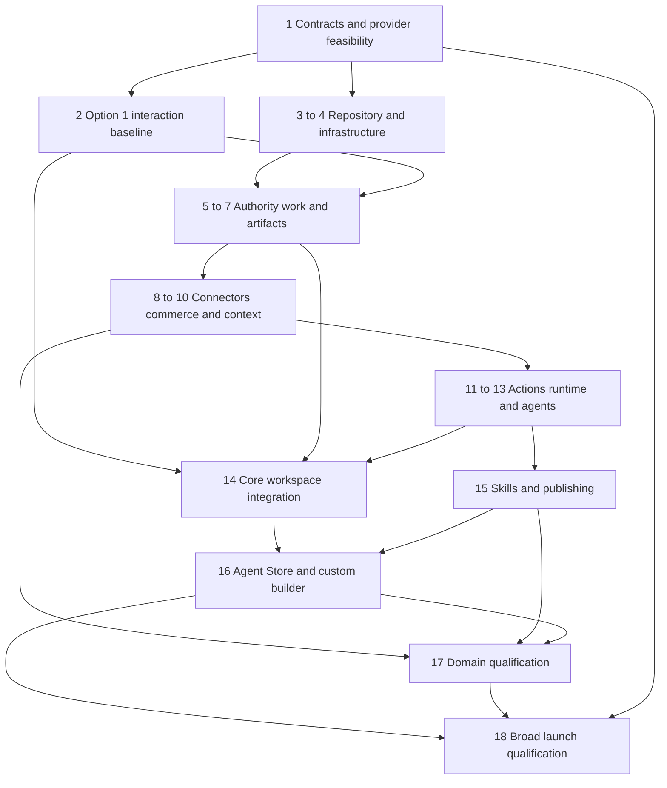

This build plan is the sole source of truth for what Morrow builds, how it is built, package order, and acceptance gates. The [Workspace Product Architecture and Day One Foundation](https://chatgpt.com/space/page_b399216c68208191a8cecc00a0287e54), [Skills and Agent Store design](https://chatgpt.com/space/page_c222d561201c81918c285c22c52a26a4), and UI foundation supply supporting detail only where consistent with this plan. Repository contracts and task packets implement the plan; they cannot silently override it. Proposed improvements must be reconciled into this Page before dependent implementation.

The destination is one complete production workspace for people and agents. Internal demonstrations prove dependencies as they are built; they are not separate narrow product launches. Authorization, enterprise identity, durable execution, collaboration, real integrations, privacy, evaluation, billing, and operational recovery are part of the launch foundation.

No delivery dates or staffing estimates are assumed. Package order follows technical dependencies. Several packages can progress together once their shared contracts are settled; ownership and scheduling follow when team capacity is known.

Current hosting decision on 14 October 2026: the owner selects Cloudflare Workers/Workflows/Queues/R2, Neon PostgreSQL and E2B isolated execution, retaining WorkOS. E2B replaces the prior unqualified Daytona choice for new implementation; older Daytona observations below are history, not active selection. Provider/account/image/network/terms and production qualification remain open; selection is not activation. AWS/CDK/Aurora/Fargate/Temporal below are superseded historical engineering observations only; no hosted resources existed and their account-selection questions no longer gate Morrow. Begin P04.T01a selected-stack reconciliation, preserving P05 local authority/SQL work and all real hosted acceptance gates. No provider provisioning, paid activation or migrated cloud data is claimed. Status on 6 October 2026: package 1 documentary design passed signed Codex semantic self-review (same implementer), qualifying local inputs rather than independent, merchant or production review. Foundation: 103 capabilities/14 domains, 116 core definitions, 206 capability bodies, 94 transitions and 12 billing definitions. Package 2 information architecture is self-reviewed; selected option 1 tokens, responsive frames and stateful prototype are review candidates with 44 URL tests and 54 recorded browser checks. Actual owners/specialists, native screen-reader findings and reviewer baseline approval remain unperformed; no human completion percentage is claimed, and feature UI is held. Package 3 standalone/connector/API/worker shells, 334 generated definitions/103 typed capability pairs and synthetic laboratory pass local self-review. Local delivery pipeline passes 515 tests, clean source-copy builds and nine scaffold guards; patched dependencies show zero npm advisories at observation. The private sultanhunter/Morrow foundation is published as draft PR #1 (https://github.com/sultanhunter/Morrow/pull/1). Hosted CI passed on commit 8fdf84fbf29c988d33855367e531f0c2d1d1b625, including the full pipeline and scaffold guards. Desktop/Morrow is saved, installed and tracks codex/morrow-foundation; twelve artifacts match independent clean builds. GitHub rejected private-main branch protection with HTTP 403 and requires Pro or an eligible organization; no upgrade was purchased and privacy was preserved. Sequencing correction: package 3's reproducible engineering/CI foundation is qualified for continued implementation; GitHub subscription eligibility does not block coding. Actual enforced repository protection remains mandatory before merging release code or privileged deployment, with manual review and draft PRs during development. No Pro purchase is requested to continue. Package 2 representative participant qualification remains pending and still precedes accepted feature UI. Package 4 now has deterministic, no-lookup CDK templates for development/staging/production, private encrypted/versioned storage, regional closed TLS/WAF ingress, database/transport definitions and a separate unrouted untrusted VPC reservation. The initial infrastructure candidate passed554 local tests; pinned CloudFormation validation reports no findings for all three templates. The actual isolated PostgreSQL17.11 local engine passes startup and transaction commit/rollback; its ephemeral container was removed. This does not qualify Aurora's regional minor, real IAM, rotation, restore, tenant authority or provider access. All actual provisioning inventories remain pending without account/qualification/complete regional quote/bound owner authorization; application services and dispatch remain absent/disabled. CDK2.272.0 has a bundled brace-expansion advisory: a checksum-verified replacement from locked upstream5.0.12 passes normal/deep nesting checks, while the original registry advisory remains recorded; no zero-advisory claim applies to this new dependency set. Hosted CI passed infrastructure commit54949de7a82c579e5a82a20c2e4beaf0cc7cca51 (run37490758758). Package4 identity/network candidate now passes589 local tests and regional CloudFormation validation: seven bounded roles per environment, broker-only credential retrieval, scoped private AWS dependency paths and effective-configuration binding for evidence/quote/cost approvals. Synthetic denials do not qualify actual AWS IAM or tenant authority. Independent clean reproduction matched fifteen artifacts and passed589 tests/nine scaffold guards; hosted CI passed identity commit befbaf6fd8fde32cab86c79eb21409c07886af51 (run37497806878). Operational/recovery candidates now pass592 repository tests and nine scaffold guards. Actual isolated PostgreSQL17.11 SCRAM rotation rejects failed/old candidates, verifies new login and retains committed SQL after abrupt client death. Actual local pg_dump/transactional pg_restore plus explicitly synthetic encrypted versioned objects detects missing/mismatched revisions, replays later erasure/revocation markers, validates foreign keys and keeps dispatch quarantined. Timings cover a tiny fixture, not production RTO/RPO. Allowlisted telemetry excludes arbitrary errors/content; dashboard/alert account/threshold/recipient bindings are pending. These reports do not qualify AWS Secrets Manager/Aurora/S3/Temporal, authenticated marker/reopening authority or live deployments. Remaining hosted qualification: designate the owner's AWS account, prepare complete bound regional costs, and qualify real development/staging identities/network/rotation/recovery through reviewed activation. Existing local profiles are not inferred to belong to Morrow. No paid provisioning is authorized. Independent local engineering has proceeded without a GitHub plan upgrade. No merge or deployment. All 18 packages, 80 tasks and 73 acceptance IDs remain. Selected: standalone Morrow/thin Shopify connector, paid managed-model work credits, US data, demand-scaled costs, Cloudflare public assets, AWS us-east-1/Aurora/Fargate, Temporal Cloud and WorkOS. No live installation, paid provisioning, merchant charges or production activation exists; classification/UI, billing eligibility, prices/terms, provider/account and engineering/launch gates remain unqualified. Hosted CI also passed operational/recovery source920e2a21f1dc5a3cc7032eb4f75138cd37a1933a (run37499932106), including both isolated container drills. Sequencing improvement: package4 engineering now qualifies local identity backend implementation and actual PostgreSQL17 tenant tests while cloud account/cost selection proceeds; actual package4/provider qualifications still gate hosted identity and activation. Start local identity engineering rather than blocking code on cloud signup. The canonical package sequence and all real acceptance/production gates remain. Package5 first local identity-persistence step is now an In-progress parent/local engineering candidate: an immutable application migration, private identity/session/membership records, same-organization workspace assignments, FORCE RLS projections and a strict server-only parameterized read transaction. Only a separate unprivileged runtime login may read an eligible workspace; maintenance authority is explicit and never inherited. Actual pinned PostgreSQL17.11 passed31 checks, including cross-merchant denial, committed revocation between statements, proof expiry/revocation, privilege/escalation denial and failed-migration rollback. Full613 repository tests and nine scaffold guards passed in both working and separate clean locked trees; fifteen build/template artifacts matched. These are local candidate/self-review observations, not WorkOS authentication, capability authority, audited lifecycle completion or hosted acceptance. Real routes still deny unqualified identity. Next local work: lifecycle/provider boundary interfaces, audited commands and shared capability authorization; hosted provider accounts and actual package4 remain required for activation. The local human-permission kernel now passes69 targeted decision cases and682 repository tests in working and separate clean locked builds. Nine application guards and31 actual SQL identity checks also passed in the clean tree; fifteen application/template artifacts matched. The kernel denies stale or ambiguous grant facts, cross-resource/account/field selection, approval-as-execution, merchant platform-publisher authority and unqualified agent/automation identities. Every call reloads its reader facts; allowed decisions retain execution obligations. The reader is still a typed port with synthetic current-fact fixtures, not an implemented SQL grant/lifecycle or HTTP/dispatch authorizer. Keep package5 lifecycle and shared authorization In progress. Hosted CI passed identity source0194e3ceac8faa1accfde9608be167396ea98ec3 (run37506347298); permission-kernel source still needs publication/current-head CI. Next implement the audited grant/current-authority database integration and qualified identity-provider boundary, preserving all hosted/production gates. SQL-backed local workspace-permission continuation now passes698 full repository tests and22 actual application/PostgreSQL boundary checks in both working and separate clean locked trees, with nine scaffold guards and fifteen matching artifacts. A second immutable migration binds grant ownership relationally and in JSON; FORCE RLS permits only the current actor's workspace grants and denies runtime issuance/writes. Actual application read transactions feed fresh SQL identity/workspace/grant facts to the shared kernel. Scope/grant denial precedes constraint lookup; SQL authority reloads after it, so changed policy or removed membership cannot return the earlier permission. Malformed stored grants, tenant-binding drift and failed second migration deny/rollback. Only identity-owned workspace resources resolve. The persistent psql adapter/session issuer and provider/entitlement facts are explicitly local test facilities, not production pool/WorkOS/TLS/IAM/HTTP/dispatch qualification. Audited lifecycle, provider-backed sign-in, resource integrations and command serialization remain required; package5 stays In progress. Hosted CI passed the pure permission source f8941d7c99a571e778488a1426a94378101ae48c (run37508391061); current SQL continuation still needs publication/CI. The owner AWS-account designation and WorkOS-project setup questions are pending; do not infer another project's credentials or provider configuration. All18 packages/80tasks/73cases and actual hosted/launch gates remain. Hosted CI now also passed SQL-backed source16fcdd7fd6e60413bdb10dbe23cffbf2408ee15c (run37511141168), including the698-test build, nine application guards, all four isolated PostgreSQL laboratories and regional template validation. The actual Desktop repository was safely aligned, its locked dependencies installed/repaired and all strict types/106 targeted identity-policy cases passed; the tree was clean. Package5 remains In progress: no production driver, WorkOS sign-in/SSO/provisioning, audited lifecycle/issuance, real domain/HTTP/dispatch authorization or launch acceptance is conferred. The two pending provider setup choices are needed for actual cloud and identity-provider integration; existing unrelated account profiles are never inferred as Morrow. Preserve these checked local implementations and resume from the audited lifecycle/provider-boundary work once owned account/project configuration is established. On10October2026, the signed-in owner's WorkOS team now has a new Morrow project with staging only and a default application named Morrow Workspace. The owned staging environment/application/client identifiers are recorded as non-secret integration selectors; production was left out and no key was copied, callback configured, user invited or provider login activated. Actual WorkOS sign-in/SSO/provisioning qualification is still pending. Local authentication-challenge engineering continues under package5's existing engineering permission. The local pre-authentication challenge candidate passed45 targeted cases and743 repository tests in working and fresh locked trees, nine application denial guards and31 actual isolated PostgreSQL challenge checks in both trees; fifteen build/template artifacts match. Real concurrent consumption has exactly one winner. Expiry after row-lock waiting is checked using database wall time after acquisition; application/environment/callback rebinding, browser mix-up, direct private-table writes, escalation and failed-migration rollback are denied. Existing31 identity and22 permission SQL cases, rotation and quarantined restore drills also passed. These are engineering/self-review observations; cookie/origin/rate controls, provider exchange/PKCE, audited issuer/provisioning and actual hosted identity remain pending, and real entry routes stay disabled. Challenge source e7b7805ebd5e3bc445bf2f2d46610d9776b9883c passed hosted CI38006242566, including743 tests, all five isolated database laboratories, nine application guards and regional template validation. Desktop/Morrow is saved and aligned clean; its identity types and45 targeted challenge cases pass. The next actual provider/infrastructure integration still needs the designated Morrow AWS account and controlled staging credential handling; the owner is unavailable, so these inputs stay pending rather than using another project's profiles or exposing credentials. On10October2026 the owner rejected the inferred blanket US-only processing requirement. US remains the default primary storage region; approved global processing is permitted, with regional-processing restrictions only for an explicit customer contract or applicable obligation. The regional AWS baseline remains an undeployed implementation candidate; a Cloudflare backend/external sandbox/serverless PostgreSQL replacement is under comparison, not activated or selected by this correction. Remove US-only default gates from provider/model-policy consumers when refreshing the affected decisions and packets; preserve provider retention/deletion, tenant authority and credential isolation checks. E2B account setup on14October2026 created the approved Morrow workspace and Morrow-staging Hobby project in US-WEST-1. Current console blocks all workspace APIs until a payment method is added; workspace credit is$0 with no cards. Live tests remain blocked; no key, sandbox, paid plan or card was created. The personal trial is separate and must be qualified before any alternative use. The pinned E2B SDK's automatic redirects are unqualified for credential-bearing execution. Live P04.T01h uses the documented native control-plane and fixed envd file APIs with redirects denied; SDK remains a pinned type/wire conformance reference. Real access/testing stays gated.

Design reference: [UI UX and Visual Foundation](https://chatgpt.com/space/page_bbb9d8ed22008191ba32290a4d6cc362).

## Recommended engineering defaults

Use TypeScript and React for the application, a modular TypeScript backend on Cloudflare Workers, Neon PostgreSQL for authoritative business records, Cloudflare R2 for artifacts, Cloudflare Workflows and Queues for durable execution and transport, and a replaceable isolated execution provider for code/browser work, with E2B as the selected unqualified provider. Keep replaceable model, connector, database and runtime adapters. Separate deployed Workers where secrets, authority or execution requires isolation, while retaining shared contracts in one repository. Specialized Python processes run only inside an approved execution profile for a justified workload. WorkOS remains the identity provider; Morrow owns all authorization. Morrow owns the harness, lease/budget enforcement, authoritative checkpoints and artifact storage. Provider-specific SDKs and handles belong in server-side runtime adapter modules; agent definitions, business tools, policy and the harness must not depend on a vendor SDK. Provider choice is a versioned qualified configuration, never model-selected authority.

The goal is a foundation that can grow without replacing its authority, work, and execution contracts. It does not require starting with dozens of independently deployed services. Module boundaries, dependency tests, ownership, and operational evidence establish modularity. A database migration, connector release, skill release, and workflow release each need an appropriate compatibility strategy.

Long-lived workflow changes need explicit versioning. Pin a workflow implementation/version and compatible configuration to each run; preserve old versions for live waits, test approval/event delivery after deployment, and reconcile database state before continuation. PostgreSQL owns business truth; Cloudflare Workflows owns resumable execution checkpoints. Worker rollback is not database rollback and does not undo provider effects. Qualify actual version retention, wait limits and upgrade behavior in P06/P12 before activation; Temporal replay semantics must not be assumed. [Workflow versions API](https://developers.cloudflare.com/api/resources/workflows/), [Worker versions](https://developers.cloudflare.com/workers/versions-and-deployments/)

## Product surface and design gate

Build one standalone React workspace application on Morrow's web origin with shared feature screens, logical routes, accessible components, state contracts and business behavior. Shopify is a thin integration app for managed installation/OAuth, verified store/workspace linking, connection status, reconnect/disconnect and return to Morrow. No full merchant workspace is rendered inside Shopify Admin in this release. Use Shopify CLI and the supported Shopify React Router template/package for the integration boundary; use App Bridge/Polaris only where the qualified connector surface requires them. Workspace domain screens do not import Shopify host SDKs. Credentials, policy, context, connectors, orchestration and consequential execution remain in backend services. Shopify connector-only/non-embedded classification, applicable UI review and billing treatment are external qualification gates; product selection is not App Store approval. A future embedded workspace is a new reviewed scope change, not a current parity obligation. [Shopify integration guidance](https://shopify.dev/docs/apps/build/integrating-with-shopify), [Shopify React Router package](https://shopify.dev/docs/api/shopify-app-react-router/latest), [App Store requirements](https://shopify.dev/docs/apps/launch/shopify-app-store/app-store-requirements)

Standalone Morrow contains Home, Work, conversations, Inbox, approvals, Assets, Agents, Agent Store, Knowledge and Settings. Responsive layouts collapse secondary panes into accessible tabs or drawers without removing workflows. Maintain a surface responsibility matrix: complete domain work belongs to standalone; the Shopify connector has only installation, identity linking, connection controls and safe return. A connector return reauthenticates and resolves existing authorized records without duplicate work, widened permissions or retargeted proposals. A connector status screen is not a second workspace or a commerce-command surface. All domain services remain independent of frontend placement.

Visual option 1 is selected, using shared project tabs, contextual agent conversations, and a persistent decision inbox. Its spacious standalone study is the visual reference for the shared workspace; package 2 defines its desktop and narrow-browser compositions plus connector states. Retain earlier studies as references. Resume package 1 contracts before package 2 completes states, prototypes, and the reviewed baseline. Preserve every package dependency.

Build visible end-to-end paths throughout the established sequence. After package 1 contracts and package 2's reviewed baseline, implement each shared feature once and exercise it through standalone entry and qualified connector handoffs as identity and task APIs qualify. Add real records, reviewable actions, and recoverable agent runs incrementally. Package 14 completes common workspace integration; package 16 completes agent lifecycle interactions in standalone desktop/narrow layouts and applicable connector journeys and package 17 qualifies domain journeys.

## Launch coverage matrix

For every row, the implementation backlog must name real providers, exact operations, required scopes, artifacts, verification rules, and release evidence. A generic SDK, placeholder agent, or mocked connector does not complete a row. Provider names still awaiting selection are decisions to resolve, not an implicit reduction in launch scope. Give each capability a stable identifier linking its scope, UI journey, connector operation, skill or agent release, implementation packet, test cases, and release evidence. A blocked promised operation stays in the scope and dependency register until resolved or the owner explicitly changes the release commitment.

| Domain | End to end capability to qualify | Essential boundary |
| --- | --- | --- |
| Workspace coordination | Scope goals, assign humans and agents, track dependencies, ask questions, report results | Responsibility is separate from permission |
| Catalog | Audit products and variants, draft changes, review and publish supported fields | Field and resource scope, source authority |
| Search and discovery | Inspect pages, use search evidence, prepare improvements, verify publication and observe results | No guaranteed citations or invented measurements |
| Creative | Brief, generate, inspect contact sheets, revise, approve, attach media | Generation budget, product fidelity, asset provenance |
| Merchandising and analytics | Governed reports, anomaly investigation, assortment proposals and approved changes | Metric definitions, currency, attribution and coverage |
| Paid acquisition | Real Meta Ads connection, reporting, campaign preparation and specifically approved execution | Account, audience, publication and spend grants |
| Lifecycle marketing | Segments, campaign briefs, content, review, supported channel execution | Consent-aware provider behavior and send authority |
| Customer support | Grounded case investigation, replies, escalation and qualified case actions | Customer data, communication and refund separation |
| Orders and fulfillment | Exception triage, state checks, coordination and supported actions | Order state, staff grants and provider constraints |
| Inventory | Reconciliation, stock risk, proposed adjustments and authoritative updates | Location scope and configured stock authority |
| Finance | Cost and margin evidence, discrepancy analysis and reconciliation tasks | Sensitive-data isolation and explicit uncertainty |
| Storefront | UX evidence, proposed changes, theme implementation, preview and approved publication | Accessible previews and controlled release |
| Governance | Access reviews, usage, audit export, policies and administration | Eligible human decisions and traceable changes |
| Custom agents | Describe, configure, test, install, schedule, revise and retire a role | Approved capabilities and bounded mandates |

## 1 Product contracts and external dependencies

Define the capability matrix, business objects, action classifications, source authority, responsibility model, retention classes and quality criteria. Turn broad requests into exact operations with completion evidence. Record the standalone workspace plus thin Shopify connector, hosting, identity/linking, orchestration, runtime isolation and initial providers. Produce a surface responsibility matrix for every launch workflow: standalone feature/route, responsive composition, identity/store scope, and any connector handoff; deny domain execution from the connector surface. Include complete everyday business work in Morrow and connection status/control in the connector. Evaluate public distribution, connector UI review and Built for Shopify eligibility separately; do not claim any from the UI choice. Define workspace-first, install-first and existing-account linking with single/multi-store ownership. Keep billing responsibility, subscription entitlements, work credits, monetary liabilities and task spending authority separate. [Shopify integration guidance](https://shopify.dev/docs/apps/build/integrating-with-shopify)

Start Shopify distribution, app review, protected-data, billing, and provider-access work immediately. Some submissions need a runnable app; prepare their evidence now and submit as soon as prerequisites exist. Public distribution and customer-data access have distinct requirements. [Shopify distribution](https://shopify.dev/docs/apps/launch/distribution), [Protected customer data](https://shopify.dev/docs/apps/launch/protected-customer-data) For each provider operation, track its accountable owner, test account, API, scopes, protected fields, plan/region restrictions, production approvals, submission prerequisites, evidence, status, and package blocked. Separate access to historical orders and permission to modify themes where applicable. Split storefront execution into analysis, app-owned extensions, and merchant-theme modifications: themeFilesUpsert requires write_themes and a Shopify exemption; an extension does not grant unrestricted theme editing. [Theme write requirements](https://shopify.dev/docs/api/admin-graphql/latest/mutations/themeFilesUpsert), [Theme app extensions](https://shopify.dev/docs/apps/build/online-store/theme-app-extensions)

**Build artifact:** reviewed operation and surface responsibility matrices; permission matrix; versioned core contracts and state diagrams; infrastructure and identity decisions; billing ownership rules; provider feasibility and approval tracker; workload, quality, cost, and recovery targets; bounded implementation packets with acceptance cases.

**Demo:** walk a small brand and an enterprise team through the same collection-launch scenario.

**Tests and exit gate:** every advertised operation has an accountable owner, authorization route, provider dependency, surface, failure behavior, and verification method. Core state ownership, deployment and identity boundaries, runtime isolation approach, billing responsibility, and acceptance thresholds are recorded before dependent implementation. External reviews that require a runnable app may remain pending with an owner, submission prerequisite, and explicit activation/launch gate; they are never treated as granted. The package 1 walkthrough tests both a small brand and a specialist team against these contracts.

### Package 01 implementation tasks

**Product contracts and external dependencies.** Input: the agreed broad release scope, selected option 1 and one full standalone workspace plus a thin Shopify connector. Materialize reviewed specifications before dependent implementation; preserve all 18 packages.

1. **P01.T01 Capability and authority catalogue.** Give every advertised operation a stable capability ID, accountable owner, provider or tracked selection decision, proposed input and output schema, eligible principal, resource and field scope, source authority, effect, retention and verification rule. Map every capability to a shared journey, task and acceptance case. **P01.A01:** Given an owner and restricted specialist, when each requests a sensitive operation, then the matrix identifies the permitted path or explicit denial without granting authority through an agent. **Done:** reviewed `docs/contracts/capabilities.md`, permission matrix and traceability report.

2. **P01.T02 State and shared workspace contracts.** Specify work, approval, question, artifact, operation and event ownership, revisions and compatibility. Define `HostContext`, logical route catalogue and narrow host ports for authenticated entry, navigation, save protection and feedback; domain screens and workflows remain shared. Specify install-first, workspace-first, existing-account linking, multiple stores and store-switch behavior. **P01.A02:** Given either host, when an existing proposal opens, then identity, target store and immutable approval binding are unambiguous. **Done:** versioned `docs/contracts/` schemas, transition tables and failure cases.

3. **P01.T03 Provider and deployment decisions.** Qualify the infrastructure candidate, identity, isolation, regions, recovery, capacity, model cost and quality targets. Record each provider's exact API, test account, scopes, restrictions, billing route, review prerequisites and launch blocker; theme writes require documented Shopify permission and exemption feasibility. **P01.A03:** Given an ungranted production approval, when feasibility is reviewed, then status remains pending and activation blocked. **Done:** `docs/decisions/` records and external dependency register.

4. **P01.T04 Package readiness review.** Resolve billing ownership, entitlements, usage, cancellation and store removal; approve ownership, dependency and evidence rules. Walk through small-brand and specialist-team cases, including unavailable capabilities. **P01.A04:** Given an unresolved structural decision, when a dependent packet requests Ready, then it cannot advance. **Done:** signed review, unresolved approval gates and `docs/acceptance/P01.md`; no claim that infrastructure or external access already exists.

### Package 1 decision register

The product audience, broad release scope, one complete standalone workspace plus a thin Shopify connector, and visual option 1 are settled. Complete these records before starting implementation that depends on them. Give each record an accountable owner, decision date, affected contracts, and evidence; assign actual owners when the work packet starts.

| Open record | Required decision or evidence | Completion boundary |
| --- | --- | --- |
| Capability and feature parity | Exact actions and outputs for every launch domain; shared workflow and host adaptations; permission and acceptance cases | Package 1, before dependent UX and schemas |
| State and authority contracts | Tenant/store ownership; human and automation grants; questions, approvals, operation states; version and event semantics | Package 1, before packages 3 to 6 consume them |
| Provider feasibility | Actual APIs, scopes, restrictions, test accounts, approval routes, and blocking dependencies | Feasibility in package 1; production grants before activation and launch |
| Infrastructure and runtime | Hosting, identity, regions, retention, isolation approach, workload/cost model, recovery and quality targets | Design decision in package 1; measured proof in packages 4 and 12 |
| Billing and entitlement ownership | Single-store/multi-store payer, approved billing path, shared usage, cancellation, store removal, and outstanding charges | Package 1; integrated billing evidence in package 18 |
| Delivery ownership | Bounded task packets, owner/reviewer, required environment, dependencies, evidence and change-control rules | Before each packet becomes Ready |

Package 1 closes through reviewed contracts and feasibility decisions. Runtime measurements and provider reviews that require later software retain explicit owners and gates. A missing structural decision blocks the work that depends on it; independent research and contract work can continue.

### Required contract inventory

Package 1 must produce the following versioned specifications before their consumers become Ready. Every contract records its owner, schema version, field types and nullability, validation, trust boundary, command/query semantics, structured errors, authorization, sensitive-data handling, compatibility, and acceptance examples. Include representative requests and responses or valid/invalid fixtures; diagrams alone are insufficient. Package 3 turns the reviewed shapes into executable schemas. File names below are planned repository locations, not claims that files already exist.

| Specification under docs/contracts | Minimum decisions and examples | First package |
| --- | --- | --- |
| identity-authority.md, workspace-linking.md, automation-mandates.md | Organization/workspace/store keys; authenticated principal; membership and provider-permission constraints; distinct view/propose/approve/execute/delegate grants; deny reasons; verified linking; mandate owner, scope, budget, expiry and revocation | 5 |
| work-state.md, events.md, execution-payloads.md | Goal/task/run/question/approval/operation states; allowed transitions and actor; immutable IDs; expected revisions; command ID and request digest; transactional delivery; ordering scope; early answers; cancellation; safe payload references and retention | 6 |
| artifacts.md, collaboration.md | Revision identity and lineage; edit conflicts; comments and table/image anchors; working versus shared files; access and derived restrictions; upload states; cleanup; takeover rules | 7 |
| connector-sdk.md, shopify-sync.md | Capability IDs; typed inputs/outputs; scopes and account identity; credential lifecycle; pagination/checkpoints; errors; retries and actual idempotency; async job verification; webhook/version ordering; tombstones and reconciliation | 8 and 9 |
| context-memory.md, source-authority.md, metrics.md | Fact/knowledge/lesson/hypothesis distinctions; source precedence; permission-filtered retrieval and lineage; freshness; money/currency/timezone semantics; metric definitions and missing-data behavior | 10 |
| action-execution.md, approvals.md, budgets.md | Immutable proposal and exact approval binding; current-policy checks; preconditions; operation states and uncertain outcomes; provider readback; resource coordination; reservation, liability and settlement; stop and repair controls | 11 |
| runtime-execution.md, schedules.md | Execution profile, leases and generations, files/network limits, checkpoints, current-grant recheck, workflow compatibility, schedule timezone/overlap/missed-run policy, task-tree limits and cleanup | 12 |
| model-gateway.md, agent-loop.md, run-manifest.md | Allowed provider/data policies; normalized outputs and failures; inference outside deterministic replay; loop termination; routing/delegation; evidence-based completion; pinned versions, context reconstruction and usage | 13 |
| workspace-host.md, workspace-routes.md, screen-contracts.md | Host bootstrap and authentication; logical route to host URL mapping; store context; native controls; shared screen data/commands/states; persisted draft handoff; width adaptation and parity cases | 2 specifies interaction details; 3 scaffolds; 9 and 14 qualify |
| skill-release.md, agent-installation.md | Namespace/version/digest; sources and resources; compatibility and lockfile; evaluation and publication states; provisional samples; overlays/authority binding; activation, upgrade, retirement and revocation | 15 and 16 |
| billing-entitlements.md, service-identities.md, recovery.md | Payer/installation ownership and allowed billing path; consumption versus entitlement; service/network permissions; retained liabilities; quarantine, deletion/revocation replay and cross-system restore reconciliation | 4 starts infrastructure; 18 qualifies integration |

Cross-cutting invariants: tenant/workspace identity is resolved by trusted server authentication; request IDs select resources but do not grant access. A repeated command with the same tenant-scoped command ID and request digest returns the existing outcome, while reuse of that ID with a different request body is rejected. A retry cannot create a new logical provider operation. Approvals bind the exact proposal, resource/store scope, revisions, limits, reviewer, and expiry; policy and preconditions are rechecked before dispatch. Unknown provider outcomes remain uncertain until reconciled. Equivalent resolved identity, grants, provider permissions, and resources produce equivalent policy decisions in standalone browsers/sessions and applicable connector handoffs.

An event envelope must identify schema version, event and aggregate IDs, tenant/workspace and applicable store, aggregate revision or declared ordering position, correlation/causation, actor reference, timestamp, and an allowlisted payload or authorized reference. Timestamps alone are not ordering guarantees. An error contract distinguishes retryable transport failures, provider rejections, conflicts, missing input, denied access, expired approval, exhausted budget, and uncertain external effects without leaking protected content. Schema choices and exact field names become binding only when their package 1 contract is reviewed.

### Package 1 core contract decisions

P01.T02 materializes a versioned JSON Schema 2020-12 contract baseline and representative valid/invalid fixtures, using pinned standard validators for documentation checks. Package 3 generates application validators and clients from the reviewed shapes; documentation checks do not implement production authorization. Internal IDs are opaque, revisions are bounded monotonic integers, UTC timestamps record observations, and event ordering uses aggregate revisions plus an opaque resumable stream position. Timestamps never establish ordering.

PostgreSQL-owned records define tenant/workspace/store ownership, membership/grants, goals/tasks/runs, typed questions and answers, artifact revisions, immutable proposals, exact approval decisions, operation outcomes, usage and budget liabilities. The orchestrator owns durable execution progress and projects it back through transactional outbox/inbox delivery. Authenticated principals and provider permission facts are resolved server-side; client host flags, selected stores and email matching cannot establish authority. Delegated and scheduled work intersects current originating/owning grants, installation scope, provider constraints and the explicit mandate, including revocation and expiry.

A proposal names exact resources/accounts, fields/parameters, expected versions, currency/cost ceiling and applicable review policy. A SHA-256 digest of canonical proposal content binds review to that immutable revision. Changes require a new proposal and review. Approval decides a proposal; it does not recursively need another action approval and cannot create a missing execution grant. Provider uncertainty is an operation state requiring reconciliation, never permission for blind replay. Money uses decimal strings with explicit currency; reporting windows preserve timezone and attribution definitions.

HostContext is a server-authenticated standalone workspace bootstrap description, not a client-issued authorization token. One logical route catalogue and screen tree serve the workspace. A separate constrained connector context identifies a verified Shopify installation and eligible connection controls; it cannot act as a full workspace session or authorize domain capabilities. Narrow ports cover authenticated entry, logical navigation, save protection, feedback and authorized external handoff. A single-use connector-to-Morrow handoff preserves eligible principal, workspace/store references and any persisted approved resume target; reauthenticate and reauthorize before use. Workspace-first, install-first, existing-account, invited-member and additional-store linking verify installation and eligible membership separately with explicit conflict handling. Existing draft version-one host enums are narrowed before release; legacy cross-host fixtures become negative unsupported-surface cases rather than evidence of embedded support.

Core contract review covers allowed state transitions, actor and precondition, early answers, stale revisions, cancellation with submitted effects, duplicate commands/events, redacted failures, derived artifact restrictions and connector return and browser/session continuity. Provider-specific nested domain projections, exact activation permissions, deployment region, retention durations, billing and runtime profiles remain explicit P01.T03/P01.T04 decisions. Dependent packets cannot become Ready while a consumed decision remains open; those decisions must be reconciled here before dependent code.

### Infrastructure baseline for qualification

P01.T03 hosting decision on 14 October 2026: the owner selects Cloudflare, Neon and E2B. Cloudflare Workers hosts public assets, private application APIs and trusted connector/broker services; Workflows and Queues replace Temporal orchestration/transport; R2 replaces S3 artifacts; Neon replaces Aurora; E2B Linux microVM sandboxes are the unqualified execution candidate, replacing the earlier Daytona selection; vendor-neutral runtime ports remain required. WorkOS identity and managed-model work credits remain selected. This supersedes the undeployed AWS/CDK/Temporal hosting baseline, not the validated local SQL and authority implementations. No cloud data migration is necessary because no Morrow resources were deployed. Preserve all 18 packages and acceptance cases. Separate provider accounts/projects and deployment identities by environment, with owned US primary storage and approved global processing. Selection authorizes local implementation; hosted account access, provider qualification and paid resource activation remain distinct. [Cloudflare Workers](https://developers.cloudflare.com/workers/), [Neon plans](https://github.com/neondatabase/website/blob/main/content/docs/introduction/plans.md), [E2B sandboxes](https://docs.e2b.dev/sandbox)

Merchant-owner decisions on 6 October 2026: the default region for primary merchant-data storage is the United States. The owner's 10 October 2026 correction removes the inferred blanket US-only processing requirement: global request processing and approved external-provider execution are permitted subject to documented provider terms, tenant authority and data handling. A storage-region preference is not an end-to-end residency promise. Regional processing restrictions apply only to an explicitly agreed customer contract or an applicable obligation; do not invent one from the initial region answer or require an enterprise localization add-on by default. Record provider storage, processing, retention and deletion behavior separately in P01.T03. Infrastructure should scale with usage and customer demand, with no arbitrary monthly ceiling. Compare variable rates and unavoidable fixed minimums, retain the agreed reliability/isolation requirements, and meter usage by tenant. This preference does not authorize paid provisioning or remove per-run merchant budgets. Keep development local where practical; record a concrete staging cost model before activating billed resources. Commercial decision on 6 October 2026: all merchant plans are paid; Morrow supplies managed model APIs and pays inference providers. Merchant ChatGPT/Claude subscriptions and API keys are not required for onboarding. This supersedes the earlier BYOM-first pricing idea. Target independent brands and enterprise specialist teams with the same governed workspace; enterprise capacity, identity services and contractual commitments require their own costed qualification. Final tier amounts remain provisional until workload measurements and commercial selection. Pricing direction: offer paid monthly packages of agent-work credits with the workspace included, plus explicitly purchased or owner-capped additional credits. Use a single merchant consumption balance; no separate infrastructure usage bill or CPU/storage/concurrency tier ladder. Complete agent work, not raw model tokens alone, determines credit consumption. Shared persistent costs and enterprise commitments still need coverage by minimum package revenue and costed enterprise contracts.

| Responsibility | Selected design | Qualification boundary |
| --- | --- | --- |
| Workspace and ingress | Cloudflare Workers Static Assets, Workers and DNS | Standalone workspace plus thin Shopify connector. Private HTML/API/session/artifact responses are uncached and authenticated. Global processing is permitted; US-only processing is required only by explicit obligation. |
| Trusted application services | Separate API, connector, broker and orchestrator Workers | Environment-specific bindings and service identities; broker-only merchant/model credential access. Admission, current permissions and budgets outside prompts. Workers never execute generated code. |
| Authoritative records | Neon PostgreSQL, US primary storage | PostgreSQL 17-compatible major and actual region/minor qualified before use. Separate environment projects and least-privilege SQL logins, FORCE RLS, bounded interactive transactions and pool-context isolation. Launch can serve development; Scale is the production candidate, with provider availability/recovery qualification. |
| Artifacts | Private Cloudflare R2, US storage | Immutable application revision keys plus checksum/manifests and conditional creation; do not assume S3 object versioning. All reads/transfers and erasure are mediated by current tenant policy. |
| Durable execution | Cloudflare Workflows plus Queues | Opaque references and safe enums in execution state; PostgreSQL business state/outbox/inbox authoritative. Duplicate delivery, provider uncertainty, long waits, workflow versions and restore reconciliation require actual tests. |
| Identity | WorkOS AuthKit, optional SSO and Directory Sync | Existing owned Morrow staging project retained. Provider proves identity; Morrow owns grants and Shopify linking. Terms, callback/session/provisioning behavior and enterprise connection costs remain qualification inputs. |
| Secrets and operations | Broker-only Cloudflare secret bindings, encrypted credential records and redacted telemetry | Platform root credentials are unavailable to ordinary Workers and untrusted execution sandboxes. Per-connection encrypted credentials have tenant/environment-bound authenticated encryption; key custody, rotation and secret-service suitability are qualified in P04/P08. Beta Secrets Store is not assumed production-qualified. |
| Untrusted code and browsers | E2B Linux microVM sandbox with scoped persistent working files | Actual VM/image/account/network/lifecycle guarantees qualified before merchant execution; separate synthetic operator labs do not qualify protected data. E2B project keys stay outside guests; immutable template builds and source-bound operation metadata are required. No database, raw merchant/model/platform keys or unrestricted internet. Only leased broker/proxy access; private/metadata addresses, redirects, rebinding and alternative protocols denied. P12 validates isolation, pause/resume, cancellation and cleanup. |

Cloudflare hosts frontend and backend while Neon supplies PostgreSQL and Daytona supplies agent computers. D1 is not the authoritative store. Start with a qualified Neon driver supporting interactive READ COMMITTED transactions and SET LOCAL tenant context; test reuse and concurrent tenant requests before pooling. Hyperdrive is optional only after its driver/session/caching behavior passes those tests; no double database layer or cached authorization facts. API-only work can execute through trusted Workers without allocating a Daytona sandbox. [Neon driver](https://neon.com/docs/serverless/serverless-driver), [Hyperdrive](https://developers.cloudflare.com/hyperdrive/)

Use versioned Cloudflare deployment configuration, Neon project/branch/role settings and Daytona image/runtime profiles in P04. Keep AWS templates and observations as explicitly superseded historical evidence, excluded from active selection and provisioning readiness. The pending AWS-account designation is obsolete; do not request AWS credentials or create AWS resources. Requalify service identity, ingress, egress, actual transaction behavior, private artifacts and recovery on the selected providers. No AWS/Temporal account is a dependency. Global processing is permitted; enterprise localization is not required by default. Demand scaling includes Cloudflare's base charge, persistent storage, database activity, reserved sandbox wall time, provider funding/quotas and enterprise identity. Idle storage is not free merely because no model call is running. Complete environment-bound cost and provider qualification precede paid activation. [Workers pricing](https://developers.cloudflare.com/workers/platform/pricing/), [Daytona billing](https://www.daytona.io/docs/billing/), [Secrets Store beta](https://developers.cloudflare.com/secrets-store/)

### P01 provider, cost and qualification decisions

Design selections: Shopify public distribution with GraphQL Admin API 2026-10 and quarterly compatibility review; Google Search Console v1 with read-only authorized property access; Meta Marketing API v26.0 through the credential broker; Klaviyo with revision 2026-07-15 for lifecycle marketing; Gorgias public-app OAuth for support. Meta advanced access, Shopify protected data/historical orders/theme exemption, Google verification, lifecycle/support app review and controlled accounts remain tracked gates. An observed API or browser login grants none of these. Exact scope and provider payload validation belongs in the versioned provider-binding register and connector conformance packets. Preserve all advertised domains. [Shopify versions](https://shopify.dev/docs/api/usage/versioning), [Meta's official collection](https://www.postman.com/meta/facebook-marketing-api/documentation/0zr4mes/facebook-marketing-api-mapi), [Klaviyo OAuth](https://developers.klaviyo.com/en/docs/set_up_oauth), [Gorgias public apps](https://developers.gorgias.com/docs/private-vs-public-app)

Provider completion boundaries: Shopify extension activation uses the supported merchant theme-editor deep link, preview and explicit Save; it is a human handoff from Morrow to Shopify's theme editor, not an invented automated activation API. Opening the link does not complete the task; qualify the authorized saved configuration/readback in P17. Unrestricted merchant-theme writes remain behind the exemption gate. Finance uses Shopify unit-cost/order/refund facts plus merchant-authorized, versioned cost/fee/shipping ledger imports; unavailable costs remain unknown, never zero. Analytics starts with governed facts from Shopify, Meta and Klaviyo, explicit coverage and provider attribution; it does not claim parity with all Shopify Analytics reports. Search indexing/observation remains evidence rather than a promised outcome. Context retrieval starts with PostgreSQL full-text search and permission-filtered structured projections; add an embedding index only after its provider/data/cost contract qualifies. These selections retain every launch domain and require provider payload/import schemas before connector implementation. [Extension configuration](https://shopify.dev/docs/apps/build/online-store/theme-app-extensions/configuration), [Inventory costs](https://shopify.dev/docs/api/admin-graphql/latest/objects/InventoryItem)

Merchant model gateway design: Morrow-managed provider credentials and provider billing; never expose platform keys to merchants or agent runtimes. Merchants select task goals/quality and spending limits rather than configuring model accounts. Qualified routing and premium escalation must remain within approved data and cost policy. Selected adapters: OpenAI Responses API, GPT-6.1 Sol for general work and selectively approved GPT-6 Astra escalation; direct Images API with GPT Image 2.5 Sunburst for product generation/editing. Model identifiers are documented provider aliases, not invented immutable snapshots. Pin routing configuration and available provider versions, detect changes and re-evaluate before rollout. No automatic fallback to an unapproved data region/provider. Use store:false; selected endpoint eligibility, processing/retention/deletion terms and applicable data controls require account evidence before protected content is sent. A US regional endpoint is required only for an explicit customer or applicable regional-processing obligation, not for Morrow's default storage preference. Controlled web-search observations are labelled API observations, not consumer-chatbot market share or guaranteed citations. Development model selection remains GPT-6.1 Sol High. [OpenAI models](https://developers.openai.com/api/docs/models), [Data controls](https://developers.openai.com/api/docs/guides/your-data), [Image generation](https://developers.openai.com/api/docs/guides/image-generation)

Billing design: paid monthly agent-work credit packages include the workspace and ordinary shared service capacity. Credit quantity is the main standard-plan difference; do not publish a separate infrastructure meter or tier-specific CPU/storage/concurrency ladder. Publish complete-work credit rates and service limits. No free merchant tier. Additional AI work requires explicit purchase or an owner-authorized capped spending mandate; automatic top-ups default off. Use Shopify App Pricing as the selected default for applicable public-installation charges, regardless of workspace UI placement. External routes and revenue treatment remain qualification gates. The Shopify shop installation is the billing principal; organization/workspace membership does not create pooled subscriptions. Every paid run reserves one eligible installation/cost center before dispatch; multi-store work has explicit allocations and cannot silently charge another shop. Shared entitlements do not confer data authority. Track entitlement, usage liability and invoiced status separately. Server-side subscription reconciliation determines current access; return URLs and client plan handles are not proof. Morrow enforces its own spending limits because Shopify App Pricing does not enforce usage caps. Cancellation stops new paid dispatch, retains incurred liabilities and bounded reconciliation, and leaves export/deletion available. Uninstall revokes shop access immediately without deleting other shops' authorized work; privacy requests have their own lifecycle. Pricing amounts, merchant-facing terms and any enterprise exception are launch decisions; no direct billing bypass is selected. [Shopify App Pricing](https://shopify.dev/docs/apps/launch/billing/shopify-app-pricing), [Billing requirements](https://shopify.dev/docs/apps/launch/billing)

Selected standalone connector direction on 6 October 2026: the owner approved Morrow website signup, Shopify OAuth installation/linking, then returning to the standalone Morrow workspace. The Shopify app supplies authorized read/write connectivity and connection controls instead of the full embedded workspace. This supersedes the previous two-workspace-host launch scope. Preserve all 18 packages, stable task/acceptance IDs and all 14 launch domains; replace embedded-domain parity cases with standalone browser/session/responsive cases and connector handoff/security cases. The selection does not establish a distribution, UI or billing exemption. Qualify the connector classification and applicable UI requirements before public distribution, and the specific merchant billing route before accepting payment. Preserve scoped authority, tenant/store linking, webhooks/privacy handling, revocation and server-side execution independently of UI placement. [App Store requirements](https://shopify.dev/docs/apps/launch/shopify-app-store/app-store-requirements)

Billing qualification clarification: Shopify Developer Support guidance says genuine existing paying customers of an independent SaaS can generally retain direct billing when later connecting Shopify, while App-Store-acquired customers need a Shopify-billed path. A free account alone is insufficient; guidance for usage-only paid relationships remains case-specific. This guidance does not establish Morrow eligibility, a mandatory pay-first connector onboarding exemption, or a revenue-share waiver. If qualified, persist evidenced billing origin and an approved provider-specific billing principal server-side; separate all checkout, upgrades and credit-purchase routes, prevent double billing, and distinguish store disconnection from SaaS subscription cancellation. The current Shopify billing default remains selected until the Morrow-specific flow and commercial terms qualify. Any off-platform agreement must explicitly resolve revenue scope, fee/reporting obligations and processing costs rather than assume zero Shopify share. [Support guidance on existing paid customers](https://community.shopify.dev/t/does-a-split-billing-model-satisfy-1-2-1-shopify-origin-installs-billing-api-pre-existing-platform-customers-direct-billing/36909), [Support clarification on separate billing paths](https://community.shopify.dev/t/billing-requirement-1-2-separating-app-store-installs-shopify-pricing-from-preexisting-saas-customers-stripe/35728), [Partner agreement](https://www.shopify.com/partners/terms)

P01.T04 billing contract elaboration: add closed version-one schemas for shop billing accounts, verified subscription/entitlement snapshots, immutable multi-store cost allocations, usage liabilities and outbound meter events. A task/operation's reviewed parameters bind the allocation revision/digest and maximum liability; changing payer, split, meter, rate revision or currency invalidates review. Match each payer to its current authorized installation and subscription; reserve each share atomically before dispatch. Provider cost, merchant-billable usage and Shopify invoice status are separate ledgers. Preserve one event identity through retries; unknown AppEvents submission outcomes stay uncertain and reconcile through the qualified provider route before retry. Cancelling, suspending or uninstalling stops new paid dispatch but retains justified incurred liabilities/reconciliation and privacy/export access. Meter names/plan prices and exact Partner/AppEvents API contract are pinned and tested in P18 before billing activation; designing records does not emit a charge. This elaboration adds billing schemas without changing the existing core proposal schema; P11 validates referenced reviewed allocation content as well as the proposal/reference hashes. Managed AI elaboration: distinguish included credits, purchased credits, authorized extra-spend cap, merchant credit consumption and actual provider/infrastructure cost. Maintain available/reserved/settled credit states under a versioned work rate card; also preserve the payer's actual monetary billing liability and the vendor monetary cost reservations separately. Reserve bounded inference/tool/runtime cost before each paid dispatch, including all child agents and retries, under the run and payer budgets. Pin separate vendor cost schedules and published Morrow rate revisions; Morrow credits price complete work and are not provider credits, raw tokens or cash. Settled token categories include cached input, cache writes when applicable, output/reasoning, long context, service tier and regional uplift; media/paid tools and occupied sandbox resources have qualified meters. Keep uncertain provider outcomes reserved for reconciliation; never invent zero usage. Do not bill the merchant twice or charge platform-caused retry duplication. Read-only workspace access, approvals, export/deletion and privacy handling remain available after the work credits are exhausted; pause new paid dispatch without revoking ordinary granted access. Refund/expiry/renewal/proration and any rollover rules must be explicit before charging. Include the lowest effective purchased-credit price and bounded low-token execution in margin/admission checks.

Commercial pricing proposal for measurement, not activated prices: standard paid monthly packages differ primarily by agent-work credits; every package includes the governed shared workspace and qualified agent roles. Additional credits are explicit purchases or bounded owner-authorized spending, with automatic top-ups off by default. Do not advertise unlimited work, model tokens, agents executing concurrently or unlimited retained data. The earlier $79/$299/$999 prices with separate $20/$100/$400 allowance amounts and tier-specific infrastructure limits are withdrawn as a launch proposal; set package prices, credit quantities and any volume discounts together after measuring workflow costs and merchant value. One credit is a published Morrow work unit, not a provider token or dollar, and the effective revenue per credit must account for discounts, refunds and promotions. Enterprise quotations cost stores, contractual capacity, SSO/SCIM, dedicated infrastructure, onboarding, support and SLA commitments; those fixed commitments cannot depend entirely on optional inference consumption. Public-installation billing remains shop-scoped through the applicable Shopify route; enterprise billing outside that route requires an applicable exception.

Merchant usage design: show one agent-work credit balance, available and reserved amounts, understandable task estimates and an explicit maximum before expensive work. A published versioned work rate card prices bounded reasoning, image generation, paid research and browser/data-execution profiles in credits without a separate infrastructure invoice. These profiles account for non-inference compute so a low-token, long-running job cannot bypass charging or budget admission. Job counts alone do not represent cost: context size, model/quality, image settings, tool use and execution duration differ. Human approval waits and parked durable workflows do not consume active-execution credits; an allocated cloud task continues to incur internal cost until released. Ordinary workspace operations and baseline bounded store synchronization are included in the package, not charged per click. Publish baseline service/data/retention limits, estimate backfills before admission, meter qualified heavy imports/reports as agent work and truthfully show any paused sync as stale. Privacy, revocation, deletion, security and outstanding-provider reconciliation continue independently of credit balance. Alert before exhaustion and pause new paid work unless extra spend is authorized. Around-the-clock schedules do not promise unlimited occupied compute. Ad spend, messaging tariffs and connected SaaS subscriptions remain identified external merchant expenses. Credit quantity does not confer greater data or action authority.

Pricing economics proposal: aggregate inference, paid tools, variable runtime/network/workflow costs and prudent retry/uncertainty reserves into each work profile's internal cost, while preserving a separate merchant credit ledger and actual provider/infrastructure ledger. Allocate persistent shared costs, ordinary sync, retained storage, support and enterprise identity/contractual commitments independently of whether a model is running. Set package and top-up credit quantities against the lowest effective selling price, full permitted consumption and adverse workload mix; do not rely on unused credits for profitability. Model Shopify processing at 2.9% and, conservatively for eligible revenue above the first $1 million lifetime threshold, an additional 15% revenue share, plus applicable taxes/regulatory fees. Aim for at least 60% contribution on core paid packages at representative steady state; a paid entry package may have an explicitly accepted lower contribution. Dedicated enterprise compute, identity connections, custom support and SLA obligations must be covered by the committed enterprise payment. Merchant rates remain pinned for reviewed work; vendor or work-profile changes require requalification, not silent price changes or weakened quality/data controls. [Shopify revenue share](https://shopify.dev/docs/apps/launch/distribution/revenue-share), [Daytona billing](https://www.daytona.io/docs/billing/), [Cloudflare pricing](https://developers.cloudflare.com/workers/platform/pricing/), [WorkOS pricing](https://workos.com/pricing)

Credit package economics: contribution equals collected package/extra-credit revenue minus applicable billing fees, inference/paid tools, variable execution, allocated persistent services and serving-support costs. With a conservative 17.9% billing-fee assumption, a $100 payment leaves $82.10 before serving costs; achieving $60 contribution leaves at most $22.10 for all allocated serving costs. This is a calculation, not a provider quote, measured margin or final package. Shared services do not switch off when one merchant exhausts credits: the selected production database and trusted services stay warm, stored content/backups persist, and bounded sync and required security/privacy/reconciliation work continue. The former tier contribution figures no longer qualify the revised credit packaging. P04 must price the complete regional resource footprint and startup/steady-state allocation, including database, warm services, network/egress, WAF/load balancing, storage/backups, workflow history, observability, identity, staging and operator costs. P12/P13/P17/P18 must measure representative and worst permitted tasks, low-token heavy execution, idle subscribed stores, backfills, retained artifacts, support effort, full credit consumption, volume discounts and refund scenarios. Contribution excludes engineering, sales/acquisition, general administration and income tax; it is not net profit.

Selected retention defaults: temporary working files seven days after run closure; minimized raw webhooks seven days; normalized commerce cache ninety days where needed; shared artifacts until deletion; content-free audit/usage metadata 365 days; redacted diagnostic logs fourteen days; completed workflow state thirty production/seven staging days. Neon production PITR is explicitly revised from thirty-five to thirty days to match the selected Scale plan; staging uses seven days. Separately retain daily recovery snapshots/exports for thirty-five days in production, measuring their recovery granularity and restore behavior rather than claiming thirty-five-day point-in-time recovery. Open workflows carry bounded references; permanent agent memory and merchant-approved artifacts reside in governed database/R2 records rather than indefinite scratch disks. Deletion/revocation overrides content retention and must replay after restore. R2 bucket locks are not enabled indiscriminately because they can obstruct erasure. Shopify mandatory privacy topics and deadlines remain unchanged. [Neon restore and snapshots](https://github.com/neondatabase/website/blob/main/content/docs/introduction/plans.md), [R2 bucket locks](https://developers.cloudflare.com/r2/buckets/bucket-locks/), [Shopify privacy](https://shopify.dev/docs/apps/build/compliance/privacy-law-compliance)

Qualification targets, not measured claims: initial load fixture 100 organizations, 1,000 linked shops, 100 concurrent interactive users, 50 reasoning jobs, ten image jobs and five isolated browser runs; 20 normal/100 peak API requests per second and 25 normal/100 burst webhook deliveries per second. Queue work fairly and throttle to each provider's actual limits. Control API target 99.9% availability; p95 normal metadata reads 500 ms, accepted commands one second, normal webhook projection two minutes. Provider jobs and imports have distinct latency/error measures. Target regional database recovery RPO five minutes/RTO sixty minutes; failover and cross-system restore must be tested, with execution quarantined until revocations/deletions and uncertain operations reconcile. Critical authorization, tenant isolation, approval and duplicate-effect failures have zero acceptance tolerance. Each advertised role needs held-out outcome, correction-effort, latency and total-cost thresholds recorded before its evaluation runs; aggregate averages cannot hide a failing role. These targets inform P04/P12/P17/P18 tests and do not authorize paid work.

Migration and rollout: no deployed application or customer state exists yet. These decisions supersede the infrastructure candidate only; P01 contracts and all 18 packages/80 tasks/73 cases remain. P01.T03 produces documentary qualification and a register separating design, controlled-test, engineering and production-review evidence. Later accounts/measurements may remain pending with named owner and blocked activation; they do not become granted through schema checks. P01.T04 must reject Ready when a consumed structural decision is unresolved. A new provider or materially different residency/billing boundary requires this Page to change first.

Use one primary workflow engine. Keep business permissions, the action gateway, skill and agent contracts, and durable artifacts independent of the frontend host. Release compute during long human waits. Sandbox instances receive narrow leases and mediated tools, without direct database access or unrestricted merchant credentials; their files must survive only through explicit durable checkpoints. A managed container service alone does not implement these application guarantees.

Before completing package 1, record the deployment region and data-residency policy, expected tenant and run concurrency, storage/media volumes, provider retention rules, monthly infrastructure and AI usage model, and runtime-provider feasibility. Define acceptance tests for isolation, permission revocation during waits, duplicate webhooks, ambiguous provider writes, workflow upgrades, and restoration. Execute those tests in the existing implementation and qualification packages. Cost, sandbox selection, and region remain open; no accounts or paid infrastructure have been provisioned.

## 2 Visual direction and interaction baseline

After package 1 establishes contracts and feasibility boundaries, develop option 1 into the interaction baseline for standalone browsers/sessions and applicable thin-connector handoffs. Test investigation, project collaboration, product-change review, image selection, agent configuration and failed-connection recovery. Earlier studies remain references; a selected image does not replace interaction specifications or a tested prototype.

Complete the shared navigation model, information hierarchy, dense tables, document surfaces, agent work pages, review cards, onboarding, configuration, and enterprise administration. Include loading, empty, denied, partial, stale, conflict, waiting, and failure states. Specify the same screen and command contracts once, then describe standalone browser composition and constrained connector chrome. Use applicable Polaris/App Bridge capabilities only for the qualified connector surface; standalone screens use no Shopify host globals.

**Build artifact:** approved design baseline, component inventory, interaction specifications, accessibility criteria, and prototype flows.

**Demo:** merchant and reviewer complete representative flows in the selected prototype.

**Tests and exit gate:** verify keyboard order, readable status, action clarity, navigation, session behavior, and host constraints in standalone desktop/narrow layouts and applicable connector journeys, and consistent permission messaging. Frontend feature work begins only after this reviewed baseline. Independent backend work follows its existing dependencies; it need not wait for decorative details. Apply the UI foundation's usability gates to owners and specialist teams: at least 90 percent of representative task attempts complete without moderator intervention; every participant identifies the affected store and draft/live state before consequential action; no tested approval produces an unintended scope or spending interpretation. Participants must locate current artifacts and blockers, and complete core mobile review and reconnection journeys. Record failures and retest corrected flows; repeat these gates on integrated journeys in standalone desktop/narrow layouts and applicable connector journeys. A narrower layout may alter composition but cannot remove a required action or obscure the affected store.

### Package 02 implementation tasks

**Interaction baseline for standalone browsers/sessions and applicable connector handoffs.** Input: qualified package 1 contracts. Develop selected option 1 into one responsive screen system before frontend feature construction; this is the existing design package, not an additional prototype stage.

1. **P02.T01 Shared information architecture.** Lock logical route IDs, URLs, navigation destinations and component inventory for Home, Work, Inbox, Agents, Assets, Knowledge and Settings. Specify detail routes, Agent Store and builder journeys, breadcrumbs, deep links and standalone URL translation. Use one domain route catalogue; the connected Shopify shop and workspace store selection are explicit separate values. **P02.A01:** Given the same permitted work record, when opened in another authorized standalone browser/session or after a connector return, then it preserves its workflow and target store; the connector itself exposes only connection controls. **Done:** reviewed `docs/contracts/workspace-routes.md` and screen contracts.

2. **P02.T02 Option 1 component baseline.** Define tokens, typography, density, artifact tabs, contextual conversations and decisions for standalone Morrow. Design by browser content width, including desktop and narrow/mobile review layouts; collapsed panels retain their functions. Specify a separate minimal Shopify connection status/linking/return interface using applicable native controls. **P02.A02:** Given narrow widths, when a panel collapses, then keyboard users can reach its contents and primary action; connector controls do not expose full workspace features. **Done:** component/token specifications and approved responsive reference frames.

3. **P02.T03 Stateful journey prototypes.** Cover onboarding, authentication recovery, questions, review, draft saving, denied access, stale data, reconnect, conflicting edits, partial failure and uncertain external outcomes. Specify shared state behavior and host feedback differences; later package 16 and 17 features remain design specifications. **P02.A03:** Given an unsaved draft or pending approval, when navigation or store selection changes, then changes are protected and the proposal cannot be silently retargeted. **Done:** linked prototype states and `docs/acceptance/P02.md`.

4. **P02.T04 Baseline qualification.** Test owners and specialist teams in standalone browsers/sessions and applicable connector handoffs, with mobile, keyboard and screen-reader scenarios. **P02.A04:** Given representative tasks, when tested, then at least 90 percent complete unassisted, every participant identifies store and draft/live state before consequential action, and no approval has unintended scope or spend interpretation. **Done:** anonymized findings, corrected-flow retests and reviewer baseline approval; integrated journeys repeat these gates later.

## 3 Repository and development laboratory

Create the modular repository for one workspace client, standalone and thin connector entry modules, API, workers, shared contracts, policy, connectors, runtime, skills, evaluations, and telemetry. Framework scaffolding can start after package 1; frontend feature construction waits for package 2's reviewed interaction baseline. Use the official Shopify React Router template with tested framework and SDK versions, production session storage, and protected credentials. Keep domain screens independent of host SDK imports and prevent a second embedded feature tree. Establish formatting, type checks, migration integrity, dependency locking, secret scanning, recorded review and reproducible builds. Define protected-branch requirements from day one and track actual host enforcement separately. Private-repository plan eligibility is not a prerequisite for writing, testing or preparing subsequent packages. Enforced repository protection is mandatory before merging release code or privileged deployment; keep draft PRs and manual review while host eligibility remains pending. Do not purchase a subscription, make the repo public or weaken runtime authorization to satisfy a local engineering gate.

Create synthetic organizations, users, stores, products, orders, and provider accounts. Build controllable fake connectors and model stubs that can inject timeouts, malformed responses, duplicate events, and partial success.

**Build artifact:** documented clean setup, CI pipeline, test fixtures, contract generation, and deployment skeleton.

**Demo:** a new checkout provisions local dependencies and executes a headless contract example against fake providers. This fixture validates the repository and contracts; package 6 supplies the real durable task service.

**Tests and exit gate:** CI detects invalid schemas, incompatible contracts, leaked secrets, and migration failures. Local setup must not need production credentials or copied merchant data.

### Package 03 implementation tasks

**Repository and engineering foundation.** Input: qualified package 1; feature UI additionally requires package 2. Scaffold one shared workspace application with host entry adapters, API and workers. This package does not implement the durable work service or production feature flows.

1. **P03.T01 Repository and entry points.** Create `apps/workspace-web`, `apps/api`, `apps/workers`, `packages/workspace-ui`, `packages/contracts` and narrow entry/connector modules. Bootstrap Shopify integration from the official React Router template and pin tested versions; isolate it from standalone feature screens. Scaffold standalone and connector entry routes against package 1 fixtures; consume package 2's final catalogue after qualification. Standalone runs without Shopify host globals. **P03.A01:** Given a fresh checkout, when workspace and connector scaffolds start, then shared backend/contracts resolve without needing feature UI or public-distribution approval. **Done:** repository map and scaffold build evidence.

2. **P03.T02 Typed boundaries.** Generate clients and validators from package 1 contracts. Enforce dependency rules separating UI, host integration, policy, connectors and server credentials. Provide configuration contracts for production session storage, Shopify authentication and host-specific response headers; package 9 qualifies real installation. Never trust a client host flag or shop query as tenant authority. **P03.A02:** Given a prohibited import or incompatible schema change, when CI runs, then it fails. **Done:** import rules, compatibility fixtures and contract reports.

3. **P03.T03 Synthetic development environment.** Provide deterministic organizations, users, stores, provider accounts and fake connector behaviors, including expiry, partial results and uncertainty. Document local dependencies and approved test-account setup. Execute a headless work-contract example without implying durable orchestration. **P03.A03:** Given a new developer environment, when setup instructions run, then the example reproduces without production credentials or merchant data. **Done:** fixture catalogue and clean-checkout transcript.

4. **P03.T04 Delivery controls.** Add formatting, typing, tests, migration validation, dependency locking, secret scanning, recorded review and reproducible builds; define and track protected-review enforcement separately. Establish evidence indexing and schema migration conventions for later packages. **P03.A04:** Given a leaked fixture secret, broken migration or failed compatibility check, when changes enter CI, then release is blocked. **Done:** passing clean build, deliberate negative-check results and baseline CI configuration/hosted checks and linked engineering self-review; no feature UI is accepted before package 2 approval. Passing this engineering gate permits subsequent local implementation without a GitHub plan upgrade. Actual enforced branch protection remains an external gate before merging release code or privileged deployment, never claimed from configuration alone.

## 4 Infrastructure and service identities

Provision separate environments through infrastructure-as-code: relational storage, object storage, durable orchestration, queues where needed, secret management, encryption, private networking, workload identities, and telemetry. Establish backups and restore procedures while data volume is small.

Define resource ownership, regional policies, service permissions, deployment promotion, and proposed recovery targets. Use production-shaped staging rather than postponing isolation and recovery architecture.

Define restoration as a coordinated application procedure across database state, object versions, workflow histories, credentials, and provider effects. Disable dispatch and consequential tool execution during recovery. Invalidate old leases, reapply deletion and revocation records, and reconcile workflow progress against restored business records before reopening access. Operations accepted after the restored checkpoint remain uncertain until provider evidence or an authorized recovery decision establishes their outcome; restoration cannot trigger automatic resubmission. Package 4 proves the storage primitives with fixtures; packages 6, 11, 12, and 18 exercise the complete procedure as services become available.

**Build artifact:** reproducible environment definitions, secret inventory, restricted service roles, deployment pipeline, dashboards, and recovery runbook.

**Demo:** rebuild staging and restore a known database and artifact checkpoint.

**Tests and exit gate:** deny unintended network paths, rotate credentials, verify encryption and log redaction, and measure restoration. Worker loss cannot destroy authoritative work state. Recovery claims must be supported by recorded exercises.

### Package 04 implementation tasks

**Inputs:** qualified packages 1 and 3; `docs/decisions/infrastructure.md`, `docs/contracts/service-identities.md`, and `docs/contracts/recovery.md`. Package 1 records providers, regions, environments, retention, permitted network paths, recovery targets, and spending authorization; this package does not select alternatives silently.

1. **P04.T01 Reproducible environments.** Implement Cloudflare Worker/service/queue/workflow/R2 configurations, Neon project/branch/role/compute settings and selected E2B image/region/quota profiles for separate development, staging and production. Older Daytona test/support records remain separate history. Produce credential-free deterministic configuration inventories with owned account/project/resource identifiers left unbound until verified. No activation through default local scripts. Qualification, quote and owner receipts bind account/environment/source/configuration digests and exact non-secret settings, including storage region, compute limits, retention, workflow versions, runtime class/image/egress and alert recipients. Changed cost or security settings invalidate old receipts. P04.T01a first reconciles active selection/registries/default tooling and archives the AWS candidate; preserve existing local SQL evidence. Then qualify actual provider adapters and staging. Readiness diagnostics never authenticate a deployment principal. P04.T01b implements the request-scoped interactive Neon Client adapter and fixes runtime compatibility: generate schema validators from unchanged canonical schemas at build time, with deterministic drift checks and equivalent rejection cases; do not compile schemas using eval/new Function in a Worker. Qualify the validator/adapter bundle in the pinned local Workers runtime before real staging; local simulation is not hosted Neon/TLS/pool or provider acceptance. Initial connections are created and closed within each request; cross-request pooling requires separate context-reuse qualification. P04.T01c prepares controlled selected-provider qualification using only synthetic identities and records. Bind owned organization/project/branch/endpoint selectors from visible provider evidence, validate the actual PostgreSQL version and separate restricted runtime login, and exercise the real Neon WSS adapter from a local Workers runtime without deploying a public service. A temporary Neon Free project may support this laboratory without paid activation; it does not replace the selected Launch staging configuration, seven-day recovery requirement or paid-environment acceptance. Capture fresh authority, concurrent tenant denial, rollback/context cleanup and redacted failures; verify fixture cleanup and never install into an unrelated existing project. For merchant or protected-data execution, Daytona Linux VM availability, regional quota, tier-specific firewall exceptions and snapshot identity must be qualified before sandbox creation or protected content; Tier 1/2 essential-service access does not satisfy Morrow's egress boundary. No production container substitution or uncontrolled network fallback. On 14 October 2026 (India), the owner approved a separate P04.T01f development-only container laboratory to continue without a $500 top-up. Keep selected development/staging/production VM inventories and protected RuntimeProfile contracts unchanged. The lab is scripts-only, disconnected from merchant routing, identity, Neon/R2 and credential-broker authority. Accept only built-in synthetic fixtures and fixed lifecycle probes; deny arbitrary code, uploaded payloads, merchant/artifact references, connector/model calls, secret environment variables, public previews and linked sandboxes. Record Tier1 essential-service exceptions explicitly; never claim strict egress or VM isolation from this lab. Pin the official SDK/image boundary, cap one disposable 1vCPU/1GiB/3GiB container, ten-minute wall lifetime, explicit idle/cleanup intervals and a $0.25 estimated credit-consumption ceiling. Default tooling prepares offline without reading credentials or contacting providers. New allocation requires verified owned account/free-credit eligibility, current balance/rates and bound private access authorization; no paid top-up, billing-method change or automatic recharge is included. Cleanup-only resume cannot allocate or continue probes: it reloads the original private journal under the controller mutex, verifies the actual key's organization/permissions/expiry, and can inspect/delete only the recorded operation even when free credit has dropped below the allocation threshold. Current owned-account binding and private access remain mandatory; credit loss must not prevent reducing an existing effect. Bound cleanup timeout and key expiry cover cleanup only, while new allocation retains the full lifetime/credit gates. Terminal absence/destruction is recorded explicitly; expired/revoked access or a crashed controller lock requires verified operator recovery, never a new allocation. Resource/time caps constrain expected cost, not a provider-enforced dollar cutoff; uncertain cleanup remains potentially billable. Persist operation/name/resource identity before effects; inspect uncertain creation by original name/labels before retry, never duplicate create or adopt a foreign resource. Verify actual container resources, synthetic filesystem write/read across stop/start, terminal deletion and cleanup outcomes with a source-bound redacted report; memory pause/resume is VM-only. Local fault tests cover foreign IDs, cancellation/timeouts, failed cleanup, partial effects and production promotion denial. This laboratory qualifies development mechanics only and does not advance P12 or production acceptance. Dedicated Morrow organization/key creation and private staging credential handling remain explicit provider-access actions, and paid resources still require a bound quote/owner receipt. On 11 October 2026 (India), the owner approved and created the separate Neon Morrow-staging Free project (cool-butterfly-64820147, branch br-flat-sea-b8pulqt6, database morrow_staging, AWS US East1) and Daytona Morrow-staging organization (8862ff17-6109-4eb1-ac70-2f7bafba64ae, region us). Read-only operator connections from local workerd passed actual PostgreSQL17.11 database/login binding, READ COMMITTED/read-only transactions, commit/rollback context cleanup and concurrent separate-client isolation. The new database credential is private local staging material, never source or deployed runtime authority. The observed Neon c-14 routing label is supported as a bounded optional numeric hostname segment; exact endpoint egress binding remains mandatory. The owner subsequently authorized the three immutable identity migrations, restricted test roles and synthetic authority tests only in morrow_staging. P04.T01d installed all three unchanged migrations as the restricted NOLOGIN identity owner and passed25 actual Neon checks from local workerd using the separate unprivileged morrow_api login. All nine tables have forced RLS; runtime has no owner/administrative membership or database/schema CREATE privilege. Real request-scoped adapter and shared kernel tests passed own-workspace access, foreign/missing/expired/revoked proof denial, concurrent contexts, retained-scope denial, private-table/write/escalation denial, commit/rollback cleanup and policy/membership revocation between awaited reads. Both synthetic tenants were removed and fixture cleanup verified. The first installation stopped after role creation because the operator lacked SET permission; catalog readback resolved the partial state, and an explicit resume retained the original private credential while changing only the operator's owner membership to SET true, INHERIT false. Future partial outcomes still require catalog inspection before continuation; never regenerate credentials, silently reinstall, grant application owner access or overwrite unrelated state. This qualifies the restricted database authority laboratory only; WorkOS authentication, deployed Cloudflare services, credential rotation, seven-day recovery and production acceptance remain pending. Daytona's prepared Linux VM/firewall/usage-pricing qualification request was sent to support. On 11 October 2026 (India), support issue20446 received a conditional offer: Tier3 requires a one-time $500 top-up, after which support can provision linux-vm access. This is not enabled access, confirmed VM quota/rates or a qualified runtime. P04.T01e records this response and a controlled qualification checklist; no purchase, key or sandbox is authorized by the reply. Official billing documentation describes top-ups as wallet credit, distinct from metered consumption; confirm this organization's credit expiry/refund and recurring/automatic-top-up terms before a bound quote. Tier3 full internet by default requires an enforced sandbox allowlist/block-all policy before protected execution; test essential-service bypass, policy mutation permissions and effective denial rather than treating the tier upgrade itself as isolation. Linux VM pause preserves memory/files; stop preserves files and clears memory. Both release CPU/RAM/disk quota but retain billed reserved disk; transitions remain fully billed, VM archive is unsupported and separately created snapshots remain charged after sandbox deletion. Keep existing gross disk cost assumptions; quota release is not a zero-cost persistent workspace. Pin the qualified Linux VM snapshot and lifecycle/network/API profile, set explicit idle handling and reconcile usage measurements before activation. [Daytona billing](https://www.daytona.io/docs/en/billing/) [Daytona limits](https://www.daytona.io/docs/en/limits/) ShopifyFlow (wandering-tree-28469764) was permanently deleted after the owner's exact action-time confirmation; provider project-list readback retains only Morrow-staging. Neon Free retains six hours of history, not the required seven-day Launch staging recovery. Daytona's new organization remains Tier1, requires a payment method and exposes Container/Windows quota views without confirming Linux VM quota. Billing, keys, sandbox creation and paid upgrades are unperformed. Obtain a qualified VM/firewall profile before runtime activation. [Daytona networking](https://www.daytona.io/docs/en/network-limits/) [Daytona sandboxes](https://www.daytona.io/docs/en/sandboxes/) P04.T01g prepares runtime portability without advancing P12 execution: audit vendor coupling, record the provider-neutral port/capability/conformance blueprint and enforce SDK import boundaries in the foundation checker. Keep the existing Daytona synthetic lab and selected merchant environment inventories unchanged. Candidate research on 14 October 2026 recommends E2B for the next no-card synthetic trial and Modal VM Sandboxes for a later usage-based production benchmark; research is not a provider switch, owned account or enabled capability. An alternate lab needs its own bounded recipe, verified actual resources/credit eligibility/private access, deny-by-default networking, create reconciliation, persistence probes and cleanup evidence. No key, account, payment method or sandbox is created by this packet. [E2B pricing](https://e2b.dev/pricing) [Modal pricing](https://modal.com/pricing) [Modal billing](https://modal.com/docs/guide/billing) On 14 October 2026 the owner selects E2B. P04.T01h reconciles the active provider and prepares a separate scripts-only E2B synthetic qualification lab; P04.T01f remains a historical Daytona lab, with cleanup retained for any original operation and no new allocation by default. Use a provider-neutral synthetic lifecycle port and a dedicated E2B adapter; no merchant routes, credentials, arbitrary code/uploads, models/connectors, database or artifact authority. Default preparation remains offline. Before allocation verify the owned project, actual free-credit eligibility, private access and a source/config/account-bound quote; no Pro subscription, card, top-up or paid activation is included. Native keys are project-scoped; do not invent scopes/expiry introspection. Confirm key/project authority through an authenticated fixed-origin read that checks the requested project, then resolve a ready immutable templateID:buildUUID and exact native resource settings. Pin official SDK/options, disable automatic retries and implicit E2B endpoint/proxy settings. Resource IDs are opaque. E2B create has no idempotent name: persist original metadata/operation/deadline before one create, reconcile uncertain creation across running and paused resources, and hold ambiguous/no-match outcomes rather than recreating. Cap one synthetic sandbox, ten-minute original wall deadline and a $0.25 expected-credit ceiling with qualified resources/rates. Explicit native timeout-to-kill bounds running time only; paused instances have no TTL, so require a persisted cleanup/recovery controller and do not claim a provider-enforced absolute deadline while paused. Readonly inspect and cleanup must not call connect because it resumes/extends expiry. Verify builtin marker files across full pause/restore; memory persistence requires its own fixed process probe. Deny guest egress at creation and test application-level denial, authenticate controller/preview access, create no public app server, and keep provider tokens out of reports/guest inputs. Cleanup-only recovery inspects/kills the original resource even after credit loss/deadline and verifies terminal absence; uncertain effects remain unresolved. Source/profile changes cannot abandon old cleanup. A successful local mock does not qualify live networking, isolation or production P12. E2B terms/enterprise data processing and commercial SaaS integration remain launch qualifications; account signup accepted by the owner is not written provider approval of all downstream use. [E2B lifecycle](https://docs.e2b.dev/sandbox/persistence) [Template build pins](https://docs.e2b.dev/template/tags) [Network controls](https://docs.e2b.dev/network/internet-access) [E2B terms](https://e2b.dev/terms) Actual account readback on14October2026: the owner approved a separate Morrow workspace/free staging project, and Morrow-staging was created on Hobby in US-WEST-1. The console now shows shared workspace invoices/payment methods/credit, a$0 balance, no cards, and API requests blocked pending a payment method; this overrides older public docs describing project-only billing and advertised no-card trial assumptions for this standard workspace. Do not add a card, upgrade, create a key or allocate from this observation. A separate personally scoped trial may be proposed only after actual entitlement/account approval and its own bound quote; never move projects or share keys to bypass a gate. Preserve original cleanup bindings. The pinned SDK's automatic compensating kill on malformed creation responses must be disabled through its supported allocation-only subclass; deletion remains behind original ownership readback. No mock report is live provider evidence, and actual egress/memory qualification stays separate. SDK redirect qualification found that a controlled307 can forward X-API-Key to a foreign origin and turn its404 into SandboxNotFoundError; fixed apiUrl and retry settings alone are insufficient. Before live P04.T01h access, implement the dedicated E2B adapter using documented native control-plane create/get/list/pause/connect/delete and fixed envd marker upload/download requests, with redirect:error, explicit original-origin validation, bounded responses/timeouts and no automatic retry for every credential-bearing request. SDK remains pinned for types and wire-conformance tests, not live network transport. Do not monkeypatch global fetch or use an unsupported client hook. Tokens stay private in controller memory; guest origin derives only from the statically owned opaque resource and fixed official domain, and file paths/payloads remain builtin. Native exact-origin GET404 alone may verify known-resource absence; foreign/redirect/error/file404 cannot. Fault tests must prove API-key and envd-token redirect denial, no foreign terminal proof, one uncertain-create request, ownership-preserving cleanup and original deadline. No actual key or sandbox was used to discover this SDK issue. The owner subsequently approves using Sultanibne's Project in Personal Workspace for the synthetic qualification, creating one project-scoped API key, storing it only in the protected local staging folder and making readonly project/template requests. Actual personal balance is$100/no card; Morrow-staging remains separate and API-blocked. Bind this operator recipe to the approved personal project, modern/legacy identifiers and current source; no merchant selector is changed. This authorization excludes sandbox allocation, paid activation/card, project moves and merchant data. Resolve immutable build/resources and a reviewed bounded quote before requesting a disposable test; key scopes/expiry remain native-observed rather than invented. Actual approved key qualification returns200 for the bound project metrics but403 for public base alias inspection. E2B's current alias/template/build metadata handlers require template ownership, including public templates. Do not use the public base discovery assumption, guessed IDs, another auth identity or runtime allocation to obtain resources. Within approved readonly scope, list only the bound project's owned templates through native GET/v2/templates, then inspect a ready owned template/build/resources if present. An empty owned catalogue is a qualified project observation with runtime image still unavailable, not a passed runtime profile. If no owned recipe exists, prepare a minimal reviewed custom-template build and its exact resource/cost/source/reconciliation controls; template creation/build is a distinct provider mutation/full build environment and requires separate explicit authorization before effects. Preserve the failed alias attempt and actual key/project proof separately. No sandbox is authorized by these reads. On15October2026 the owner requests owned-image/build-cost qualification followed by the E2B test. Extend P04.T01h with a separate scripts-only owned-template preparation and recovery controller; no new business schemas, package sequence or merchant selectors. Pin the verified official e2bdev/base OCI indexsha256:4a369f01a820fe5e65f53c2c5727a78899daf86f0541b721097f289559c8b73f and Linuxamd64 childsha256:197ad15124a51884aea5a629b96045cd8300bdbbb6df648647004fad99fc59ec using anonymous exact-origin bounded manifest reads/hash verification, not guessed public template/build IDs. OCI integrity does not attest hosted image configuration/resources, envd authentication or an owned ready build. Use one fresh UUID private name/owner-scoped recipe, explicit2vCPU/512MiB/minFreeDiskMb0 and no uploaded files/custom build steps/provider keys/models/connectors/merchant content; minFreeDiskMb is no-growth intent, not a disk cap. Default scripts prepare offline, without private input or provider calls; public manifest verification is separate opt-in readonly and cannot register/start a template. Owned registration POST/v3/templates and start POST/v2/templates/{originalID}/builds/{originalBuildID} are distinct non-idempotent effects: persist original source/project/name/recipe/manifest proof before registration, and pin verified private owned IDs plus each synchronized attempted flag before either single POST. Never retry an uncertain registration/start or start a replacement to cancel; bounded complete owned-catalogue/build readback reconciles only the original operation. Ambiguous/no-match/unprovable recipe provenance remains held; failed/foreign/redirect responses cannot establish ownership or terminal cleanup. Poll the original build without arbitrary logs; request cancellation cannot claim server cancellation. The current public API lacks customer build cancellation, template deletion is a catalogue effect and the backend's one-hour best-effort cancel is not a guaranteed compute/cost ceiling. Keep any active/unknown builder held for read-only reconciliation/operator recovery, not catalogue404 cleanup proof. Preserve terminal build and image qualification independently of template-retention/deletion policy. Actual building stays denied until fresh owned Hobby/free-credit/key/project proof, the reviewed public manifest/source, exact builder/retention/transfer rates and estimated-credit quote, acceptable original-build recovery and explicit owner receipt qualify. The owner's approved E2B support request asks for these billing/recovery facts; no new key, card, upgrade or merchant access. Prepare meaningful registration/start/ownership/unknown-effect/source/journal/redirect fault tests and a source-bound evidence packet while that reply is pending. Preserve actual59 readonly results under their original source; cleanup decoders retain55–59 original operations while new runtime allocation requires the current source/profile. Qualify owned ready template/build/resources, then rebind the single ten-minute runtime test and its all-meters$0.25 expected-credit budget before execution; no production/P12 acceptance is inferred.

2. **P04.T02 Service identity and network boundaries.** Compile environment-scoped API, connector, orchestrator, credential-broker, execution, deployment and recovery permission profiles. Use separate Workers and explicit service bindings/internal request authorization; unauthenticated public requests cannot reach internal broker methods. API/connector/orchestrator never read raw merchant/model credentials directly. Broker executes approved provider calls after fresh policy, scope, operation and budget checks. PostgreSQL runtime/issuer/migration/recovery roles remain separate; pooled transactions cannot retain another tenant's context. The selected untrusted runtime obtains only short-lived tenant/run/generation-scoped broker/artifact capabilities, no Cloudflare/Neon/WorkOS/model/Shopify credentials. Sandbox direct networking is denied before any protected content enters; actual effective network denials must pass, not merely configuration assertions. Deployment/recovery identities bind reviewed environments and resource scopes. Real cross-environment denial, key rotation, R2 authorization and provider-egress tests remain P04/P12 acceptance inputs.

3. **P04.T03 Secrets and operational signals.** Configure encrypted secret storage, credential rotation, redacted logs, correlation identifiers, health checks, and actionable dependency alerts. Exercise a failed deployment and credential rotation without exposing values. Output dashboards, alert routes, and rotation procedures. Local candidate baseline: strict allowlisted operational events carry opaque correlation IDs and fixed codes, excluding arbitrary errors, credentials, customer content and metric dimensions derived from merchants. Dashboard/alert routes remain unbound until actual signals, thresholds and recipients are qualified; no invented paging success. Exercise SCRAM credential rotation and abrupt synthetic client-worker death on the pinned isolated PostgreSQL17 image, with credentials delivered over stdin/tmpfs and redacted evidence. Encrypted local credential fixtures and failed activation checks do not qualify Cloudflare broker-secret rotation, Neon runtime-role rotation, a live service deployment or Cloudflare durable orchestration. Keep those real-account acceptance observations pending.

4. **P04.T04 Restore laboratory.** Implement backup/restore procedures and a recovery quarantine that prevents dispatch. Restore synthetic database records and matching object versions, and verify referential integrity. Document how later packages invalidate leases, replay deletion/revocation records, and reconcile newer workflow/provider state. Output a measured restore report and runbook. Local candidate baseline: use actual pinned PostgreSQL17 pg_dump/transactional restore plus an explicitly synthetic encrypted versioned-object fixture. Verify revision checksums and foreign keys, replay later erasure/revocation markers, reject missing objects and unresolved provider/workflow state, and leave dispatch disabled. Measure this small fixture without claiming production RTO/RPO, Neon PITR/snapshot recovery or R2 artifact restoration. Real target/quarantine identities, object versions, later marker sources and authenticated reopening authority must qualify separately; local recovery reports cannot authorize reopening. Qualify R2 revision manifests and Neon recovery independently; Provider working disks/checkpoints are reconstructable execution state, not the sole copy of business artifacts. Resume only with a new generation and current authority after uncertain effects reconcile.

**Acceptance evidence:**

- **P04.A01** Given a development workload identity, when it requests staging secrets or private storage, then access fails without disclosing content.

- **P04.A02** Given running test services, when credentials rotate and a worker dies, then new connections recover and durable fixtures remain intact.

- **P04.A03** Given a backup plus later deletion markers, when restoration runs in quarantine, then data integrity is checked and dispatch remains disabled; unresolved recovery steps block reopening.

**Done:** a fresh authorized staging deployment and restore exercise meet package 1 targets. Attach configuration revisions, permission results, measured recovery evidence, and remaining later-package qualifications. No production reliability claim follows from fixture restoration alone.

## 5 Tenant identity and authority

Implement organizations, workspaces, memberships, teams, resource grants, service principals, SSO, SCIM, session revocation, and policy inheritance. Provide standalone authentication and session lifecycle, and securely link eligible Shopify identities and installations without treating an identity token as an API permission grant. Distinguish platform publishers from merchant administrators.

Implement both the principal-authorized delegation envelope and each agent's direct execution grant. Bind schedules to explicit automation mandates with expiry, ownership, and departure rules.

**Build artifact:** policy API, capability matrix enforcement, grant lifecycle, identity integration, and audited administrative commands.

**Demo:** an authorized coordinator delegates specialist work it cannot directly execute; an SEO analyst's refund request is denied.

**Tests and exit gate:** cross-tenant IDs reveal nothing; revoked employees lose access; cached results respect changed grants; ordinary approval cannot manufacture authority. Every service uses trusted tenant identity rather than client-supplied identifiers. Test installation-to-workspace linking against wrong-tenant selection, expired or replayed handoffs, conflicting ownership, and an invited user's insufficient authority. Email matching alone cannot establish workspace ownership.

### Package 05 implementation tasks

**Inputs:** package 4 and reviewed `docs/contracts/identity-authority.md`, `docs/contracts/workspace-linking.md`, and `docs/contracts/automation-mandates.md`. These define ownership, role/resource conditions, authenticated handoff semantics, session rules, revocation behavior, and the policy decision schema.

1. **P05.T01 Identity and membership lifecycle.** Implement organizations, workspaces, memberships, teams, service identities, SSO, provisioning events, and session revocation using the selected identity provider. Normalize standalone browsers/sessions and applicable connector handoffs into one trusted request context in `apps/api`. Never accept client tenant identifiers as authority. Output migrations, authenticated middleware, and audited membership commands. Local engineering may proceed after package4's reproducible definitions and actual isolated PostgreSQL17 primitive/recovery tests. Build deployable identity interfaces, audited membership persistence and tenant SQL enforcement against the same supported major; explicit local test identity adapters never authenticate production requests. Keep selected WorkOS token/session/provisioning/SSO/SCIM qualification pending until owned controlled accounts and actual package4 integration exist. Missing qualified identity configuration fails closed. No accepted feature UI or live tenant activation is implied. Initial provider-login preparation uses a private, short-lived authentication-challenge ledger with 256-bit random state and separate browser proof, stored only as digests and bound to an owner-configured environment/application/exact callback/return-route tuple. Narrow security-definer functions may create and atomically consume these pre-authentication challenges under the unprivileged API role; they confer no principal, tenant, session or capability authority and expose no direct private-table writes. Expiry is checked using database time; consumed or mismatched challenges cannot authorize a second callback. Qualify the application boundary and real isolated PostgreSQL replay/concurrency/cross-binding/privilege tests. Keep login routes disabled until rate/origin/cookie/CSRF controls, provider exchange/PKCE, secret broker, audited identity mapping/session issuer and actual provider/infrastructure qualification exist. A successful challenge proves only the initiating browser transaction, never authentication. Record the selected owned staging application without storing secrets. The next local lifecycle slice is an internal workspace-access revocation persistence primitive, not the public organization-membership revocation capability. Introduce a separate NOLOGIN lifecycle executor with no table privileges or owner membership; neither the API role nor merchant/runtime roles may execute or assume it. A private, owner-seeded test receipt binds the exact command ID, request digest, actor session digest, organization, workspace, target membership, expected organization policy revision, immutable approval-evidence reference, expiry and validated authorizing-grant payload. No production receipt issuer or approval bypass is provided. Under one organization serialization lock, re-resolve current active human/session/organization/workspace memberships, compare every receipt field and the current authorizing-grant payload, and check database time after waits. Atomically deactivate only the target workspace membership, revoke only its workspace grants, advance the organization policy revision, consume the receipt and append one attributable audit/result record. Preserve the target's organization membership, other workspaces and organization-wide sessions; those sessions must immediately lose resolution for the revoked workspace. Expected denial results commit their redacted audit when an exactly bound receipt supplies attributable authority; unknown or mismatched receipts confer none. Exact successful replays return the original result only to a currently eligible actor; changed bindings cannot replay or mutate. An uncertain commit never proves failure and reconciles the same command instead of creating a fresh one. Qualify real PostgreSQL17 privilege, isolation, rollback, receipt replay, expiry-after-lock, concurrent revocation and fresh-policy-read tests. HTTP routes, provider identity, organization-wide revocation, grant issuance, approval issuance, affected-run cancellation and dispatch serialization remain gated follow-on work.

2. **P05.T02 Shared authorization service.** Implement `packages/policy` decisions for view, propose, approve, execute, delegate, connect, and administer, including store/resource conditions. Return structured decisions and obligations against current grants. Gate reads, exports, retrieval, and commands consistently; invalidate permission-sensitive caches on grant changes. Output policy APIs and negative fixtures. Local kernel engineering may consume the first identity-persistence interface while provider-backed lifecycle qualification proceeds. First implement closed, explicit human grant/scope decisions with fresh server-resolved identity/resource/account/grant facts; no client grant or role-title authority and no cache of allows. Treat connection setup as the explicit governance.connection.connect capability with an administer grant, consistent with the existing six-verb Grant schema; do not silently invent a seventh schema verb. Preserve structured execution obligations: a permission decision is not exact approval, budget reservation or provider dispatch qualification. Nonhuman/delegated authority remains denied until task4 supplies its qualified intersection. Actual SQL grant/lifecycle integration, revocation-sensitive caches and all entry/dispatch enforcement still require follow-on integration; a pure local kernel is not end-to-end acceptance. Initial SQL-backed engineering now stores grants behind tenant-bound foreign keys/JSON bindings and FORCE RLS. Resolve current actor/workspace/policy/grants through protected SQL, qualify the requested scope before consulting constraints and reload current SQL authority after asynchronous constraints; reject changed revisions or removed membership. The first actual resource resolver is restricted to identity-owned workspaces. Shopify and other domain resources require their owning integrations. Runtime cannot issue/write grants; audited grant/membership lifecycle and dispatch serialization remain follow-on. A scripts-only persistent psql test adapter can exercise the actual application read transaction and kernel on isolated PostgreSQL17, but is never the production driver or authenticator.

3. **P05.T03 Verified workspace linking.** Implement the linking contract with short-lived, one-use handoffs, explicit eligible principals, installation ownership checks, and conflicting-ownership handling. Use controlled installation proofs here; package 9 supplies actual Shopify authentication. Email equality and possession of an identity token cannot establish ownership. Output the linking service and replay tests.

4. **P05.T04 Delegation and automation authority.** Implement the principal-authorized work envelope separately from an agent's direct execution grant. Require dispatch permission; intersect specialist grants with the principal envelope, delegation scope, live policy, and provider permissions. Persist requester/authorizer/executor lineage. Implement owned, expiring automation mandates and departure rules without requiring an active human session. Output grant and mandate lifecycle APIs.

**Acceptance evidence:**

- **P05.A01** Given equivalent resolved standalone authority, when the same operation is requested across sessions, then decisions match; a connector token cannot become workspace authority or bypass a restriction.

- **P05.A02** Given an authorized owner and a coordinator lacking a direct tool, when delegation occurs, then the qualified specialist can act; an SEO analyst proposing a refund through the same route is denied.

- **P05.A03** Given a revoked member, replayed handoff, or expired mandate, when cached access or background execution is attempted, then it fails and produces an attributable denial.

**Done:** policy and lifecycle cases pass against isolated tenants, including cross-tenant identifiers and restricted specialist outputs. Runtime enforcement follows in packages 11 and 12.

## 6 Durable work state and event delivery

Implement goals, tasks, runs, assignments, dependencies, responsibility maps, questions, approvals, action intents, and operation records. The relational work service owns intent and decisions; the orchestrator owns execution progress. Project runtime events into user-facing status.

Define allowlisted payload schemas for workflow histories, queues, traces, and errors. Pass access-controlled references for sensitive content and large artifacts, and reauthorize every dereference. Specify retention, deletion, and supported encryption for unavoidable sensitive payloads. Credentials, browser sessions, and raw customer records must not enter general execution histories or logs.

Add transactional outboxes, durable deduplicated inboxes, stable command IDs, expected revisions, event causation, and reconciliation. Define partial completion and cancellation explicitly.

Build the minimal orchestration bridge here: stable workflow identities, transactional start/resume commands, authenticated signal delivery, and reconciliation with authoritative work records. Persist answers or approvals together with their delivery intent; deliver them safely whether they precede or follow a workflow wait. Late progress events cannot overwrite newer cancellation or decision revisions. Exercise a small real workflow now; package 12 expands this foundation into the complete agent runtime.

**Build artifact:** command APIs, state machines, ordered resumable events, and consistency repair jobs.

**Demo:** create a task, interrupt event delivery, restore service, and recover the correct state.

**Tests and exit gate:** crash between commit and dispatch, duplicate commands, reorder events, lose acknowledgements, and replay safely. No phantom completion, lost approval, or repeated business operation is accepted as normal recovery behavior. Exercise a real workflow with lost start acknowledgements, repeated start/resume messages, an answer arriving before the wait, and cancellation racing with completion. Inspect workflow histories, queue payloads, failures, and telemetry with seeded sensitive markers; paused and replayed work cannot dereference deleted or newly restricted content.

### Package 06 implementation tasks

**Inputs:** package 5; `docs/contracts/work-state.md`, `docs/contracts/events.md`, and `docs/contracts/execution-payloads.md`. Package 1 defines state transitions, command identity/revision rules, event ordering scope, payload classifications, and the database/orchestrator ownership boundary.

1. **P06.T01 Authoritative work commands.** Implement goals, tasks, runs, assignments, dependencies, questions, approval records, action intents, and operation schemas in the relational work service. Commands validate current authority, expected revisions, and stable idempotency identifiers. Output migrations and typed command/query APIs. Recording an intent does not enable provider effects; package 11 owns execution.

2. **P06.T02 Reliable event transport.** Commit business changes and outbox records atomically. Implement durable consumer inboxes, deduplication, causation identifiers, ordered projections within the declared scope, and resumable client cursors. Output dispatchers and reconciliation jobs; do not promise a cross-system transaction.

3. **P06.T03 Real orchestration bridge.** Implement stable workflow identities, idempotent start/resume delivery, authenticated messages, and a minimal actual workflow using the chosen engine. Persist answers/approvals with delivery intent before signaling. Handle responses arriving before waits and lost start acknowledgements. Output the production bridge and retained test histories, available before package 11 qualification.

4. **P06.T04 Recovery and safe payloads.** Reconcile workflow progress without overwriting newer business decisions. Implement cancellation/partial-result semantics and payload allowlists; dereference content through current authorization. Use controlled reference fixtures until package 7 integrates artifact storage. Output repair commands, redaction checks, and recovery evidence using package 4 quarantine.

**Acceptance evidence:**

- **P06.A01** Given a committed task, when dispatch crashes after workflow creation but before acknowledgement, then retry attaches to the same logical workflow without duplicating work.

- **P06.A02** Given an early answer and duplicate delivery, when the workflow reaches its wait, then one valid decision resumes it; stale progress cannot undo a newer cancellation.

- **P06.A03** Given sensitive markers and subsequently revoked references, when execution pauses, resumes, or replays, then histories/logs contain only permitted payloads and dereferencing is denied.

**Done:** real database, transport, and orchestration fault tests pass. Both hosts consume identical work records and decision commands. Full worker isolation and scheduling remain package 12 responsibilities.

## 7 Artifacts and collaboration services

Implement versioned documents, tables, images, files, comments, mentions, assignments, notifications, search, and exports behind common permissions. Integrate mature editing components after the design gate. Agent edits use the same revision and conflict checks as human edits.

Scan uploads, isolate active HTML rendering, stage downloads, and distinguish private working files from shared artifacts. Add task takeover leases and durable notification delivery.

**Build artifact:** artifact APIs, lineage, revision diffs, collaboration events, and retention-aware file access.

**Demo:** a person edits an agent draft while another reviewer comments on a specific row or image.

**Tests and exit gate:** simultaneous edits preserve work or expose conflicts; reconnect restores missed activity; invalid revisions cannot retain approval; private sources cannot leak through summaries, exports, links, or notifications.

### Package 07 implementation tasks

Dependencies: packages 1, 3–6 for contracts, storage, authority, and work events; package 2 before editor UI construction. Later packages consume these services rather than inventing parallel artifact stores.

1. **P07.T01 — Versioned artifact contract.** Implement documents, tables, images, and files with tenant/resource identity, immutable revision identifiers, provenance, sensitivity, retention class, and task links. Define create, read, revise, diff, and export contracts with expected-revision preconditions. Deliver migrations, API schemas, and contract fixtures. **P07.A01:** a human and agent updating the same revision preserve both contributions or receive an actionable conflict; neither silently overwrites work.

2. **P07.T02 — File ingestion and delivery.** Implement upload quarantine, scanning, approved storage, bounded downloads, isolated active-content previews, and private-working-file promotion. All access passes current authorization; choose and document revocation behavior for issued download links. **P07.A02:** malicious uploads, cross-tenant object IDs, forged media types, and revoked access cannot expose protected content; incomplete uploads expire without producing usable artifacts.

3. **P07.T03 — Collaboration and takeover.** Add revision-anchored comments, row/image references, mentions, assignments, and durable notifications. Implement human task-takeover behavior using package 5 authority and package 6 work state, distinct from package 12 runtime leases. **P07.A03:** duplicate events create one logical notification; reconnect restores activity; stale takeover cannot commit; comments cannot grant authority or publish changes.

4. **P07.T04 — Shared editors and resource views.** Integrate reviewed editing components into `packages/workspace-ui`; persist state through common APIs in both shells. Provide lineage, conflict resolution, unsaved-work protection, and accessible image/table review. **P07.A04:** edit in one shell and continue in the other with the same authorized revision; keyboard and screen-reader users resolve a conflict without losing content.

5. **P07.T05 — Disclosure and approval integrity.** Qualify search, previews, exports, notifications, and deletion propagation against source restrictions. **P07.A05:** restricted text never appears in a broader-access summary or notification; changing approved content invalidates its approval; stale caches respect revocation. Preserve redacted test records and representative artifact diffs.

Done: P07.A01–A05 pass against real storage and multi-tenant fixtures; package 11 later qualifies provider-action approval binding.

## 8 Connector SDK and credential gateway

Implement typed lifecycle hooks for authorization, refresh, revocation, discovery, sync, events, execution, asynchronous jobs, cancellation, reconciliation, verification, and supported compensation. Define normalized errors, rate limits, data classifications, actual concurrency guarantees, and capability schemas.

Build credential brokerage, provider account identity, package compatibility, provenance checks, fixtures, and a connector conformance runner. Approved MCP tools enter through these same boundaries.

**Build artifact:** versioned SDK, scaffold command, fake provider, vault integration, and release checklist.

**Demo:** generate a connector scaffold and qualify it against a deliberately unreliable fake service.

**Tests and exit gate:** refresh races, throttling, malformed responses, callback spoofing, pagination, changed scopes, and uncertain outcomes are handled. A reusable SDK is complete only as infrastructure; individual provider integrations still require separate implementation and qualification.

### Package 08 implementation tasks

**Connector SDK and credential boundary.** Inputs: qualified packages 6 and 7. Implement reusable service adapters and their conformance framework; merchant connections remain separate instances that agents can share only through authorized capabilities.

1. **P08.T01 Contracts and manifests.** Implement `packages/connectors` lifecycle interfaces for authorize, refresh, revoke, discover, sync, events, execute, asynchronous status, cancellation, reconciliation, verification and supported compensation. Define versioned operation schemas, account and connection IDs, scopes, effects, costs, pagination, error classes, concurrency and provider limits. Unsupported lifecycle methods must declare that fact. **P08.A01:** Given an incomplete or incompatible manifest, when registered, then validation rejects it before activation. **Done:** SDK contract tests and manifest examples.

2. **P08.T02 Credential broker.** Resolve connection and provider-account identity server-side; issue bounded access through approved secrets infrastructure without exposing tokens to prompts or clients. Serialize refresh using connection revision checks, enforce tenant and capability scope, and propagate revocation. **P08.A02:** Given concurrent refresh and revocation, when both execute, then retired credentials cannot become the active connection again. **Done:** race, isolation, rotation and redaction evidence.

3. **P08.T03 Execution integration ports.** Connect lifecycle operations to work records, typed event ingestion and effect declarations. Expose policy and execution-authorization ports for package 11; unqualified mutations remain disabled. Separate retryable transport failure from uncertain external completion, and declare verification limitations rather than claiming exactly-once effects. **P08.A03:** Given a timed-out external write, when status is unknown, then the SDK preserves uncertainty and requests reconciliation instead of blindly repeating it. **Done:** fault-injection traces and integration contract tests.

4. **P08.T04 Scaffold and release conformance.** Produce a connector generator, synthetic provider, fixtures and release checks covering spoofed events, repeated pages, schema changes, token expiry, throttling and asynchronous failures. Apply the same broker and policy boundary to MCP adapters. **P08.A04:** Given an adapter that passes mocks but lacks real-provider evidence, when evaluated, then SDK conformance is recorded without marking that integration production-ready. **Done:** scaffold walkthrough, reproducible provenance and conformance report; Shopify and other real adapters qualify in packages 9 and 17.

## 9 Shopify installation and commerce synchronization

Implement Shopify managed installation/OAuth and constrained connector authentication, independent Morrow workspace sessions, verified identity/installation linking, current scopes, expiring offline credentials, appropriate staff-bound access, serialized refresh and uninstall handling. Keep human workspace sessions distinct from Shopify API access. Shopify distinguishes identity from API access and requires expiring offline tokens for new public GraphQL Admin apps. [Access tokens](https://shopify.dev/docs/apps/build/authentication-authorization/access-tokens) Implement workspace-first, install-first, existing-account and additional-store linking with a short-lived replay-resistant handoff returning to Morrow. Never infer workspace ownership from email equality or forward credentials in URLs. The connector status surface shows only authorized connection facts and controls; no embedded domain workspace or agent execution. A connector public-review classification remains separately qualified. [Shopify integration guidance](https://shopify.dev/docs/apps/build/integrating-with-shopify)

Build bulk bootstrap, checkpointed imports, verified webhook inboxes, deletion tombstones, reconciliation, provider mappings, API-budget coordination, and pinned API versions. Implement required privacy callbacks and downstream deletion/export jobs. [Privacy callbacks](https://shopify.dev/docs/apps/build/compliance/privacy-law-compliance)

**Build artifact:** real Shopify adapter, synchronized commerce projection, connection health, and privacy workflows.

**Demo:** install on a development store, import records, observe edits, remove access, and uninstall.

**Tests and exit gate:** bootstrap races, duplicate/late events, invalid signatures, scope loss, protected-data redaction, and token rotation pass. Development-store success is not treated as production access approval. Also verify wrong-workspace binding, repeated callbacks, conflicting installation ownership, restricted staff, expired sessions, reinstall, and supported embedded operation without third-party-cookie dependence. [App Store requirements](https://shopify.dev/docs/apps/launch/shopify-app-store/app-store-requirements)

### Package 09 implementation tasks

**Shopify installation and recoverable commerce data.** Inputs: qualified packages 2 and 8. Implement `packages/connectors-shopify` and real installation journeys through the shared client; development-store evidence does not grant production approval.

1. **P09.T01 Installation and ownership.** Configure app distribution, pinned GraphQL API version, scopes and callbacks. Implement install-first, workspace-first, verified linking, invited users and additional stores using stable installation IDs and short-lived, single-use handoffs. **P09.A01:** Given conflicting ownership or a replayed handoff, when linking occurs, then no store changes workspace without authorized resolution. **Done:** installation matrix and development-store traces.

2. **P09.T02 Connector authentication and credentials.** Implement verified Shopify installation/connector requests with the official integration and independently authenticated Morrow sessions. Resolve the installation from validated server context; authorize membership separately from API credentials. Rotate expiring offline tokens and support staff-bound access where required. Qualify CSP and session-token/cookie behavior for the actual connector presentation; protect standalone sessions independently. Deny full workspace/domain routes on the connector. [Iframe protection](https://shopify.dev/docs/apps/build/security/set-up-iframe-protection) **P09.A02:** Given a forged installation, unsupported surface, missing membership or expired session, when a route opens or returns to Morrow, then it denies or reauthenticates without another tenant's data. **Done:** connector/standalone entry, header, restricted-staff, handoff replay and token-race tests.

3. **P09.T03 Initial projection and budgets.** Implement bulk bootstrap, durable checkpoints, normalized identifiers, freshness indicators, tombstones, field coverage and cost-aware API scheduling. **P09.A03:** Given changes during bootstrap or throttling, when synchronization resumes, then reconciliation converges without declaring incomplete data current. **Done:** source-to-projection comparisons and recovery evidence.

4. **P09.T04 Webhook processing and reconciliation.** Verify raw-body HMAC, durably deduplicate deliveries and handle late or out-of-order events; reconcile missing events against authoritative records. **P09.A04:** Given duplicates, invalid signatures or gaps, when deliveries arrive, then invalid messages cannot mutate state and valid gaps are repaired. **Done:** replay and reconciliation reports.

5. **P09.T05 Revocation and privacy.** Implement scope loss, uninstall, reinstall and required privacy handling for existing credentials, work records, projections and artifacts. Publish durable cleanup and revocation contracts for later consumers. **P09.A05:** Given removal or redaction, when current consumers process it, then forbidden access stops and completion evidence records outstanding consumers. **Done:** current lifecycle evidence and pending production-access gates; packages 10, 12 and 18 must qualify real downstream propagation before launch.

## 10 Merchant context and governed measurement

Implement source authority by domain, exact money values, currencies, reporting timezones, product identity, and metric definitions. Add approved knowledge, source records, lessons, hypotheses, responsibility context, and permission-aware retrieval with freshness metadata.

Build bounded context plans that identify missing required facts and optional enrichment. Preserve source restrictions in derived outputs. Keep merchant facts out of globally published skills.

**Build artifact:** typed context APIs, governed queries, authorized search, evidence links, and correction/deletion propagation.

**Demo:** reconcile differing revenue reports and conflicting stock sources without inventing a combined truth.

**Tests and exit gate:** cross-store SKU collisions, refunds, timezone boundaries, missing costs, conflicting policies, deleted documents, and revoked retrieval access produce accurate qualified outputs. Aggregate access does not automatically authorize underlying customer records.

### Package 10 implementation tasks

**Inputs:** packages 7 and 9; `docs/contracts/context-memory.md`, `docs/contracts/source-authority.md`, and `docs/contracts/metrics.md`. Package 1 settles identity keys, money representation, reporting periods, metric definitions, source precedence, and supported retrieval technology.

1. **P10.T01 Governed commerce queries.** Implement typed queries over qualified projections using store/provider/resource identity, exact monetary representation, currency, reporting timezone, and coverage/freshness metadata. Encode refunds and other agreed metric semantics; mark missing costs and unavailable history rather than inventing values. Output versioned metric definitions and deterministic reference fixtures.

2. **P10.T02 Knowledge and memory lifecycle.** Implement separate source records, approved knowledge, reviewable lessons, and temporary hypotheses with provenance, access scope, status, retention, and supersession. Require eligible review to promote a lesson into approved knowledge. Output memory commands and conflict-resolution rules; this package cannot publish merchant facts into global skills.

3. **P10.T03 Authorized retrieval and lineage.** Integrate structured queries and the selected document search implementation. Enforce access before retrieval and before disclosure; scope caches by authority context and revalidate results. Track restrictions into derived summaries and artifacts. Propagate corrections, deletion, and revocation to indexes, caches, and links. Output retrieval APIs and lineage jobs.

4. **P10.T04 Bounded context assembly.** Implement context plans listing required facts, optional enrichment, authorized references, freshness, unresolved conflicts, and resource limits. Return structured missing-input requirements rather than fabricating context. Expose the same APIs to shared workspace features and the later agent kernel. Output context bundles with evidence links and a qualification report.

**Acceptance evidence:**

- **P10.A01** Given identical SKUs in different stores and reports spanning a timezone boundary, when metrics are requested, then identities and periods remain distinct and results match reference calculations.

- **P10.A02** Given cached restricted evidence, when its grant is revoked or source deleted, then neither host, a summary, nor a resumed task can disclose it.

- **P10.A03** Given conflicting stock authorities or missing costs, when a context bundle is assembled, then the configured authority and uncertainty are explicit; aggregate access does not expose customer rows.

**Done:** governed calculations, retrieval isolation, deletion propagation, and bounded context cases pass with preserved query/source versions. No model is required to establish factual correctness.

## 11 Controlled actions and task budgets

Implement immutable change sets, approval hashes, eligible reviewers, expiry, current-policy checks, source preconditions, resource coordination, postcondition verification, and per-item batch results. Record each logical operation before provider submission.

Add atomic budget reservations and usage settlement across child tasks and provider jobs. Unknown outcomes retain their liabilities until reconciled. Provider idempotency is capability-specific, not an assumed universal guarantee.

Before enabling provider writes, implement platform, workspace, connection, and capability stop controls, provider circuit breakers, and bounded admission in the shared action gateway. Manual repair, compensation, and operational replay use the same current authority, approval, budget, and operation-recording controls. Test replay uses recorded responses or controlled accounts. Uncertain external actions require reconciliation before any resubmission.

**Build artifact:** shared action gateway, approval service, operation ledger, usage ledger, and recovery queue.

**Demo:** approve a product update, introduce a conflicting edit, and recover an accepted request whose response was lost.

**Tests and exit gate:** stale approval, wrong reviewer, partial success, exhausted budget, GraphQL business errors, and duplicate delivery cannot cause blind execution. Document residual races when the provider lacks conditional writes. Use package 6's real orchestration bridge for recovery tests. Exercise stop controls before dispatch and during repair; reconcile accepted provider jobs after a stop without claiming that the stop reverses completed external effects.

### Package 11 implementation tasks

**Inputs:** packages 6, 8, 9, and 10; `docs/contracts/action-execution.md`, `docs/contracts/approvals.md`, and `docs/contracts/budgets.md`. These specify operation states, approval binding, retry classifications, budget liabilities, and connector guarantees. Use package 6's real orchestration bridge.

1. **P11.T01 Exact proposals and decisions.** Implement immutable change sets containing account/resources, parameters, versions, costs, risk, and approval requirements. Bind decisions to proposal hash, reviewer, expiry, and selected items. Output approval commands shared by standalone browsers/sessions and applicable connector handoffs; store switching cannot retarget an existing proposal.

2. **P11.T02 Single execution gateway.** Implement current authority, approval, resource preconditions, operation claiming, and stop-control checks before dispatch. Record the logical operation before submission; reuse supported provider idempotency keys. Route human, agent, scheduled, and administrative effect requests through this gateway. Output gateway APIs and operation transitions in `apps/api` and trusted `apps/workers`.

3. **P11.T03 Verification and uncertain outcomes.** Inspect transport, GraphQL, and business errors; perform capability-specific readback and retain per-item results. Distinguish rejected, accepted, uncertain, and verified outcomes. Reconcile uncertainty before resubmission; unresolved cases stop. Output verification handlers and recovery commands, with provider concurrency limitations documented.

4. **P11.T04 Budget enforcement.** Implement atomic reservations across task descendants, raw usage records, settlement, and safe release. Retain liabilities for uncertain external jobs. Output the usage ledger and concurrency tests; billing entitlements remain distinct from spending authority.

5. **P11.T05 Operational controls.** Implement platform/workspace/connection/capability stops, circuit breakers, and bounded admission before enabling writes. Apply identical authorization and recording to repair, compensation, and replay. Output restricted controls and recorded-response replay tooling.

**Acceptance evidence:**

- **P11.A01** Given a changed proposal or concurrent source edit, when either host submits approval/execution, then stale authority or preconditions block dispatch.

- **P11.A02** Given provider acceptance followed by response loss and worker failure, when recovery retries, then reconciliation prevents blind duplicate execution and preserves budget liability.

- **P11.A03** Given parallel children competing for insufficient funds, when they submit concurrently, then reservations bound submission; activating a stop prevents new effects while accepted effects remain tracked.

**Done:** real controlled Shopify writes and fault-simulated outcomes produce matching ledger/readback evidence. No repair endpoint bypasses the single action architecture.

## 12 Runtime and durable orchestration

Build versioned execution profiles, isolated workers, scoped files, read-only packages, checkpoints, leases, lease generations, and stale-worker fencing. Implement durable waits, retries, schedules, overlap rules, catch-up limits, and bounded subtask delegation. Build on package 6's minimal orchestration bridge. Implement per-tenant concurrency limits and fair scheduling here, and verify that stop controls cover queued, delegated, browser, and resumed work.

Qualify optional browser profiles for account ownership, persistence, encrypted session state, mediated actions, egress, recovery, and cleanup. Persistent agent identity remains independent of permanent compute.

**Build artifact:** runtime service, scheduler, orchestration workflows, recovery mechanisms, and operational controls.

**Demo:** kill a worker during an approval wait, replace it, and resume under the same pinned configuration and current grants.

**Tests and exit gate:** zombie workers, browser-account switching, lost provider responses, schedule bursts, cross-tenant files, and cancellation pass. Browser workflows whose permissions cannot be enforced require supported APIs or human handoff, not unrestricted automation.

### Package 12 implementation tasks

**Inputs:** packages 6, 7, and 11; `docs/contracts/runtime-execution.md`, `docs/contracts/schedules.md`, and the package 1 isolation decision. Profile sizes, regions, network policy, browser requirements, and recovery targets must already be reviewed.

1. **P12.T01 Execution profiles and leases.** Implement `packages/runtime` contracts for versioned images, modalities, mounts, destinations, limits, and leases binding tenant, agent, task/run, principal, stores, configuration, budget, expiry, and generation. Output allocation/renewal/revocation APIs; workers cannot broaden leases. Define a provider-neutral RuntimeProviderPort for allocation, inspection/reconciliation, bounded command/file operations, quiescence, restore, verified deletion and normalized usage outcomes. Separate required capabilities from advertised provider features: hardware isolation, effective egress, file persistence, memory persistence, maximum lifetime, ownership reconciliation and cleanup semantics. Missing or unknown guarantees deny the execution profile; never reduce security to the weakest provider. Each operation pins provider/account/environment/region, adapter and API version, immutable image/profile digest, opaque provider resource identifier, original deadline and lease generation. Provider handles are internal and cannot confer authority; adapters cannot mint/renew grants, enlarge leases, set budgets or promote artifacts. Conformance tests must cover uncertain allocation without duplication, foreign-resource rejection, cancellation, timeout, pause/resume distinctions, partial usage and failed deletion.

2. **P12.T02 Isolated execution and durable files.** Implement the selected runtime adapter, scoped scratch space, read-only reviewed packages, controlled artifact promotion, and durable checkpoints. Separate untrusted execution from trusted connector workers. Deny direct database and unrestricted merchant-credential access. Output reproducible runtime images and isolation evidence. Require a qualified hardware-isolated Linux VM profile for merchant execution; E2B is the selected unqualified candidate as of 14 October 2026, and another provider may satisfy the same explicit requirements through its own qualified adapter. Pin the runtime image and API/SDK boundary, and bind each mutable working space to one tenant/agent with a single writer generation. P04.T01f's historical Daytona container lab and P04.T01h's E2B synthetic lab is a separate operator facility and cannot satisfy this production profile or its isolation/pause-resume cases. Separate overlapping runs with isolated scratch branches. Stop/pause compute when safe; retain files under the declared lifecycle and promote durable merchant artifacts into R2. Test provider quota/funding behavior, actual effective egress denial, resume/cancel races and orphan cleanup; unavailable guarantees block that execution profile. Keep business-domain code and the harness independent of provider names. Vendor VM snapshots, live memory and browser sessions are not portable. Provider changes affect new qualified allocations; an existing run remains bound to its original provider for reconciliation and cleanup, especially after an unknown effect. Cross-provider migration freezes/revokes the old writer, exports approved files and checkpoint manifests through Morrow-owned R2/Neon, validates a new runtime recipe/profile, then restores under a new fenced generation. No automatic failover may replay connector effects or abandon an unresolved original resource.

3. **P12.T03 Recovery and fencing.** Extend the existing bridge with resumable execution, durable waits, current-grant checks, operation reconciliation, and configuration pinning. Validate lease generations at gateway dispatch and durable writes. Release compute during waits. Output recovery workflows and retained-history upgrade tests.

4. **P12.T04 Scheduling and task-tree limits.** Implement owned mandates, timezone/DST semantics, overlap/missed-run policies, catch-up caps, deduplication, bounded delegation, per-tenant fairness, and cancellation propagation. Output scheduler and admission controls using the existing authority and budget services.

5. **P12.T05 Browser sessions and cleanup.** Qualify selected browser profiles against account/store binding, single active interaction leases, encrypted session state, mediated effects, restricted egress, download staging, and recovery by re-observation. Implement expiry/cancellation/uninstall cleanup. Unenforceable workflows require the declared API or human route.

**Acceptance evidence:**

- **P12.A01** Given replacement and stale workers, when both attempt writes or tool dispatch, then only the current generation succeeds; accepted remote jobs stay recorded.

- **P12.A02** Given a paused run and revoked grant, when it resumes after deployment, then pinned configuration is recoverable but affected execution is denied.

- **P12.A03** Given missed schedules and competing tenants, when scheduling resumes, then catch-up and task-tree budgets remain bounded and one tenant cannot monopolize dispatch.

- **P12.A04** Given foreign files, account changes, or cancellation, when execution continues, then access/actions are denied or suspended and cleanup preserves only permitted durable state.

**Done:** runtime fault, isolation, restore, upgrade, and fairness evidence passes before agent-kernel qualification. Agent identity survives complete compute loss.

## 13 Models and the agent execution kernel

Integrate model providers behind capability matching, schema validation, streaming, cost accounting, data policy, and tested fallback. Implement the coordinator's bounded plan, retrieve, act, verify, ask, and delegate loop through existing services. Resolve current authorized capabilities, connection health, and available roles before proposing execution or delegation. Test a simple direct answer, a temporary specialist task, and a recurring-agent recommendation separately; the coordinator cannot invent tools or treat a job title as authority. Package 15 supplies the qualified skill registry and package 16 the installation lifecycle.

Persist concise plans, evidence, tool receipts, context references, and actual versions. Reconstruct context after interruption. Distinguish useful progress from unsupported completion claims.

**Build artifact:** model gateway, agent kernel, routing policy, run manifest, and baseline evaluation harness.

**Demo:** investigate a catalog issue, request a missing decision, delegate a bounded task, and produce verified artifacts.

**Tests and exit gate:** malformed model output, unavailable providers, injected source instructions, context compaction, runaway loops, and incompatible fallback are controlled. Neither reasoning text nor a subagent message grants execution authority.

### Package 13 implementation tasks

**Inputs:** packages 10, 11, and 12; `docs/contracts/model-gateway.md`, `docs/contracts/agent-loop.md`, and `docs/contracts/run-manifest.md`. Package 1 defines allowed providers/data policies, capability requirements, output schemas, termination conditions, and quality/cost thresholds.

1. **P13.T01 Model gateway.** Implement provider adapters with capability matching, structured-output validation, streaming, normalized failures, actual usage, and policy-compatible fallback. Keep external inference outside deterministic workflow replay. Output gateway APIs and provider conformance fixtures; fallback cannot weaken data policy or required output guarantees. Enforce managed credentials through the gateway and atomic cost reservations before inference. Set input/context, output/reasoning, tool, retry and child-run bounds; streaming/cancellation must reconcile incurred usage. Include vendor price changes, unknown usage, exhausted budgets, qualified escalation and simultaneous child reservations in conformance fixtures. A model cannot approve its own higher spending limit.

2. **P13.T02 Capability discovery and routing.** Resolve current permitted tools, connection health, and role definitions before planning. Implement direct answers, temporary specialist delegation, and recurring-role recommendations as distinct paths. Use a typed definition-provider interface and reviewed fixtures until packages 15 and 16 supply registry/installations. Output routing decisions; fixtures do not become merchant-installed agents.

3. **P13.T03 Bounded agent loop.** Implement plan, retrieve, act, verify, ask, and delegate transitions through existing services. Persist questions through package 6, retrieve through package 10, execute through package 11, and obtain leases through package 12. Enforce step/time/budget/delegation limits. Output executable workflows and structured completion evidence; model statements alone cannot complete an external action.

4. **P13.T04 Context reconstruction and evaluations.** Persist concise plans, source/artifact references, tool receipts, decision records, usage, and model/prompt/tool/configuration versions in a run manifest. Reconstruct authorized context after compaction or interruption. Implement repeated evaluation cases for routing, factual outputs, permissions, failure recovery, and cost. Output versioned cases, graders, and trace-linked reports.

**Acceptance evidence:**

- **P13.A01** Given an injected source instruction or invented tool call, when the loop proposes execution, then backend policy/schema checks prevent unauthorized effects.

- **P13.A02** Given a provider outage, malformed result, or runaway delegation, when execution continues, then approved fallback or bounded failure occurs without losing usage or duplicating actions.

- **P13.A03** Given an interrupted task and revoked source, when context is reconstructed from either host, then restricted evidence is unavailable and both surfaces show the same durable state.

- **P13.A04** Given recurring work, when routing it, then the kernel proposes governed creation without granting permissions or activating a schedule.

**Done:** the kernel passes agreed workload thresholds and denial/recovery invariants. Registry and installation lifecycle qualification remain in packages 15 and 16.

## 14 Complete the shared workspace in both host modes

Integrate option 1 as the complete standalone Morrow workspace using common APIs: onboarding, Home, Work and contextual conversations, Inbox/review, Assets/resource views, Agents, Knowledge and Settings for connections, governance and usage. Apply the surface responsibility matrix, responsive layout, persisted drafts and stable logical routes. Domain screens exist only in Morrow; integrate the thin Shopify connector's qualified return/linking/status paths. Package 14 qualifies workspace and existing execution flows; package 16 completes Agent Store/builder lifecycle and package 17 qualifies domain journeys. No simulated provider result satisfies production acceptance.

Implement merchant company context, responsibility setup, multi-store selection, reviewer assignment, collaboration, and direct specialist access. Empty states reflect actual unavailable capabilities rather than simulated success.

**Build artifact:** one connected workspace, qualified standalone entry and connector returns, a completed responsibility matrix, and evidence against the reviewed design baseline and applicable distribution requirements.

**Demo:** owner, analyst, and reviewer complete a shared task without copying information between disconnected screens.

**Tests and exit gate:** standalone keyboard/screen-reader journeys, narrow/wide layouts, session expiry, browser history, live updates, unsaved work, permissions, partial completion and recovery pass. Verify install-first/workspace-first connector linking and returns preserve authorization and current target without creating duplicate work. Reject domain routes invoked through a connector context. Frontend features wait for package 2's reviewed baseline; integrate incrementally as APIs qualify. Agent Store/builder lifecycle tests finish in package 16, domain journeys in package 17; provisional fixtures cannot satisfy package 18. Test bulk selection across filtering/pagination and store switching without retargeting approvals.

### Package 14 implementation tasks

**Complete shared workspace integration.** Inputs: qualified packages 2, 7, 9 and 13. Qualify one complete workspace client in standalone browsers/sessions and applicable connector handoffs, progressively consuming earlier APIs. Package 16 completes agent lifecycle interactions; package 17 qualifies released domain journeys.

1. **P14.T01 Workspace routes and connector returns.** Integrate onboarding, Home, Work/conversations, Inbox, Assets, Agents, Knowledge and Settings from package 2. Mount one standalone domain screen tree; integrate qualified Shopify connection status/linking/return without copying workspace features into Admin. Use logical navigation, authentication and feedback ports. **P14.A01:** Given current effective grants, when a standalone journey is resumed from another authorized browser/session or connector return, then existing records and targets persist; connector context cannot invoke domain actions. **Done:** route responsibility inventory and standalone/connector-handoff journey evidence.

2. **P14.T02 Persistent collaboration.** Integrate company context, responsibility maps, human and agent assignments, scoped conversations, versioned artifacts and live updates. Connect real APIs for filtering, pagination, empty states, partial results and reconnect recovery. Shared draft logic owns persistence; the host supplies save-bar presentation and navigation protection. **P14.A02:** Given concurrent edits and reconnection, when users resume, then revisions remain attributable and conflicts are visible. **Done:** collaboration, draft recovery and artifact trace evidence.

3. **P14.T03 Decisions and store boundaries.** Integrate structured questions, exact change review, effective-permission denial, cost estimates, approved actions and uncertain-outcome recovery. Distinguish the connector installation shop from explicitly selected work stores, and preserve approval targets across filters and deep links. **P14.A03:** Given a pending proposal, when stores change or grants are revoked, then its target cannot change and stale authority cannot execute it. **Done:** adversarial store, revision and authorization cases through the shared action gateway.

4. **P14.T04 Integrated experience qualification.** Exercise narrow and wide containers, keyboard and screen reader use, session expiry, handoffs, browser history, live updates and long-running work in standalone browsers/sessions and applicable connector handoffs. Repeat package 2 usability gates on working software. **P14.A04:** Given unavailable later-package capabilities, when users reach their locations, then truthful availability and dependency states appear without simulated completion. **Done:** accessibility, performance, surface responsibility and recovery reports; package 16 and 17 evidence remains required before broad launch.

## 15 Skills registry and operator research workbench

Implement immutable skill releases, manifests, dependency graphs, source dossiers, signatures, runtime profiles, progressive loading, revocation, and activation evidence. Build the operator workbench from brief and primary-source research through procedures, fixtures, evaluations, agent composition, and release review.

Implement the source dependency index and maintenance queue. Changed provider guidance identifies affected skills, agent releases, installations, and evaluation suites, assigns review, and produces a tested candidate release. Qualify a scheduled freshness review and an event-driven critical update. Stale evidence creates a review task; suspend the affected capability when its safe execution depends on that evidence. Published release content stays immutable.

Separate author, domain reviewer, and publisher permissions. Evaluate routing separately from task quality and compare skill-assisted outcomes with a strong baseline. Authoring environments use approved fixtures rather than production merchant credentials.

**Build artifact:** registry, authoring tools, evaluation service, release pipeline, and listing preview.

**Demo:** research an SEO procedure, identify a missing connector, improve its evaluation results, and publish a qualified internal release.

**Tests and exit gate:** tampering, dependency cycles, stale evidence, shadowed names, unapproved scripts, incompatible runtimes, and unauthorized publishing fail safely. Every published package has reproducible provenance and scoped evaluation evidence. Qualify authorized discovery, activation, and resource reads separately: stable release identities, compatible resources, recorded purpose and phase lifetime, deduplicated loading, removal of irrelevant context, and pinned instructions restored after compaction or interruption. Positive, negative, ambiguous, and overlapping requests must pass routing criteria independently of output quality. Backend authorization must hold even when no safety skill is loaded.

### Package 15 implementation tasks

Dependencies: packages 5–8 and 10–13 for authority, artifacts, context, runtime, and evaluation execution. Schemas and research may begin earlier against approved contracts; runtime qualification cannot.

1. **P15.T01 — Immutable registry.** Implement namespaced SkillDefinition, SkillRelease, AgentRelease, dependency lockfiles, runtime compatibility, digests, signatures, and separate release status. Resolve requirements for skills, tools, workflows, models, and merchant inputs. **P15.A01:** tampering, cycles, missing resources, schema conflicts, unsupported runtimes, and name shadowing block qualification; merchant administrators cannot publish first-party releases.

2. **P15.T02 — Research and authoring workbench.** Deliver the operator journey from job brief to source dossier, compact SKILL.md, references, output templates, meaningful validators, agent composition, and listing preview. Track source URLs, observed dates, applicability, licensing, evidence class, and reviewer. **P15.A02:** author an SEO procedure; missing APIs become engineering dependencies, missing merchant facts become inputs, and uncertain tactics remain hypotheses. No production merchant credentials enter authoring fixtures.

3. **P15.T03 — Evaluation and publishing.** Separate author, reviewer, and publisher permissions. Run versioned routing, task-quality, composition, authority, and efficiency suites, comparing a strong baseline, skill assistance, authorized context, and prior release under equivalent conditions. **P15.A03:** held-out cases and independent artifact review detect invented certification, attribution double counting, changed product features, and unsupported uplift claims. Evidence must meet role-specific thresholds before promotion through internal, canary, and stable channels.

4. **P15.T04 — Progressive skill loading.** Implement authorized search, activation, resource reads, purpose/lifetime records, deduplication, phase cleanup, and pinned resume. **P15.A04:** positive, negative, ambiguous, and overlapping requests pass routing criteria; interruption restores exact instructions; forbidden actions remain denied when no safety skill loads.

5. **P15.T05 — Maintained expertise.** Index source-to-skill-to-agent-to-installation dependencies; implement scheduled review, critical-change triggers, review tasks, and reviewed updates. **P15.A05:** changed guidance finds affected evaluations and contract-valid fixture installation references; merchant corrections never silently rewrite releases. Packages 16 and 18 qualify real suspension/revocation fanout. Fixtures do not finish runtime or domain gates.

Done: P15.A01–A05 retain reproducible source, package, evaluation, and approval evidence. Publishing metadata is distinct from installing or authorizing merchant execution.

## 16 Agent Store and merchant agent builder

Build first-party listings, readiness checks, connection binding, configuration schemas, overlays, provisional samples, installation revisions, entitlements, updates, disable/uninstall, and emergency revocation. Activate one complete lockfile, overlay, and authority binding atomically.

Implement natural-language creation as compilation into approved capabilities, skills, workflows, and output contracts. Ask structured questions for meaningful gaps; create a dependency request when a capability is absent. Private custom agents do not gain first-party publishing rights.

**Build artifact:** installable agents, governed merchant builder, and complete installation lifecycle.

**Demo:** describe a recurring CMO role, answer missing inputs, review a sample, configure its mandate, upgrade it, and revoke it.

**Tests and exit gate:** samples have bounded provisional authority; abandoned setup leaves no schedules; missing providers remain visible; failed upgrades retain the previous installation; cached revoked releases cannot execute. Test owner-selected update policies, staged enterprise rollout, overlay compatibility, and explicit authorization for additional permissions. Existing runs retain their revision unless revoked. Upgrade, disable, and uninstall retries cannot duplicate routines; disabling stops new work and applies the declared in-flight policy. Rollback restores a qualified configuration without reversing external effects. Saving a custom-agent draft cannot activate a routine; activation requires its inputs, capabilities, output checks, and mandate.

### Package 16 implementation tasks

Dependencies: packages 5–7 and 10–15; package 14 supplies shared UI. Qualify this lifecycle using an already-qualified controlled Shopify capability and internal release. Package 17 repeats domain-specific samples and journeys; it does not gate package 16 closure.

1. **P16.T01 — First-party catalogue and readiness.** Implement listings with supported outcomes, representative artifacts, prerequisites, language coverage, permissions, usage drivers, evaluated limitations, and support owner. Bind readiness to real connections, entitlements, current grants, stores, and required inputs. **P16.A01:** two differently scoped merchants see accurate eligible capabilities; an unavailable provider cannot appear ready or be concealed by a demo artifact.

2. **P16.T02 — Natural-language agent builder.** Compile a requested role into approved skills, workflows, output contracts, configuration, and bounded authority. Persist structured factual questions separately from permission requests and change approvals; reuse authorized preferences. **P16.A02:** “create my CMO” produces a reviewable configuration, asks consequential missing questions, and creates a dependency request for unsupported work. A malicious description cannot invent tools, privileges, or first-party publishing rights.

3. **P16.T03 — Sample and atomic activation.** Create a provisional revision with scoped authority and reserved budget; evaluate its artifact before activating the complete lockfile, overlay, connections, and authority binding. **P16.A03:** cancellation and abandoned setup expire authority and release unused reservations; retries create one installation; saving a draft starts no schedule. Ongoing work requires a configured mandate.

4. **P16.T04 — Update and retirement lifecycle.** Implement pinned releases, owner update policy, staged rollout, overlay migration, additional-permission authorization, disable, uninstall, and revocation. **P16.A04:** failed upgrades preserve the prior revision; running work retains its version unless revoked; duplicate commands create no duplicate routines; cached revoked releases cannot act. Reconcile submitted provider jobs separately; rollback never claims to undo external effects.

5. **P16.T05 — Complete standalone agent journeys.** Wire installation, builder, sample review, schedules, credits/spending, correction history, upgrades and retirement into Morrow. **P16.A05:** small-brand owners and specialist teams complete desktop/narrow-browser journeys, including interrupted setup resumed after session renewal or a connector return with current identity/store scope.

Done: P16.A01–A05 pass; samples satisfy declared output checks; integrated usability gates pass separately for both merchant segments and shells.

## 17 Real provider adapters and domain agent qualification

Implement every selected launch integration and domain package from the coverage matrix. Include a real Meta Ads adapter: account discovery, authorized reporting, declared campaign/creative operations, publication controls, budget boundaries, provider errors, and result verification. Verify current Meta access and review requirements against the chosen operations; do not infer them from SDK support.

Add creative generation, search/analytics, files, communication, lifecycle, support, and inventory integrations as required. Qualify APIs on controlled accounts; simulated provider tests supplement, but never replace, actual integration evidence. Live spend or customer communication requires its own authorized test conditions. For storefront changes, qualify the selected extension or theme-write route, required access, theme-version conflicts, isolated preview, exact publication approval, and recovery. Provider access that is unavailable remains a blocker for the promised operation.

**Build artifact:** released adapters, domain skills, agent packages, capability matrix evidence, and provider runbooks.

**Demo:** complete collection improvement across SEO, creative, analytics, review, and publication; then introduce a supplier delay and revise dependent campaign work.

**Tests and exit gate:** facts, images, metric interpretation, source authority, sends, spend, conflicts, and partial results meet each role's criteria. Every advertised integration is real and approved for its production use.

### Package 17 implementation tasks

Dependencies: packages 8–13 and 15 for connector contracts, authorized execution, and release qualification. Integrated merchant journeys require packages 14 and 16. Provider production approvals remain explicit activation and launch gates.

1. **P17.T01 — Expand provider operation contracts.** Turn every package 1 capability row into a named provider/API operation, version, scopes, account/region constraints, output schema, verification rule, and acceptance case. Include coordination, catalog, search, creative, merchandising/analytics, paid acquisition, lifecycle, support, orders/fulfillment, inventory, finance, storefront, governance, and custom agents. **P17.A01:** every advertised operation traces to executable evidence; unresolved access remains a blocker.

2. **P17.T02 — Deliver actual adapters.** Implement each selected provider behind package 8, including real Meta Ads account discovery, reporting, declared campaign/creative operations, publication, budget boundaries, and readback. Cover creative, search/analytics, files, communication, lifecycle, support, and inventory providers. **P17.A02:** controlled-account API traces prove each operation; refresh races, throttling, changed permissions, malformed responses, and ambiguous writes are handled. SDKs and simulated responses cannot qualify providers.

3. **P17.T03 — Release all domain roles.** Compose supported workflows, skills, outputs, and connection requirements through package 15; install through package 16. **P17.A03:** each advertised role completes its individual journey against governed facts and real capabilities, meeting predefined quality, correction-effort, latency, and cost criteria. No generic agent prompt substitutes for domain evidence.

4. **P17.T04 — Verify domain-specific consequences.** Test image/product fidelity; factual SEO changes versus uncertain later discovery; currency, refunds, and overlapping attribution; consent-aware sends; support communication versus refund authority; inventory-location conflicts; and order-state transitions. Qualify extension/theme routes with preview, exact publication approval, conflicts, and recovery. **P17.A04:** provider readback and independently reviewed artifacts establish results; authorized test spend, messages, and cleanup are recorded.

5. **P17.T05 — Cross-functional delivery.** Run a collection launch, then introduce a supplier delay requiring inventory, creative, merchandising, and campaign changes with owner decisions. **P17.A05:** both shells preserve shared work and approvals; specialists respect originating authority; partial outcomes remain visible; no duplicate publication occurs. Repeat with a small brand and department-scoped large team.

Done: P17.A01–A05 cover every committed capability and provider; real integration evidence accompanies failure simulations.

## 18 Enterprise operations and production launch qualification

Finish cross-cutting integration of billing, usage reconciliation, audit export, retention, deletion, support access, release migrations, kill switches, fair queues, circuit breakers, and incident response. These systems start in earlier packages; this package proves they work together.

Implement the applicable Shopify billing path and verify entitlements independently from metered consumption. Confirm current requirements during release preparation. [Shopify app billing](https://shopify.dev/docs/apps/launch/billing) Qualify the package 1 billing contract for multiple stores, shared allowances, plan changes, cancellation, reinstall, and loss of the billing installation. Preserve outstanding provider liabilities and retained-work rules when entitlements change. A standalone website does not itself establish permission to charge outside Shopify's applicable billing path.

**Build artifact:** launch evidence bundle, measured objectives, recovery drills, operational ownership, support playbooks, and release checklist.

**Demo:** operate the broad workspace under load, remove a provider, revoke a defective skill, restore data, and recover paused work.

**Tests and exit gate:** all domain journeys, external approvals, security reviews, load/soak tests, failure exercises, billing checks, accessibility checks, and recovery objectives pass. There is one production launch gate. No demo, mock, or unreviewed future integration substitutes for the promised scope. Restore a database checkpoint older than an accepted provider write while workflow history is newer; recovery must neither repeat the effect nor restore revoked access or deleted data. Required distribution, data-access, and provider approvals gate launch. Built for Shopify is a separate qualification track once its adoption, review, and measurement prerequisites are met; meet applicable standards from the outset without making the badge a prerequisite to acquiring the first customers. [Built for Shopify requirements](https://shopify.dev/docs/apps/launch/built-for-shopify/requirements)

### Package 18 implementation tasks

Dependencies: all preceding packages’ applicable acceptance evidence, current distribution/provider approvals, and package 1 operating targets. This package integrates earlier controls; it must not postpone their first implementation.

1. **P18.T01 — Billing and usage reconciliation.** Qualify the approved charging path, payer ownership, multi-store allowances, plan changes, cancellation, reinstall, and loss of the billing installation. Reconcile entitlements, reservations, actual consumption, and outstanding provider liabilities independently. **P18.A01:** duplicate usage delivery, delayed charges, and concurrent budgets neither double bill nor erase liabilities; loss of entitlement follows the retained-work contract. Qualify paid-only managed AI allowances, disabled-by-default top-ups, expiry/renewal/proration/refunds, versioned merchant and vendor rates, regional/tool/media costs, runaway children, cancellation after provider acceptance and missing-usage reconciliation. Demonstrate hard spending limits across both shells; no surprise charge can be created from a client/model assertion. Benchmark complete workflow costs and contribution under full included consumption before publishing tier allowances.

2. **P18.T02 — Privacy and enterprise operations.** Complete scoped support access, audit export, retention, deletion, identity deprovisioning, and release migrations. **P18.A02:** an exported audit remains permission-filtered; time-limited support authority expires; deletion reaches derived indexes and artifacts; revocation survives reconnect and restores. Test small-team defaults and enterprise department/store restrictions with the same backend rules.

3. **P18.T03 — Load and incident control.** Exercise representative tenant/run/media loads, fair queues, circuit breakers, cost ceilings, observability, and tenant/provider/capability kill switches. **P18.A03:** one tenant’s burst and one provider’s outage do not starve unrelated work; stopping new dispatch respects already-submitted operations and reconciles them truthfully. Measure agreed latency, throughput, and recovery targets; retain alert and on-call response evidence.

4. **P18.T04 — Restore and upgrade rehearsal.** Restore a database checkpoint older than an accepted provider write while retained workflow history is newer; replay paused histories across qualified releases. **P18.A04:** the recovery barrier prevents dispatch until reconciliation; no external effect repeats, no revoked authority returns, and no deleted data becomes usable. Demonstrate rollback, backup recovery, and verified reopening under named operational ownership.

5. **P18.T05 — Broad production release gate.** Assemble the capability-to-evidence ledger, required external approvals, security results, accessibility journeys, operator runbooks, and measured merchant outcomes. **P18.A05:** every advertised workflow passes standalone desktop/narrow browsers, with small-brand and specialist-team results recorded separately; failures retain explicit blockers. Revenue claims require suitable attribution or experiments, not installation timing.

Done: P18.A01–A05 and every prerequisite acceptance ID pass at recorded versions; release review assigns operational owners and rollout/recovery criteria. A badge or mock demonstration cannot replace production qualification.

## Dependency graph

Package numbers remain stable. The table below specifies qualification prerequisites; drafting and research can begin earlier against reviewed contracts. The diagram summarizes the main paths. A provisional adapter, mocked role, or prototype does not satisfy a downstream integration gate.

| Package | Required qualified inputs | Qualification boundary |
| --- | --- | --- |
| 1 Contracts | Agreed product direction | Reviewed decisions, contracts, provider feasibility, and tracked pending approvals |
| 2 Design | 1 | Option 1 shared interaction baseline and standalone responsive and connector prototype evidence |
| 3 Repository | 1 | Reproducible scaffold, contracts, CI and fixtures; feature UI waits for 2. Host-enforced protection gates release merge/privileged deployment, not coding. |
| 4 Infrastructure | 1, 3 engineering | Infrastructure templates/local primitive tests may proceed; actual provisioning needs qualified accounts and cost authorization. Isolated real environments and storage/recovery evidence still qualify the package. |
| 5 Identity | 4 engineering for local implementation; actual4 for hosted qualification | Reviewed reproducible infrastructure, actual isolated PostgreSQL17 rotation/recovery primitives and fail-closed service boundaries qualify local identity/membership/policy code and real local DB tests. Selected-provider/SSO/SCIM/session integration and hosted tenant/IAM/rotation/recovery qualification still require actual4 and controlled provider accounts; local fixtures cannot qualify hosted activation or production. |
| 6 Work state | 5 | Durable records, events and minimal real orchestration bridge |
| 7 Collaboration | 2, 6 | Versioned artifacts, conflicts, access and reconnect behavior |
| 8 Connector SDK | 6, 7 | Typed lifecycle, credential gateway and conformance suite |
| 9 Shopify | 2, 8 | Real installation, verified connection and recoverable sync |
| 10 Context | 7, 9 | Authorized knowledge, current facts and governed measurement |
| 11 Actions | 6, 8, 9, 10 | Reviewed effects, budgets, verification and stop controls |
| 12 Runtime | 6, 7, 11 | Isolated execution, durable waits, leases and fair scheduling |
| 13 Agent kernel | 10, 11, 12 | Bounded reasoning, discovery, delegation and truthful results |
| 14 Workspace | 2, 7, 9, 13 | Standalone workspace and connector returns qualified; lifecycle views finish in 16 |
| 15 Skills | 8, 10, 12, 13 | Research, skill selection, maintenance and qualified publication |
| 16 Agent Store | 14, 15 | Real installation/builder UI, scoped samples, upgrades and revocation |
| 17 Domain roles | 9 to 13, 15, 16 | Installed roles and real providers pass every advertised domain journey |
| 18 Production | 1 to 17 and required external approvals | Broad launch evidence, measured operations, recovery and support |



The grouped arrow from package 2 applies to collaboration UI within package 7; packages 3 through 6 can progress after their own prerequisites. Real provider feasibility starts in package 1 and adapter work can proceed after package 8. Package 17 is final domain qualification using installed releases, not the first attempt to connect a provider. External approvals remain distinct launch dependencies.

The shared workspace consumes identity, work, artifact, and Shopify APIs from packages 5 through 9 through standalone entry and qualified connector handoffs. Implement each feature slice once as its contracts qualify after package 2's baseline. Connector teams can work in parallel after the SDK contract stabilizes; operator research and evaluation-case authoring can begin before execution infrastructure is finished. Qualification waits for the integrated runtime. The visual choice and surface responsibilities do not reorder these dependencies.

The critical path combines authority and durable state, real provider access, controlled execution, runtime recovery, contextual agents, installable releases, and domain acceptance. Track external approvals separately from engineering completion. Visual option 1 is settled; package 2's interaction baseline and validation remain required.

## Internal integration demonstrations

| Checkpoint | Working demonstration | Evidence before advancing |
| --- | --- | --- |
| After identity and work state | Invite two differently scoped people and collaborate on one persistent task | Isolation, permissions, revisions, reconnect recovery |
| After Shopify synchronization | Install a development store and inspect a real synchronized catalog | Bootstrap race, webhook replay, scope and freshness checks |
| After controlled actions | Review and publish an exact product change without an AI dependency | Approval binding, conflict handling, provider verification |
| After contextual execution | Ask the coordinator to investigate, create a draft, wait for an answer, and recover after interruption | Model evaluation, durable wait, current authority, truthful status |
| After registry and store | Publish a researched role, install it in two workspaces, and safely upgrade one | Provenance, scoped sample, isolation, atomic activation, revocation |
| Before broad launch | Run collection launch and operational disruption across departments | Real adapters, human review, cross-agent coordination, recovery, outcome measurement |

For a founder working with Codex, keep one active integration path and delegate bounded research, adapter, or evaluation tasks once contracts are stable. A larger team can use platform, workspace, integrations, and expertise workstreams with a shared integration owner. More parallel code does not shorten provider reviews or replace integration tests. Estimate calendar duration only after scope rows, provider access, capacity, and the first representative task timings are known.

## Test tiers and evidence

| Tier | Purpose | Required evidence |
| --- | --- | --- |
| Contract and component | Validate schemas, state transitions, policies, money and revisions | Automated deterministic checks in CI |
| Service integration | Exercise storage, queues, orchestration, identity and vault boundaries | Isolated multi-tenant integration runs |
| Provider conformance | Validate actual APIs, permissions, rate limits and errors | Real controlled accounts plus failure simulators |
| Agent evaluation | Test routing, factual quality, outcomes, cost and repeated-run reliability | Versioned cases, independent grading and artifacts |
| Merchant journey | Prove people and agents finish shared work | Same journeys in standalone desktop/narrow layouts and applicable connector journeys, connector return and browser/session continuity, and distinct roles |
| Security and resilience | Challenge isolation, injection, revocation, recovery and deletion | Adversarial tests, fault injection and restore records |
| Production operation | Validate scale, migrations, alerting, billing and support | Load/soak results, incident exercises and launch signoff |

Maintain clean fixtures and isolated evaluation trials. Pin relevant versions and compare old and new releases under equivalent conditions. Read failed traces to distinguish product failures from broken tests. Prefer checking outcomes over prescribing one exact reasoning path; authorization, approval, and irreversible-action boundaries still require explicit invariant tests.

For each acceptance case, record the capability identifier, fixture or controlled account, actor and store scope, expected artifact or provider readback, failure invariant, metric threshold, sample, and result. Link the exact code, schema, model, skill, connector, and workflow versions to the evidence. Access leaks, unauthorized effects, stale approvals, and uncontrolled duplicate actions are release-blocking failures; quality and cost thresholds are set per workload. Requalify affected cases after contract, model, skill, or provider changes.

Proposed starting objectives include 99.9% control API availability and p95 webhook-to-projection delay below two minutes under defined normal conditions. These are design candidates, not observed results or public promises. Set recovery objectives by data class and cost/latency/quality thresholds by workload before qualification. Provider outages, bulk imports, and long creative jobs need distinct measures. A universal agent score would conceal important differences.

Qualification also measures merchant value: accepted output quality, time to first useful result, review and correction minutes, avoidable interruptions, completed work per team, and total execution cost. Establish baselines with small-brand owners and larger specialist teams. Revenue, margin, and retention changes require governed attribution and suitable experiments; an increase after installing an agent alone does not prove the agent caused it. Repeated merchant testing begins with prototypes and internal slices, before public launch. Before qualification, record each workflow's baseline, acceptance thresholds, sample, and accountable reviewer, including correction effort and total execution cost. Report small-brand and specialist-team results separately. A workflow missing its agreed outcome gate remains unqualified even when technical checks pass.

## Coding agent execution contract

The selected working split is planning and architectural review with GPT-6 Astra Ultra, followed by implementation with GPT-6.1 Sol at High reasoning. These are development roles; the merchant platform's model-provider policy is a separate package 1 decision. Each coding run receives one bounded task packet and its current dependencies. The package recipes specify work to perform; they are not evidence that contracts, accounts, software, or approvals already exist. Materialize each packet as docs/packets/PNN.TNN.md, shared specifications in docs/contracts/, decisions in docs/decisions/, acceptance cases in docs/acceptance/, and a redacted evidence index in docs/evidence/PNN.TNN/. These are planned repository paths until packages 1 and 3 establish them.

- Identity and readiness: task ID, package, capability IDs, owner, reviewer, status, dependencies, authoritative design links, exact decision and contract revisions, and blocking decision IDs. A recipe starts Planned; a research/contract task can be Ready without implementation infrastructure when its own inputs and review criteria are complete.

- Outcome: one concrete merchant or operational result, its observable acceptance scenarios, and equivalent behavior in standalone desktop/narrow browsers modes where applicable. State the starting condition and expected artifact, state transition, provider readback, or denial.

- Change boundary: permitted modules, expected changed files or file areas after repository inspection, explicit exclusions, and affected consumers. Distinguish existing files from planned additions. Avoid unrelated refactoring and duplicated embedded/standalone feature implementations.

- Contract delta: input/output schemas, API and event contracts, state transitions, tenant/store ownership, revision and idempotency rules, structured errors, audit behavior, and compatibility. Name migrations, backfill, retained-work effects, and rollback/recovery behavior; state none where no change is intended.

- Execution envelope: human or automation principal, direct versus delegated authority, store/resource limits, required grants, eligible approval, effect/spend limits, data classifications, and audit obligations. Changing host never expands authority.

- Environment and dependencies: approved provider/API versions, fixture or controlled accounts, required services, safe credential-injection mechanism, production-access status, and cleanup. Never commit credential values or real merchant payloads. A coding task does not itself authorize live customer messages, publication, or ad spend.

- Acceptance and evidence: stable PNN.ANN case IDs, fixture/account, actor, starting state, action, expected result, failure invariant, workload threshold, sample, and evidence destination. Link code, schema, connector, workflow, model, skill, and relevant configuration versions to results. Add packet-specific cases when a package case does not cover its changed behavior.

- Verification and release: exact working directory and runnable commands resolved from actual repository scripts, seed/fixture, required services and environment-variable names, expected exit/result, evidence path, rollout, rollback, telemetry, and documentation. A bootstrap task creates and validates missing tooling before dependent tasks become Ready.

- Delivery and continuation: reviewable change or pull request, changed files and contract deltas, checks actually run and their results, visual or provider evidence where applicable, remaining limitations and blockers, current branch/commit, and the next bounded action. Keep sensitive traces and media in authorized artifact storage, with redacted references in the evidence index.

Before each task and after resuming a session, read the current build plan Page and the active packet. Keep the relevant package, dependencies, and acceptance cases in working context. Refresh the repository's read-only plan snapshot with the Page ID, sequence, capture time, and content digest; never edit the snapshot as an alternative plan. Inspect repository instructions, approved decisions and contracts, dependent code, working tree, and existing evidence. Implement the smallest coherent change and run the relevant verification. Routine choices within the plan and reviewed contract do not require replanning. If a packet conflicts with the plan or a provider, identify the discrepancy and continue independent work. Do not mark a task complete because it compiles or looks finished: evaluate observable behavior, failure paths, and required artifacts.

Track packets as Planned, Ready, In progress, In review, Verified, or Blocked. Ready requires settled consumed contracts, bounded scope, suitable fixtures/accounts, acceptance cases, and runnable verification instructions appropriate to the task. Verified requires the linked evidence and review to pass. Engineering completion, production-provider permission, and merchant-workflow qualification remain separate recorded states; activation and launch require all applicable gates. A failure creates a repair task and holds dependent activation rather than removing a test or weakening the capability.

### Review and change control

Changes to authority, data ownership, public contracts, deployment boundaries, provider selection, billing, or committed scope require a recorded decision with affected consumers, migration, acceptance, and rollout consequences. Update this build plan Page with the resulting change before implementing dependent work, then refresh its repository snapshot and affected packets. Hold dependent implementation until the decision is resolved by the designated owner or reviewer. Preserve the user's existing approvals and scope; this rule is for material design changes, not an approval request for every routine code edit.

Tests must challenge observable behavior independently of implementation: persisted provider state, separate consumer expectations, concurrency/recovery cases, hostile inputs, and held-out merchant cases. Avoid tests that copy the implementation's calculation or mock every meaningful boundary. Review actual generated artifacts and source evidence. For authority, migrations, connectors, and durable execution, a separate review pass examines contracts and failure paths. Repair findings and rerun affected checks before promotion.

### Resume and delivery protocol

On resume, inspect the current diff, packet status, evidence index, active workflow/provider operations, pending approvals, and unresolved decisions. Reconcile unknown outcomes before retrying any effect. Continue the next incomplete task or acceptance step without repeating completed publication, provider jobs, or paid work. Persist a concise checkpoint when interrupted: completed task/case IDs, current versions, commands and results, unresolved state, and next action.

Use each package's ordered tasks as the starting breakdown. If a task has multiple independently reviewable outcomes, split it into lettered child packets such as P11.T03a while retaining its parent ID and acceptance links. A task may span several coding sessions; do not expand its scope merely to fill a session. Keep one active integration path and parallelize only work with stable interfaces.

### First coding handoff

Start with P01.T01 and its linked architecture and skills documents. Produce the exact capability and parity records before downstream schemas or product code. Complete the remaining package 1 decisions and contracts, then use P02 for the shared interaction baseline and P03 for the repository laboratory. The following prompt is a reusable starting handoff; launching it does not provision services or grant provider permissions.

```codex-prompt
Work on P01.T01 from the Shopify Workspace End to End Build and Test Plan. Read the current build plan, Product Architecture and Day One Foundation, and Agent Skills and Agent Store Architecture, plus any repository instructions. Preserve visual option 1, one complete standalone Morrow workspace plus a thin Shopify connector, and all 18 build packages. Materialize the packet with inputs, output files, boundaries, stable capability and acceptance IDs, and review criteria. Decompose every launch-domain row into exact operations, data inputs, required authority, provider dependencies, observable outputs, failure behavior, and equivalent workflows in standalone browsers/sessions and applicable connector handoffs. Research unresolved provider facts from primary documentation and record evidence and open decisions rather than guessing. Do not treat a proposed provider, production approval, or future schema as settled. Produce the reviewable capability/surface responsibility records and report covered operations, unresolved decisions, validation performed, and the next bounded package 1 task. Do not begin downstream feature implementation.
```

## First ten work milestones

1. Create the launch capability matrix with exact operations, provider choices, data access, and acceptance stories for every domain.

2. Complete package 1 architecture decisions and core contracts for tenancy, state ownership, identity/linking, workspace features, connector entry adapters and surface responsibilities, billing, hosting, isolation, orchestration, and model/provider policy.

3. Establish provider test-account plans and the external dependency tracker, including Shopify data/theme access, Meta Ads feasibility, service regions, workloads, and cost/quality/recovery targets; close the package 1 exit gate.

4. Develop option 1 into package 2's shared interaction baseline, component rules, host adaptations, prototypes in standalone desktop/narrow layouts and applicable connector journeys, and accessibility evidence; close the frontend construction gate.

5. Scaffold the modular repository, CI, contract generation, migration runner, and synthetic multi-tenant fixtures.

6. Provision isolated development and staging infrastructure with secret management, service identities, telemetry, and a first restore exercise.

7. Implement tenant identity and the policy decision contract, including direct execution versus delegated authority tests.

8. Implement task, artifact, approval, and operation schemas with outbox/inbox delivery and duplicate-command recovery tests.

9. Implement versioned artifacts, files, collaboration, and authorized delivery from package 7 before qualifying the connector SDK that depends on them.

10. Implement package 8's connector SDK, credential broker, fake provider, normalized errors, and conformance tests. Then proceed to package 9's real Shopify installation, authentication, and checkpointed commerce import through the shared workspace.

These milestones summarize sequencing; execute the bounded PNN.TNN packets rather than treating each milestone as one large coding task. They preserve the artifact dependency before connector qualification and the shared design gate before feature UI. Continue through all 18 packages and every supported role, real provider, and production control before the broad launch gate.