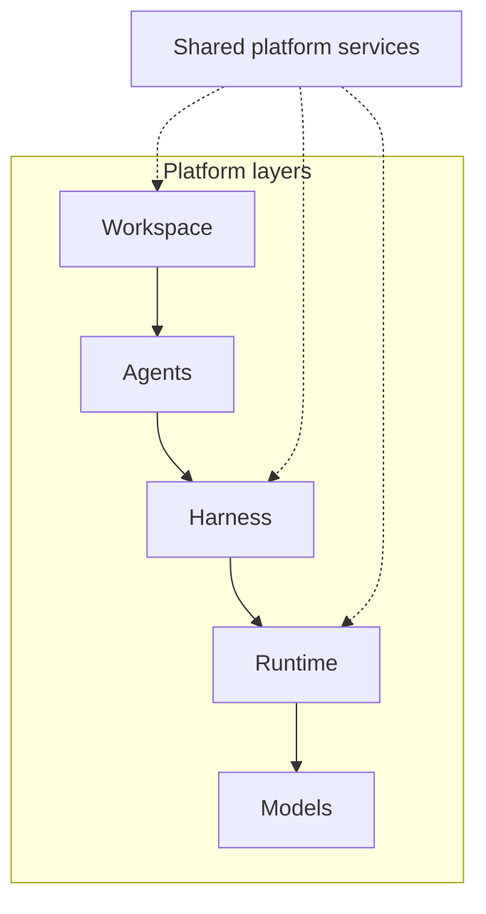
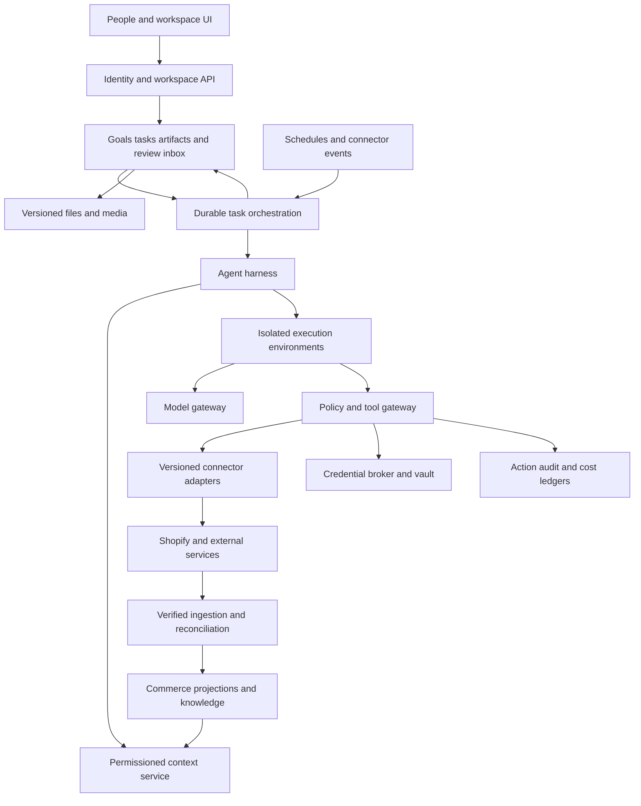
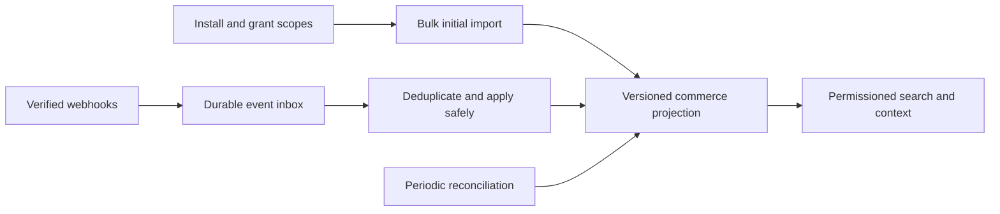
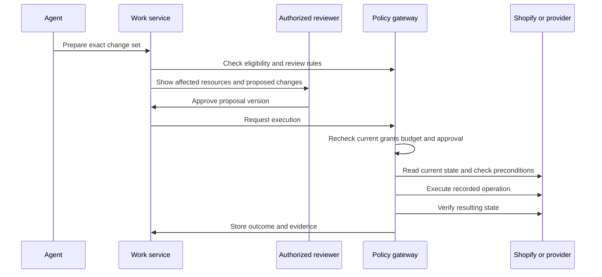

This is a fresh product and high-level architecture proposal for a Shopify operations workspace where people and AI agents run ongoing business work together. It supersedes the earlier prompt-led build direction. The intended customers are both independent brands with small teams and larger brands with specialist teams. The first release should provide a broad workspace, as requested, with clear limits on each agent's initial responsibilities.

The central recommendation is to build a durable commerce work system: shared tasks and artifacts, permissioned store context, installable agents, reusable connectors, and a harness that plans, executes, checks, waits for people, and resumes. Shopify is authoritative for its native commerce records; each connected domain has an explicitly configured source of authority. This product owns coordination, work in progress, decisions, approval history, and evidence of completed work.

Status: proposed architecture for discussion, researched on 5 October 2026. A full workspace and production-grade foundation from day one are explicit requirements. Technical defaults below are recommendations, not settled implementation choices or delivery estimates.

Implementation references: [End to End Build and Test Plan](https://chatgpt.com/space/page_b1ef27b80b788191b91e67cbb52f1037) translates this architecture into 18 build packages with implementation tasks, demonstrations, and test gates. [UI UX and Visual Foundation](https://chatgpt.com/space/page_bbb9d8ed22008191ba32290a4d6cc362) records visual option 1 for one complete Dock-inspired workspace available inside Shopify Admin and standalone. Shared screens and workflows adapt to available width and host controls, with feature parity by default. Earlier studies remain references. Package 1 contracts and infrastructure dependencies is the next planning work; package 2 develops the selected visual into a tested interaction baseline for both modes. The implementation order remains unchanged.

## Day one foundation requirements

This plan is for a complete foundational platform, not an MVP. Engineering milestones organize dependencies; they are not permission to launch with missing authorization, unreliable execution, disconnected work surfaces, or unfinished operational controls. State of the art is a quality bar to demonstrate through evaluations, production testing, and merchant outcomes rather than an unsupported claim of superiority.

| Foundation required at launch | Acceptance standard |
| --- | --- |
| Shared workspace | People and agents collaborate on tasks, documents, tables, files, images, comments, and versioned decisions with consistent permissions. |
| Durable agent harness | Work survives restarts and long waits; execution, delegation, schedules, verification, and cancellation have defined semantics. |
| Extensible agent and connector platforms | New packages use documented versioned contracts, tests, release controls, and compatibility guarantees. |
| Enterprise governance | Teams, multiple stores, resource-level permissions, approval chains, service identities, revocation, audit exports, and identity-provider integration are supported. |
| Commerce knowledge | Source-linked facts, fresh commerce projections, approved brand knowledge, governed memory, and access-aware retrieval. |
| Controlled execution | Every external effect passes authorization, budget, precondition, approval where required, and postcondition checks. |
| Quality and change management | Agents, tools, prompts, workflows, and models are versioned and evaluated before release, with canary and rollback procedures. |
| Production operations | Tenant isolation, monitoring, cost accounting, billing, incident controls, tested backups, restore procedures, and deletion/export workflows. |

The extension system should support a wide range of future agents without redesigning these foundations. Each advertised agent or connector still needs a concrete supported capability set; the platform must accurately report dependencies and unsupported actions.

## Research basis and boundaries

Dock describes a shared workspace where people and persistent agents pursue objectives, share artifacts, remember decisions, and hand off work. Its technical article describes per-agent roles, tools, memory, schedules, and execution environments. These are useful product patterns; the articles are not a complete specification of Dock's internal infrastructure. Our commerce architecture below is an original proposal informed by those patterns. [Dock product article](https://trydock.ai/blog/dock-a-company-of-ai-agents-in-one-workspace), [Dock agent article](https://trydock.ai/blog/what-a-dock-agent-is-made-of).

The [shared planning conversation](https://chatgpt.com/share/6abd62d4-b7dc-83e8-a92f-70a6551bb551) and [ShopOS SHEIN case study](https://shopos.ai/casestudy/casestudy-shein) were read in the merchant-opened browser tabs. The conversation clarifies that Chief of Staff is one optional employee role; merchants may create a CMO, product manager, or other custom roles. Its earlier assistant suggestions are background, while the current requirements for a broad workspace and complete day-one foundation govern this proposal.

ShopOS describes catalog production through input validation, generation, quality review, and delivery. It reports more than 5,000 SKUs monthly, five images per SKU, a reduction from roughly 17 to two generations per usable image, and approximately halved launch time. These are vendor-published customer claims with no independently assessed methodology here; they are not performance guarantees for our system. [SHEIN case study](https://shopos.ai/casestudy/casestudy-shein).

The earlier conversation discusses ShopOS, Dock, Squad, Moby, and adjacent tools as competitive references. Its revenue and pricing figures have not been independently reverified in this architecture review and are not inputs to our forecasts. Naming suggestions in that conversation are not a selected product name.

Shopify already positions Sidekick as a store-aware assistant that generates content, builds apps, and performs tasks. Our proposed differentiation is therefore durable work across Shopify and other tools, coordinated human review, controlled delegation, specialized production workflows, and attributable results. This is a positioning hypothesis to validate with merchants. [Shopify Sidekick](https://help.shopify.com/en/manual/ai-powered-tools/sidekick).

## Product model and merchant experience

The product promise should be: give the workspace a business objective, see who owns the work, review decisions that need your judgment, and inspect what changed in your business.

People and agents use the same task and artifact records. A merchant can begin in chat, a product table, an agent page, a scheduled routine, or an exception inbox. Each entry point creates or updates the same underlying work objects. Important results should remain usable after the conversation ends.

Separate the platform's workspace coordinator from merchant-created employees. The coordinator is the entry-point assistant that understands supported capabilities, helps scope requests, routes work, and reports progress under the existing permission rules. Chief of Staff, CMO, product manager, and other roles are configurable agent installations. A merchant can work directly with a specialist, and no job title is a mandatory root manager or a source of extra authority.

Business onboarding captures goals, the planning calendar, participating humans and agents, decision owners, escalation paths, operating preferences, and approved brand constraints. Maintain a versioned responsibility map by domain and store, separate from access grants. Human-confirmed facts such as supplier delays need an owner, source, timestamp, and affected resources. Unknown responsibilities become structured questions. Connecting Shopify supplies commerce data; onboarding establishes how this particular company works.

| Workspace area | What the merchant does there |
| --- | --- |
| Home | See active goals, changes since the last visit, blocked work, upcoming routines, and outcomes with evidence. |
| Ask | Talk to the workspace coordinator or a selected employee agent; scope a request, investigate an issue, delegate work, or open an existing task. |
| Work | Track goals, tasks, owners, dependencies, deadlines, costs, and activity. People can take over a task. |
| Review inbox | Answer questions, review exact proposed changes, approve or reject actions, and handle failures. |
| Catalog and creative | Work in product tables, compare content revisions, review contact sheets, and inspect asset versions. |
| Agents | Install, configure, test, pause, update, and inspect agents and their routines. |
| Knowledge | Manage brand facts, policies, approved examples, decisions, and agent lessons with their sources. |
| Connections | Install connectors, grant access, see sync health, and resolve missing permissions. |
| Governance and usage | Manage people, roles, store boundaries, agent grants, approval rules, costs, and audit exports. |

Use progressive configuration for the two customer segments. A small brand can start with an owner, a few collaborators, one store, and simple approval defaults. Larger brands use teams, multiple stores or regions, resource restrictions, review chains, cost centers, and separation of responsibilities. Tenant isolation, scoped permissions, auditability, and revocation belong in the shared core. The production foundation should support enterprise sign-in and provisioning through SSO and SCIM, session revocation, configurable retention, and organization-level policy. Small teams should not need to configure these enterprise controls to get useful work done.

An organization owns workspaces; a workspace may connect multiple stores, but each task and action names its allowed stores. A store installation should have one owning workspace by default. Cross-workspace sharing and agency portfolios need explicit grants and should not emerge accidentally from shared credentials.

Use mature collaborative document/table components with conflict-safe editing, presence, anchored comments, revision history, search, and export. Agent edits should use the same revision checks as human edits and show a clear diff. Store conversation channels and task threads separately from the authoritative work state, with links in both directions. A single notification center handles mentions, assignments, review requests, and outcomes. A resumable, ordered workspace event stream lets reconnecting clients recover missed activity. Task takeover uses a claim/lease and revision check so a human and an agent do not unknowingly continue as simultaneous owners.

## System architecture

Use five layers for the architectural overview: Workspace, Agents, Harness, Runtime, and Models. This matches the useful conceptual separation in Dock's published architecture while specializing the responsibilities for Shopify operations. The layers describe responsibility and dependency, not five independent microservices or a requirement that every request traverse every layer in order. [Dock architecture explanation](https://trydock.ai/blog/what-a-dock-agent-is-made-of)



The **Workspace** owns collaborative work surfaces and human participation. **Agents** own configured roles, objectives, skills, and scoped mandates. The **Harness** manages planning, delegation, tool use, verification, and durable waits. The **Runtime** supplies controlled compute, files, browser environments, and provider-job execution. **Models** supply reasoning and generation through tested provider interfaces.

Shared services support the whole stack: merchant context and memory, skill and agent registries, connectors, identity and permissions, credential brokerage, budgets, audit, and evaluation. Their checks apply wherever work originates, including schedules, subagents, scripts, and browser actions.

The detailed diagram below shows these logical boundaries. It does not imply a separate microservice for every box.



Four shared responsibilities cut across the five layers and should remain clear throughout implementation:

1. **Workspace control:** identity, membership, roles, agent installations, connections, review rules, budgets, and billing entitlements.

2. **Business work:** goals, tasks, artifacts, questions, approvals, schedules, assignments, and activity history.

3. **Execution:** durable orchestration, bounded model loops, tool authorization, external operations, recovery, and verification.

4. **Knowledge and evidence:** synchronized commerce records, approved business knowledge, source-aware retrieval, memory, and operational measurements.

The model proposes plans and tool calls. Server code decides whether they are allowed, how to execute them, and whether the evidence establishes completion. A useful harness is the entire controlled loop around the model, not only a framework that invokes it.

Define authoritative state ownership. The relational work service owns task intent, grants, artifacts, approvals, action intents, and operation records. The orchestrator owns execution progress and durable waits. Project execution events into merchant-facing task status. Use a transactional outbox when a committed business change must dispatch work, durable inboxes and deduplication on receipt, and stable task/operation IDs across retries. Reconcile the workflow projection after failures. Do not depend on a database write and a queue publication succeeding as one implicit transaction. Keep large artifacts and sensitive payloads in access-controlled storage and pass references into workflow histories.

## Core domain objects

| Object | Responsibility and important relationships |
| --- | --- |
| Organization and Workspace | Tenant ownership, billing relationship, policy defaults, and collaboration boundaries. |
| Membership and Grant | Human or service identity, role, resource conditions, expiry, and delegation rights. |
| StoreInstallation and Connection | Provider account, owning workspace, current scopes, health, sync state, API version, and vault reference. |
| CommerceResource and ProviderMapping | Canonical products, variants, collections, locations, inventory levels, orders/lines, fulfillment orders, returns, refunds, campaigns, and their provider IDs. |
| DomainAuthority and MetricDefinition | Authoritative system per domain/field, approved write direction, units, currency, locale, reporting window, and metric provenance. |
| ConnectorDefinitionVersion | Provider adapter and typed capabilities, authentication contract, tests, and compatibility metadata. |
| AgentDefinitionVersion | Reusable agent package containing instructions, capability needs, context needs, workflows, outputs, and evaluations. |
| AgentInstallation | Workspace-specific instance with a named owner, approved grants, configuration, budgets, and pinned version. |
| Goal and Task | Business objective, measurable completion criteria, scope, owner, dependencies, and accepted outputs. |
| Run and RunEvent | One execution attempt with pinned configuration, traceable events, checkpoints, and result. A task can span many runs. |
| Artifact and ArtifactVersion | Report, content revision, product change set, contact sheet, or other work product, with access controls and lineage. |
| QuestionRequest | Missing input, expected answer schema, assignee, due time, and whether it blocks a task. |
| ActionIntent and ApprovalRequest | Exact proposed external effect, resource versions, cost ceiling, approval state, and expiry. |
| Operation | Stable logical action identifier, provider request identifiers, attempts, uncertain outcomes, and verification evidence. |
| AutomationMandate and Trigger | Explicit owner-authorized scope for background work, trigger/schedule semantics, limits, expiry, and suspension rules. |
| MemoryRecord and SourceRecord | Fact, policy, lesson, or hypothesis with origin, access controls, confidence/status, and supersession. |
| UsageEntry and AuditEvent | Actual consumption, reserved budget, authorized actor, affected resources, and outcome. |

An agent definition is not a running process. Installing an agent does not imply granting every capability it supports. A conversation is not the authoritative task state. These distinctions allow the system to survive restarts, switch model providers, and explain historical decisions.

Money values must retain currency and decimal precision. Preserve store/market timezones and locales, and keep refunds, returns, payment events, fulfillment, and stock adjustments as distinct stateful operations. The domain authority registry prevents competing writes: if an ERP owns stock quantities, an agent should change the approved authoritative system or use the agreed adjustment path, rather than inventing a new absolute stock balance in Shopify. Shopify's inventory guidance explicitly distinguishes absolute source-of-truth writes from adjustments. [Inventory quantity semantics](https://shopify.dev/docs/api/admin-graphql/latest/mutations/inventorySetQuantities).

## Shopify connection and data ingestion

Build one full workspace with shared React feature screens, logical routes, state contracts, and accessible components. Render it inside Shopify Admin using developer-hosted App Home and directly on our web origin. Thin host adapters handle authentication entry, navigation, native controls, save protection, resource selection, and short feedback. App Bridge calls stay within the Shopify adapter; standalone operation does not require Shopify host APIs. Both modes use the same backend, work records, agents, approvals, and current permission checks. Adapt panels to content width without removing core workflows. Optional browser expansion resumes the same authorized task and persisted draft without changing its store or authority. For unrelated merchants, evaluate public distribution and current review requirements in package 1; feature parity does not itself establish App Store or Built for Shopify approval. [App Home](https://shopify.dev/docs/apps/build/app-home), [Shopify integration guidance](https://shopify.dev/docs/apps/build/integrating-with-shopify), [Shopify distribution](https://shopify.dev/docs/apps/launch/distribution), [App Store requirements](https://shopify.dev/docs/apps/launch/shopify-app-store/app-store-requirements)

Use Shopify's supported authentication flows for installation and embedded workspace access, and a verified connection flow to link the installation to the authorized workspace. Workspace membership and human sessions in either mode remain separate from Shopify API authority. Identity tokens establish the user; they do not independently grant Admin API permission. Online access is associated with a staff user; background work uses installation credentials and our explicit automation grants. Current Shopify documentation requires expiring offline tokens for new public apps, so build refresh and rotation from the beginning. Serialize refresh per connection and keep secrets out of prompts, artifacts, and normal logs. [Authentication](https://shopify.dev/docs/apps/build/authentication-authorization), [Access tokens](https://shopify.dev/docs/apps/build/authentication-authorization/access-tokens).

Request the minimum installation scopes and add optional scopes when a feature needs them. Store permissions and protected-customer-data approval are separate capability constraints. Product SEO and image work should operate without customer PII. Historical order analysis must account for the normal 60-day limit and any additional approved access. [Access scopes](https://shopify.dev/docs/apps/build/authentication-authorization/manage-access-scopes), [Protected customer data](https://shopify.dev/docs/apps/launch/protected-customer-data).

The ingestion path should be:



Use bulk operations for large imports; track checkpoints and changes arriving during bootstrap. For webhooks, verify the signature on the raw request, persist the event, acknowledge promptly, and process asynchronously. Shopify does not guarantee delivery or ordering, so reconcile periodically and resolve late events through authoritative reads or suitable version checks. Maintain deletion tombstones. [Bulk queries](https://shopify.dev/docs/apps/build/apis/graphql-admin/bulk-operations/queries), [Webhooks](https://shopify.dev/docs/apps/build/webhooks).

Every projected resource needs workspace/store IDs, source ID, source update time, ingestion time, provenance, and sync health. The UI should show when relevant data was refreshed and when a conclusion depends on incomplete data. Fresh source reads are required before sensitive mutations even if a cached record was sufficient for analysis. Provider account plus provider resource ID forms identity; an SKU alone is not a safe cross-store identifier.

Build a metric-definition layer for performance agents: currency, timezone, reporting window, discounts, taxes, refunds, and gross/net sales must be explicit. Compute authoritative aggregates in governed queries and let the model explain them. Missing cost or attribution data should produce a stated limitation rather than a fabricated margin or causal conclusion.

All Shopify agents share the same app/store API budget. Centralize cost-aware throttling and prioritize interactive work over backfills. Pin a tested API version per adapter release and run compatibility checks before upgrading. [Rate limits](https://shopify.dev/docs/apps/build/apis/graphql-admin/rate-limits), [Versioning](https://shopify.dev/docs/api/usage/versioning).

Uninstall, scope removal, and credential failure must suspend affected operations. Implement Shopify's required privacy callbacks and deletion/export propagation through databases, indexes, embeddings, files, and retained traces. Do not rely on working Shopify credentials after uninstall. [Privacy compliance](https://shopify.dev/docs/apps/build/compliance/privacy-law-compliance).

## Context and memory

The workspace coordinator should know the platform's supported features and discover the user's permitted business context. It should retrieve the relevant subset for each task. Loading every store record, tool, and conversation into a single prompt would create unnecessary cost and disclosure risk. Just-in-time retrieval is consistent with published context-engineering guidance. [Anthropic context engineering](https://www.anthropic.com/engineering/effective-context-engineering-for-ai-agents).

Use five separate information classes:

| Information | Authority and handling |
| --- | --- |
| Live commerce facts | Shopify or another connected system is authoritative; the local projection includes freshness. |
| Approved business knowledge | Brand book, positioning, policies, approved claims, and operating rules; versioned and approved by eligible people. |
| Work history | Task events, decisions, comments, source references, and artifact revisions. |
| Agent lessons | Reviewable corrections and reusable guidance with an author, reason, scope, and status. |
| Working hypotheses | Temporary analysis or inferred preferences; clearly labeled and never silently promoted to policy. |

Each memory entry carries tenant/store scope, access rules, source references, author, creation/update time, trust class, retention, and supersession links. Resolve conflicts using source authority and freshness; surface unresolved conflicts to a person. A recent web page cannot override an approved merchant policy.

Retrieval should combine structured database queries for exact commerce facts with text/vector search for documents. Start with relational links between products, assets, tasks, campaigns, and decisions; adopt a specialized graph store only if measured queries justify it. Enforce access before retrieval and before exposing results. Include the permission context in cache keys and revalidate cached results after role changes.

Derived artifacts and summaries inherit the restrictions of their sources unless an explicit authorized release process permits broader sharing. A manager agent must not reveal a restricted specialist report through its summary. Secrets never become memory. Deletion and revocation must propagate to derived retrieval copies and shared links.

## Agent harness and durable execution

Use a durable orchestrator, with Temporal as the proposed default, around bounded agent runs. Temporal supports persistent workflow state and recovery; external calls belong in activities so workflow replay does not itself repeat uncontrolled I/O. This is a recommended implementation choice, not a requirement to build on a particular vendor. [Temporal workflow execution](https://docs.temporal.io/workflow-execution), [Workflow definitions](https://docs.temporal.io/workflow-definition).

Each task follows this sequence:

1. Resolve the human or automation principal, store scope, business objective, and completion criteria.

2. Retrieve authorized context and discover eligible tools and installed agents.

3. Select a known workflow or create a bounded plan for an open-ended investigation.

4. Execute within step, time, spend, concurrency, and delegation limits.

5. Produce structured outputs and artifacts, then check their validity and completeness.

6. Ask for missing input or prepare exact external changes for review when needed.

7. Reauthorize, revalidate current resource state, execute permitted changes, and verify the external result.

8. Record evidence, costs, unresolved items, and a concise outcome.

Suggested task states are queued, running, waiting for input, waiting for approval, waiting for provider, blocked, completed, failed, and cancelled. A wait persists state and releases worker resources. An answer, approval, provider event, or timer resumes the correct task. A retry is a new attempt of a recorded operation, not a fresh untracked action. Schedules record the merchant's timezone, daylight-saving behavior, overlap policy, missed-run policy, deduplication key, and catch-up limit. A burst of missed runs must not create uncontrolled spending.

Use deterministic workflows for repeatable processes such as photo production and review/publish. Use agent reasoning for diagnosis, research, and choosing what to do next. Multiple agents are useful for independent specialties or parallel batches; publication of conflicting resource changes should be coordinated. This follows the distinction between workflows and autonomous agents in [Anthropic's agent design guidance](https://www.anthropic.com/engineering/building-effective-agents).

Subtask handoffs contain the objective, input references, expected output schema, completion criteria, allowed resources, grant, and budget. Store handoffs as task events with correlation IDs. Limit delegation depth and total team cost. Dedupe repeated work, track dependencies, and stop self-triggering loops using event causation and origin metadata.

Model the impact of changed business facts as a first-class workflow. For example, a human confirms a supplier delay; the system identifies affected launch assumptions, inventory-dependent tasks, and campaign drafts; appropriate specialists prepare alternatives; the eligible decision owner reviews the revised plan; only authorized downstream changes execute.

Store the triggering evidence, affected resource and plan versions, dependency links, responsible people/agents, proposed alternatives, and the decision. Material changes mark dependent work as needing review and invalidate affected approvals where necessary. Deduplicate repeated impacts and bound cascading replanning. A supplier note cannot itself authorize campaign changes or customer messages.

The harness requests a versioned execution profile and a bounded execution lease from the runtime. Agent identity and durable work state survive independently of workers. The runtime contract below defines isolation, persistent files, browser sessions, recovery, and cleanup for those assignments.

Keep model selection behind a small gateway that supports capability matching, structured outputs, provider errors, budgets, and tenant data policies. Pin model, prompt, tool, and agent versions to each run. Provider fallback must respect data-location and capability constraints; it must not silently weaken safety or output guarantees.

## Runtime and execution environment contract

An agent is a persistent workspace identity with a role, installed skills, owner, grants, memory, routines, and work history. Compute is allocated to its current work. Use cloud worker pools with isolated per-run environments and durable state outside the workers; a named agent does not require a permanently running virtual machine.

The following is the proposed runtime contract. Its guarantees are launch requirements, not claims of an already implemented system.

| Contract area | Required behavior |
| --- | --- |
| Execution profile | Version the worker image, supported tools and modalities, allowed file mounts and network destinations, browser policy, region, and CPU, memory, storage, time, and concurrency limits. Skills declare needs; the harness selects an approved compatible profile. |
| Execution lease | Bind tenant, workspace, agent installation, task/run, initiating or automation principal, selected stores/resources, configuration revision, budget reservation, expiry, and a lease generation. Workers cannot broaden these values. |
| Durable files | Keep approved knowledge, versioned artifacts, and selected working-file checkpoints outside workers. Scope access to tenant, installation, task, and resource grants; folder naming alone is not isolation. Mount reviewed skill releases read-only and give each run isolated scratch space. |
| Recovery | Persist task events, operation IDs, artifact references, and checkpoint versions. A replacement worker restores the pinned configuration, checks current authority, and reconciles unfinished operations. Model context is reconstructed from durable records. |
| Credentials and egress | Use narrow worker identities and broker provider credentials through approved connectors. Restrict network destinations and data disclosure. Browser session material is protected authentication state and must not enter prompts, artifacts, or ordinary logs. |
| Resource accounting | Enforce step, runtime, storage, tool, inference, provider-job, and concurrency limits across the task and its delegated work. Reserve spend before parallel submissions. Release compute during long human or provider waits. |

Use lease fencing to prevent a replaced worker from committing new state or initiating further actions. The action gateway and durable state writes validate the current lease generation. Already-submitted provider operations can still finish; cancellation or revocation triggers reconciliation rather than an assumption that the remote action vanished. A checkpoint cannot prove whether an unrecorded external effect occurred.

Browser execution is a qualified runtime capability for workflows that need it. Prefer typed APIs when they support the required work. Bind each browser profile to the tenant, provider connection/account, approved store scope, and declared purpose. Never reuse a mutable profile across tenants; use a single active lease for each interaction sequence. Declare whether session state is ephemeral or encrypted and persistent, its expiry, authentication refresh, and revocation behavior. Human login happens through a secure connection flow.

A logged-in browser may possess broader provider privileges than the task. Expose mediated browser operations with enforced destination, data-access, and action restrictions; apply the same grant, approval, budget, and operation-recording requirements as API tools. Recheck the selected account/store before consequential actions. If the platform cannot enforce a workflow's boundaries through the browser, that workflow cannot be advertised as autonomous and must use a supported API or an explicit human handoff.

Browser recovery must re-observe the current page and external state. Do not blindly replay clicks or form submissions after a crash. Downloads enter isolated staging and become workspace artifacts only through the controlled artifact pipeline. Browser cookies, cached account data, and downloaded files follow the same tenant isolation and retention rules as other sensitive state.

Persistent agent working files are distinct from shared artifact versions. Promote a file deliberately when teammates need it; enforce artifact permissions and version conflicts. Only reviewed, versioned runtime images and skill packages enter an environment. Untrusted code or computer execution requires a separately qualified isolation profile and cannot inherit the privileges of a trusted connector worker.

Cloud schedules run without the merchant's laptop. Preserve timezone, overlap, missed-run, catch-up, and cost limits in the durable scheduler. On completion, cancellation, lease expiry, or uninstall, stop future dispatch, revoke affected leases, remove scratch data, and retain or destroy session/checkpoint state according to policy. Track cancellation of remote jobs separately. Deletion rules must cover derived files and checkpoints, and restored backups must reapply deletion records before serving data.

### Runtime launch qualification

| Scenario | Required evidence |
| --- | --- |
| A worker restarts during a long approval wait | The exact proposal and decision survive; resumed work rechecks current grants and source state. |
| A provider accepts an action but its response is lost | The action becomes uncertain and is reconciled before any resubmission. |
| Old and replacement workers both try to act | Stale leases cannot commit or initiate new effects; already-submitted effects remain tracked. |
| A run supplies another tenant's file or browser profile | Access is denied without disclosing content, cookies, or account state. |
| A grant is revoked while work is queued or paused | New affected API, browser, and delegated actions stop. |
| Parallel agents compete for a small generation budget | Atomic reservations bound new submissions across the whole task tree. |
| Browser work resumes or changes accounts | The correct account/store is verified; profiles, caches, downloads, and artifacts remain isolated. |
| Work is cancelled or its agent is uninstalled | Future dispatch stops, temporary resources are cleaned up, and completed external effects are reported accurately. |

## Permissions and delegated authority

Enforce authorization in backend code for reads, retrieval, tool execution, artifacts, exports, schedules, and delegation. Prompt instructions can explain policy to the agent but cannot enforce it. Shopify also warns against trusting client-supplied shop and resource identifiers. [Shopify application security](https://shopify.dev/docs/apps/build/security/following-security-best-practices).

Combine role-based permissions with resource conditions. Roles provide understandable defaults; conditions restrict the stores, collections, markets, fields, recipients, and spending limits. Distinguish permission to view, propose, approve, execute, manage connections, and grant authority.

| Role example | Typical initial grant | Outside its default grant |
| --- | --- | --- |
| Owner | Manage workspace policy, connections, billing, and grants | Platform protections and unavailable provider permissions remain binding. |
| Operations admin | Manage delegated operational work and eligible approvals | Ownership or billing authority unless explicitly granted. |
| SEO analyst | Read allowed catalog/search data and create SEO drafts | Refunds, payment settings, customer exports, and unrelated publishing. |
| Creative specialist | Read approved product assets and create/review creative drafts | Price changes, inventory changes, and order access. |
| Merchandising manager | Approve and publish assigned catalog changes | Financial or other-store actions outside the grant. |
| Viewer or auditor | Read authorized artifacts and evidence | External writes and grant management. |

These are proposed role templates; merchants can customize them. Approval rules can require one reviewer for a small brand or separate reviewers for brand, regional, and commercial decisions in a larger brand.

For an interactive action, effective authority is the intersection of the current requesting principal's grant, the installed agent's grant, the run/delegation grant, connector scopes, and current resource policy. Online Shopify credentials add Shopify's staff-permission boundary. For scheduled work, an explicit automation principal and mandate replace the active human session requirement.

Every background mandate records its owner, purpose, allowed actions/resources, trigger, budget, expiry/review period, and behavior on owner departure or revocation. Recheck live grants at execution. Creation by an owner does not give an automation unlimited permanent authority.

Delegation cannot expand the requester's authority. An SEO analyst requesting a refund receives a denial even if a finance agent or the app token could technically perform it. Asking the chief of staff, scheduling the action, or switching agents must produce the same denial. An authorized owner can separately authorize a new task through an explicit handoff; the analyst cannot approve that transition.

Maintain two authority envelopes: the principal-authorized work envelope that may be delegated, and each agent's direct-execution grant. The coordinator can route work it cannot itself execute when it has dispatch permission and the initiating principal may delegate that capability. The specialist receives the intersection of the current principal envelope, approved delegation envelope, specialist installation grant, live resource policy, and provider scopes. The coordinator's own direct-tool list is not the specialist's permission source. A parent cannot mint permission merely by writing a message. Read authority also matters: a specialist can return only output that its recipient is permitted to receive.

Keep the original requester, explicit authorizer where different, executing principal, specialist identity, and delegation chain in the audit record. Retain grant snapshots as historical evidence while enforcing current grants and revocation at each action. A normal approval cannot enlarge a requester's grant; an explicit handoff to an authorized principal is a separate, audited transition.

## Safe external changes and recovery

External changes should be represented as immutable change sets containing the target account/resources, exact parameters, before/after values where available, expected source versions, risk class, estimated cost, and required reviewer roles. Human approval binds to a hash of that exact proposal, an expiry, and the approving identity.



If an artifact, resource, price, recipient, or proposed effect changes, revalidate and obtain a new approval where the approved proposal is no longer applicable. Approval never substitutes for missing authority. Workspace policy may preauthorize narrow low-risk actions; this must specify bounded effects and limits, rather than a generic unlimited autonomous mode.

Use resource coordination to serialize our own conflicting writers and provider-side compare-and-set or version preconditions where available. A read-before-write check alone cannot prevent another Shopify app or an administrator from changing a record in the gap. Every connector should declare its actual concurrency guarantees; when the provider lacks conditional writes, minimize the write set, recheck, detect conflicts afterward, and document the residual race. For bulk operations, store per-item results and allow review of subsets. A batch can be partially successful; show exactly which items changed.

A GraphQL HTTP 200 response is not sufficient proof of success. Inspect GraphQL errors and mutation user errors, then verify the relevant postcondition. [GraphQL Admin API](https://shopify.dev/docs/api/admin-graphql/latest).

Record each logical operation before calling a provider. Reuse supported provider idempotency keys. Shopify supports idempotency for specific operations, not every mutation. When a timeout leaves the outcome unknown, reconcile before retrying; if the outcome cannot be established, stop for recovery. Never claim universal exactly-once execution across third-party systems. [Shopify idempotent requests](https://shopify.dev/docs/api/usage/idempotent-requests).

Use compensating actions where supported, with their own permission checks. Reverting product text may be possible; unsending an email or undoing consumed image credits may not be. Record reversibility per capability and show it in review. Cancellation stops future work and attempts provider cancellation; it cannot guarantee reversal of completed effects.

## Connector platform

A connector is a versioned integration package. A connection is one merchant's authenticated account for that package. Keep both separate from agent instructions. This lets Codex build a new integration against a stable contract while multiple agents reuse it.

| Connector contract | Required contents |
| --- | --- |
| Identity and compatibility | Provider, package version, supported API versions, capability IDs, migration rules. |
| Authentication | OAuth or API-key flow, scopes, secret references, rotation, connection test, revocation. |
| Typed capabilities | Input/output schemas, permission requirements, allowed resources, and business semantics. |
| Effects and policy | Read/write/external-send/spend/delete class, approval rules, estimated cost, data classification. |
| Reliability | Pagination, rate limits, timeouts, retry classification, idempotency, preconditions, verification, compensation. |
| Data and events | Resource mappings, incremental cursors, verified webhooks, event IDs, deletion and reconciliation support. |
| Operations | Health signals, logs with redaction, fixtures, contract tests, sandbox instructions, owner and deprecation policy. |

Illustrative capability: `catalog.publish_seo_changes` accepts an approved change-set reference, requires catalog publishing permission on the named products, checks current source values, applies allowed SEO fields, and verifies those fields afterward. It cannot accept an arbitrary shop domain, token, or unrestricted GraphQL mutation from the model.

Prefer semantic operations whose policy is understandable. Avoid collapsing unrelated fields under a broad tool such as `update_anything`. Provider-specific extensions can coexist with shared commerce types; do not force every provider into an abstraction that loses its real constraints.

MCP can expose or consume tools behind the connector adapter. It does not provide our tenant isolation, permission model, credential broker, billing, or approval semantics. Remote tools require an approved server registry, authenticated connections, pinned schemas, egress checks, and validation of metadata and results. MCP's security guidance specifically prohibits token passthrough. [MCP security guidance](https://modelcontextprotocol.io/docs/draft/tutorials/security/security_best_practices).

The developer workflow for a new connector should be: scaffold from the SDK; map supported provider capabilities; implement authentication and handlers; add recorded fixtures and failure tests; pass the conformance suite; review scopes and external effects; release a version; canary it on a test account; then enable it for merchants. AI-generated connector code goes through this same process. Missing provider access or API features must be reported as limitations.

The SDK needs explicit lifecycle interfaces: authorize, refresh, revoke, discover capabilities, bootstrap, incremental sync, receive event, execute, inspect asynchronous job, cancel, reconcile unknown outcome, verify effect, and compensate. Capability declarations identify which hooks exist and which guarantees they provide. Normalize errors into invalid input, denied access, missing connection, expired credentials, throttled, transient failure, provider rejection, partial success, and unknown outcome. Package releases need verified provenance, dependency integrity checks, schema-compatibility checks against installed agents, and documented reauthorization/migration rules.

The foundation should support all required connector patterns on day one: OAuth and API keys, reads and controlled writes, sync and events, asynchronous provider jobs, files/media, rate limits, and consent/revocation. Select concrete providers through the launch capability matrix across Shopify, creative generation, search/analytics, knowledge/files, team communication, marketing, support, and inventory. Shopify, an image provider, Search Console, and a knowledge integration are reference implementations that exercise different SDK paths; they do not define a ceiling on the launch product. Every advertised workflow must have its real provider integration implemented and qualified.

Potential distribution surfaces include Shopify Flow integration and Sidekick extensions. Keep these as adapters into the same workspace services. Shopify's current Sidekick app-data extension retrieves app data and links back into the app; an existing MCP server cannot simply be reused as that extension. [Sidekick app-data extensions](https://shopify.dev/docs/apps/build/sidekick/build-app-data).

## Installable agents and custom agent creation

The detailed [Shopify Agent Skills and Agent Store Architecture](https://chatgpt.com/space/page_c222d561201c81918c285c22c52a26a4) specifies the core and specialist skill catalogue, research-to-release workbench, portable skill format, immutable registry, merchant context assembly, first-party Agent Store, installation lifecycle, evaluation gates, and release maintenance. It includes worked SEO and AI search and CMO examples. Skills teach procedures; tools, permissions, merchant facts, and durable workflows remain separate platform components.

An agent package needs more than a name and a prompt. Its definition should include purpose, configurable inputs, instructions, examples, required/optional capabilities, allowed context classes, workflows, output schemas, success checks, escalation rules, model policy, budgets, triggers, and regression evaluations.

Illustrative package shape, to be formalized into a typed schema:

```yaml
agent_type: product_creative_studio
definition_version: 1
purpose: Produce approved product imagery from merchant references
inputs: [product_selection, creative_brief, output_formats]
context: [approved_brand_knowledge, selected_product_facts, approved_assets]
capabilities:
  required: [catalog.read, assets.read, images.generate, artifacts.write]
  optional: [product_media.publish]
workflow: product_photo_production_v1
outputs: [contact_sheet, asset_versions, proposed_media_changes]
verification: [file_integrity, product_fidelity_review, publication_readback]
policy:
  spend: workspace_budget_required
  publish: workspace_policy_and_current_grant
  missing_input: structured_question
triggers: [manual, approved_schedule, approved_event]
evaluations: [faithfulness, permission_denial, budget_limit, timeout_recovery]
```

The installation binds these capability names to eligible connections and records the human-approved grants. The manifest cannot override workspace or platform policy. A run then pins that installation version and receives only its permitted subset.

Credentials belong to workspace connections in the vault. A photo agent declares its need for an image-generation capability; it receives authorized access through the gateway. It does not contain API keys. Platform-funded generation can be the default; merchant-supplied provider credentials can be an optional configuration with the same boundaries.

Installing an agent should show its role, required information, data access, supported actions, autonomy limits, estimated usage, and missing connections. The installer grants an eligible subset and runs a sample. Updates pin existing installations until compatibility and grant changes are handled; an update that needs broader access must not silently receive it. Disabling an agent stops its schedules and new runs while preserving the historical record.

The natural-language builder is a compiler from merchant intent into a validated agent configuration:


For example, a merchant asks for a weekly agent that finds weak product descriptions and drafts replacements. The builder identifies catalog access, brand knowledge, draft output, a weekly schedule, permitted product groups, and a completion metric. It asks only for missing choices such as language or reviewer. It tests on a sample and shows the result before activation.

If the requested task needs an unavailable connector or capability, explain the gap and preserve a draft agent with that dependency. Do not pretend an integration exists. Merchant-time agent creation assembles approved capabilities. Developer-time connector or workflow creation may generate code, but production execution requires review and testing. Persistent agents also need an authorized owner and a granted mandate; temporary helper runs can stay within an existing task's limits.

## Questions approvals and human participation

Build a single review inbox with distinct request types. An input question gathers information. An approval authorizes an exact effect. An access request asks an eligible administrator for a grant. An exception reports a failure or uncertain outcome. Keep these states separate so answering a creative question cannot accidentally authorize publication or spending.

Each request includes a clear reason, the decision needed, eligible respondents, related task/artifact, structured answer options or fields, expiry, and what work can proceed independently. Batch related questions. Reuse explicit merchant preferences with provenance; ask again when context changes materially. Never infer consent from silence.

People should be able to edit a draft, annotate a specific product row or image, ask an agent to revise it, reassign work, pause a task, or take over execution. A revision creates a new artifact version and invalidates approval when it changes the proposed effects. Notifications should focus on meaningful changes, failures, and required action, with digests and quiet periods configurable by the merchant.

Use authenticated UI responses to resume durable tasks. Chat language such as “yes” should resolve against an unambiguous pending proposal and the user's current authority. For substantial actions, show the specific approval card. Durable workflow messages provide the mechanism for resuming waits. [Temporal message passing](https://docs.temporal.io/encyclopedia/workflow-message-passing).

Configured communication channels can act as participation surfaces: people receive updates, answer supported questions, and follow links into the same work record. Channel adapters map verified users to workspace identities, preserve task and request IDs, recheck current authority, and deduplicate replies. Keep authoritative state in the workspace. If a channel cannot present and bind an exact proposal reliably, route consequential approval into authenticated review. This lets teams participate through existing tools while preserving one record of decisions.

## Broad first release and agent catalogue

The first release should provide one complete workspace: common work records, review inbox, collaborative artifacts, connections, people/roles, budgets, and activity history. The following is a proposed launch capability map. Select the concrete provider adapters and operation contracts during detailed design; do not market a domain as operational until its advertised paths are implemented and tested. This is domain coverage for the platform, not a requirement to deploy a separate agent process for every row.

| Domain and agent role | Supported work to design and qualify | Execution boundary |
| --- | --- | --- |
| Chief of Staff or other coordinating employee | Merchant-configured planning, delegation, blocker management, and reporting responsibilities. | Principal-authorized delegation and filtered reporting. |
| Catalog management | Product/variant fact quality, collection work, drafts, bulk comparisons, and approved field updates. | Field/resource scopes and source authority. |
| SEO and search visibility | Content audits, search evidence, metadata, localization, and approved improvements. | Verified facts, supported channels, and review of publishing. |
| Creative studio | Briefs, image generation, contact sheets, revisions, asset lineage, and selected media publication. | Provider budget, product fidelity review, and media grants. |
| Merchandising and performance | Reports, anomaly investigation, assortment/collection proposals, and outcome measurement. | Governed metric definitions and approved catalog changes. |
| Growth and lifecycle | Campaign briefs, content, segments, experiments, and supported campaign execution. | Audience, channel, spend, and send-specific authorization. |
| Customer support | Grounded case analysis, response drafts, escalation, and supported case actions. | Customer-data access, eligible channels, and send/refund separation. |
| Orders and fulfillment | Exception queues, order investigation, fulfillment coordination, and eligible operational actions. | State-specific checks, staff/resource grants, and provider constraints. |
| Inventory | Stock-risk analysis, reconciliation, proposed adjustments, and approved authoritative updates. | Location scope and configured inventory source of truth. |
| Finance and reconciliation | Cost/margin evidence, reconciliation reports, and discrepancy tasks. | Sensitive-data isolation; funds movement is a separately specified capability. |
| Governance | Access reviews, audit evidence, usage/cost reporting, and policy administration surfaces. | Authorized human decisions for grant/policy changes. |
| Merchant-created agents | Describe, configure, test, install, schedule, inspect, and version a CMO, product manager, specialist, or other custom role using available capabilities. | No invented capabilities or self-granted authority. |

For order-based work, protected-data and scope approval are launch dependencies. The workspace must show unavailable capabilities honestly. Catalog-based operations can remain useful when order access is absent. The release acceptance scope should explicitly identify which workflows are available for each connection/grant combination.

SEO/GEO should improve product information and measured discovery, with no guaranteed AI placements or universal GEO score. Google’s newer guidance combines SEO fundamentals with indexing, snippet eligibility, and Search generative AI inclusion. Its dedicated documentation now covers a separate inclusion control and an AI impressions report; verify available merchant access and supported connector methods. [Current AI optimization guide](https://developers.google.com/search/docs/fundamentals/ai-optimization-guide), [Search inclusion control](https://support.google.com/webmasters/answer/16908024), [AI performance report](https://support.google.com/webmasters/answer/16984139).

Package each domain's workflows with its own evaluations and checks. Autonomy is an action-level policy: analysis, drafts, approved execution, and narrowly preauthorized execution can coexist in the full product. Financial effects, pricing, paid campaigns, and customer communication need explicit limits and authority even when the domain is part of the launch workspace.

## Product photo production example

Merchant request: create new lifestyle images for a selected collection, use the approved brand direction, stay within the chosen generation budget, and publish only selected approved outputs.

1. Resolve the requester, store, selected products, allowed source assets, and available provider.

2. Build a creative brief from approved brand knowledge and product facts. Ask for missing format, audience, or styling decisions.

3. Show the batch, generation estimate, maximum budget, and proposed outputs. Reserve budget before provider submission, including parallel jobs.

4. Create stable provider-job records and submit asynchronous generation jobs. Await verified callbacks or poll with backoff. Record job IDs, input hashes, model/settings, attempts, and actual usage.

5. Store outputs as immutable assets with provenance. Check resolution, duplicates, and product fidelity against approved references: color, shape, packaging, text, and included accessories. Automated checks assist review; they cannot guarantee faithful representation.

6. Assemble a contact sheet with approve, reject, annotate, and regenerate actions. Bound regeneration attempts and spend.

7. Prepare the selected media assignment changes. Recheck permission and current Shopify media before publishing the approved selections.

8. Verify processing/attachment state and show exactly which products received which assets. Preserve originals and the revision history where the provider and store workflow permit it.

The photo agent, SEO agent, and merchandiser can share a task while retaining separate scopes. Their artifacts link to the same product IDs. One publication coordinator handles conflicting changes. Actual generation fees, cancellation behavior, retention, and output rights depend on the selected provider and must be verified when implementing that adapter.

Proposed production controls: define a per-SKU shot specification covering required views, formats, variant mapping, reference sufficiency, and fidelity criteria. Calibrate a production recipe on a representative sample before committing a large batch; version the accepted recipe and its reference assets. The image count is merchant-configurable, not universally fixed at five.

Track each SKU and each required shot through input acceptance, generation, review, rework, and delivery. Review garment/product construction, pattern and color, variant consistency, and model identity where continuity is requested. Use contact sheets, batch decisions, exception queues, bounded retries, and human escalation after repeated rejection. Distinguish generated, accepted, delivered, and published assets. Measure attempts per accepted image, first-pass acceptance, review minutes per accepted SKU, and time to verified delivery. Validate quality thresholds on merchant samples; model evaluation alone does not justify eliminating human review.

## Security reliability and quality

Treat product descriptions, customer messages, uploaded documents, web pages, connector results, and other agents' messages as untrusted input. Keep them separate from system policy. Use server-side capability allowlists, scoped credentials, egress restrictions, payload validation, isolated execution, and exact approvals. Prompt-injection detection can add a signal but is not an authorization boundary. [Anthropic guidance on trustworthy agents](https://www.anthropic.com/research/trustworthy-agents).

Use tenant IDs in storage keys, queries, queues, traces, and search namespaces, with database access controls as defense in depth. Authenticate file access with short-lived links. Scan and safely parse uploaded files; isolate rendering of generated HTML or other active content. Redact unnecessary personal data from prompts and telemetry; restrict operational support access. Keep audit trails of externally meaningful actions and access changes with tamper-evident retention appropriate to the product tier.

Define instruction precedence explicitly: platform policy, organization policy, approved agent definition, authorized task instructions, then untrusted evidence. Model output cannot rewrite platform policy. Evaluate proposed memory changes and propagate approved lessons only to their intended scope. Persist tool calls, outcomes, sources, configuration, and concise decision rationales for debugging; the product should not depend on access to a model's private chain of thought.

The initial release needs a regression suite that tests outcomes and failure behavior:

| Scenario | Required result |
| --- | --- |
| SEO analyst requests a refund through another agent | Denied before provider execution; no authority gained through delegation. |
| Agent retrieves another tenant's product or file ID | No record or content disclosed. |
| Source document includes malicious operational instructions | No new permissions or unauthorized outbound action. |
| Reviewer approves and then source content changes | Preconditions catch the conflict; no silent overwrite. |
| Role is revoked while a task waits | Resumed run is reauthorized and affected work stops. |
| Provider accepts a write but the response times out | Outcome is reconciled; no blind duplicate operation. |
| Duplicate or late webhook arrives | Consistent final projection without resurrecting deleted records. |
| Parallel jobs compete for a small image budget | Atomic reservations prevent unbounded submission. |
| Agent says a publish succeeded but provider returned errors | Task shows failure or partial completion, with evidence. |
| Worker restarts during a human wait | Task resumes from persisted state without losing the decision. |
| Two agents propose changes to one product | Conflicts are visible and publication is coordinated. |
| Customer/store data must be removed | Deletion covers retrieval copies and derived records under the retention policy. |

Evaluate agents on representative merchant tasks, expected outputs, permission denials, and adversarial cases. Pin evaluation results to agent/model/tool versions. Use deterministic validators where possible and human review for subjective quality; a second model's agreement alone is not proof of correctness. Roll out model or prompt updates through samples and canaries with rollback to known configurations.

Define operational targets before production launch and validate them in qualification: interactive acknowledgement latency, task completion reliability, projection freshness, approval turnaround, and recovery time. Example proposed targets for validation are a 99.9% control API availability goal and p95 webhook-to-projection delay under two minutes during normal provider operation. These are design targets, not promises or observed measurements; bulk imports and provider outages need separate expectations.

Add system-failure tests for lost outbox delivery, duplicate approval commands, stale execution leases, schedule overlaps, mid-run connector upgrades, workflow migrations, partial batch recovery, and backup restoration after data deletion. Recovery must replay deletion tombstones and policies so a restore cannot silently resurrect removed merchant data.

## Deployment technology and operating cost

Start with a modular backend and separate execution workers, using one repository with explicit package boundaries. A proposed layout is workspace web app, API, worker processes, and shared packages for domain objects, policy, orchestration, connector SDK, agent SDK, context, evaluation, and telemetry.

Recommended defaults are TypeScript for the shared application contracts, a React workspace interface, PostgreSQL for relational state, object storage for files/media, and a durable orchestration service. Add text/vector retrieval to the existing data stack when needed. Redis can support ephemeral coordination or throttling if necessary; it must not be the only copy of task or approval state. Python workers can serve specialized media/data workloads behind the same contracts.

Deploy API/UI separately from worker pools for ingestion, agent reasoning, provider I/O, and media processing. Use managed database backups, tested restores, secret management, queue dead-letter handling, dependency monitoring, and tenant-aware tracing. Choose a hosting region and provider data policy before onboarding production merchants. Dedicated tenant infrastructure can remain an enterprise option if isolation or residency requirements justify it.

Design production deployment across availability zones, with documented recovery point and recovery time targets for each data class, point-in-time recovery for relational state, object versioning, and restore drills. Separate development, staging, and production accounts and credentials. Use service identities and least-privilege network paths. Implement platform, workspace, connection, and capability kill switches; provider circuit breakers; per-tenant concurrency quotas; and fair queues. Revocation stops newly dispatched work, while already accepted external operations require reconciliation rather than a false promise of instantaneous cancellation.

Schema changes, agent definitions, connector versions, and workflow code need backward-compatible migrations and release procedures for in-flight work. Operational replay should use recorded responses or a sandbox by default; replaying historical events must not silently repeat production effects. Expose support views for stuck jobs, stale connections, uncertain actions, and expensive loops with access-limited repair controls.

Build the merchant work model, permission/delegation semantics, commerce change sets, agent/connector contracts, review UX, and quality evaluations. Buy or adopt authentication, database/object storage, durable execution, model APIs, and observability where suitable. Avoid starting with a custom workflow engine, generalized browser OS, separate database per agent, or many independently deployed services.

Track cost at workspace, agent, task, and provider-operation level. Reserve expected budget before parallel work and settle actual consumption afterward. Include model tokens, image generations including rejected attempts, provider charges, worker time, storage, and retries. Record raw usage independently of the pricing formula so plans can evolve. Budget reservations move through reserved, submitted, settled, released, or unknown states. Release unused reservations after safe expiry, but retain liabilities for externally accepted jobs until reconciled; use conservative reservations and provider limits where costs are uncertain.

Price around workspace value with included usage and transparent ceilings; exact tiers require merchant interviews and measured unit economics. For an App Store distribution, follow Shopify's provided billing requirements. Current documentation identifies Shopify App Pricing as the default for new public apps and supports recurring and usage charges. [Shopify billing](https://shopify.dev/docs/apps/launch/billing).

The core unit-economics question is cost per accepted business outcome. For images, include all generation and review attempts per approved asset; for catalog work, include rework per accepted update. Measure time saved carefully against a recorded baseline. Revenue changes after edits are not automatically causal proof of the agent's impact.

## Delivery sequence and launch gates

These are dependency stages inside the plan for a broad first release, not a recommendation to launch a single-feature product. Dates require team size, available skills, budget, and integration-review lead times.

| Stage | Deliverable | Exit evidence |
| --- | --- | --- |
| Product and policy definition | Representative merchant workflows, task/agent contracts, role templates, first connectors, and success measures. | Small-brand and specialist-team scenarios fit the same model without hidden permission bypasses. |
| Shared foundation | Shopify install/sync, workspace membership, knowledge, artifact revisions, action gateway, usage ledger, and audit trail. | Isolation, uninstall, scope removal, ingestion recovery, and safe mutation tests pass. |
| Harness and runtime | Durable tasks, questions/approvals, schedules, skill and agent registries, execution profiles, leases, isolated files/browser sessions, budgets, and verification. | Runtime qualification passes, including recovery, stale-worker fencing, session isolation, and delegated budget enforcement. |
| Integrated workspace qualification | Complete the launch domain map, shared collaboration surfaces, enterprise identity/provisioning, and capability-aware natural-language builder. | Every advertised workflow produces reviewable artifacts and tested external effects; teams can complete the whole work cycle together. |
| Production readiness | App review and data-access approvals, billing, load/recovery testing, support tools, and onboarding. | Each customer segment completes representative work; operational and cost targets are measured. |
| Ongoing platform growth | More connectors, deeper domain skills, additional bounded autonomy policies, and an optional marketplace. | New capabilities pass the same compatibility, permission, reliability, and evaluation gates without replacing the core. |

A useful broad-workspace acceptance story is: the owner connects the store, defines responsibilities, and invites specialists; the workspace coordinator or a merchant-selected employee scopes a collection goal; SEO prepares content; creative generates assets; the analyst establishes a baseline; reviewers answer questions and approve selected changes; the platform publishes only authorized items, verifies them, and schedules measurement. In parallel, operations handles its own supported exception workflow.

A second launch qualification scenario should introduce a confirmed supplier delay while campaign and merchandising work are already underway. The system must find the relevant dependencies, alert the right people, produce reviewable alternatives, retire outdated proposals, and carry out only newly authorized effects. Evaluate the total coordination and review effort, not merely whether several agents exchanged messages.

Measure activation through the first verified useful outcome, recurring usage through completed accepted tasks, quality through revision/rejection rate, autonomy through completion within grants, and economics through cost per accepted output. Track permission denials, unknown-outcome operations, data freshness, and unnecessary human interruptions as operational measures.

Measure collaboration itself: participating teammates, unresolved handoffs, repeated manual copying, human follow-up effort, and review/correction time per accepted work package. Compare these with the merchant's existing process. A broad workspace earns its place when shared context helps the human and agent team finish work with less coordination burden.

### Product advantages to validate

Shared workspaces, persistent agent memory, delegation, schedules, human participation, and model flexibility are baseline capabilities to qualify. Our proposed Shopify advantages are deeper commerce knowledge, precise reviewable changes, maintained specialist skills, and reduced merchant coordination effort. Public competitor material does not establish which internal controls competitors possess; architectural detail alone does not demonstrate superiority.

Evaluate representative collection launches, inventory disruptions, content improvements, creative production, and operational exceptions against the merchant's current process and a strong general-agent baseline where access and conditions are comparable. Record accepted-output quality, factual and product fidelity, verified external effects, human review and correction time, elapsed time, and total cost. Preserve model, skill, connector, and context versions. Set release thresholds before qualification and retain failed cases for regression testing. Revenue effects require separate measurement; successful execution alone is not causal proof of uplift.

## Decisions to settle before detailed design

The product audience, broad-workspace launch, and production-grade day-one foundation are established. The next design choices are the exact supported workflows/actions in the launch domain map, non-Shopify providers, supported store/region structure, default approval rules, hosting/data policies, and the engineering team and budget. These choices determine the work needed to meet the launch bar; they do not lower the foundation requirements.

The recommended next design package consists of a product requirements document with explicit acceptance stories, a permission/capability matrix, versioned connector and agent contracts, and the runtime profile/lease contract. Detailed designs should cover store installation and synchronization, custom-agent creation, approved change execution, worker failure and recovery, browser-session lifecycle, and skill/agent publication and upgrades. Specify the isolation technology, storage/session retention, recovery targets, and benchmark thresholds before production implementation is qualified. These contracts should drive implementation tasks after review of this HLD.

The defensible long-term asset is the combination of reliable commerce workflows, merchant-specific approved knowledge, connected operational history, and governed execution. A better model should improve the product without requiring merchants to rebuild their agents, permissions, or work history.
